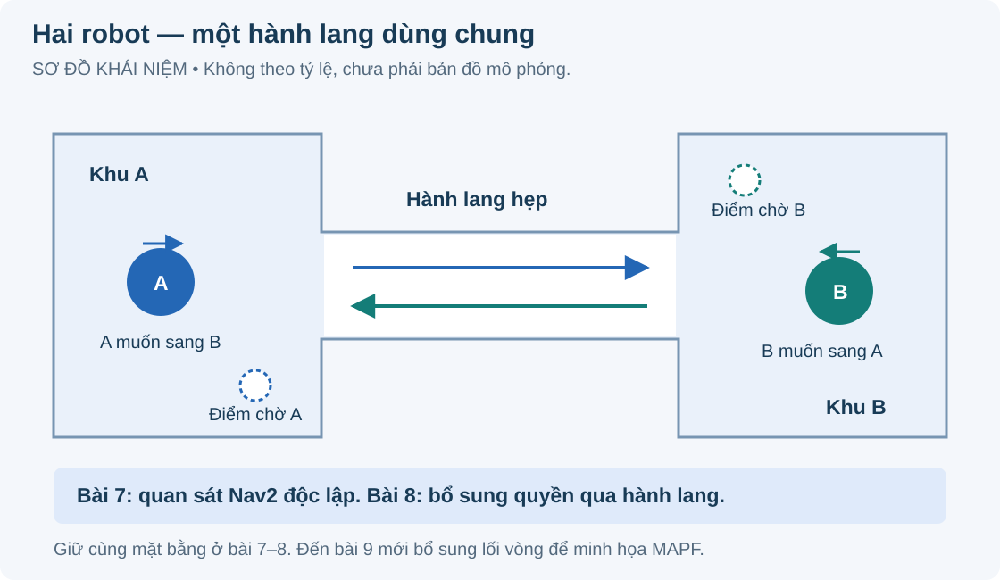

# Tổng quan điều phối nhiều robot

Khi tìm hiểu về robot tự hành, chúng ta thường bắt đầu với những chức năng cơ bản như tạo bản đồ, xác định vị trí, tìm đường và tránh vật cản. Khi đã có những khả năng này, robot có thể tự di chuyển đến một vị trí được yêu cầu mà không cần con người điều khiển trực tiếp.

Tuy nhiên, trong các ứng dụng thực tế như nhà máy, kho hàng hay trung tâm logistics, chúng ta thường không chỉ sử dụng một robot. Nhiều robot được đưa vào hoạt động đồng thời để tăng năng suất và đáp ứng nhu cầu vận chuyển.

Một câu hỏi đặt ra là: Nếu một robot đã có thể tự di chuyển và tránh vật cản, liệu chúng ta chỉ cần đưa thêm nhiều robot tương tự vào cùng một môi trường là có thể xây dựng được một hệ thống đa robot?

Để trả lời câu hỏi này, trước tiên hãy tìm hiểu cách một robot tự hành hoạt động.

## 1. Một robot tự hành hoạt động như thế nào?

Giả sử chúng ta có một robot vận chuyển hàng hóa từ vị trí A đến vị trí B trong nhà kho.

Để thực hiện nhiệm vụ này, robot cần giải quyết một số vấn đề cơ bản:

- **Định vị (Localization):** Xác định robot đang ở đâu trên bản đồ.
- **Lập kế hoạch đường đi (Path Planning):** Tìm đường từ vị trí hiện tại đến vị trí đích.
- **Điều khiển chuyển động (Motion Control):** Điều khiển động cơ để robot di chuyển theo đường đã được tính toán.
- **Tránh vật cản (Obstacle Avoidance):** Phản ứng với người, hàng hóa hoặc các vật cản xuất hiện trong quá trình di chuyển.

Các chức năng này phối hợp với nhau để giúp robot di chuyển tự động trong môi trường.

Trong ROS 2, một hệ thống thường được sử dụng để thực hiện các chức năng điều hướng là **Navigation2 (Nav2)**. Khi được cung cấp thông tin về môi trường, vị trí hiện tại và vị trí đích, Nav2 có thể lập kế hoạch đường đi, tính toán lệnh điều khiển và thực hiện các hành vi cần thiết để đưa robot đến đích.

Đối với hệ thống chỉ có một robot, robot chủ yếu cần quan tâm đến vị trí của mình, môi trường xung quanh và nhiệm vụ đang thực hiện.

Nhưng khi có thêm các robot khác, vấn đề bắt đầu trở nên phức tạp hơn.

## 2. Điều gì xảy ra khi nhiều robot cùng hoạt động?

Hãy tưởng tượng một nhà kho có hai robot vận chuyển hàng hóa.

Robot A cần di chuyển từ khu vực A sang khu vực B. Trong khi đó, robot B cần di chuyển theo hướng ngược lại. Giữa hai khu vực chỉ có một hành lang hẹp, không đủ không gian để hai robot đi qua nhau.

Nếu hoạt động độc lập, cả hai robot có thể lựa chọn hành lang này vì đây là đường đi ngắn nhất đến đích của mình.

Khi gặp nhau trong hành lang, mỗi robot có thể phát hiện chiếc còn lại là một vật cản và giảm tốc hoặc dừng lại để tránh va chạm. Tuy nhiên, nếu không có đường đi thay thế hoặc cơ chế nhường đường phù hợp, cả hai có thể bị mắc kẹt tại đó.

Điều đáng chú ý là trong tình huống này, cả hai robot đều có thể đang hoạt động đúng theo chương trình điều hướng của mình.

Vấn đề nằm ở chỗ chúng chưa có cơ chế phối hợp để sử dụng chung một lối đi.

### Tại sao tránh vật cản chưa đủ?

Tránh vật cản giúp robot hạn chế va chạm trong quá trình di chuyển. Tuy nhiên, chức năng này không nhất thiết giúp robot quyết định được chiếc nào nên đi trước, chiếc nào nên nhường đường hoặc khi nào cần thay đổi lộ trình để đảm bảo hiệu quả hoạt động của cả đội.

Khi triển khai nhiều robot sử dụng Nav2, mỗi robot có thể chạy một hệ thống điều hướng riêng. Các hệ thống này có thể hoạt động đồng thời nhưng mặc định không có cơ chế điều phối giao thông chung cho toàn bộ đội robot.

Việc một robot nhìn thấy robot khác thông qua cảm biến không đồng nghĩa với việc nó biết robot đó đang đi đâu, thực hiện nhiệm vụ gì hoặc dự định di chuyển như thế nào.

Đây chính là sự khác biệt quan trọng giữa việc vận hành nhiều robot độc lập và xây dựng một hệ thống đa robot có khả năng phối hợp.

## 3. Điều phối nhiều robot là gì?

Điều phối nhiều robot (Multi-Robot Coordination) là quá trình tổ chức hoạt động của nhiều robot nhằm giúp chúng phối hợp với nhau để hoàn thành các nhiệm vụ trong một môi trường chung.

Quay lại ví dụ về hành lang hẹp, một phương án đơn giản là cho robot A đi qua trước, trong khi robot B chờ tại một vị trí không cản trở lối đi. Sau khi robot A rời khỏi hành lang, robot B mới bắt đầu di chuyển.

Bằng cách bổ sung một quy tắc phối hợp, chúng ta đã có thể giải quyết một tình huống mà hai robot điều hướng độc lập có thể không tự xử lý được.

Tuy nhiên, trong thực tế, điều phối robot không chỉ liên quan đến việc nhường đường. Khi số lượng robot và nhiệm vụ tăng lên, hệ thống còn phải giải quyết nhiều bài toán khác nhau.

### Những bài toán thường gặp trong hệ thống đa robot

| Bài toán | Mục đích | Ví dụ thực tế |
| --- | --- | --- |
| Phân công nhiệm vụ | Xác định robot nào thực hiện công việc nào. | Chọn robot phù hợp để đến lấy hàng. |
| Lập kế hoạch đường đi | Xác định đường di chuyển cho robot. | Lựa chọn giữa đường ngắn và đường vòng. |
| Điều phối giao thông | Tổ chức việc di chuyển của các robot trong khu vực dùng chung. | Cấp quyền đi qua giao lộ hoặc hành lang hẹp. |
| Xử lý tắc nghẽn | Giải quyết các tình huống robot cản trở hoặc chờ đợi lẫn nhau. | Yêu cầu một robot lùi về điểm chờ để giải phóng đường. |
| Quản lý nhiệm vụ | Theo dõi và cập nhật quá trình thực hiện công việc. | Giao nhiệm vụ mới khi robot hoàn thành công việc trước đó. |
| Quản lý tài nguyên | Phân bổ các tài nguyên có giới hạn trong hệ thống. | Sắp xếp thứ tự robot sử dụng trạm sạc hoặc trạm lấy hàng. |

Các bài toán này có mối liên hệ chặt chẽ với nhau.

Ví dụ, lựa chọn robot gần vị trí lấy hàng nhất có thể giúp giảm quãng đường di chuyển. Tuy nhiên, nếu đường đến vị trí lấy hàng đang bị tắc nghẽn, lựa chọn một robot ở xa hơn đôi khi lại giúp hoàn thành nhiệm vụ nhanh hơn.

Vì vậy, mục tiêu của hệ thống điều phối không chỉ là tối ưu hoạt động của từng robot, mà còn là nâng cao hiệu quả hoạt động của toàn bộ đội robot.

## 4. Các mô hình tổ chức và điều phối nhiều robot

Có nhiều cách để xây dựng một hệ thống đa robot. Một cách phân loại phổ biến là dựa trên nơi đưa ra các quyết định phối hợp.

### 4.1. Điều phối tập trung (Centralized Coordination)

Trong mô hình tập trung, một bộ điều phối chung thu thập thông tin từ các robot và đưa ra các quyết định ở cấp độ hệ thống.

Bộ điều phối có thể nắm được vị trí, trạng thái, mức pin, nhiệm vụ hiện tại và đường đi dự kiến của từng robot.

Dựa trên những thông tin này, hệ thống có thể phân công công việc, lập kế hoạch đường đi và quản lý quyền di chuyển tại các khu vực dùng chung.

Có thể hình dung bộ điều phối hoạt động tương tự một trung tâm điều hành giao thông.

Các robot không nhất thiết phải trao đổi trực tiếp với nhau. Thay vào đó, chúng gửi thông tin về bộ điều phối và nhận các yêu cầu cần thiết từ hệ thống.

**Ưu điểm:**

- Có cái nhìn tổng thể về hoạt động của đội robot.
- Thuận lợi cho việc quản lý nhiệm vụ và giao thông.
- Có khả năng tối ưu hoạt động trên phạm vi toàn hệ thống.

**Hạn chế:**

- Khả năng xử lý phụ thuộc vào bộ điều phối và kiến trúc hệ thống.
- Cần duy trì việc trao đổi thông tin với các robot.
- Cần có cơ chế dự phòng để hạn chế ảnh hưởng khi bộ điều phối gặp sự cố.

Trong các ứng dụng công nghiệp, bộ điều phối thường được tích hợp trong hệ thống quản lý đội robot, chẳng hạn như RCS (Robot Control System) hoặc Fleet Management System.

### 4.2. Điều phối phân tán (Distributed Coordination)

Trong mô hình phân tán, các quyết định phối hợp được thực hiện bởi chính các robot hoặc nhiều thành phần xử lý khác nhau, thay vì phụ thuộc hoàn toàn vào một bộ điều phối trung tâm.

Tùy vào cách thiết kế, mỗi robot có thể sử dụng thông tin từ cảm biến, trạng thái của các robot lân cận hoặc dữ liệu được trao đổi qua mạng để đưa ra quyết định.

Ví dụ, khi hai robot tiến đến cùng một giao lộ, chúng có thể trao đổi thông tin và xác định thứ tự di chuyển dựa trên một quy tắc ưu tiên đã được thiết lập.

**Ưu điểm:**

- Giảm sự phụ thuộc vào một bộ điều phối trung tâm.
- Có tiềm năng mở rộng khi số lượng robot tăng lên.
- Cho phép robot chủ động phản ứng với những thay đổi trong môi trường.

**Hạn chế:**

- Khó đảm bảo các quyết định cục bộ tạo ra kết quả tốt cho toàn hệ thống.
- Việc thiết kế cơ chế phối hợp giữa các robot có thể phức tạp.
- Cần xử lý các tình huống thông tin không đầy đủ hoặc không đồng nhất.

Đây cũng là một hướng nghiên cứu quan trọng trong lĩnh vực hệ thống đa tác nhân (Multi-Agent Systems) và robot bầy đàn (Swarm Robotics).

### 4.3. Điều phối kết hợp (Hybrid Coordination)

Mô hình kết hợp sử dụng cả cơ chế ra quyết định tập trung và phân tán hoặc tự chủ cục bộ.

Một số quyết định được thực hiện ở cấp độ hệ thống, trong khi các quyết định khác được giao cho từng robot.

Ví dụ:

- Bộ điều phối lựa chọn robot thực hiện nhiệm vụ.
- Bộ điều phối quản lý quyền sử dụng giao lộ và hành lang hẹp.
- Robot tự lập kế hoạch di chuyển trong phạm vi được giao.
- Robot tự điều khiển động cơ và phản ứng với vật cản.

Cách tổ chức này cho phép hệ thống duy trì khả năng quản lý tổng thể, đồng thời tận dụng khả năng tự chủ của từng robot.

Đây là một kiến trúc hữu ích trong nhiều ứng dụng robot tự hành, đặc biệt khi cần kết hợp quản lý giao thông chung với khả năng điều hướng cục bộ của robot.

### So sánh các mô hình điều phối

| Tiêu chí | Tập trung | Phân tán | Kết hợp |
| --- | --- | --- | --- |
| Nơi ra quyết định phối hợp | Bộ điều phối chung | Các robot hoặc các thành phần phân tán | Cả bộ điều phối và robot |
| Thông tin sử dụng | Thông tin toàn hệ thống | Thông tin cục bộ hoặc được chia sẻ | Kết hợp cả hai |
| Khả năng tự chủ | Phụ thuộc vào thiết kế | Thường cao | Linh hoạt theo từng chức năng |
| Tối ưu toàn hệ thống | Thuận lợi hơn | Có thể khó khăn hơn | Phụ thuộc cách phân chia trách nhiệm |
| Khả năng mở rộng | Phụ thuộc kiến trúc bộ điều phối | Có tiềm năng tốt | Phụ thuộc kiến trúc triển khai |

Không có mô hình nào phù hợp với tất cả các ứng dụng. Việc lựa chọn phụ thuộc vào số lượng robot, đặc điểm môi trường, khả năng giao tiếp và yêu cầu vận hành của hệ thống.

## 5. Bài toán tìm đường cho nhiều robot (MAPF)

Khi tìm đường cho một robot, chúng ta thường muốn xác định một đường đi phù hợp từ vị trí bắt đầu đến vị trí đích, đồng thời tránh các vật cản trong môi trường.

Khi tìm đường cho nhiều robot, chúng ta cần quan tâm thêm đến vị trí và đường di chuyển của những robot khác.

Giả sử hai robot đều cần đi qua một giao lộ. Nếu chỉ xét riêng từng robot, cả hai có thể lựa chọn đường đi ngắn nhất và dự kiến đến giao lộ cùng một thời điểm.

Nếu xét đồng thời cả hai robot, hệ thống có thể đưa ra một phương án khác:

- Cho một robot đi qua giao lộ trước.
- Yêu cầu robot còn lại chờ trong một khoảng thời gian.
- Hoặc lựa chọn một đường đi khác để tránh xung đột.

Bài toán tìm kiếm đường đi cho nhiều đối tượng di chuyển, có xét đến các xung đột giữa chúng, được gọi là **Multi-Agent Path Finding (MAPF)**.

Điểm khác biệt quan trọng là chúng ta không chỉ quan tâm robot đi qua những vị trí nào, mà còn quan tâm đến thời điểm robot đi qua những vị trí đó.

Trong các ứng dụng mà robot liên tục nhận nhiệm vụ mới, chẳng hạn như vận chuyển hàng hóa trong kho, bài toán còn có thể được mở rộng theo hướng **Lifelong MAPF**.

MAPF là một phần của lĩnh vực điều phối đa robot. Một hệ thống điều phối hoàn chỉnh có thể sử dụng MAPF hoặc các phương pháp khác để giải quyết vấn đề tìm đường và xung đột giao thông, kết hợp với các chức năng phân công nhiệm vụ, quản lý tài nguyên và theo dõi trạng thái robot.

Không phải mọi hệ thống điều phối robot đều bắt buộc phải sử dụng thuật toán MAPF.

## 6. Tại sao nên học điều phối nhiều robot thông qua mô phỏng?

Việc xây dựng một hệ thống nhiều robot thực tế đòi hỏi chi phí phần cứng, không gian thử nghiệm và thời gian triển khai.

Bên cạnh đó, một số tình huống như tắc nghẽn, xung đột giao thông hoặc lỗi điều phối có thể khó tái hiện một cách chính xác trên robot thật.

Môi trường mô phỏng giúp chúng ta tiếp cận những vấn đề này dễ dàng hơn.

Thay vì phải chuẩn bị nhiều robot vật lý, chúng ta có thể tạo ra nhiều robot ảo hoạt động trong cùng một môi trường, quan sát cách chúng di chuyển và thử nghiệm các phương pháp điều phối khác nhau.

Thông qua mô phỏng, chúng ta có thể:

- Hiểu cách tổ chức phần mềm cho một hệ thống nhiều robot.
- Tìm hiểu cách các robot trao đổi và phân biệt dữ liệu với nhau.
- Quan sát những hạn chế của việc điều hướng độc lập.
- Chủ động tạo ra các tình huống xung đột và tắc nghẽn.
- Xây dựng và kiểm tra các thuật toán điều phối.
- So sánh hiệu quả của hệ thống trước và sau khi bổ sung cơ chế phối hợp.

Mô phỏng không thể thay thế hoàn toàn việc thử nghiệm trên robot thật, nhưng đây là một bước khởi đầu phù hợp để học tập, nghiên cứu và phát triển các hệ thống đa robot.

## 7. Bài toán thực hành trong series

Để bắt đầu tìm hiểu về điều phối nhiều robot, chúng ta chưa cần xây dựng ngay một hệ thống quản lý hàng chục hay hàng trăm robot.

Một hệ thống gồm hai robot đã đủ để minh họa nhiều vấn đề cơ bản.

Trong series mô phỏng nhiều robot, chúng ta sẽ sử dụng tình huống hai robot cần di chuyển ngược chiều qua một hành lang hẹp.

<figure class="tutorial-figure" markdown>

<figcaption>Minh họa tình huống hai robot cần phối hợp để sử dụng chung một hành lang hẹp.</figcaption>
</figure>

Ban đầu, chúng ta sẽ cho hai robot hoạt động độc lập để quan sát những vấn đề có thể phát sinh.

Sau đó, một chương trình điều phối sẽ được bổ sung để quản lý quyền sử dụng hành lang. Khi một robot đang di chuyển trong hành lang, robot còn lại sẽ chờ tại vị trí phù hợp. Quyền di chuyển được cấp cho robot tiếp theo sau khi hành lang đã được giải phóng.

Hệ thống mô phỏng sẽ sử dụng các công cụ sau:

| Công cụ | Vai trò |
| --- | --- |
| ROS 2 Humble | Nền tảng phát triển và kết nối các thành phần phần mềm. |
| TurtleBot3 Burger | Mô hình robot sử dụng trong quá trình thực hành. |
| Gazebo | Môi trường mô phỏng robot và không gian hoạt động. |
| Navigation2 | Thực hiện các chức năng điều hướng cho từng robot. |
| Python | Xây dựng chương trình điều phối chung. |

Kiến trúc này cho phép chúng ta tận dụng hệ thống điều hướng có sẵn của TurtleBot3 và tập trung vào việc tìm hiểu, xây dựng các chức năng phối hợp giữa các robot.

Trong những bài đầu tiên, nhiệm vụ và vị trí đích của robot sẽ được thiết lập trước. Các vấn đề phức tạp hơn như phân công nhiệm vụ tự động, tìm đường cho toàn bộ đội robot hay tối ưu năng suất chưa được đưa vào ngay.

Sau khi hiểu được cách điều phối hai robot trong một tình huống đơn giản, chúng ta có thể tiếp tục mở rộng hệ thống với nhiều robot, nhiều giao lộ và các quy tắc điều phối phức tạp hơn.

## 8. Tổng kết

Việc chuyển từ hệ thống một robot sang hệ thống nhiều robot không đơn thuần là tăng số lượng thiết bị.

Bên cạnh khả năng định vị, tìm đường và điều hướng của từng robot, chúng ta cần quan tâm đến cách các robot chia sẻ không gian hoạt động, sử dụng tài nguyên và phối hợp để hoàn thành nhiệm vụ.

Hiểu được những vấn đề này là nền tảng quan trọng trước khi tiếp cận các thuật toán điều phối đa robot hoặc xây dựng một hệ thống quản lý robot trong thực tế.

Trong các bài tiếp theo, chúng ta sẽ từng bước xây dựng môi trường mô phỏng, vận hành nhiều robot với ROS 2 và phát triển một chương trình điều phối đơn giản.

Xem tiếp: [Lộ trình 9 bài mô phỏng và điều phối nhiều robot](../mo-phong-nhieu-robot/index.md).

??? note "Tài liệu đọc thêm"
    - [Khảo sát về phối hợp nhiều robot — Yan và cộng sự](https://doi.org/10.5772/57313).
    - [MAPF: Định nghĩa và các biến thể — Stern và cộng sự](https://arxiv.org/abs/1906.08291).
    - [Những bài toán khi mở rộng Lifelong MAPF — Jiang và cộng sự](https://arxiv.org/abs/2404.16162).

[← Chuyên mục Robot tự hành](../index.md)
