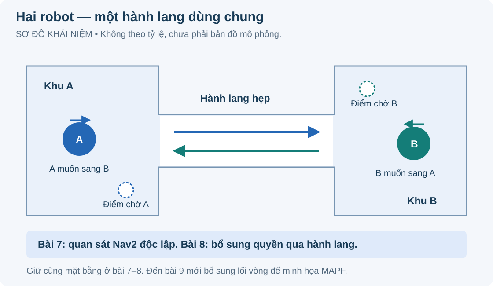

# Mô phỏng và điều phối nhiều robot

**TurtleBot3 Burger · ROS 2 Humble · Gazebo**

Một robot có thể tự tìm đường từ khu A sang khu B. Khi thêm robot thứ hai đi theo chiều ngược lại, cả hai có thể cùng chọn hành lang hẹp. Ai được đi trước, chiếc còn lại chờ ở đâu và khi nào hành lang được coi là trống?

Series này đi từ một mô hình robot đến hai robot có hệ điều hướng riêng, sau đó bổ sung cơ chế phối hợp cho khu vực dùng chung. Lộ trình gồm **8 bài chính và 1 bài mở rộng về Multi-Agent Path Finding (MAPF)**.

!!! info "Phạm vi trang lộ trình"
    Trang này giới thiệu mục tiêu, thứ tự học và kết quả cần đạt của từng bài. Các bài thực hành chi tiết, tệp cấu hình và mã điều phối sẽ được bổ sung theo lộ trình; hiện chưa có kết quả chạy mô phỏng được công bố.

Nếu muốn hình dung các dạng bài toán trước khi thực hành, đọc [Tổng quan điều phối nhiều robot](../dieu-phoi-da-robot/index.md). Bài này dùng ví dụ đơn giản để dẫn vào mục tiêu hai robot qua hành lang; lộ trình thực hành vẫn gồm 9 bài bên dưới.

## 1. Kịch bản xuyên suốt: nhà kho có một hành lang hẹp

Hai robot vận chuyển giữa hai khu A và B. Ở giai đoạn đầu, chúng chạy trên những tuyến không xung đột. Sau khi kiểm tra từng robot điều hướng được, ta đặt chúng đi ngược chiều qua cùng một hành lang.

<figure class="tutorial-figure" markdown>

<figcaption>Kịch bản dùng cho series: hai robot có nhu cầu đi qua một vùng dùng chung. Các điểm chờ chỉ minh họa vị trí tránh chắn cửa; kích thước và tọa độ sẽ được xác định trong bài thực hành.</figcaption>
</figure>

**Bài 7 và bài 8 giữ cùng mặt bằng, vị trí đầu, đích và cấu hình Nav2.** Yếu tố được bổ sung ở bài 8 là quyền đi qua hành lang. Đến bài 9 mới thêm lối vòng để so sánh lựa chọn chờ với lựa chọn đổi tuyến.

## 2. Ai nên học series này?

Series dành cho bạn đã làm quen ROS 2 và muốn hiểu điều gì thay đổi khi một hệ thống có nhiều robot cùng hoạt động. Phần mô phỏng dùng mô hình **TurtleBot3 Burger có sẵn**, không yêu cầu mua hoặc kết nối robot Robovis thật.

Trước khi bắt đầu, bạn nên:

- Dùng được Terminal, đường dẫn và trình soạn thảo trên [Ubuntu](../../../ubuntu-co-ban/index.md).
- Phân biệt [node, topic và message](../../../kien-thuc-nen/robot-ros2/01-node-topic-va-lenh.md).
- Hiểu [launch, parameter và namespace](../../../kien-thuc-nen/robot-ros2/05-parameter-va-launch.md).
- Đọc được các quan hệ [hệ tọa độ và TF](../../../kien-thuc-nen/robot-ros2/he-toa-do-va-tf.md), biết RViz dùng để quan sát dữ liệu.
- Đọc được Python cơ bản để theo dõi node điều phối ở phần cuối.

Nếu còn thiếu các phần này, bắt đầu với [Robot và ROS 2 cơ bản](../../../kien-thuc-nen/robot-ros2/index.md). Phần kiến thức nền giải thích các công cụ; series này dùng chúng để giải quyết một bài toán phối hợp cụ thể.

## 3. Mỗi thành phần đảm nhiệm việc gì?

| Thành phần | Vai trò trong series |
| --- | --- |
| TurtleBot3 Burger | Mô hình robot được dùng thống nhất từ đầu đến cuối |
| Gazebo | Mô phỏng môi trường và chuyển động của robot |
| ROS 2 | Tổ chức chương trình, topic, action và dữ liệu giữa các thành phần |
| RViz | Quan sát bản đồ, pose, dữ liệu cảm biến và quan hệ tọa độ |
| Nav2 riêng cho từng robot | Nhận đích, lập đường, bám đường và phản hồi trạng thái hành trình |
| Node điều phối chung ở bài 8 | Nhận yêu cầu qua hành lang, cấp lượt và theo dõi khi robot đã ra hết |
| MAPF ở bài 9 | Biểu diễn lựa chọn đường đi và bước chờ của nhiều robot theo thời gian |

Trong phạm vi series, **Nav2 tiếp tục điều khiển từng chặng di chuyển của mỗi robot**. Node điều phối quyết định khi nào một robot được vào vùng dùng chung. Việc tránh một vật cản đang xuất hiện trước robot và việc phân chia quyền sử dụng một hành lang là hai quyết định cần được phân biệt.

Môi trường định hướng là **Ubuntu 22.04 và ROS 2 Humble**. Khi triển khai bài thực hành, cần ghi rõ phiên bản Gazebo và nhánh gói TurtleBot3 đã kiểm tra cùng nhau; giữ cùng bộ phiên bản giữa các bài để kết quả so sánh có ý nghĩa.

## 4. Lộ trình 9 bài

### Phần I — Hiểu bài toán và một robot mô phỏng

| Bài | Chủ đề | Thực hành và nội dung trọng tâm | Kết quả cần đạt |
| --- | --- | --- | --- |
| **1** | **Từ một robot đến một đội robot** | Giới thiệu tình huống hành lang, phân biệt việc tự di chuyển với việc phối hợp giữa các robot; xác định mục tiêu series và vai trò của mô phỏng | Giải thích được vì sao hai robot đều tìm được đường nhưng vẫn có thể cản nhau |
| **2** | **Một TurtleBot3 trong Gazebo hoạt động như thế nào?** | Chuẩn bị môi trường, mở mô hình Burger, điều khiển bàn phím; lần theo `cmd_vel`, `odom` và `scan`; quan sát bằng Gazebo và RViz | Chạy được một robot và tìm đúng dữ liệu để xác nhận robot phản ứng với lệnh |

### Phần II — Từ hai mô hình đến hai robot tự điều hướng

| Bài | Chủ đề | Thực hành và nội dung trọng tâm | Kết quả cần đạt |
| --- | --- | --- | --- |
| **3** | **Chạy hai TurtleBot3 và điều khiển riêng từng chiếc** | Đọc ví dụ multi-robot và launch file; phân biệt tên model, vị trí spawn, namespace và topic điều khiển | Điều khiển robot thứ nhất trong khi robot thứ hai đứng yên, rồi đổi vai |
| **4** | **Lệnh đến đúng robot, dữ liệu có hiển thị đúng trên RViz?** | Phân biệt namespace của topic với tên frame TF; kiểm tra `odom`, `base_link` và frame LiDAR của từng robot | Xoay riêng một robot và xác nhận đúng mô hình, đúng dữ liệu cảm biến của nó thay đổi |
| **5** | **Hai TurtleBot3 định vị trên cùng một bản đồ** | Dùng bản đồ khớp với Gazebo world; chạy định vị riêng, đặt hai pose ban đầu và kiểm tra quan hệ từ `map` tới từng robot | Hiển thị đồng thời hai robot; di chuyển một chiếc mà vị trí hiển thị của chiếc còn lại vẫn đúng |
| **6** | **Hai bộ Nav2, hai đích đến** | Theo dõi một hành trình qua `NavigateToPose`, lập đường, bám đường và kết quả; gửi hai đích qua hai namespace | Cả hai hoàn thành các tuyến tách biệt, tạo mốc kiểm tra trước khi thử xung đột |

### Phần III — Từ điều hướng độc lập đến điều phối giao thông

| Bài | Chủ đề | Thực hành và nội dung trọng tâm | Kết quả cần đạt |
| --- | --- | --- | --- |
| **7** | **Hai robot gặp nhau trong hành lang hẹp** | Giữ cấu hình bài 6; đổi vị trí đầu và đích để hai robot đi ngược chiều; quan sát phản ứng khi chúng phát hiện nhau | Ghi vị trí dừng, thời gian chờ và khả năng tới đích qua nhiều lần thử |
| **8** | **Viết bộ điều phối cho hai robot lần lượt qua hành lang** | Đặt điểm chờ lệch cửa; viết node Python nhận yêu cầu, cấp lượt và chỉ giải phóng hành lang khi robot đã ra hết; Nav2 di chuyển từng chặng | Chạy lại kịch bản bài 7 và so sánh thứ tự đi, nhiệm vụ hoàn thành, thời gian của cả đội |
| **9 · Mở rộng** | **Chờ hay đi đường vòng? Nhập môn MAPF** | Thêm lối vòng; mô hình hóa đường bằng node, cạnh và bước thời gian; xét xung đột cùng node hoặc đổi chỗ trên một cạnh | Lập lịch nhỏ cho hai robot, so sánh chờ với đi vòng theo thời điểm chiếc cuối cùng tới đích |

Các hàng trong bảng là **đề cương bài học**, không phải liên kết tới bài thực hành đã hoàn thiện.

## 5. Mạch nội dung của bài mở đầu

Bài 1 sẽ làm rõ năm câu hỏi trước khi đưa người đọc vào lệnh cài đặt hoặc launch file.

### Khi có thêm robot, bài toán thay đổi ở đâu?

Với một robot, ta theo dõi vị trí, đích và trạng thái của nó. Khi có cả đội, còn cần nhận diện dữ liệu từng chiếc, phân công nhiệm vụ và quản lý khu vực dùng chung. Hai lệnh gửi đúng địa chỉ chưa đủ để đảm bảo cả đội cùng hoàn thành công việc.

### Nav2 của từng robot giải quyết phần nào?

Mỗi chiếc trong cấu hình của series có một bộ Nav2 riêng. Khi hai đích nằm ở hai phía đối diện, cả hai có thể chọn cùng hành lang. Ta cần quan sát phản ứng thực tế của hệ điều hướng thay vì mặc định rằng chúng sẽ luôn tự nhường nhau hoặc luôn bị kẹt.

### Điều hướng độc lập khác điều phối theo quy tắc ra sao?

Ở cách thứ nhất, từng robot nhận nhiệm vụ và tự điều hướng. Ở cách thứ hai, một bộ điều phối đặt quy tắc dùng chung, ví dụ mỗi lượt chỉ một robot được qua hành lang. Robot còn lại chờ ở vị trí không chắn cửa, rồi nhận lượt khi khu vực đã được giải phóng.

### Khi nào cần xét đường đi của cả hai robot?

Khi hai đường đi cùng sử dụng một lối hẹp, ta cần xét cả thứ tự di chuyển và vị trí chờ. Các bài chính bắt đầu bằng quy tắc mỗi lượt một robot qua hành lang. Bài mở rộng cuối series mới thêm đường vòng để người học thử lựa chọn giữa chờ và đổi lối.

### Vì sao cần mô phỏng lặp lại?

Mô phỏng giúp đưa robot về cùng vị trí đầu và thử lại cùng nhiệm vụ. Khi giữ các điều kiện khác ổn định, người học có thể nhận ra tác động của việc thêm bộ điều phối, thay vì gán mọi khác biệt cho một lần chạy ngẫu nhiên.

## 6. So sánh công bằng giữa bài 7 và bài 8

Giữ nguyên world, bản đồ, mô hình Burger, vị trí đầu, hướng đầu, đích và cấu hình Nav2. Chạy nhiều lượt cho mỗi phương án và ghi rõ điều kiện của từng lượt.

| Thông tin cần ghi | Câu hỏi cần trả lời |
| --- | --- |
| Hoàn thành đích | Từng robot có đến đúng đích hay không? |
| Vị trí dừng hoặc chờ | Robot chờ ở điểm được bố trí hay chắn cửa hành lang? |
| Thời gian chờ | Mỗi chiếc chờ bao lâu và đang chờ điều gì? |
| Thứ tự qua hành lang | Hai robot có cùng được cấp quyền vào vùng dùng chung không? |
| Thời gian hoàn thành cả đội | Từ khi bắt đầu tới khi chiếc cuối cùng hoàn thành mất bao lâu? |
| Trường hợp lỗi | Robot có hủy nhiệm vụ, timeout hoặc cần can thiệp không? |

**Chưa có số đo mô phỏng trong trang này.** Kết luận về việc giảm chờ, tránh kẹt hoặc cải thiện thời gian chỉ được đưa ra sau khi có dữ liệu từ các lần chạy tương ứng.

Ở bài 8, điều kiện giải phóng phải phản ánh việc robot đã ra hết vùng dùng chung, không chỉ việc node đã gửi một đích mới. Khi sang bài 9, việc thêm lối vòng là thay đổi có chủ đích của bài toán, cần ghi nhận riêng khi so sánh kết quả.

## 7. Tài liệu nền để đối chiếu khi triển khai

- [ROBOTIS — Mô phỏng TurtleBot3](https://emanual.robotis.com/docs/en/platform/turtlebot3/simulation/): chọn nội dung đúng phiên bản ROS đang dùng, không chép lệnh của bản phân phối khác.
- [Nav2 — NavigateToPose trên Humble](https://api.nav2.org/actions/humble/navigatetopose.html): giao diện action cho một nhiệm vụ đi tới pose đích.
- [ROBOTIS — Gói turtlebot3_simulations, nhánh humble](https://github.com/ROBOTIS-GIT/turtlebot3_simulations/tree/humble): nguồn mô hình và launch dùng để đối chiếu trước khi viết các bài chạy mô phỏng.

[← Chuyên mục Robot tự hành](../index.md) · [Ôn tập ROS 2 cơ bản](../../../kien-thuc-nen/robot-ros2/index.md)
