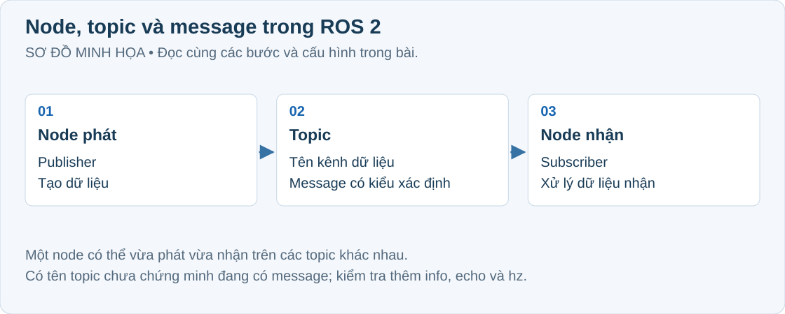
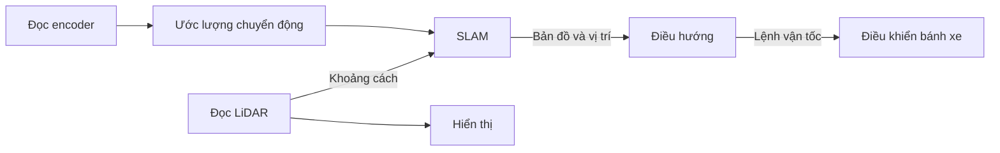

# Bài 1: Robot, kiến trúc phần mềm và ROS graph

Khi yêu cầu robot đi tới cửa phòng, chúng ta thường nghĩ đến vị trí đích và đường di chuyển. Tuy nhiên, để thực hiện yêu cầu đó, robot còn phải đọc cảm biến, ước lượng vị trí và chuyển kết quả xử lý thành lệnh cho bánh xe.

Trước khi học lệnh ROS 2, chúng ta sẽ tìm hiểu cách chia những công việc này thành các thành phần phần mềm và cách lần theo dữ liệu giữa chúng.

## 1. Mục tiêu bài học

Sau bài này, bạn có thể phân biệt dữ liệu cảm biến với lệnh điều khiển, giải thích vai trò của node và vẽ kiến trúc một robot di động. Bạn chưa cần viết mã hoặc có robot thật.

<!-- tutorial-figure:ros2-topic -->
<figure class="tutorial-figure" markdown>

<figcaption>Topic là kênh, message là dữ liệu truyền trên kênh. Kiểm tra dữ liệu thật thay vì chỉ dựa vào tên topic trong danh sách. Nhấp hình để xem lớn.</figcaption>
</figure>
<!-- /tutorial-figure:ros2-topic -->

## 2. Robot cần biết và làm những gì?

Quay lại tình huống đi tới cửa phòng: người dùng có thể chỉ ra vị trí cửa trên bản đồ, trong khi động cơ cần tín hiệu điều khiển để quay. Hệ thống phải xử lý những câu hỏi trung gian trước khi tạo được tín hiệu đó.

| Câu hỏi | Thành phần giải quyết | Dữ liệu ví dụ |
| --- | --- | --- |
| Xung quanh có gì? | Cảm biến và xử lý cảm biến | Khoảng cách LiDAR |
| Robot đang ở đâu? | Ước lượng trạng thái, định vị | Vị trí và hướng |
| Nên đi theo đường nào? | Lập kế hoạch | Chuỗi điểm đường đi |
| Ngay lúc này nên chạy thế nào? | Điều khiển | Vận tốc tiến và quay |
| Bánh có thực sự quay đúng không? | Phản hồi động cơ | Xung encoder, tốc độ đo |

Chẳng hạn, LiDAR cung cấp các phép đo khoảng cách, còn phần mềm dựng bản đồ phải sử dụng những phép đo đó để tạo một biểu diễn về môi trường. Tương tự, đường đi cần được bộ điều khiển chuyển thành lệnh chuyển động. Với mỗi thành phần, chúng ta nên xác định rõ dữ liệu nhận vào, công việc xử lý và kết quả gửi đi.

## 3. Từ một vòng lặp đến nhiều chương trình

Ở Arduino hoặc ESP32, bạn thường viết `setup()` và `loop()` trong một dự án. Với robot có LiDAR, camera, bản đồ và giao diện, việc dồn toàn bộ công việc vào một vòng lặp khiến chương trình khó kiểm tra và khó thay đổi.

Một cách tổ chức là chia phần mềm theo nhiệm vụ. Chương trình đọc LiDAR phụ trách giao tiếp với thiết bị, chương trình dựng bản đồ nhận dữ liệu đo, còn chương trình hiển thị vẽ kết quả lên màn hình. Nhờ cách chia này, chúng ta có thể kiểm tra dữ liệu LiDAR ngay cả khi phần dựng bản đồ chưa được khởi chạy.

Sơ đồ mô tả luồng chức năng. Một hệ thống cụ thể có thể gộp hoặc tách các khối thành số lượng node khác nhau.

## 4. ROS 2 cung cấp điều gì?

Khi các chương trình đã được tách theo nhiệm vụ, chúng cần cách trao đổi dữ liệu và công cụ để kiểm tra hoạt động. ROS 2 cung cấp thư viện, giao diện truyền dữ liệu và công cụ phát triển phục vụ những công việc này. Trong quá trình học, chúng ta sẽ làm việc với ba nhóm chính:

- **Thư viện lập trình:** `rclpy` cho Python, `rclcpp` cho C++.
- **Giao diện trao đổi:** topic, service và action.
- **Công cụ:** dòng lệnh `ros2`, RViz, rqt, rosbag và hệ thống build.

ROS 2 được cài trên một hệ điều hành hỗ trợ. Trong bộ tài liệu này, môi trường học là Ubuntu 22.04 với ROS 2 Humble. Việc cài ROS 2 mới chỉ chuẩn bị công cụ; để robot hoạt động cần thêm driver, mô hình, thuật toán và cấu hình đúng.

## 5. Node, process, package và ROS graph

Trong ROS 2, một thành phần tính toán tham gia hệ thống được gọi là **node**. Khi chạy chương trình, hệ điều hành tạo **tiến trình (process)** để thực thi nó. Hai khái niệm có liên quan nhưng không tương đương: một process có thể chứa một hoặc nhiều node.

Để lưu và phân phối phần mềm, ROS 2 sử dụng **package**, gồm mã nguồn, tệp cấu hình và thông tin phụ thuộc. Một package có thể cung cấp nhiều chương trình chạy được, gọi là **executable**. Chẳng hạn, trong lệnh `ros2 run turtlesim turtlesim_node`, chúng ta chọn executable `turtlesim_node` từ package `turtlesim`.

Khi nhiều node cùng hoạt động, các node và giao diện trao đổi của chúng tạo thành **ROS graph**. Công cụ kiểm tra graph giúp chúng ta biết thành phần nào đã xuất hiện, bên nào phát dữ liệu và bên nào nhận dữ liệu. Với ROS 2, quá trình này không yêu cầu khởi động một ROS master như quy trình thường gặp ở ROS 1.

| Tên trong một ví dụ | Nó là gì? |
| --- | --- |
| `robovis_practice` | Package do người học tạo |
| `bo_phat` | Executable được đăng ký trong package |
| `/nguon_toc_do` | Tên node khi chương trình đang chạy |
| `/toc_do_do` | Topic mang dữ liệu tốc độ |

Bốn tên có thể giống nhau hoặc khác nhau. Ta sẽ cố ý dùng tên khác ở một số chỗ để bạn thấy rõ mỗi vai trò.

## 6. Áp dụng cho Robot ESP32 LiDAR

Trong [kiến trúc sản phẩm](../../robot-esp32-lidar/01-gioi-thieu/02-kien-truc-he-thong.md), ESP32 đọc cảm biến và điều khiển động cơ. Máy tính nhận dữ liệu qua chương trình kết nối rồi đưa vào ROS 2.

Như vậy, chúng ta cần phân biệt giao tiếp giữa máy tính với ESP32 và giao tiếp giữa các node ROS 2 trên máy tính. Việc ESP32 có địa chỉ IP chỉ cho biết một phần cấu hình mạng; cách thiết bị trao đổi với ROS 2 còn phụ thuộc firmware và chương trình kết nối của sản phẩm.

Khi robot không nhận lệnh, cần lần theo chuỗi: nguồn lệnh → topic → chương trình gửi lệnh → kết nối → ESP32 → driver → động cơ. Cách lần theo luồng này hữu ích hơn việc thay tham số ở nhiều nơi cùng lúc.

Đọc thêm: [ROS 2 — Understanding nodes](https://docs.ros.org/en/humble/Tutorials/Beginner-CLI-Tools/Understanding-ROS2-Nodes/Understanding-ROS2-Nodes.html).

## 7. Tổng kết { #8-tong-ket }

Chúng ta đã nhìn một nhiệm vụ robot như một chuỗi xử lý có đầu vào và đầu ra. Node thực hiện phần việc trong hệ thống, package tổ chức phần mềm, còn ROS graph thể hiện các thành phần đang trao đổi. Bài tiếp theo sẽ đưa những khái niệm này vào một ví dụ chạy được trên máy tính.

[← Lộ trình](index.md) · [Bài 2: Môi trường và chương trình mẫu →](chuan-bi-va-turtlesim.md)
