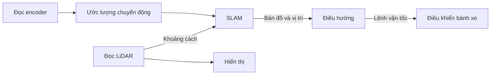

# Bài 1: Robot, kiến trúc phần mềm và ROS graph

## 1. Mục tiêu bài học

Sau bài này, bạn có thể phân biệt dữ liệu cảm biến với lệnh điều khiển, giải thích vai trò của node và vẽ kiến trúc một robot di động. Bạn chưa cần viết mã hoặc có robot thật.

## 2. Robot cần biết và làm những gì?

Giả sử robot cần đi tới cửa phòng. Người dùng biết cửa ở đâu trên bản đồ, nhưng động cơ chỉ nhận được tín hiệu điều khiển. Giữa yêu cầu “đi tới cửa” và chuyển động bánh xe là nhiều bước xử lý.

| Câu hỏi | Thành phần giải quyết | Dữ liệu ví dụ |
| --- | --- | --- |
| Xung quanh có gì? | Cảm biến và xử lý cảm biến | Khoảng cách LiDAR |
| Robot đang ở đâu? | Ước lượng trạng thái, định vị | Vị trí và hướng |
| Nên đi theo đường nào? | Lập kế hoạch | Chuỗi điểm đường đi |
| Ngay lúc này nên chạy thế nào? | Điều khiển | Vận tốc tiến và quay |
| Bánh có thực sự quay đúng không? | Phản hồi động cơ | Xung encoder, tốc độ đo |

Một phép đo khoảng cách không tự trở thành bản đồ. Một đường đi cũng không tự làm bánh xe quay. Khi phân tích hệ thống, hãy tìm rõ đầu vào, đầu ra và nhiệm vụ của mỗi phần.

## 3. Từ một vòng lặp đến nhiều chương trình

Ở Arduino hoặc ESP32, bạn thường viết `setup()` và `loop()` trong một dự án. Với robot có LiDAR, camera, bản đồ và giao diện, việc dồn toàn bộ công việc vào một vòng lặp khiến chương trình khó kiểm tra và khó thay đổi.

Ta có thể chia phần mềm theo nhiệm vụ. Chương trình đọc LiDAR phụ trách thiết bị; chương trình dựng bản đồ nhận dữ liệu đo; chương trình hiển thị nhận kết quả và vẽ lên màn hình. Khi kiểm tra LiDAR, ta có thể quan sát dữ liệu ngay cả khi chưa chạy dựng bản đồ.

Sơ đồ mô tả luồng chức năng. Một hệ thống cụ thể có thể gộp hoặc tách các khối thành số lượng node khác nhau.

## 4. ROS 2 cung cấp điều gì?

ROS 2 cung cấp thư viện, giao diện truyền dữ liệu và công cụ phát triển cho phần mềm robot. Khi học, bạn sẽ làm việc với ba nhóm:

- **Thư viện lập trình:** `rclpy` cho Python, `rclcpp` cho C++.
- **Giao diện trao đổi:** topic, service và action.
- **Công cụ:** dòng lệnh `ros2`, RViz, rqt, rosbag và hệ thống build.

ROS 2 được cài trên một hệ điều hành hỗ trợ. Trong bộ tài liệu này, môi trường học là Ubuntu 22.04 với ROS 2 Humble. Việc cài ROS 2 mới chỉ chuẩn bị công cụ; để robot hoạt động cần thêm driver, mô hình, thuật toán và cấu hình đúng.

## 5. Node, process, package và ROS graph

**Node** là thành phần tính toán tham gia hệ thống ROS 2. **Process** là tiến trình hệ điều hành chạy chương trình. Một process có thể chứa một hoặc nhiều node.

**Package** là đơn vị tổ chức mã nguồn, tệp cấu hình và phụ thuộc. Một package có thể cung cấp nhiều chương trình chạy được, gọi là executable. Khi gõ `ros2 run turtlesim turtlesim_node`, bạn chọn executable `turtlesim_node` trong package `turtlesim`.

**ROS graph** là mạng các node và giao diện trao đổi của chúng. Ta dùng công cụ kiểm tra để biết node nào đang chạy, ai gửi dữ liệu và ai đang nhận. Không có yêu cầu phải khởi động một ROS master như quy trình thường gặp ở ROS 1.

| Tên trong một ví dụ | Nó là gì? |
| --- | --- |
| `robovis_practice` | Package do người học tạo |
| `bo_phat` | Executable được đăng ký trong package |
| `/nguon_toc_do` | Tên node khi chương trình đang chạy |
| `/toc_do_do` | Topic mang dữ liệu tốc độ |

Bốn tên có thể giống nhau hoặc khác nhau. Ta sẽ cố ý dùng tên khác ở một số chỗ để bạn thấy rõ mỗi vai trò.

## 6. Áp dụng cho Robot ESP32 LiDAR

Trong [kiến trúc sản phẩm](../../robot-esp32-lidar/01-gioi-thieu/02-kien-truc-he-thong.md), ESP32 đọc cảm biến và điều khiển động cơ. Máy tính nhận dữ liệu qua chương trình kết nối rồi đưa vào ROS 2.

Do đó có hai lớp cần hiểu: giao tiếp giữa máy tính với ESP32, và giao tiếp giữa các node ROS 2 trên máy tính. ESP32 có địa chỉ IP không có nghĩa nó đang chạy cùng kiểu node như chương trình Python trên PC.

Khi robot không nhận lệnh, cần lần theo chuỗi: nguồn lệnh → topic → chương trình gửi lệnh → kết nối → ESP32 → driver → động cơ. Cách lần theo luồng này hữu ích hơn việc thay tham số ở nhiều nơi cùng lúc.

## 7. Bài tập và tự kiểm tra

Vẽ sơ đồ xe tránh vật cản có LiDAR và encoder. Với mỗi mũi tên, ghi rõ đó là phép đo, trạng thái ước lượng hay lệnh.

1. LiDAR vẫn gửi dữ liệu nhưng bản đồ không xuất hiện: hai khối nào cần kiểm tra tiếp?
2. Lệnh vận tốc là 0,2 m/s nhưng bánh bị kẹt: vì sao không thể dùng lệnh làm số đo tốc độ?
3. Thay cửa sổ hiển thị bằng phần mềm khác có nhất thiết phải sửa driver cảm biến không?

**Tự kiểm tra:** bạn cần giải thích được package chứa chương trình, executable được chạy thành process, và node cung cấp giao diện trao đổi.

Đọc thêm: [ROS 2 — Understanding nodes](https://docs.ros.org/en/humble/Tutorials/Beginner-CLI-Tools/Understanding-ROS2-Nodes/Understanding-ROS2-Nodes.html).

[← Lộ trình](index.md) · [Bài 2: Môi trường và chương trình mẫu →](chuan-bi-va-turtlesim.md)
