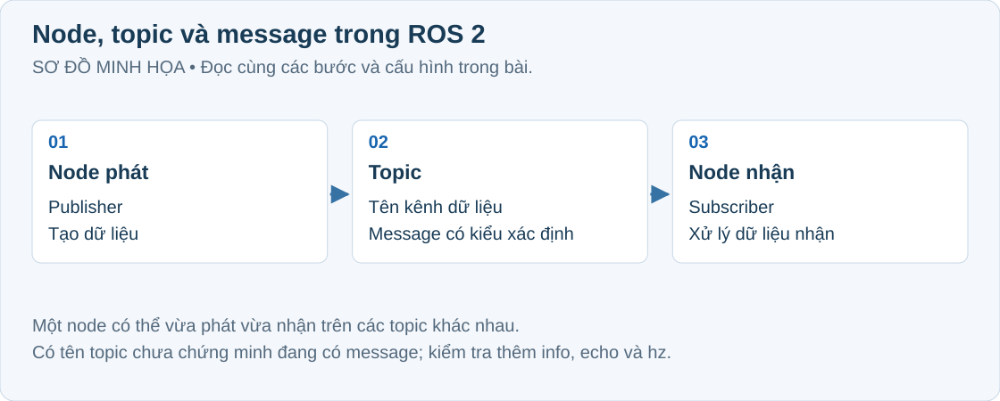
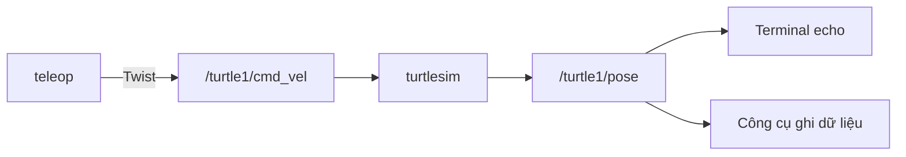

# Bài 3: Node, topic, message và công cụ kiểm tra

Trong bài Turtlesim, nhấn phím đã làm rùa di chuyển. Tuy nhiên, chỉ quan sát cửa sổ mô phỏng chưa cho biết chương trình nào gửi lệnh, lệnh đi qua đâu và trạng thái của rùa được biểu diễn như thế nào.

Chúng ta sẽ dùng các công cụ dòng lệnh để lần theo quá trình này, từ tìm node đang chạy đến đọc một mẫu dữ liệu cụ thể.

## 1. Mục tiêu và nguồn dữ liệu

Sau bài này, bạn có thể tìm một node, xác định giao diện của nó và kiểm tra dữ liệu theo thứ tự. Dùng Turtlesim và teleop từ bài 2. Mọi Terminal mới cần `source /opt/ros/humble/setup.bash`.

## 2. Node đang chạy có những giao diện nào?

Trước tiên, chúng ta tìm tên node trong hệ thống rồi xem các giao diện mà nó cung cấp. Giữ Turtlesim và teleop chạy, mở Terminal kiểm tra và nhập:

```bash
ros2 node list
ros2 node info /turtlesim
```

Trong kết quả, hãy đọc các mục Publishers, Subscribers, Service Servers và Action Servers. Chúng cho biết node phát dữ liệu, nhận dữ liệu và cung cấp những giao diện yêu cầu nào. Turtlesim vừa nhận lệnh chuyển động vừa phát trạng thái, nên vai trò của một node cần được xét theo từng kênh trao đổi.

Nếu không có `/turtlesim`, hãy lấy tên thật từ `node list`. Không đổi tên chương trình chỉ để làm cho một lệnh trong tài liệu có kết quả.

## 3. Topic khác message như thế nào?

Khi teleop gửi một lệnh vận tốc, nó phát một **message**, tức một mẫu dữ liệu, qua kênh có tên xác định là **topic**. Kiểu giao diện, chẳng hạn `geometry_msgs/msg/Twist`, quy định cấu trúc dữ liệu được trao đổi. Bên phát gọi là **publisher**, bên nhận gọi là **subscriber**; nhiều subscriber có thể nhận cùng dữ liệu để phục vụ các công việc khác nhau.

<!-- tutorial-figure:ros2-topic -->
<figure class="tutorial-figure" markdown>

[](../../assets/illustrations/ros2-topic.svg)

<figcaption>Topic là kênh, message là dữ liệu truyền trên kênh. Kiểm tra dữ liệu thật thay vì chỉ dựa vào tên topic trong danh sách. Nhấp hình để xem lớn.</figcaption>
</figure>
<!-- /tutorial-figure:ros2-topic -->



Topic không phải một tệp trong thư mục Linux. Dấu `/` trong tên biểu thị cấu trúc tên ROS, không có nghĩa bạn dùng `cd` để đi vào topic.

## 4. Từ tên kênh tới cấu trúc dữ liệu

Biết tên topic giúp chúng ta tìm được kênh cần quan sát. Bước tiếp theo là đọc kiểu giao diện để biết một message trên kênh đó chứa những trường nào:

```bash
ros2 topic list -t
ros2 topic type /turtle1/cmd_vel
ros2 interface show geometry_msgs/msg/Twist
```

Kết quả định nghĩa `Twist` cho thấy hai vector `linear` và `angular`, mỗi vector có các thành phần `x`, `y`, `z`. Nhờ biết cấu trúc trước, chúng ta có thể đọc ý nghĩa từng phần của message và soạn lệnh gửi đúng kiểu ở bước thực hành sau.

Tiếp theo:

```bash
ros2 topic info /turtle1/cmd_vel --verbose
```

Lệnh cho biết các đầu gửi/nhận được phát hiện, tên node và QoS. Số publisher lớn hơn 0 chỉ xác nhận có đầu gửi được phát hiện; đầu gửi có thể đang chờ sự kiện để phát.

## 5. Đọc một mẫu và đọc liên tục

Để bắt đầu quan sát nội dung, chúng ta đọc một mẫu trạng thái của rùa. Tùy chọn `--once` giúp lệnh kết thúc sau khi nhận mẫu, thuận tiện cho việc xem từng trường:

```bash
ros2 topic echo /turtle1/pose --once
```

Lệnh kết thúc sau khi nhận một mẫu. Đọc `x`, `y` và `theta`, điều khiển rùa rồi chạy lại. Đây là trạng thái mô phỏng hiện tại, không phải lệnh bàn phím vừa nhập.

Để xem lệnh:

```bash
ros2 topic echo /turtle1/cmd_vel
```

Hãy giữ `echo` chạy rồi chuyển sang Terminal teleop và nhấn phím. Bạn sẽ thấy message xuất hiện khi có lệnh được gửi. Nếu chưa nhấn phím, công cụ có thể chỉ đang chờ dữ liệu; cửa sổ chưa in thêm dòng không nhất thiết là lỗi. Dùng `Ctrl+C` để dừng sau khi quan sát.

## 6. Tự gửi một message trong mô phỏng

Sau khi đọc lệnh từ teleop, chúng ta sẽ tự tạo một message để thấy cấu trúc vừa học được sử dụng ra sao. Dừng teleop để chỉ còn một nguồn lệnh trong phép thử, giữ Turtlesim chạy rồi nhập:

```bash
ros2 topic pub --once /turtle1/cmd_vel geometry_msgs/msg/Twist '{linear: {x: 1.0}, angular: {z: 0.5}}'
```

Rùa đi theo một cung trong một khoảng ngắn rồi dừng theo cơ chế của Turtlesim. `--once` chỉ gửi một mẫu; nó không có nghĩa mọi robot thật sẽ tự dừng sau cùng khoảng thời gian như mô phỏng.

Dấu nháy đơn giữ nguyên chuỗi YAML cho shell. Dấu ngoặc và tên trường mô tả message, không phải tên biến Python. Các trường không ghi được khởi tạo bằng giá trị mặc định của message.

## 7. Tần số, QoS và giới hạn quan sát

```bash
ros2 topic hz /turtle1/pose
```

Quan sát `average rate`, sau đó `Ctrl+C`. Tần số phản ánh các mẫu công cụ nhận được. Chất lượng kết nối, QoS và tải máy có thể ảnh hưởng phép đo.

Ngoài tên và kiểu dữ liệu, bên gửi và bên nhận còn sử dụng **QoS (Quality of Service)**, tức các chính sách về truyền nhận như độ tin cậy và lưu giữ dữ liệu. Những chính sách này cần tương thích để hai đầu trao đổi được. Chẳng hạn, một ứng dụng cảm biến có thể ưu tiên mẫu mới hơn việc nhận lại mọi mẫu cũ; lựa chọn phù hợp phụ thuộc cách ứng dụng dùng dữ liệu.

Ví dụ kiểm tra nguồn LiDAR đã chạy:

```bash
ros2 topic echo /scan --qos-reliability best_effort --once
```

Turtlesim không tạo `/scan`. Chỉ dùng lệnh này khi đã có nguồn LiDAR hoặc bag tương ứng. Đọc QoS thật bằng `info --verbose` trước khi kết luận lỗi do chương trình.

## 8. Một quy trình kiểm tra có thứ tự

| Bước | Câu hỏi | Lệnh |
| --- | --- | --- |
| 1 | Thành phần đã khởi chạy chưa? | `ros2 node list` và log |
| 2 | Tên đầy đủ của kênh là gì? | `ros2 topic list -t` |
| 3 | Ai gửi và nhận? | `ros2 topic info TOPIC --verbose` |
| 4 | Dữ liệu bên trong đúng không? | `ros2 topic echo TOPIC --once` |
| 5 | Có cập nhật đều không? | `ros2 topic hz TOPIC` |

`TOPIC` là chỗ cần thay. Một mẫu có giá trị hợp lệ chưa chứng minh dữ liệu vẫn tiếp tục cập nhật; hãy kết hợp đọc nội dung và quan sát thời gian.

Đọc thêm: [Understanding topics](https://docs.ros.org/en/humble/Tutorials/Beginner-CLI-Tools/Understanding-ROS2-Topics/Understanding-ROS2-Topics.html), [Quality of Service](https://docs.ros.org/en/humble/Concepts/Intermediate/About-Quality-of-Service-Settings.html).

## 9. Tổng kết { #10-tong-ket }

Chúng ta đã đi từ tên node đến topic, kiểu giao diện và nội dung message. Khi một hệ thống chưa cho kết quả mong muốn, cách kiểm tra theo thứ tự này giúp xác định đang thiếu nguồn, sai kênh hay chưa có dữ liệu mới. Ở bài tiếp theo, chúng ta sẽ tự viết bên phát và bên nhận để tạo một luồng trao đổi tương tự.

[← Bài 2](chuan-bi-va-turtlesim.md) · [Bài 4: Viết publisher và subscriber →](06-workspace-va-node-python.md)
