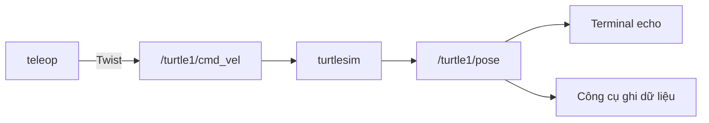

# Bài 3: Node, topic, message và công cụ kiểm tra

## 1. Mục tiêu và nguồn dữ liệu

Sau bài này, bạn có thể tìm một node, xác định giao diện của nó và kiểm tra dữ liệu theo thứ tự. Dùng Turtlesim và teleop từ bài 2. Mọi Terminal mới cần `source /opt/ros/humble/setup.bash`.

## 2. Node đang chạy có những giao diện nào?

```bash
ros2 node list
ros2 node info /turtlesim
```

Đọc các mục Publishers, Subscribers, Service Servers và Action Servers. Turtlesim nhận lệnh nhưng đồng thời cũng phát trạng thái. Một node có nhiều vai trò tùy kênh đang xét.

Nếu không có `/turtlesim`, hãy lấy tên thật từ `node list`. Không đổi tên chương trình chỉ để làm cho một lệnh trong tài liệu có kết quả.

## 3. Topic khác message như thế nào?

Topic là tên kênh; message là một mẫu dữ liệu đi qua kênh đó. Mỗi topic có kiểu giao diện, chẳng hạn `geometry_msgs/msg/Twist` cho vận tốc. Nhiều subscriber có thể dùng cùng dữ liệu mà không cần bên gửi viết riêng một bản cho từng ứng dụng.



Topic không phải một tệp trong thư mục Linux. Dấu `/` trong tên biểu thị cấu trúc tên ROS, không có nghĩa bạn dùng `cd` để đi vào topic.

## 4. Từ tên kênh tới cấu trúc dữ liệu

```bash
ros2 topic list -t
ros2 topic type /turtle1/cmd_vel
ros2 interface show geometry_msgs/msg/Twist
```

`Twist` chứa hai vector `linear` và `angular`; mỗi vector có `x`, `y`, `z`. Bạn sẽ dùng thông tin này để đọc hoặc soạn message đúng kiểu.

Tiếp theo:

```bash
ros2 topic info /turtle1/cmd_vel --verbose
```

Lệnh cho biết các đầu gửi/nhận được phát hiện, tên node và QoS. Số publisher lớn hơn 0 chỉ xác nhận có đầu gửi được phát hiện; đầu gửi có thể đang chờ sự kiện để phát.

## 5. Đọc một mẫu và đọc liên tục

```bash
ros2 topic echo /turtle1/pose --once
```

Lệnh kết thúc sau khi nhận một mẫu. Đọc `x`, `y` và `theta`, điều khiển rùa rồi chạy lại. Đây là trạng thái mô phỏng hiện tại, không phải lệnh bàn phím vừa nhập.

Để xem lệnh:

```bash
ros2 topic echo /turtle1/cmd_vel
```

Giữ lệnh chạy, nhấn phím trong Terminal teleop. Nếu chưa có lệnh được gửi, `echo` có thể chỉ đang chờ. Dùng `Ctrl+C` để dừng.

## 6. Tự gửi một message trong mô phỏng

Dừng teleop để tránh hai nguồn cùng gửi lệnh. Giữ Turtlesim chạy, rồi phát một lệnh:

```bash
ros2 topic pub --once /turtle1/cmd_vel geometry_msgs/msg/Twist '{linear: {x: 1.0}, angular: {z: 0.5}}'
```

Rùa đi theo một cung trong một khoảng ngắn rồi dừng theo cơ chế của Turtlesim. `--once` chỉ gửi một mẫu; nó không có nghĩa mọi robot thật sẽ tự dừng sau cùng khoảng thời gian như mô phỏng.

Dấu nháy đơn giữ nguyên chuỗi YAML cho shell. Dấu ngoặc và tên trường mô tả message, không phải tên biến Python. Các trường không ghi được khởi tạo bằng giá trị mặc định của message.

## 7. Tần số, QoS và giới hạn quan sát

```bash
ros2 topic hz /turtle1/pose
```

Quan sát `average rate`, sau đó `Ctrl+C`. Tần số phản ánh các mẫu công cụ nhận được. Chất lượng kết nối, QoS và tải máy có thể ảnh hưởng phép đo.

**QoS** là chính sách truyền nhận, như độ tin cậy và lưu giữ dữ liệu. Hai đầu dùng cùng tên và kiểu vẫn cần chính sách tương thích. Với dữ liệu cảm biến, việc ưu tiên mẫu mới đôi khi hữu ích hơn cố nhận lại mọi mẫu cũ; lựa chọn phải dựa trên ứng dụng.

Ví dụ kiểm tra nguồn LiDAR đã chạy:

```bash
ros2 topic echo /scan --qos-reliability best_effort --once
```

Turtlesim không tạo `/scan`. Chỉ dùng lệnh này khi đã có nguồn LiDAR hoặc bag tương ứng. Đọc QoS thật bằng `info --verbose` trước khi kết luận lỗi do chương trình.

## 8. Một quy trình kiểm tra có thứ tự

| Bước | Câu hỏi | Lệnh |
| --- | --- | --- |
| 1 | Thành phần đã khởi chạy chưa? | `ros2 node list` và log |
| 2 | Tên đầy đủ của kênh là gì? | `ros2 topic list -t` |
| 3 | Ai gửi và nhận? | `ros2 topic info TOPIC --verbose` |
| 4 | Dữ liệu bên trong đúng không? | `ros2 topic echo TOPIC --once` |
| 5 | Có cập nhật đều không? | `ros2 topic hz TOPIC` |

`TOPIC` là chỗ cần thay. Một mẫu có giá trị hợp lệ chưa chứng minh dữ liệu vẫn tiếp tục cập nhật; hãy kết hợp đọc nội dung và quan sát thời gian.

## 9. Bài tập

Đo trạng thái rùa trước và sau khi tự gửi lệnh. Ghi tên node nguồn lệnh trong `info --verbose`. Thử khởi động lại teleop và giải thích vì sao lúc này có thể xuất hiện thêm publisher trên cùng topic.

Đọc thêm: [Understanding topics](https://docs.ros.org/en/humble/Tutorials/Beginner-CLI-Tools/Understanding-ROS2-Topics/Understanding-ROS2-Topics.html), [Quality of Service](https://docs.ros.org/en/humble/Concepts/Intermediate/About-Quality-of-Service-Settings.html).

[← Bài 2](chuan-bi-va-turtlesim.md) · [Bài 4: Viết publisher và subscriber →](06-workspace-va-node-python.md)
