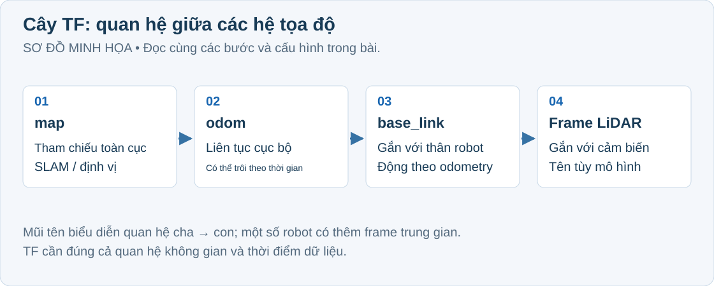

# Bài 11: RViz, URDF và kiểm tra dữ liệu

Sau bài TF, chúng ta đã biết cách mô tả vị trí cảm biến so với thân robot. Bước tiếp theo là nhìn thấy các quan hệ đó trên màn hình và đối chiếu với hình dạng mô hình.

Trong bài này, chúng ta tạo một thân robot hình hộp với LiDAR hình trụ để tìm hiểu cách mô hình, TF và công cụ hiển thị phối hợp với nhau. Từ ví dụ nhỏ này, bạn có thể áp dụng cùng cách kiểm tra khi xem dữ liệu robot thật.

## 1. Mục tiêu

Trong bài này, bạn sẽ tạo mô hình robot nhỏ, phát quan hệ thân–LiDAR và xem trong RViz. Sau đó, chúng ta đối chiếu các bước tương tự khi xem dữ liệu của Robot ESP32 LiDAR thật.

<!-- tutorial-figure:tf-chuoi-frame -->
<figure class="tutorial-figure" markdown>

[](../../assets/illustrations/tf-chuoi-frame.svg)

<figcaption>Chuỗi frame thường gặp để đưa dữ liệu cảm biến vào bản đồ. Đối chiếu tên frame và các nhánh thực tế của robot đang chạy. Nhấp hình để xem lớn.</figcaption>
</figure>
<!-- /tutorial-figure:tf-chuoi-frame -->

Bạn cần package thực hành của bài 4–7 và kiến thức TF của bài 10. Các tệp mô hình bên dưới chỉ thuộc bài thử trên máy tính.

## 2. RViz và mô phỏng khác nhau thế nào?

Khi mở Turtlesim, chương trình vừa cập nhật thế giới mô phỏng vừa vẽ rùa. **RViz** có vai trò hiển thị dữ liệu do các nguồn ROS 2 cung cấp. Vì vậy, để thấy robot, phép quét hoặc bản đồ trong RViz, chúng ta phải có nguồn tạo ra những dữ liệu tương ứng.

Trong cửa sổ RViz, chúng ta thêm các **display**, tức thành phần nhận và vẽ từng loại dữ liệu. Display TF hiển thị các frame, RobotModel vẽ hình dạng từ mô hình, LaserScan vẽ mẫu quét và Map hiển thị lưới bản đồ. Mỗi display cần được chọn đúng nguồn và cấu hình phù hợp.

## 3. URDF mô tả hình học và quan hệ khớp

Để hiển thị mô hình robot, chúng ta cần mô tả các bộ phận và cách chúng nối với nhau. **URDF (Unified Robot Description Format)** sử dụng **link** cho bộ phận và **joint** cho quan hệ nối. Một joint cố định giữ nguyên vị trí tương đối giữa hai link; với joint chuyển động, hệ thống cần cập nhật trạng thái khi bộ phận vận động.

Cài công cụ khi đang có Internet:

```bash
sudo apt install ros-humble-robot-state-publisher ros-humble-rviz2
```

Trong package `robovis_practice`, tạo thư mục `urdf`, rồi tệp `~/ros2_practice_ws/src/robovis_practice/urdf/robot_hoc.urdf`:

```xml
<?xml version="1.0"?>
<robot name="robot_hoc">
  <link name="base_link">
    <visual>
      <origin xyz="0 0 0.03"/>
      <geometry><box size="0.24 0.18 0.06"/></geometry>
      <material name="xanh"><color rgba="0.1 0.4 0.8 1"/></material>
    </visual>
  </link>
  <link name="base_scan">
    <visual>
      <geometry><cylinder radius="0.03" length="0.03"/></geometry>
      <material name="do"><color rgba="0.8 0.1 0.1 1"/></material>
    </visual>
  </link>
  <joint name="gan_lidar" type="fixed">
    <parent link="base_link"/>
    <child link="base_scan"/>
    <origin xyz="0.08 0 0.09" rpy="0 0 0"/>
  </joint>
</robot>
```

Trong mô hình trên, kích thước dùng mét và góc `rpy` dùng radian. Joint `gan_lidar` đặt frame LiDAR trước thân 0,08 m và cao 0,09 m. Riêng `visual/origin` của thân chỉ đặt hình hộp so với gốc link, nên chúng ta cần phân biệt vị trí hình hiển thị với quan hệ giữa các frame trong TF.

Mô hình này chỉ có hình hiển thị và một khớp cố định. Một mô hình dùng cho mô phỏng vật lý còn cần mô tả va chạm, quán tính và các thông số phù hợp.

## 4. Nạp mô hình bằng launch

Tệp URDF đã mô tả cấu trúc robot, nhưng chúng ta còn cần một chương trình đọc mô hình và công bố quan hệ cho ROS 2. Launch file sau khởi động `robot_state_publisher` và truyền nội dung mô hình qua parameter `robot_description`.

Tạo tệp `~/ros2_practice_ws/src/robovis_practice/launch/mo_hinh.launch.py`:

```python
from pathlib import Path

from ament_index_python.packages import get_package_share_directory
from launch import LaunchDescription
from launch_ros.actions import Node


def generate_launch_description():
    model = (
        Path(get_package_share_directory('robovis_practice'))
        / 'urdf' / 'robot_hoc.urdf')
    return LaunchDescription([
        Node(
            package='robot_state_publisher',
            executable='robot_state_publisher',
            parameters=[{'robot_description': model.read_text()}],
            output='screen'),
    ])
```

Trong `setup.py`, bổ sung phần tử cài mô hình vào `data_files`:

```text
('share/' + package_name + '/urdf', glob('urdf/*.urdf')),
```

Giữ phần cài launch/config ở bài 7. Thêm `<exec_depend>robot_state_publisher</exec_depend>` vào `package.xml`, build lại rồi mở Terminal mới:

```bash
source /opt/ros/humble/setup.bash
source ~/ros2_practice_ws/install/setup.bash
ros2 launch robovis_practice mo_hinh.launch.py
```

Khi chạy, `robot_state_publisher` đọc mô hình để công bố các quan hệ khớp. Ví dụ của chúng ta chỉ có joint cố định, nên không cần thêm nguồn phát vị trí khớp. Nếu mô hình có joint chuyển động như bánh quay, các quan hệ động cần trạng thái từ nguồn phù hợp, thường thông qua `/joint_states`.

## 5. Hiển thị và kiểm tra

Mở Terminal khác, nạp ROS 2 rồi chạy `rviz2`. Trong cửa sổ:

1. Đặt **Global Options → Fixed Frame** thành `base_link`.
2. Chọn **Add → TF**.
3. Chọn **Add → RobotModel**. Nếu display yêu cầu, chọn nguồn mô tả dạng topic và topic `robot_description` thực tế.
4. Quan sát thân hình hộp và LiDAR hình trụ; đọc trạng thái display nếu chưa thấy.

Gốc `base_scan` cần lệch trước và cao đúng mô hình. Kiểm tra bằng Terminal đã nạp ROS 2:

```bash
ros2 run tf2_ros tf2_echo base_link base_scan
```

Kết quả tịnh tiến cần gần `(0.08, 0, 0.09)`, phép quay là không quay. `Ctrl+C` dừng công cụ.

Nếu một frame đã có quan hệ đúng nhưng hình vẽ lệch, kiểm tra `visual/origin`. Nếu cả frame lẫn hình đều sai, kiểm tra joint và nguồn mô hình được nạp.

## 6. Vì sao Fixed Frame ảnh hưởng kết quả?

Để vẽ nhiều nguồn dữ liệu trong cùng một không gian, RViz cần một frame tham chiếu chung, gọi là **Fixed Frame**. Trong bài thử, cây chỉ có `base_link` và `base_scan`, nên chúng ta chọn `base_link`. Các frame `odom` hoặc `map` chưa được tạo bởi mô hình này.

| Bối cảnh | Fixed Frame thường dùng |
| --- | --- |
| Bài mô hình cố định trên máy tính | `base_link` |
| Kiểm tra odometry robot | `odom` |
| Đã chạy SLAM hoặc định vị toàn cục | `map` |

RViz cần tra được chuỗi TF từ frame dữ liệu tới Fixed Frame tại thời điểm hợp lệ. Chọn một tên không tồn tại không tạo thêm quan hệ còn thiếu.

## 7. Chuyển sang dữ liệu LiDAR thật

Dừng launch mô hình thử trước khi [khởi động robot thật](../../robot-esp32-lidar/03-van-hanh/02-khoi-dong-va-kiem-tra.md), vì mô hình thử dùng các tên frame có thể trùng sản phẩm.

Với robot thật, chúng ta giữ cùng cách kiểm tra nhưng sử dụng nguồn và mô hình của sản phẩm. Mở cấu hình RViz được bàn giao nếu có, thêm display LaserScan và chọn topic quét thực tế. Nếu chưa thấy các điểm, lần lượt xem những thông tin sau:

- Có mẫu quét mới trên topic không?
- `header.frame_id` có frame tương ứng không?
- Chuỗi TF có nối tới Fixed Frame không?
- Timestamp và nguồn thời gian có thống nhất không?
- QoS của display có tương thích publisher không?

Với cảm biến phát best effort, chọn độ tin cậy phù hợp trong thuộc tính display. Thay màu hoặc cỡ điểm không sửa được lỗi nguồn dữ liệu hay TF.

Đọc thêm: [ROS 2 — URDF với robot_state_publisher](https://docs.ros.org/en/humble/Tutorials/Intermediate/URDF/Using-URDF-with-Robot-State-Publisher.html), [RViz User Guide](https://docs.ros.org/en/humble/Tutorials/Intermediate/RViz/RViz-User-Guide/RViz-User-Guide.html).

## 8. Tổng kết { #9-tong-ket }

URDF mô tả bộ phận và quan hệ khớp, `robot_state_publisher` công bố các quan hệ từ mô hình, còn RViz hiển thị dữ liệu theo Fixed Frame đã chọn. Khi hình chưa đúng, chúng ta có thể kiểm tra riêng mô hình, TF và nguồn dữ liệu. Bài cuối sẽ hướng dẫn lưu dữ liệu để quan sát lại một lần thử và tổng hợp kết quả kiểm tra.

[← Bài 10](he-toa-do-va-tf.md) · [Bài 12: Rosbag và thực hành tổng hợp →](07-rosbag-va-xu-ly-loi.md)
