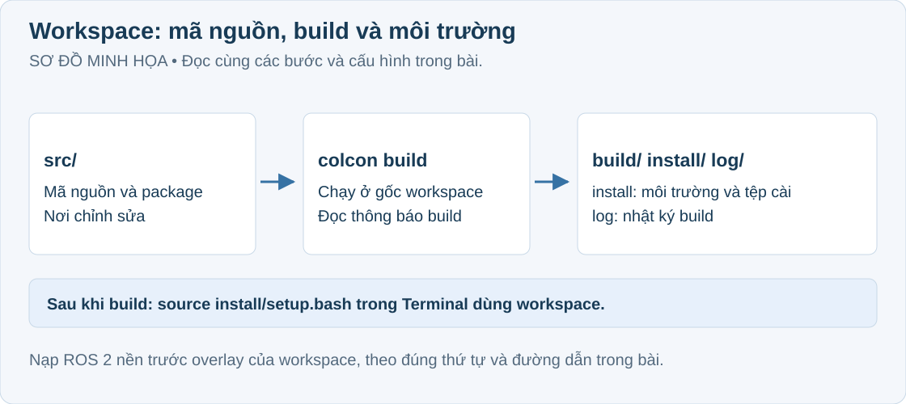

# Bài 4: Workspace, publisher và subscriber bằng Python

Sau khi quan sát các node có sẵn, chúng ta sẽ tự tạo một luồng dữ liệu nhỏ. Giả sử cần theo dõi tốc độ và tính giá trị trung bình của các mẫu gần đây: một chương trình có thể phụ trách phát mẫu, còn chương trình khác nhận mẫu để xử lý.

Trong bài này, chúng ta viết hai chương trình bằng Python và đặt chúng trong một package ROS 2. Ví dụ sẽ được dùng tiếp ở các bài service, parameter và ghi dữ liệu.

## 1. Mục tiêu và cấu trúc ví dụ

Trong bài này, chúng ta sẽ tạo package `robovis_practice`, viết hai node và kiểm tra luồng dữ liệu. Một node tạo tốc độ giả lập, node còn lại tính trung bình của tối đa năm mẫu gần nhất.

```text
bo_phat → /toc_do_do → bo_nhan → thông báo trung bình trong Terminal
```

Giá trị trong ví dụ mang quy ước đơn vị m/s. Đây là dữ liệu giả lập phục vụ học lập trình; nó chưa được đo từ encoder và không gửi lệnh tới động cơ.

## 2. Workspace, underlay và overlay

Trước khi viết mã, chúng ta cần một nơi tổ chức dự án. **Workspace** là thư mục chứa các package đang phát triển cùng kết quả của quá trình build. Trong workspace, mã nguồn và các tệp được tạo khi build có vai trò khác nhau:

<!-- tutorial-figure:workspace-build-source -->
<figure class="tutorial-figure" markdown>

[](../../assets/illustrations/workspace-build-source.svg)

<figcaption>Quan hệ giữa mã nguồn, kết quả build và môi trường Terminal. Bài LiDAR có hai workspace: giữ đúng thứ tự build/source được hướng dẫn. Nhấp hình để xem lớn.</figcaption>
</figure>
<!-- /tutorial-figure:workspace-build-source -->

| Thư mục | Vai trò |
| --- | --- |
| `src` | Mã nguồn bạn chỉnh sửa |
| `build` | Tệp trung gian của quá trình build |
| `install` | Chương trình và tệp được cài để ROS 2 tìm thấy |
| `log` | Nhật ký quá trình build |

Trong ví dụ này, môi trường ROS 2 đã cài tại `/opt/ros/humble` cung cấp nền tảng và được gọi là **underlay**. Workspace của chúng ta được nạp sau để bổ sung các package đang phát triển, đóng vai trò **overlay**. Lệnh `source install/setup.bash` giúp Terminal tìm thấy phần bổ sung đó.

Build package Python còn thực hiện việc cài đặt và đăng ký executable. Vì vậy, dù Python không cần biên dịch như C++, bạn vẫn cần bước build để dùng package đúng cách với `ros2 run`.

## 3. Tạo package

Chúng ta sử dụng workspace `~/ros2_practice_ws` và package `robovis_practice` xuyên suốt các bài. Mở Terminal mới, nạp môi trường ROS 2 rồi tạo cấu trúc dự án:

```bash
source /opt/ros/humble/setup.bash
sudo apt install python3-colcon-common-extensions
mkdir -p ~/ros2_practice_ws/src
cd ~/ros2_practice_ws/src
ros2 pkg create robovis_practice --build-type ament_python --dependencies rclpy std_msgs std_srvs
```

Nếu package đã có từ lần học trước, giữ thư mục đó và chỉnh đúng các tệp bên dưới. Kiểm tra `package.xml` có phụ thuộc `rclpy`, `std_msgs` và `std_srvs`; bài service sẽ dùng phụ thuộc thứ ba.

| Tệp trong package | Chứa gì? |
| --- | --- |
| `package.xml` | Thông tin package và các phụ thuộc |
| `setup.py` | Quy tắc cài và đăng ký executable |
| `setup.cfg` | Vị trí cài script cho package Python |
| `robovis_practice/__init__.py` | Đánh dấu mô-đun Python |
| `resource/robovis_practice` | Dấu nhận diện trong chỉ mục package |

Sau khi tạo package, hãy giữ các tệp có sẵn theo cấu trúc trên. Bạn sẽ thấy hai cấp thư mục cùng tên `robovis_practice`: thư mục ngoài là package, còn thư mục bên trong chứa các mô-đun Python chúng ta sẽ viết.

## 4. Viết bên phát dữ liệu

Bên phát cần tạo mẫu theo một chu kỳ để bên nhận có dữ liệu quan sát. Chúng ta sẽ dùng một giá trị tốc độ cơ sở cộng với dãy độ lệch lặp lại; cách tạo này giúp tính trước kết quả để kiểm tra chương trình.

Tạo tệp `~/ros2_practice_ws/src/robovis_practice/robovis_practice/bo_phat.py`:

```python
import rclpy
from rclpy.node import Node
from std_msgs.msg import Float64


class BoPhat(Node):
    def __init__(self):
        super().__init__('nguon_toc_do')
        self.declare_parameter('toc_do_co_so', 0.2)
        self.declare_parameter('chu_ky', 0.2)
        chu_ky = self.get_parameter('chu_ky').value
        if chu_ky <= 0.0:
            raise ValueError('chu_ky phai lon hon 0')
        self.pub = self.create_publisher(Float64, 'toc_do_do', 10)
        self.sai_lech = [-0.02, 0.0, 0.02, 0.0]
        self.chi_so = 0
        self.timer = self.create_timer(chu_ky, self.gui_mau)

    def gui_mau(self):
        co_so = self.get_parameter('toc_do_co_so').value
        message = Float64()
        message.data = co_so + self.sai_lech[self.chi_so]
        self.pub.publish(message)
        self.chi_so = (self.chi_so + 1) % len(self.sai_lech)
        self.get_logger().info(f'Do: {message.data:.3f} m/s')


def main(args=None):
    rclpy.init(args=args)
    node = None
    try:
        node = BoPhat()
        rclpy.spin(node)
    except KeyboardInterrupt:
        pass
    finally:
        if node is not None:
            node.destroy_node()
        if rclpy.ok():
            rclpy.shutdown()


if __name__ == '__main__':
    main()
```

### Giải thích theo luồng chạy

Khi chương trình tạo đối tượng `BoPhat`, hàm khởi tạo đặt tên node là `nguon_toc_do`, khai báo các giá trị cấu hình và tạo publisher. Publisher dùng message `Float64`, có một trường số thực là `data`. Trong ví dụ, chúng ta thống nhất hiểu số đó theo đơn vị m/s; bản thân kiểu message không ghi đơn vị này.

Để phát dữ liệu định kỳ, chương trình tạo **timer** gọi hàm `gui_mau()` mỗi 0,2 giây theo cấu hình mặc định, tương ứng khoảng 5 Hz. Hàm được gọi khi có sự kiện như vậy thường gọi là **callback**. Mỗi lần chạy, callback đọc tốc độ cơ sở, cộng độ lệch hiện tại và phát một message mới.

Số `10` trong `create_publisher` là độ sâu hàng đợi theo cấu hình QoS được tạo từ tham số này, không phải tần số phát. `spin()` cho executor xử lý timer và các callback khác; nếu tạo node rồi thoát ngay, timer chưa có cơ hội hoạt động.

## 5. Viết bên nhận và lọc dữ liệu

Với bên nhận, chúng ta muốn giữ tối đa năm mẫu gần nhất và tính lại trung bình mỗi khi có dữ liệu. Công việc này được thực hiện trong callback của subscriber, thay vì dùng một vòng lặp liên tục hỏi xem đã có mẫu hay chưa.

Tạo tệp `~/ros2_practice_ws/src/robovis_practice/robovis_practice/bo_nhan.py`:

```python
from collections import deque

import rclpy
from rclpy.node import Node
from std_msgs.msg import Float64


class BoNhan(Node):
    def __init__(self):
        super().__init__('theo_doi_toc_do')
        self.mau = deque(maxlen=5)
        self.sub = self.create_subscription(
            Float64, 'toc_do_do', self.nhan_mau, 10)

    def nhan_mau(self, message):
        self.mau.append(message.data)
        trung_binh = sum(self.mau) / len(self.mau)
        self.get_logger().info(
            f'Nhan: {message.data:.3f}; '
            f'TB {len(self.mau)} mau: {trung_binh:.3f} m/s')


def main(args=None):
    rclpy.init(args=args)
    node = BoNhan()
    try:
        rclpy.spin(node)
    except KeyboardInterrupt:
        pass
    finally:
        node.destroy_node()
        if rclpy.ok():
            rclpy.shutdown()


if __name__ == '__main__':
    main()
```

Khi nhận message, subscriber gọi `nhan_mau()` để thêm giá trị vào `deque(maxlen=5)`. Cấu trúc này tự bỏ mẫu cũ nhất khi đã đầy, nên phép tính luôn dùng tối đa năm mẫu gần đây. Lúc mới chạy chưa đủ năm mẫu, chúng ta chia cho số mẫu thực có là `len(self.mau)` để tính đúng trung bình.

Trung bình trượt làm dữ liệu bớt dao động nhưng cũng làm phản ứng chậm hơn khi giá trị đổi đột ngột. Đây là đánh đổi cần xem xét khi dùng bộ lọc trong điều khiển.

## 6. Đăng ký executable

Hai tệp Python đã có hàm `main`, nhưng ROS 2 còn cần biết tên lệnh nào sẽ gọi các hàm đó. Chúng ta khai báo mối liên hệ này bằng **entry point** trong cấu hình package.

Trong `setup.py`, giữ thông tin và cấu trúc package đang có, sửa phần `entry_points` thành:

```python
entry_points = {
    'console_scripts': [
        'bo_phat = robovis_practice.bo_phat:main',
        'bo_nhan = robovis_practice.bo_nhan:main',
    ],
}
```

Đây là giá trị cho đối số `entry_points` **bên trong lời gọi `setup(...)`**. Trong tệp thật, giữ dấu phẩy ngăn với các đối số khác. Không đặt thêm một khối độc lập rồi bỏ qua đối số đang có.

Mỗi dòng có dạng `executable = package.module:function`. Khi gõ `ros2 run robovis_practice bo_phat`, ROS 2 tìm entry point rồi gọi `main` trong mô-đun `bo_phat`.

## 7. Build, nạp môi trường và chạy

Sau khi lưu mã và đăng ký executable, chúng ta build package để cài các thành phần vào workspace. Dùng một Terminal cho bước build:

```bash
source /opt/ros/humble/setup.bash
cd ~/ros2_practice_ws
colcon build --symlink-install --packages-select robovis_practice
```

Chờ `Summary` kết thúc không có package thất bại. Mở **Terminal 1**:

```bash
source /opt/ros/humble/setup.bash
source ~/ros2_practice_ws/install/setup.bash
ros2 run robovis_practice bo_phat
```

Mở **Terminal 2**, nạp hai môi trường tương tự rồi chạy:

```bash
ros2 run robovis_practice bo_nhan
```

Terminal 1 in các giá trị quanh 0,2 m/s; Terminal 2 in mẫu nhận và trung bình. Vì thời điểm kết nối khác nhau, mẫu đầu mà bên nhận thấy có thể không phải 0,18.

Terminal kiểm tra:

```bash
source /opt/ros/humble/setup.bash
source ~/ros2_practice_ws/install/setup.bash
ros2 pkg executables robovis_practice
ros2 node info /nguon_toc_do
ros2 topic hz /toc_do_do
```

Độ lệch nhỏ quanh 5 Hz là bình thường. `Ctrl+C` dừng từng chương trình. Nếu đã sửa entry point nhưng chưa build lại, executable mới chưa được cài.

## 8. Lỗi thường gặp

| Lỗi | Hướng kiểm tra |
| --- | --- |
| `Package not found` | Build thành công và đã nạp `install/setup.bash` chưa? |
| `No executable found` | Entry point có đúng tên, đã build lại chưa? |
| `ModuleNotFoundError` | Tên thư mục Python, tên tệp và đường dẫn mô-đun có khớp không? |
| Có log bên phát nhưng bên nhận im lặng | Tên topic, kiểu, domain và nguồn đang chạy |
| Sửa mã không thấy đổi | Xác định package đang được tìm từ workspace nào bằng `ros2 pkg prefix` |

Đọc thêm: [ROS 2 — Publisher/subscriber Python](https://docs.ros.org/en/humble/Tutorials/Beginner-Client-Libraries/Writing-A-Simple-Py-Publisher-And-Subscriber.html), [Creating a package](https://docs.ros.org/en/humble/Tutorials/Beginner-Client-Libraries/Creating-Your-First-ROS2-Package.html).

## 9. Tổng kết { #10-tong-ket }

Chúng ta đã tổ chức mã trong workspace, viết publisher và subscriber, rồi đăng ký các chương trình để chạy bằng `ros2 run`. Timer tạo nhịp phát dữ liệu, còn callback bên nhận xử lý từng mẫu được gửi đến. Bài tiếp theo sẽ mở rộng từ một số thực sang các message có nhiều trường thông tin của robot.

[← Bài 3](01-node-topic-va-lenh.md) · [Bài 5: Đọc message của robot →](02-cac-topic-cua-robot.md)
