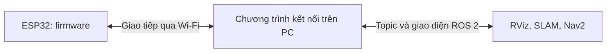

# Bài 9: ROS 2 qua mạng và kết nối ESP32

Từ đầu series, các chương trình của chúng ta chủ yếu chạy trên cùng một máy tính. Khi chuyển sang robot thật, cảm biến và phần mềm xử lý có thể nằm trên những thiết bị khác nhau, nên dữ liệu còn phải đi qua kết nối mạng.

Trong bài này, chúng ta sẽ thử talker và listener trên hai máy, rồi đối chiếu với đường giao tiếp giữa máy tính và ESP32 của bộ robot. Việc phân biệt hai trường hợp giúp chọn đúng nơi kiểm tra khi dữ liệu chưa tới được bên nhận.

## 1. Mục tiêu và hai tình huống cần phân biệt

Chúng ta sẽ chạy một ví dụ ROS 2 trên hai máy và tìm hiểu nó khác giao tiếp với ESP32 thế nào. Phần hai máy cần hai môi trường Ubuntu có ROS 2 Humble và kết nối cùng mạng; có thể đọc phần lý thuyết nếu chỉ có một máy.

| Tình huống | Những bên đang trao đổi |
| --- | --- |
| Hai máy chạy node ROS 2 | ROS 2 trên máy A ↔ ROS 2 trên máy B |
| Robot ESP32 LiDAR Robovis | Chương trình ROS 2 trên PC ↔ giao thức kết nối ↔ firmware ESP32 |

Trong trường hợp hai máy chạy ROS 2, các node sử dụng cơ chế giao tiếp của ROS 2. Với ESP32, thiết bị có thể trao đổi qua một giao thức do firmware và chương trình kết nối quy định. Vì vậy, việc có Wi-Fi và IP chưa cho biết ESP32 có tham gia quá trình tìm thấy node của ROS 2 hay không; chúng ta cần xem thiết kế sản phẩm.

## 2. Discovery và domain

Để trao đổi dữ liệu, các thành phần trước hết cần tìm thấy nhau. Trong cấu hình ROS 2 thông dụng, lớp phần mềm trung gian, gọi là **middleware**, thực hiện quá trình **discovery** để nhận biết các đầu gửi và nhận. Những đầu tương thích có thể trao đổi dữ liệu theo giao diện và QoS tương ứng.

Chúng ta sử dụng `ROS_DOMAIN_ID` để phân tách các nhóm giao tiếp ROS 2. Hai máy trong cùng bài thử cần đặt cùng giá trị để thuộc cùng nhóm. Giá trị domain phục vụ việc phân nhóm này; địa chỉ IP và cơ chế xác thực là những thông tin có vai trò khác.

`ROS_LOCALHOST_ONLY=1` giới hạn giao tiếp ROS trong máy theo cấu hình hỗ trợ. Khi thử hai máy, kiểm tra để không vô tình giữ thiết lập này.

## 3. Kiểm tra mạng trước ROS 2

Trước khi kiểm tra node, chúng ta xác nhận từng máy có địa chỉ và đường mạng phù hợp. Trên mỗi máy, chạy:

```bash
ip -4 addr
ip route
```

Ví dụ phòng học có máy A `192.168.1.51`, máy B `192.168.1.52`. Đây là địa chỉ minh họa; thay bằng IP của máy bạn rồi kiểm tra từ A:

```bash
ping -c 4 192.168.1.52
```

Phản hồi ping giúp xác nhận phép thử liên lạc IP cơ bản đã thành công. Để ROS 2 trao đổi được, mạng còn phải cho phép các luồng truyền mà middleware sử dụng, trong đó có thể có multicast phục vụ discovery. Vì vậy, sau khi kiểm tra IP, chúng ta tiếp tục thử trực tiếp talker/listener và xem cấu hình discovery, tường lửa nếu cần.

Với máy ảo, kiểm tra card mạng của Ubuntu. Chế độ NAT và bridge có thể tạo đường đi mạng khác nhau; máy ảo truy cập Internet được chưa chứng minh discovery giữa các máy đã thông.

## 4. Bài thử hai máy bằng talker/listener

Chúng ta dùng lại talker/listener của bài 2 để giảm số yếu tố mới trong phép thử. Chọn một mạng thử được phép sử dụng, rồi đặt cùng domain và cho phép giao tiếp ra ngoài localhost ở hai Terminal. Các lệnh `export` chỉ áp dụng cho Terminal hiện tại, không ghi vào `~/.bashrc`.

Trên **máy A**:

```bash
source /opt/ros/humble/setup.bash
export ROS_DOMAIN_ID=42
export ROS_LOCALHOST_ONLY=0
ros2 run demo_nodes_cpp talker
```

Trên **máy B**:

```bash
source /opt/ros/humble/setup.bash
export ROS_DOMAIN_ID=42
export ROS_LOCALHOST_ONLY=0
ros2 run demo_nodes_cpp listener
```

**Kết quả mong đợi:** B nhận chuỗi từ A. Giá trị `42` là lựa chọn cho bài thử, không phải cấu hình bắt buộc của robot Robovis. Khi quay về vận hành sản phẩm, dùng môi trường của bộ bàn giao.

Nếu đã thay domain trong phiên trước, daemon CLI có thể đang gắn với môi trường cũ. Có thể dừng daemon bằng `ros2 daemon stop` trong Terminal kiểm tra rồi chạy lại lệnh quan sát để tạo lại theo môi trường đang dùng. Việc này không sửa mạng và không thay thế kiểm tra talker/listener.

## 5. Xác định điểm không thông

Nếu B chưa nhận được chuỗi, chúng ta cần biết hai máy đã tìm thấy các thành phần của nhau chưa hay chỉ đang thiếu mẫu mới. Trước tiên, xem danh sách node, topic và thông tin đầu gửi, nhận ở phía B.

Trên B, mở Terminal quan sát với cùng hai biến ở trên:

```bash
ros2 node list
ros2 topic list -t
ros2 topic info /chatter --verbose
```

| Hiện tượng | Hướng kiểm tra |
| --- | --- |
| Không thấy node của A | Domain, localhost-only, middleware, discovery và mạng |
| Thấy topic nhưng không nhận mẫu | Publisher có phát mới không, kiểu và QoS có khớp không |
| Cùng máy chạy được, khác máy không | Card mạng, tường lửa, multicast, cấu hình RMW |
| Có nhiều nguồn `/chatter` | Các nhóm trong lớp có dùng trùng domain và tên không |

Kiểm tra `printenv RMW_IMPLEMENTATION` trên hai máy. Giá trị rỗng có thể có nghĩa đang dùng mặc định, không có nghĩa thiếu middleware. Trong bài chẩn đoán, dùng cùng bản ROS 2 và cùng cấu hình middleware đã biết giúp giảm số yếu tố cần xét. Nếu đặt RMW cụ thể, gói đó phải được cài.

Không tắt toàn bộ tường lửa để thử một cách kéo dài. Hãy xác định cấu hình và chính sách mạng của môi trường đang dùng.

## 6. Áp dụng đúng với Robot ESP32 LiDAR

Với Robot ESP32 LiDAR trong tài liệu bàn giao, robot gửi dữ liệu cảm biến về PC, rồi các chương trình trên PC tạo giao diện ROS 2 cho những phần mềm khác sử dụng. Khi kiểm tra, chúng ta cần xét riêng địa chỉ gửi dữ liệu trong firmware và nhóm giao tiếp ROS 2 trên PC. Thay `ROS_DOMAIN_ID` trên PC không tự thay địa chỉ đích của ESP32.



Với Wi-Fi mặc định, [hướng dẫn cấu hình sản phẩm](../../robot-esp32-lidar/02-chuan-bi/03-cau-hinh-wifi.md) dùng robot `192.168.4.1` và PC `192.168.4.99`. Khi dùng mạng ngoài, xem IP thực tế. Đây là cấu hình của sản phẩm, khác địa chỉ minh họa của bài hai máy.

Thực hiện [khởi động và kiểm tra dữ liệu](../../robot-esp32-lidar/03-van-hanh/02-khoi-dong-va-kiem-tra.md), lần lượt kiểm tra Wi-Fi/IP → chương trình kết nối → `/scan`, `/odom` → TF/RViz. Giữ cấu hình RMW và workspace theo [bài cài workspace](../../robot-esp32-lidar/02-chuan-bi/02-cai-dat-workspace.md).

Đọc thêm: [ROS 2 — Configuring environment](https://docs.ros.org/en/humble/Tutorials/Beginner-CLI-Tools/Configuring-ROS2-Environment.html).

## 7. Tổng kết { #8-tong-ket }

Kết nối mạng tạo đường truyền giữa các thiết bị, còn discovery, domain và QoS quyết định việc trao đổi giữa các thành phần ROS 2. Với robot ESP32, chúng ta còn phải kiểm tra lớp kết nối từ firmware đến chương trình trên PC. Sau khi dữ liệu đã tới nơi, bài tiếp theo sẽ giải thích cách xác định dữ liệu đó nằm trong hệ tọa độ nào.

[← Bài 8](08-dong-hoc-va-odometry.md) · [Bài 10: Hệ tọa độ và TF →](he-toa-do-va-tf.md)
