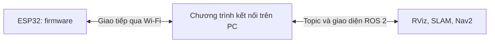

# Bài 9: ROS 2 qua mạng và kết nối ESP32

## 1. Mục tiêu và hai tình huống cần phân biệt

Chúng ta sẽ chạy một ví dụ ROS 2 trên hai máy và tìm hiểu nó khác giao tiếp với ESP32 thế nào. Phần hai máy cần hai môi trường Ubuntu có ROS 2 Humble và kết nối cùng mạng; có thể đọc phần lý thuyết nếu chỉ có một máy.

| Tình huống | Những bên đang trao đổi |
| --- | --- |
| Hai máy chạy node ROS 2 | ROS 2 trên máy A ↔ ROS 2 trên máy B |
| Robot ESP32 LiDAR Robovis | Chương trình ROS 2 trên PC ↔ giao thức kết nối ↔ firmware ESP32 |

Việc ESP32 có Wi-Fi và IP không tự làm nó tham gia discovery như một node trên PC. Muốn biết giao thức truyền thực tế, phải xem firmware và chương trình kết nối của sản phẩm.

## 2. Discovery và domain

Trong cấu hình ROS 2 thông dụng, middleware tìm các thành phần có thể trao đổi qua quá trình discovery. Sau khi nhận biết các đầu gửi/nhận, dữ liệu mới được trao đổi theo giao diện và QoS tương ứng.

`ROS_DOMAIN_ID` phân tách các nhóm giao tiếp. Hai máy trong cùng bài thử cần dùng cùng giá trị. Domain ID không phải địa chỉ IP và không phải cơ chế xác thực người dùng.

`ROS_LOCALHOST_ONLY=1` giới hạn giao tiếp ROS trong máy theo cấu hình hỗ trợ. Khi thử hai máy, kiểm tra để không vô tình giữ thiết lập này.

## 3. Kiểm tra mạng trước ROS 2

Trên mỗi máy:

```bash
ip -4 addr
ip route
```

Ví dụ phòng học có máy A `192.168.1.51`, máy B `192.168.1.52`. Đây là địa chỉ minh họa; thay bằng IP của máy bạn rồi kiểm tra từ A:

```bash
ping -c 4 192.168.1.52
```

Ping phản hồi cho thấy liên lạc IP cơ bản. ROS 2 còn phụ thuộc các luồng truyền mà middleware dùng, cấu hình discovery, tường lửa và khả năng mạng chuyển multicast. Vì vậy, ping thành công chưa đủ kết luận ROS 2 hoạt động.

Với máy ảo, kiểm tra card mạng của Ubuntu. Chế độ NAT và bridge có thể tạo đường đi mạng khác nhau; máy ảo truy cập Internet được chưa chứng minh discovery giữa các máy đã thông.

## 4. Bài thử hai máy bằng talker/listener

Trước tiên, dùng một mạng thử được phép sử dụng. Các lệnh `export` dưới đây chỉ đặt giá trị cho Terminal hiện tại, không thêm vào `~/.bashrc`.

Trên **máy A**:

```bash
source /opt/ros/humble/setup.bash
export ROS_DOMAIN_ID=42
export ROS_LOCALHOST_ONLY=0
ros2 run demo_nodes_cpp talker
```

Trên **máy B**:

```bash
source /opt/ros/humble/setup.bash
export ROS_DOMAIN_ID=42
export ROS_LOCALHOST_ONLY=0
ros2 run demo_nodes_cpp listener
```

**Kết quả mong đợi:** B nhận chuỗi từ A. Giá trị `42` là lựa chọn cho bài thử, không phải cấu hình bắt buộc của robot Robovis. Khi quay về vận hành sản phẩm, dùng môi trường của bộ bàn giao.

Nếu đã thay domain trong phiên trước, daemon CLI có thể đang gắn với môi trường cũ. Có thể dừng daemon bằng `ros2 daemon stop` trong Terminal kiểm tra rồi chạy lại lệnh quan sát để tạo lại theo môi trường đang dùng. Việc này không sửa mạng và không thay thế kiểm tra talker/listener.

## 5. Xác định điểm không thông

Trên B, mở Terminal quan sát với cùng hai biến ở trên:

```bash
ros2 node list
ros2 topic list -t
ros2 topic info /chatter --verbose
```

| Hiện tượng | Hướng kiểm tra |
| --- | --- |
| Không thấy node của A | Domain, localhost-only, middleware, discovery và mạng |
| Thấy topic nhưng không nhận mẫu | Publisher có phát mới không, kiểu và QoS có khớp không |
| Cùng máy chạy được, khác máy không | Card mạng, tường lửa, multicast, cấu hình RMW |
| Có nhiều nguồn `/chatter` | Các nhóm trong lớp có dùng trùng domain và tên không |

Kiểm tra `printenv RMW_IMPLEMENTATION` trên hai máy. Giá trị rỗng có thể có nghĩa đang dùng mặc định, không có nghĩa thiếu middleware. Trong bài chẩn đoán, dùng cùng bản ROS 2 và cùng cấu hình middleware đã biết giúp giảm số yếu tố cần xét. Nếu đặt RMW cụ thể, gói đó phải được cài.

Không tắt toàn bộ tường lửa để thử một cách kéo dài. Hãy xác định cấu hình và chính sách mạng của môi trường đang dùng.

## 6. Áp dụng đúng với Robot ESP32 LiDAR

Theo tài liệu bàn giao, robot gửi dữ liệu cảm biến về PC; các chương trình trên PC tạo giao diện ROS 2. Vì vậy, việc đặt `ROS_DOMAIN_ID` trên PC không tự đổi địa chỉ đích trong firmware ESP32.



Với Wi-Fi mặc định, [hướng dẫn cấu hình sản phẩm](../../robot-esp32-lidar/02-chuan-bi/03-cau-hinh-wifi.md) dùng robot `192.168.4.1` và PC `192.168.4.99`. Khi dùng mạng ngoài, xem IP thực tế. Đây là cấu hình của sản phẩm, khác địa chỉ minh họa của bài hai máy.

Thực hiện [khởi động và kiểm tra dữ liệu](../../robot-esp32-lidar/03-van-hanh/02-khoi-dong-va-kiem-tra.md), lần lượt kiểm tra Wi-Fi/IP → chương trình kết nối → `/scan`, `/odom` → TF/RViz. Giữ cấu hình RMW và workspace theo [bài cài workspace](../../robot-esp32-lidar/02-chuan-bi/02-cai-dat-workspace.md).

## 7. Bài tập

1. Đổi domain ở riêng B, dừng và chạy lại listener; sau đó đưa về cùng domain. Ghi sự khác nhau.
2. Vẽ hai lớp giao tiếp của robot ESP32 và ghi công cụ kiểm tra cho từng lớp.
3. PC ping robot được nhưng không có `/scan`: nêu hai kiểm tra tiếp theo mà không sửa thuật toán SLAM.

Đọc thêm: [ROS 2 — Configuring environment](https://docs.ros.org/en/humble/Tutorials/Beginner-CLI-Tools/Configuring-ROS2-Environment.html).

[← Bài 8](08-dong-hoc-va-odometry.md) · [Bài 10: Hệ tọa độ và TF →](he-toa-do-va-tf.md)
