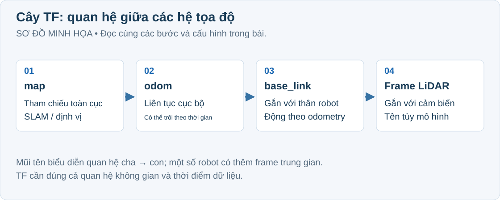
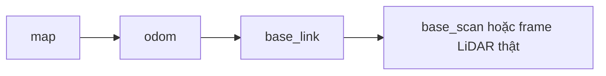

# Bài 10: Hệ tọa độ và TF

Giả sử LiDAR phát hiện một vật cách cảm biến 1 m về phía trước. Để đặt vật đó lên bản đồ, chúng ta còn cần biết cảm biến được lắp ở đâu trên thân và thân robot đang nằm ở đâu trong môi trường.

Đây là nhu cầu chuyển dữ liệu giữa các hệ tọa độ. Chúng ta sẽ bắt đầu bằng phép tính trên mặt phẳng, sau đó tìm hiểu cách TF quản lý các quan hệ này trong ROS 2.

## 1. Mục tiêu

Bạn sẽ đổi một điểm từ hệ tọa độ cảm biến sang thân robot, phân biệt `map`, `odom`, `base_link` và kiểm tra quan hệ TF theo thời gian. Bài tính có thể làm trên giấy; phần kiểm tra robot cần nguồn dữ liệu đã khởi động.

## 2. Frame là gốc và các trục

Một **hệ tọa độ (frame)** được xác định bởi gốc và các trục dùng để biểu diễn vị trí, hướng. Với cùng một vật, tọa độ tính từ LiDAR có thể khác tọa độ tính từ tâm thân robot, chẳng hạn khi LiDAR được đặt trước tâm 0,1 m. Vì vậy, mỗi phép đo cần đi cùng thông tin về frame chứa nó.

Quy ước thân robot thông dụng trong ROS là x trước, y trái, z lên; khoảng cách dùng mét và góc dùng radian. Chiều quay dương theo quy tắc bàn tay phải. Camera có thể có optical frame với quy ước khác, nên cần đọc tên frame và mô hình lắp đặt.

Trong mặt phẳng, pose của một frame so với frame khác có thể biểu diễn bằng `(x, y, theta)`. Trong không gian 3D, cần ba thành phần tịnh tiến và biểu diễn quay thích hợp.

## 3. Tịnh tiến và quay phải thực hiện đúng thứ tự

Để chuyển một điểm đo sang frame thân, chúng ta phải xét cả hướng lắp và vị trí lắp cảm biến. Giả sử frame LiDAR so với thân có độ lệch `(tx, ty)` và góc quay `theta`, còn điểm đo trong LiDAR là `(xL, yL)`. Khi đó, tọa độ trong thân được tính như sau:

```text
xB = cos(theta) × xL - sin(theta) × yL + tx
yB = sin(theta) × xL + cos(theta) × yL + ty
```

Trong công thức này, phần chứa sin và cos quay vector đo theo hướng của cảm biến, sau đó chúng ta cộng độ lệch gốc được biểu diễn theo hệ thân. Hai ví dụ dưới đây cho thấy vì sao cần thực hiện đủ cả phần quay và phần tịnh tiến.

### Ví dụ 1: cùng hướng

LiDAR nằm trước tâm thân `0,10 m`, không quay. Điểm `(1,0; 0)` m trong LiDAR trở thành `(1,10; 0)` m trong thân.

### Ví dụ 2: quay 90 độ

LiDAR vẫn ở trước `0,10 m` nhưng hướng x của nó quay trái 90°. Điểm `(1,0; 0)` m trở thành `(0,10; 1,0)` m trong thân. Chỉ cộng 0,10 vào x mà bỏ phép quay sẽ đặt vật sai vị trí.

Có thể kiểm tra bằng Python:

```python
from math import cos, sin


def doi_diem(x_lidar, y_lidar, tx, ty, theta):
    return (
        cos(theta) * x_lidar - sin(theta) * y_lidar + tx,
        sin(theta) * x_lidar + cos(theta) * y_lidar + ty,
    )
```

Kết quả chuyển đổi gồm các giá trị tọa độ mới cùng frame mà chúng được biểu diễn trong đó. Nếu chỉ thay tên `header.frame_id` mà giữ nguyên giá trị, chúng ta chưa thực hiện phép biến đổi và có thể khiến chương trình nhận hiểu sai vị trí vật.

## 4. Ghép nhiều phép biến đổi

Khi robot có nhiều bộ phận, chúng ta có thể biết từng quan hệ lân cận thay vì đo trực tiếp quan hệ giữa mọi cặp frame. Chẳng hạn, để đưa một điểm LiDAR vào bản đồ, ta có thể ghép các quan hệ từ cảm biến tới thân, rồi qua odom tới map:

<!-- tutorial-figure:tf-chuoi-frame -->
<figure class="tutorial-figure" markdown>

[](../../assets/illustrations/tf-chuoi-frame.svg)

<figcaption>Chuỗi frame thường gặp để đưa dữ liệu cảm biến vào bản đồ. Đối chiếu tên frame và các nhánh thực tế của robot đang chạy. Nhấp hình để xem lớn.</figcaption>
</figure>
<!-- /tutorial-figure:tf-chuoi-frame -->

```text
LiDAR → thân robot → odom → map
```

Trong cây frame, quan hệ thường được vẽ theo cha tới con:



Sơ đồ cây thường vẽ theo quan hệ cha tới con, còn việc đổi điểm bắt đầu từ frame nguồn và hướng tới frame đích. **TF** là hệ thống quản lý và tra cứu các quan hệ tọa độ trong ROS 2; nó có thể ghép các phép biến đổi và nghịch đảo cần thiết trên cây. Nhờ đó, chúng ta không phải tự phát một cạnh trực tiếp cho mọi cặp frame muốn sử dụng.

## 5. Vì sao cần cả `map` và `odom`?

Một nguồn ước lượng có thể cho chuyển động liên tục nhưng dần lệch khỏi vị trí thật. Nguồn định vị toàn cục lại có thể hiệu chỉnh vị trí khi nhận ra sai số. Hai nhu cầu này dẫn đến việc sử dụng các frame có vai trò khác nhau:

| Frame | Đặc điểm | Nguồn quan hệ thường gặp |
| --- | --- | --- |
| `base_link` | Gắn cứng với thân | Mô hình robot |
| `odom` | Cục bộ, liên tục, có thể trôi | Odometry hoặc bộ hợp nhất trạng thái |
| `map` | Tham chiếu toàn cục, có thể hiệu chỉnh vị trí | SLAM hoặc định vị |

Robot có thể đi mượt theo odometry nhưng lệch dần khỏi vị trí thật. Khi định vị nhận ra sai số, quan hệ `map → odom` được hiệu chỉnh. Nhờ tách hai frame, điều khiển cục bộ không cần coi một hiệu chỉnh toàn cục là chuyển động đột ngột của bánh xe.

Không mặc định mọi hệ thống dùng đúng một chuỗi duy nhất. Một số mô hình có thêm `base_footprint` hoặc frame trung gian. Tên và nguồn phát phải đối chiếu với workspace đang chạy.

## 6. Transform tĩnh và động

Phép biến đổi giữa hai frame được gọi là **transform**. Nếu LiDAR gắn cố định trên thân, quan hệ giữa hai bộ phận thường là transform tĩnh. Trong khi đó, `odom → base_link` thay đổi khi robot di chuyển nên là transform động. Các quan hệ tĩnh thường được đưa lên `/tf_static`, còn các quan hệ thay đổi được cập nhật trên `/tf`.

Mỗi frame con cần một cha nhất quán trong cây. Hai node cùng phát quan hệ mâu thuẫn cho một frame con có thể làm dữ liệu nhảy hoặc gây kết quả khó hiểu.

Khi nguồn odometry đã tồn tại, không thêm một static transform `odom → base_link` chỉ để làm RViz hết cảnh báo. Quan hệ đó cần thay đổi theo chuyển động thật.

## 7. Thời gian là một phần của TF

Robot có thể tiếp tục di chuyển sau khi LiDAR tạo một phép đo. Nếu dùng pose hiện tại để đặt một phép đo cũ lên bản đồ, vị trí điểm có thể bị sai. Vì vậy, TF còn lưu quan hệ theo thời gian để chương trình tra pose phù hợp với thời điểm dữ liệu được tạo.

| Lỗi | Điều nên kiểm tra |
| --- | --- |
| Frame không tồn tại | Tên thật, node phát quan hệ đã chạy chưa? |
| Hai frame thuộc hai cây rời | Quan hệ trung gian nào đang thiếu? |
| Yêu cầu thời điểm tương lai | Timestamp dữ liệu, đồng hồ và độ trễ TF |
| Dữ liệu quá cũ | Buffer, nguồn cảm biến bị ngừng, thời gian phát lại |

`use_sim_time` làm node sử dụng thời gian mô phỏng khi có `/clock`. Nếu một số node dùng thời gian thực và số khác dùng thời gian mô phỏng, topic có thể vẫn hiện nhưng tra TF thất bại.

## 8. Kiểm tra quan hệ

Sau khi [khởi động Robot ESP32 LiDAR](../../robot-esp32-lidar/03-van-hanh/02-khoi-dong-va-kiem-tra.md), dùng tên frame thật. Ví dụ nếu có `odom` và `base_link`:

```bash
ros2 run tf2_ros tf2_echo odom base_link
```

Quan sát tịnh tiến và quay, dùng `Ctrl+C` để dừng. Với dữ liệu tĩnh:

```bash
ros2 topic echo /tf_static --qos-durability transient_local --once
```

Tùy chọn durability giúp subscriber đến sau yêu cầu dữ liệu tĩnh đã được nguồn lưu. Có `/odom` không tự chứng minh có cạnh TF: message odometry và transform là hai giao diện cần được chương trình cung cấp đúng.

Đọc thêm: [REP 103](https://www.ros.org/reps/rep-0103.html), [REP 105](https://www.ros.org/reps/rep-0105.html), [ROS 2 — tf2](https://docs.ros.org/en/humble/Concepts/Intermediate/About-Tf2.html).

## 9. Tổng kết { #10-tong-ket }

Một giá trị tọa độ có ý nghĩa khi chúng ta biết frame và thời điểm của nó. TF giúp quản lý các quan hệ đó để chuyển dữ liệu từ cảm biến qua thân robot tới hệ tham chiếu cần dùng. Ở bài tiếp theo, chúng ta sẽ tạo mô hình nhỏ và dùng RViz để quan sát trực tiếp các frame cùng hình dạng robot.

[← Bài 9](09-ros2-qua-mang.md) · [Bài 11: RViz và mô hình robot →](03-rviz-va-tf.md)
