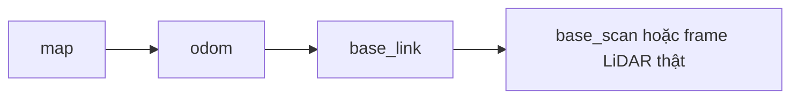

# Bài 10: Hệ tọa độ và TF

## 1. Mục tiêu

Bạn sẽ đổi một điểm từ hệ tọa độ cảm biến sang thân robot, phân biệt `map`, `odom`, `base_link` và kiểm tra quan hệ TF theo thời gian. Bài tính có thể làm trên giấy; phần kiểm tra robot cần nguồn dữ liệu đã khởi động.

## 2. Frame là gốc và các trục

Câu “vật ở trước 1 m” chưa cho biết phía trước bộ phận nào. Một LiDAR đặt trước tâm robot 0,1 m sẽ đo khoảng cách khác với tọa độ tính từ tâm thân.

Quy ước thân robot thông dụng trong ROS là x trước, y trái, z lên; khoảng cách dùng mét và góc dùng radian. Chiều quay dương theo quy tắc bàn tay phải. Camera có thể có optical frame với quy ước khác, nên cần đọc tên frame và mô hình lắp đặt.

Trong mặt phẳng, pose của một frame so với frame khác có thể biểu diễn bằng `(x, y, theta)`. Trong không gian 3D, cần ba thành phần tịnh tiến và biểu diễn quay thích hợp.

## 3. Tịnh tiến và quay phải thực hiện đúng thứ tự

Giả sử frame LiDAR so với thân robot có độ lệch `(tx, ty)` và góc quay `theta`. Điểm đo trong LiDAR là `(xL, yL)`. Tọa độ trong thân:

```text
xB = cos(theta) × xL - sin(theta) × yL + tx
yB = sin(theta) × xL + cos(theta) × yL + ty
```

Trước hết quay vector đo theo hướng cảm biến, sau đó cộng độ lệch gốc theo hệ thân.

### Ví dụ 1: cùng hướng

LiDAR nằm trước tâm thân `0,10 m`, không quay. Điểm `(1,0; 0)` m trong LiDAR trở thành `(1,10; 0)` m trong thân.

### Ví dụ 2: quay 90 độ

LiDAR vẫn ở trước `0,10 m` nhưng hướng x của nó quay trái 90°. Điểm `(1,0; 0)` m trở thành `(0,10; 1,0)` m trong thân. Chỉ cộng 0,10 vào x mà bỏ phép quay sẽ đặt vật sai vị trí.

Có thể kiểm tra bằng Python:

```python
from math import cos, sin


def doi_diem(x_lidar, y_lidar, tx, ty, theta):
    return (
        cos(theta) * x_lidar - sin(theta) * y_lidar + tx,
        sin(theta) * x_lidar + cos(theta) * y_lidar + ty,
    )
```

Đổi `header.frame_id` thành một tên mới không thực hiện phép tính trên. Nhãn frame và giá trị tọa độ phải nhất quán.

## 4. Ghép nhiều phép biến đổi

Một điểm từ LiDAR đi tới bản đồ có thể cần qua nhiều quan hệ:

```text
LiDAR → thân robot → odom → map
```

Trong cây frame, quan hệ thường được vẽ theo cha tới con:



Đây là hai cách diễn đạt khác nhau: cây mô tả quan hệ cha/con, còn khi đổi điểm ta tra phép biến đổi từ frame nguồn tới frame đích. TF có thể tính theo các cạnh và nghịch đảo thích hợp; không cần tự phát thêm cạnh nối trực tiếp mọi cặp.

## 5. Vì sao cần cả `map` và `odom`?

| Frame | Đặc điểm | Nguồn quan hệ thường gặp |
| --- | --- | --- |
| `base_link` | Gắn cứng với thân | Mô hình robot |
| `odom` | Cục bộ, liên tục, có thể trôi | Odometry hoặc bộ hợp nhất trạng thái |
| `map` | Tham chiếu toàn cục, có thể hiệu chỉnh vị trí | SLAM hoặc định vị |

Robot có thể đi mượt theo odometry nhưng lệch dần khỏi vị trí thật. Khi định vị nhận ra sai số, quan hệ `map → odom` được hiệu chỉnh. Nhờ tách hai frame, điều khiển cục bộ không cần coi một hiệu chỉnh toàn cục là chuyển động đột ngột của bánh xe.

Không mặc định mọi hệ thống dùng đúng một chuỗi duy nhất. Một số mô hình có thêm `base_footprint` hoặc frame trung gian. Tên và nguồn phát phải đối chiếu với workspace đang chạy.

## 6. Transform tĩnh và động

Vị trí LiDAR bắt cố định trên thân thường là transform tĩnh. Chuyển động `odom → base_link` là transform động. Quan hệ tĩnh thường được đưa lên `/tf_static`; các quan hệ thay đổi được cập nhật trên `/tf`.

Mỗi frame con cần một cha nhất quán trong cây. Hai node cùng phát quan hệ mâu thuẫn cho một frame con có thể làm dữ liệu nhảy hoặc gây kết quả khó hiểu.

Khi nguồn odometry đã tồn tại, không thêm một static transform `odom → base_link` chỉ để làm RViz hết cảnh báo. Quan hệ đó cần thay đổi theo chuyển động thật.

## 7. Thời gian là một phần của TF

Robot di chuyển trong lúc LiDAR đo. Muốn đưa phép đo vào bản đồ, cần biết pose tương ứng thời điểm đo. TF lưu các quan hệ theo thời gian và trả lời yêu cầu tra cứu khi có dữ liệu phù hợp.

| Lỗi | Điều nên kiểm tra |
| --- | --- |
| Frame không tồn tại | Tên thật, node phát quan hệ đã chạy chưa? |
| Hai frame thuộc hai cây rời | Quan hệ trung gian nào đang thiếu? |
| Yêu cầu thời điểm tương lai | Timestamp dữ liệu, đồng hồ và độ trễ TF |
| Dữ liệu quá cũ | Buffer, nguồn cảm biến bị ngừng, thời gian phát lại |

`use_sim_time` làm node sử dụng thời gian mô phỏng khi có `/clock`. Nếu một số node dùng thời gian thực và số khác dùng thời gian mô phỏng, topic có thể vẫn hiện nhưng tra TF thất bại.

## 8. Kiểm tra quan hệ

Sau khi [khởi động Robot ESP32 LiDAR](../../robot-esp32-lidar/03-van-hanh/02-khoi-dong-va-kiem-tra.md), dùng tên frame thật. Ví dụ nếu có `odom` và `base_link`:

```bash
ros2 run tf2_ros tf2_echo odom base_link
```

Quan sát tịnh tiến và quay, dùng `Ctrl+C` để dừng. Với dữ liệu tĩnh:

```bash
ros2 topic echo /tf_static --qos-durability transient_local --once
```

Tùy chọn durability giúp subscriber đến sau yêu cầu dữ liệu tĩnh đã được nguồn lưu. Có `/odom` không tự chứng minh có cạnh TF: message odometry và transform là hai giao diện cần được chương trình cung cấp đúng.

## 9. Bài tập

1. LiDAR nằm tại `(0,10; 0,05)` m trong thân, quay trái pi/2. Đổi điểm `(2; 0)` m. Kết quả gần `(0,10; 2,05)` m.
2. Chỉ có bringup cảm biến, chưa chạy SLAM: vì sao `map` có thể chưa tồn tại?
3. Trên robot thật, ghi frame cha/con và nguồn phát cho từng cạnh từ odom tới LiDAR.

Đọc thêm: [REP 103](https://www.ros.org/reps/rep-0103.html), [REP 105](https://www.ros.org/reps/rep-0105.html), [ROS 2 — tf2](https://docs.ros.org/en/humble/Concepts/Intermediate/About-Tf2.html).

[← Bài 9](09-ros2-qua-mang.md) · [Bài 11: RViz và mô hình robot →](03-rviz-va-tf.md)
