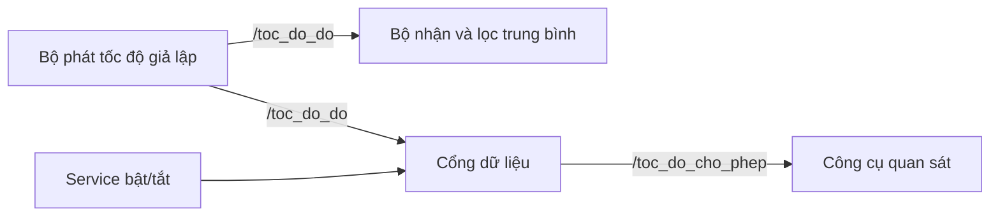

# Robot và ROS 2 cơ bản

Một robot tự hành phải thực hiện nhiều công việc cùng lúc: đọc cảm biến, ước lượng chuyển động, nhận lệnh, điều khiển bánh xe và hiển thị trạng thái. Học ROS 2 là học cách tổ chức những công việc đó thành các chương trình có thể trao đổi dữ liệu và được kiểm tra độc lập.

Trong phần này, chúng ta sẽ học từ các khái niệm đầu tiên đến cách viết chương trình, đọc dữ liệu và kiểm tra hệ thống robot. Các bài thực hành sử dụng Python trên **Ubuntu 22.04 và ROS 2 Humble**.

## 1. Bạn sẽ tự xây dựng được gì?

Chúng ta sẽ xây dựng một hệ thống đo tốc độ giả lập trên máy tính:

Từ ví dụ này, bạn sẽ biết tạo package, đăng ký executable, viết publisher/subscriber, dùng timer và callback, gọi service, truyền parameter và viết launch file. Sau đó, chúng ta dùng động học và TF để hiểu dữ liệu của robot thật.

Ví dụ giả lập chỉ tạo dữ liệu trên máy tính. Các chương trình có tên `bo_phat`, `bo_nhan` và `cong_du_lieu` là chương trình thực hành trong khóa học.

## 2. Kiến thức cần có

Bạn cần dùng được Terminal, đường dẫn và trình soạn thảo trên Ubuntu. Phần lập trình sử dụng hàm, lớp, danh sách và phép tính cơ bản của Python. Nếu chưa quen Ubuntu, hãy bắt đầu với [Ubuntu và công cụ](../../ubuntu-co-ban/index.md).

Mỗi Terminal cần nạp môi trường ROS 2. Từ bài 4 trở đi, Terminal chạy chương trình tự viết cần nạp thêm workspace thực hành. Hai thao tác này được giải thích trong bài 2 và bài 4.

## 3. Lộ trình học

| Bài | Nội dung | Sản phẩm cần đạt |
| --- | --- | --- |
| 1 | [Robot, kiến trúc phần mềm và ROS graph](00-robot-va-ros2.md) | Vẽ được luồng dữ liệu và lệnh của robot |
| 2 | [Môi trường, talker/listener và Turtlesim](chuan-bi-va-turtlesim.md) | Chạy được hai chương trình trao đổi dữ liệu |
| 3 | [Node, topic, message và công cụ kiểm tra](01-node-topic-va-lenh.md) | Tự tìm nguồn gửi, bên nhận và kiểu dữ liệu |
| 4 | [Workspace, publisher và subscriber bằng Python](06-workspace-va-node-python.md) | Tạo và chạy package có hai node |
| 5 | [Đọc dữ liệu vận tốc, LiDAR và odometry](02-cac-topic-cua-robot.md) | Giải thích được các trường của message |
| 6 | [Viết service, client và làm quen action](04-service-va-action.md) | Bật/tắt một luồng dữ liệu bằng yêu cầu |
| 7 | [Parameter, launch và namespace](05-parameter-va-launch.md) | Khởi động cả ví dụ bằng một lệnh |
| 8 | [Động học robot hai bánh và odometry](08-dong-hoc-va-odometry.md) | Tính vận tốc robot từ vận tốc bánh |
| 9 | [ROS 2 qua mạng và kết nối ESP32](09-ros2-qua-mang.md) | Phân biệt mạng ROS 2 với giao tiếp ESP32 |
| 10 | [Hệ tọa độ và TF](he-toa-do-va-tf.md) | Đổi một điểm từ frame LiDAR sang thân robot |
| 11 | [RViz, URDF và kiểm tra dữ liệu](03-rviz-va-tf.md) | Hiển thị được frame và tìm nguyên nhân lỗi |
| 12 | [Rosbag và bài thực hành tổng hợp](07-rosbag-va-xu-ly-loi.md) | Ghi dữ liệu, phát lại và lập báo cáo kiểm tra |

Không cần học hết 12 bài trước khi chạm vào robot. Tuy nhiên, hãy hoàn thành phần môi trường, đọc topic, động học và TF trước khi tự thay cấu hình SLAM hoặc Nav2.

## 4. Cách học từng bài

Đọc mục tiêu, chuẩn bị đúng chương trình cần chạy, thực hiện từng Terminal rồi đối chiếu kết quả. Khi gặp lỗi, giữ lại lệnh đã chạy và dòng lỗi đầu tiên. Chỉ thay một yếu tố trong mỗi lần kiểm tra để biết thay đổi nào tạo ra kết quả.

Các đoạn mã có ghi đường dẫn tệp. Chép toàn bộ khối khi bài yêu cầu tạo tệp mới; khi bài yêu cầu sửa một phần, đối chiếu đúng vị trí. Dùng workspace `~/ros2_practice_ws` cho ví dụ xuyên suốt để các bài sau tìm thấy package của bài trước.

## 5. Chuyển sang Robot ESP32 LiDAR

Khi đã hiểu luồng dữ liệu, hãy mở [tài liệu Robot ESP32 LiDAR](../../robot-esp32-lidar/index.md). Dùng workspace và launch của bộ bàn giao để kết nối phần cứng, sau đó học [SLAM](../../robot-esp32-lidar/05-lidar-slam-navigation/02-tao-ban-do-slam.md) và [Nav2](../../robot-esp32-lidar/05-lidar-slam-navigation/04-dieu-huong-nav2.md).

Các bài SLAM và điều hướng được trình bày trong mục sản phẩm, với thông số và lệnh chạy phù hợp với robot đang sử dụng.

[← Kiến thức nền](../index.md) · [Bắt đầu bài 1 →](00-robot-va-ros2.md)
