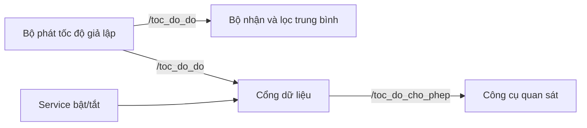

# Robot và ROS 2 cơ bản

Khi điều khiển một robot đi tới vị trí mong muốn, chúng ta chỉ nhìn thấy kết quả là bánh xe chuyển động. Bên trong hệ thống, nhiều công việc đang diễn ra: đọc cảm biến, ước lượng chuyển động, nhận lệnh và cập nhật trạng thái trên màn hình.

Nếu tách những công việc này thành các chương trình riêng, chúng sẽ trao đổi dữ liệu với nhau như thế nào? Làm sao biết phần nào đang hoạt động khi robot chưa đáp ứng đúng yêu cầu? Nhóm bài này giới thiệu ROS 2 từ những câu hỏi đó, rồi từng bước hướng dẫn viết chương trình và kiểm tra hệ thống. Các bài thực hành sử dụng Python trên **Ubuntu 22.04 và ROS 2 Humble**.

## 1. Bạn sẽ tự xây dựng được gì?

Để bắt đầu, chúng ta sử dụng một hệ thống đo tốc độ giả lập ngay trên máy tính. Một chương trình tạo các mẫu tốc độ, chương trình khác nhận và tính trung bình; sau đó, chúng ta bổ sung khả năng bật hoặc tắt việc chuyển tiếp dữ liệu.

Qua ví dụ này, chúng ta sẽ gặp các công việc thường có trong một dự án ROS 2: tổ chức mã trong package, tạo bên phát và bên nhận, gọi service để thay đổi trạng thái, rồi lưu cấu hình và khởi động hệ thống bằng launch file. Mỗi công cụ được giới thiệu khi ví dụ cần đến nó. Ở phần sau, chúng ta dùng động học và TF để hiểu thêm dữ liệu của robot thật.

Các chương trình `bo_phat`, `bo_nhan` và `cong_du_lieu` thuộc ví dụ thực hành này. Dữ liệu được tạo trên máy tính để chúng ta quan sát luồng trao đổi, chưa phải số đo từ bánh xe hoặc lệnh điều khiển động cơ.

## 2. Kiến thức cần có

Bạn cần dùng được Terminal, đường dẫn và trình soạn thảo trên Ubuntu. Phần lập trình sử dụng hàm, lớp, danh sách và phép tính cơ bản của Python. Nếu chưa quen Ubuntu, hãy bắt đầu với [Ubuntu và công cụ](../../ubuntu-co-ban/index.md).

Mỗi Terminal cần nạp môi trường ROS 2. Từ bài 4 trở đi, Terminal chạy chương trình tự viết cần nạp thêm workspace thực hành. Hai thao tác này được giải thích trong bài 2 và bài 4.

## 3. Lộ trình học

Lộ trình đi từ quan sát chương trình có sẵn đến tự xây dựng một luồng dữ liệu. Sau đó, chúng ta mới xét đơn vị đo, chuyển động, kết nối mạng và hệ tọa độ để liên hệ với robot thật.

| Bài | Nội dung | Sản phẩm cần đạt |
| --- | --- | --- |
| 1 | [Robot, kiến trúc phần mềm và ROS graph](00-robot-va-ros2.md) | Vẽ được luồng dữ liệu và lệnh của robot |
| 2 | [Môi trường, talker/listener và Turtlesim](chuan-bi-va-turtlesim.md) | Chạy được hai chương trình trao đổi dữ liệu |
| 3 | [Node, topic, message và công cụ kiểm tra](01-node-topic-va-lenh.md) | Tự tìm nguồn gửi, bên nhận và kiểu dữ liệu |
| 4 | [Workspace, publisher và subscriber bằng Python](06-workspace-va-node-python.md) | Tạo và chạy package có hai node |
| 5 | [Đọc dữ liệu vận tốc, LiDAR và odometry](02-cac-topic-cua-robot.md) | Giải thích được các trường của message |
| 6 | [Viết service, client và làm quen action](04-service-va-action.md) | Bật/tắt một luồng dữ liệu bằng yêu cầu |
| 7 | [Parameter, launch và namespace](05-parameter-va-launch.md) | Khởi động cả ví dụ bằng một lệnh |
| 8 | [Động học robot hai bánh và odometry](08-dong-hoc-va-odometry.md) | Tính vận tốc robot từ vận tốc bánh |
| 9 | [ROS 2 qua mạng và kết nối ESP32](09-ros2-qua-mang.md) | Phân biệt mạng ROS 2 với giao tiếp ESP32 |
| 10 | [Hệ tọa độ và TF](he-toa-do-va-tf.md) | Đổi một điểm từ frame LiDAR sang thân robot |
| 11 | [RViz, URDF và kiểm tra dữ liệu](03-rviz-va-tf.md) | Hiển thị được frame và tìm nguyên nhân lỗi |
| 12 | [Rosbag và bài thực hành tổng hợp](07-rosbag-va-xu-ly-loi.md) | Ghi dữ liệu, phát lại và lập báo cáo kiểm tra |

Không cần học hết 12 bài trước khi chạm vào robot. Tuy nhiên, hãy hoàn thành phần môi trường, đọc topic, động học và TF trước khi tự thay cấu hình SLAM hoặc Nav2.

## 4. Cách học từng bài

Với mỗi bài, hãy đọc tình huống và mục tiêu trước khi nhập lệnh. Sau khi chuẩn bị đúng các chương trình cần chạy, chúng ta thực hiện từng bước trong Terminal và đối chiếu kết quả. Nếu một bước chưa đạt, giữ lại lệnh cùng dòng lỗi đầu tiên, rồi kiểm tra từng yếu tố để biết thay đổi nào có tác dụng.

Các đoạn mã có ghi đường dẫn tệp. Chép toàn bộ khối khi bài yêu cầu tạo tệp mới; khi bài yêu cầu sửa một phần, đối chiếu đúng vị trí. Dùng workspace `~/ros2_practice_ws` cho ví dụ xuyên suốt để các bài sau tìm thấy package của bài trước.

## 5. Chuyển sang Robot ESP32 LiDAR

Khi đã hiểu luồng dữ liệu, hãy mở [tài liệu Robot ESP32 LiDAR](../../robot-esp32-lidar/index.md). Dùng workspace và launch của bộ bàn giao để kết nối phần cứng, sau đó học [SLAM](../../robot-esp32-lidar/05-lidar-slam-navigation/02-tao-ban-do-slam.md) và [Nav2](../../robot-esp32-lidar/05-lidar-slam-navigation/04-dieu-huong-nav2.md).

Các bài SLAM và điều hướng nằm trong mục sản phẩm để đi cùng thông số và lệnh chạy của robot đang sử dụng. Kiến thức trong nhóm bài này sẽ giúp chúng ta hiểu vai trò của từng chương trình và kiểm tra dữ liệu trước khi thay đổi cấu hình robot.

[← Kiến thức nền](../index.md) · [Bắt đầu bài 1 →](00-robot-va-ros2.md)
