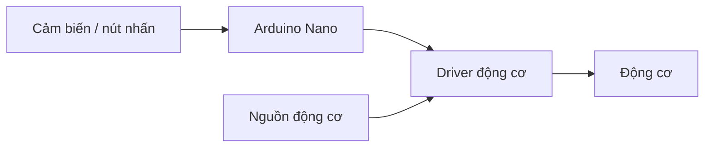

# Arduino và Arduino Nano là gì?

**Mục tiêu:** hiểu vai trò của Nano trong robot và các thao tác cần học.

## Từ mã lệnh đến chuyển động

Arduino là nền tảng giúp bạn lập trình bo vi điều khiển. Bạn viết mã trên máy tính, biên dịch rồi nạp vào bo. Bo có thể chạy chương trình khi được cấp nguồn, kể cả khi rút khỏi máy tính.

Trong robot, Nano đọc cảm biến, quyết định hành động và gửi tín hiệu tới driver động cơ. Động cơ lấy điện từ nguồn qua driver; chân Nano không cấp điện trực tiếp cho động cơ.

## Nhận diện Nano

Ví dụ dùng **Nano classic ATmega328P**: chân digital D0–D13, analog A0–A7, mức logic 5 V. A6/A7 chỉ là đầu vào analog. D0/RX và D1/TX dùng cho Serial, nên để trống khi học nạp qua USB. Đối chiếu pinout trong [tài liệu Nano của Arduino](https://docs.arduino.cc/hardware/nano/).

Nano tương thích có thể dùng CH340 và cổng USB khác bo gốc. Loại cổng không quyết định vi điều khiển hoặc bootloader. Nếu bo ghi Nano Every, Nano 33 hoặc Nano ESP32, cần hướng dẫn đúng dòng đó.

## Thuật ngữ cơ bản

| Từ | Ý nghĩa |
| --- | --- |
| Sketch | Chương trình Arduino, thường có tệp `.ino` |
| IDE | Ứng dụng viết, biên dịch và nạp mã |
| Board package / core | Gói hỗ trợ một họ bo |
| Library | Thư viện mã có sẵn để sử dụng linh kiện/tính năng |
| Verify | Biên dịch mã trên máy tính |
| Upload | Biên dịch rồi gửi mã vào bo |
| Port / COM | Cổng giao tiếp với bo |

**Tự kiểm tra:** tìm tên chip, GND và D13 trên bo hoặc pinout. Vì sao Verify thành công chưa chứng minh mã đã chạy trên Nano?

[Lộ trình](index.md) · [Bài tiếp: Chuẩn bị](02-chuan-bi.md)
