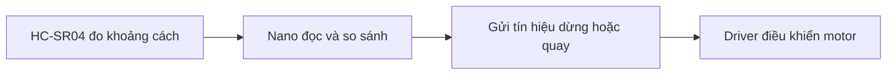

# Bài 1: Giới thiệu xe Arduino Nano

**Mục tiêu:** nhận diện các bộ phận và hiểu việc gì diễn ra khi bạn cho xe chạy. Bài này chỉ quan sát, chưa cần viết mã hoặc thay dây.

## Xe robot khác xe đồ chơi ở đâu?

Xe đồ chơi thường di chuyển theo lệnh từ người cầm điều khiển. Với xe Arduino, bạn còn có thể viết chương trình để xe đọc cảm biến và tự chọn hành động.

Ví dụ, muốn xe dừng khi gặp vật phía trước, chương trình cần làm ba việc: đọc khoảng cách, so với mức bạn chọn, rồi gửi lệnh dừng tới mạch động cơ. Nano là nơi thực hiện các quyết định đó.

## Robot và máy tính làm gì?

| Thành phần | Hiểu đơn giản | Việc bạn sẽ làm |
| --- | --- | --- |
| Máy tính | Nơi viết chương trình | Mở Arduino IDE, sửa mã và nhấn Upload |
| Arduino Nano | Bộ điều khiển trên xe | Nhận và thực hiện chương trình đã nạp |
| Driver động cơ | Mạch cấp điện và đổi chiều cho động cơ | Nhận các tín hiệu từ Nano |
| Cảm biến | Phần giúp xe nhận biết môi trường/chuyển động | Gửi dữ liệu về Nano |
| Nguồn pin | Cung cấp năng lượng | Cấp điện theo sơ đồ của bộ xe |

**Arduino IDE** là phần mềm bạn sẽ cài trên máy tính. **Nạp chương trình** là gửi mã từ máy tính vào Nano qua cáp USB. Sau khi nạp, rút USB không làm mất chương trình; Nano sẽ chạy lại khi được cấp nguồn.

## Bước 1. Tìm Nano và board mở rộng

Tắt công tắc robot trước khi cầm và kiểm tra. Tìm bo nhỏ có chữ **Nano**, chip vi điều khiển và cổng USB. Bo này thường cắm lên một board lớn hơn có nhiều hàng chân để nối dây: đó là **board mở rộng**.

Board mở rộng giúp chia các chân của Nano ra đầu nối thuận tiện. Nó không phải một Nano thứ hai. Các ký hiệu thường gặp:

| Ký hiệu | Dùng để làm gì? |
| --- | --- |
| D0, D1… | Chân tín hiệu của Nano; số là tên chân, không phải vị trí đếm từ mép bo |
| A0, A1… | Nhóm chân có thể dùng cho tín hiệu analog; một số bài cũng dùng chúng làm tín hiệu digital |
| GND hoặc G | Đường chung làm mốc cho điện áp/tín hiệu |
| VCC, V hoặc 5V | Đường nguồn; cần kiểm tra điện áp đúng board, không tự nối pin vào mọi chân có chữ V |

**Kết quả cần thấy:** bạn chỉ được Nano, cổng USB và board mở rộng. Đối chiếu [tài liệu Nano của Arduino](https://docs.arduino.cc/hardware/nano/) nếu chưa nhận ra bo. Bộ bài dùng Nano classic ATmega328P; Nano ESP32/Nano Every là các dòng khác.

## Bước 2. Nhận diện các bộ phận của xe

| Bộ phận trong bộ bàn giao | Vai trò | Bạn sẽ học ở bài |
| --- | --- | --- |
| Động cơ DC và bánh xe | Tạo chuyển động tiến, lùi, quay | [L298N](bai-giang/05-dong-co.md) |
| Driver động cơ | Cấp dòng tải và điều khiển chiều quay | [L298N](bai-giang/05-dong-co.md) |
| Servo SG90 | Quay gá cảm biến siêu âm sang các phía | [Servo](bai-giang/04-servo.md) |
| HC-SR04, có hai đầu tròn | Đo khoảng cách phía trước | [Siêu âm](bai-giang/06-hc-sr04.md) |
| Cảm biến dò line 5 mắt | Nhận biết vị trí đường line dưới xe | [Dò line](bai-giang/07-do-line.md) |
| Đĩa khe và module encoder | Đếm chuyển động quay của bánh | [Encoder](bai-giang/08-encoder.md) |
| Module Bluetooth HM-10 | Nhận lệnh từ điện thoại | [Bluetooth](bai-giang/09-bluetooth.md) |

Xem [ảnh khi nhận hàng](03-lap-rap.md) để nhận diện cụm siêu âm và servo. Không cần tháo dây để tìm linh kiện. Driver thực tế cần kiểm tra tên trên mạch: tài liệu có chỗ ghi L9110s nhưng mã bàn giao dùng các chân điều khiển L298N; xem [ghi chú sơ đồ](08-su-dung-robot.md) trước khi đấu lại.

## Bước 3. Theo dõi một lệnh của robot

Giả sử xe cần tránh một hộp phía trước:

Cảm biến không tự quyết định cho xe quay. Driver không tự biết hộp ở đâu. **Chương trình trên Nano** nối hai việc đó với nhau.

Nguồn pin cấp điện cho động cơ qua driver. Chân tín hiệu của Nano chỉ gửi lệnh, không đủ để nối động cơ trực tiếp. Vì vậy bạn sẽ thấy cả **dây nguồn** và **dây tín hiệu** trên robot.

## Bước 4. Làm quen các từ trong Arduino IDE

| Từ sẽ thấy | Ý nghĩa |
| --- | --- |
| Sketch | Một chương trình Arduino; tệp chính có đuôi .ino |
| Verify, biểu tượng dấu kiểm | Kiểm tra mã và chuyển mã thành dạng có thể nạp |
| Upload, biểu tượng mũi tên | Gửi chương trình vào Nano |
| Port hoặc COM | Cổng máy tính đang dùng để nói chuyện với Nano |
| Library, thư viện | Bộ lệnh có sẵn cho một linh kiện/tính năng |

Bạn chưa cần ghi nhớ mọi từ. Khi gặp lại trong bài cài đặt, hãy quay về bảng này.

## Khi nào hoàn thành?

- Bạn tìm được Nano, driver, cảm biến và nguồn trên xe.
- Bạn giải thích được máy tính viết/nạp mã, còn Nano chạy mã.
- Bạn biết cần driver để điều khiển động cơ.

**Bài tập:** chọn một chức năng như dò line hoặc điều khiển điện thoại. Kể tên bộ phận nhận dữ liệu, Nano và bộ phận thực hiện chuyển động.

Nếu máy chưa có công cụ, mở [Chuẩn bị](02-chuan-bi.md) và [Cài Arduino IDE](05-cai-arduino-ide.md). Khi đã nạp thử thành công, chuyển sang [Bài 2: Lập trình đầu tiên](bai-giang/02-lap-trinh.md).

[Lộ trình](index.md) · [Bài tiếp](bai-giang/02-lap-trinh.md)
