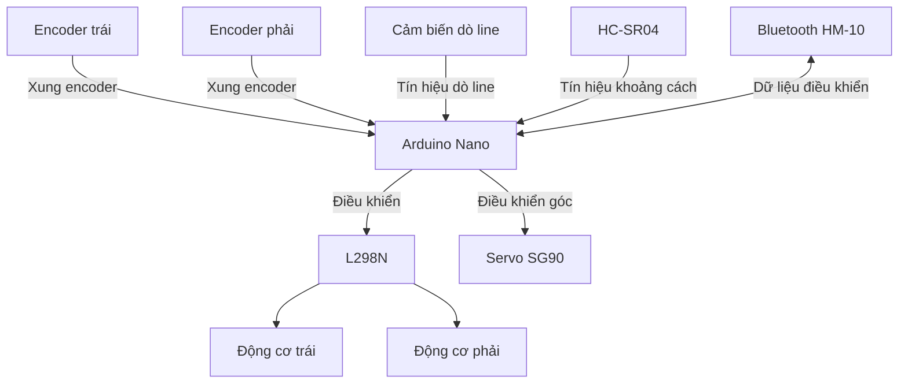
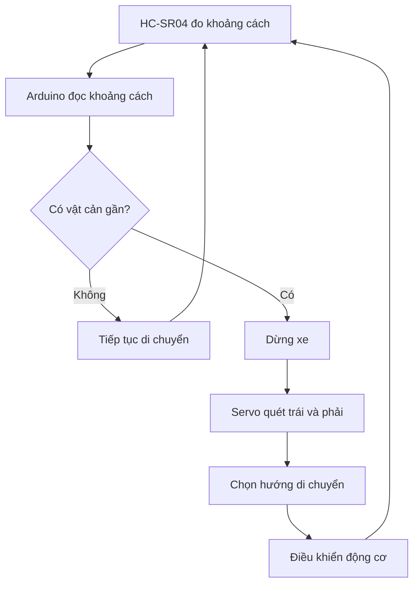

# Bài 1: Tổng quan về xe Robot Arduino Nano

## 1. Giới thiệu

Trong chuỗi bài học này, chúng ta sẽ cùng tìm hiểu và lập trình một chiếc **xe robot sử dụng Arduino Nano**.

Xe được trang bị các động cơ, cảm biến và module giao tiếp, cho phép thực hiện nhiều chức năng như điều khiển di chuyển, phát hiện vật cản, dò đường line và điều khiển từ xa bằng điện thoại.

Thông qua các bài học, chúng ta sẽ lần lượt tìm hiểu cách hoạt động của từng linh kiện, cách kết nối với Arduino và cách lập trình để kết hợp chúng thành một hệ thống robot hoàn chỉnh.

Sau khi hoàn thành chuỗi bài học, bạn có thể xây dựng các chức năng:

- Điều khiển xe tiến, lùi, rẽ trái, rẽ phải và dừng.
- Điều chỉnh tốc độ động cơ bằng tín hiệu PWM.
- Đo khoảng cách và phát hiện vật cản bằng cảm biến siêu âm.
- Điều khiển servo để xoay cảm biến sang các hướng khác nhau.
- Lập trình xe tự động di chuyển theo đường line.
- Điều khiển xe từ xa bằng điện thoại thông qua Bluetooth.
- Đo tốc độ và quãng đường di chuyển bằng cảm biến encoder.
- Ứng dụng thuật toán PID để điều khiển chuyển động ổn định hơn.

Bài học đầu tiên sẽ giúp bạn làm quen với cấu tạo, chức năng và nguyên lý hoạt động tổng thể của xe trước khi bắt đầu lập trình.

## 2. Các thành phần chính của xe

### 2.1. Bộ điều khiển Arduino Nano

**Arduino Nano** là bộ điều khiển trung tâm của xe robot, sử dụng vi điều khiển ATmega328P.

Arduino có nhiệm vụ nhận dữ liệu từ các cảm biến, xử lý chương trình và gửi tín hiệu điều khiển đến các thiết bị khác.

Các chức năng chính:

- Đọc tín hiệu từ cảm biến siêu âm, cảm biến dò line và encoder.
- Điều khiển tốc độ và chiều quay của động cơ.
- Điều khiển góc quay của servo.
- Nhận lệnh điều khiển từ module Bluetooth.
- Thực hiện các thuật toán điều khiển tự động.

Arduino Nano được kết nối với máy tính thông qua cáp USB để nạp chương trình.

Sau khi nạp thành công, chương trình được lưu trong bộ nhớ của Arduino và có thể hoạt động độc lập khi xe được cấp nguồn.

### 2.2. Board mở rộng Arduino Nano

Board mở rộng là mạch giúp kết nối các chân của Arduino Nano với những linh kiện bên ngoài thuận tiện hơn.

Các chân trên board thường được chia thành những nhóm:

| Ký hiệu | Chức năng |
|---|---|
| D0 – D13 | Các chân tín hiệu Digital |
| A0 – A7 | Các chân Analog, trong đó A0 – A5 có thể sử dụng làm Digital |
| 5V | Nguồn điện áp 5V |
| GND | Chân nối đất, mốc điện áp chung |
| VIN | Đầu vào nguồn ngoài theo thông số của board |

Nhờ board mở rộng, chúng ta có thể kết nối nhiều cảm biến và thiết bị mà không cần hàn trực tiếp lên Arduino Nano.

**Lưu ý:** Cần kiểm tra ký hiệu và điện áp trên board mở rộng trước khi đấu nối nguồn.

### 2.3. Động cơ giảm tốc DC

Xe sử dụng **2 động cơ giảm tốc DC màu vàng (TT Motor)** để tạo chuyển động cho hai bánh xe.

Mỗi động cơ được điều khiển độc lập, cho phép xe thực hiện các chuyển động:

- Tiến và lùi.
- Rẽ trái và rẽ phải.
- Quay tại chỗ.
- Điều chỉnh tốc độ di chuyển.

Động cơ DC hoạt động dựa trên điện áp cấp vào. Khi đảo chiều điện áp đặt lên hai cực động cơ, chiều quay của động cơ sẽ thay đổi.

Để điều khiển động cơ bằng Arduino, chúng ta cần sử dụng thêm mạch driver.

### 2.4. Module điều khiển động cơ L298N

**L298N** là module driver dùng để điều khiển hai động cơ DC.

Arduino Nano không thể cấp trực tiếp dòng điện đủ lớn để vận hành động cơ. Vì vậy, L298N đóng vai trò trung gian giữa Arduino, nguồn điện và động cơ.

Các chức năng:

- Điều khiển chiều quay của từng động cơ.
- Điều chỉnh tốc độ bằng tín hiệu PWM.
- Điều khiển hai động cơ độc lập.

Arduino gửi tín hiệu điều khiển đến L298N, sau đó L298N cấp điện cho các động cơ theo lệnh nhận được.

### 2.5. Cảm biến siêu âm HC-SR04

**HC-SR04** là cảm biến dùng để đo khoảng cách từ xe đến vật thể phía trước.

Cảm biến có hai đầu phát và thu sóng siêu âm.

Nguyên lý hoạt động:

1. Cảm biến phát một xung siêu âm.
2. Sóng siêu âm truyền đi và phản xạ khi gặp vật cản.
3. Cảm biến nhận tín hiệu phản xạ.
4. Arduino đo thời gian truyền và nhận để tính khoảng cách.

Ứng dụng:

- Phát hiện vật cản phía trước.
- Tự động dừng xe khi đến gần vật cản.
- Kết hợp servo để quét và lựa chọn hướng di chuyển.

### 2.6. Động cơ Servo SG90

**Servo SG90** là động cơ có khả năng điều khiển đến một góc xác định.

Khác với động cơ DC quay liên tục, servo thông thường được sử dụng để điều khiển vị trí góc.

Trên xe robot, servo được dùng để xoay cảm biến HC-SR04 sang các hướng khác nhau.

Ví dụ:

- Quay sang trái để đo khoảng cách.
- Quay về giữa để đo khoảng cách phía trước.
- Quay sang phải để đo khoảng cách.

Thông qua đó, xe có thể quan sát nhiều hướng mà không cần xoay toàn bộ thân xe.

### 2.7. Cảm biến dò line 5 mắt TCRT5000

Xe sử dụng **module cảm biến dò line 5 mắt TCRT5000** được lắp ở phía dưới thân xe.

Module gồm 5 cảm biến hồng ngoại có nhiệm vụ phát hiện sự khác biệt về phản xạ ánh sáng giữa bề mặt sáng và tối.

Các chức năng:

- Phát hiện đường line đen trên nền trắng hoặc ngược lại.
- Xác định vị trí tương đối của đường line so với xe.
- Cung cấp dữ liệu để Arduino điều chỉnh hướng di chuyển.

Ví dụ, khi đường line lệch sang trái, Arduino có thể điều chỉnh tốc độ hai bánh để đưa xe trở lại đường line.

### 2.8. Module encoder ngoài

Xe sử dụng **2 module cảm biến encoder ngoài**, mỗi module dùng để đo chuyển động quay của một bánh xe.

Khác với động cơ tích hợp encoder, động cơ vàng trên xe không có bộ đo tốc độ bên trong.

Thay vào đó, chúng ta sử dụng đĩa encoder gắn với trục bánh xe và cảm biến đặt bên ngoài.

Khi bánh xe quay, các khe trên đĩa lần lượt đi qua cảm biến và tạo ra các xung tín hiệu.

Arduino đếm số xung để xác định:

- Số vòng quay của bánh xe.
- Tốc độ quay của từng bánh.
- Quãng đường xe đã di chuyển.

Dữ liệu encoder còn được sử dụng để xây dựng thuật toán điều khiển PID, giúp hai bánh xe duy trì tốc độ mong muốn.

**Lưu ý:** Encoder một kênh chỉ cung cấp xung quay, không tự xác định được chiều quay. Khi tính quãng đường có dấu, chương trình cần kết hợp với chiều điều khiển động cơ.

### 2.9. Module Bluetooth HM-10

**HM-10** là module giao tiếp Bluetooth Low Energy (BLE), cho phép Arduino trao đổi dữ liệu không dây với điện thoại.

Trong bộ xe này, HM-10 được sử dụng để nhận lệnh điều khiển từ ứng dụng **Dabble** trên điện thoại.

Các chức năng:

- Điều khiển xe tiến, lùi, rẽ trái và rẽ phải.
- Điều chỉnh tốc độ theo chương trình.
- Điều khiển servo từ xa.
- Thực hiện các chức năng khác thông qua dữ liệu nhận được.

Arduino nhận dữ liệu từ HM-10, phân tích lệnh và điều khiển các thiết bị tương ứng.

### 2.10. Bộ nguồn

Bộ nguồn cung cấp năng lượng cho Arduino, driver động cơ và các linh kiện trên xe.

Trong quá trình hoạt động, động cơ thường tiêu thụ dòng điện lớn hơn các cảm biến và bộ điều khiển.

Vì vậy, hệ thống cần được cấp nguồn đúng điện áp và đủ dòng điện.

Khi đấu nối cần lưu ý:

- Kiểm tra cực dương và cực âm của nguồn.
- Không cấp điện áp vượt quá giới hạn cho phép của linh kiện.
- Các mạch trao đổi tín hiệu cần có GND chung.
- Không cấp nguồn động cơ trực tiếp từ chân tín hiệu Arduino.

## 3. Sơ đồ kết nối phần cứng

Các linh kiện trên xe được kết nối với Arduino Nano theo sơ đồ chân dưới đây.

### 3.1. Bảng kết nối

| Linh kiện | Chân thiết bị | Chân Arduino Nano |
|---|---|---|
| L298N | ENA | D5 |
| L298N | IN1 | D0 |
| L298N | IN2 | D1 |
| L298N | ENB | D6 |
| L298N | IN3 | D4 |
| L298N | IN4 | D7 |
| Encoder trái | OUT | D2 |
| Encoder phải | OUT | D3 |
| Cảm biến dò line | OUT1 | D8 |
| Cảm biến dò line | OUT2 | D9 |
| Cảm biến dò line | OUT3 | D10 |
| Cảm biến dò line | OUT4 | D11 |
| Cảm biến dò line | OUT5 | D12 |
| HC-SR04 | TRIG | A0 |
| HC-SR04 | ECHO | A1 |
| Servo SG90 | Signal | A5 |

**Lưu ý:** Bảng trên là sơ đồ chân tín hiệu theo cấu hình xe. Các chân VCC, GND và đường cấp nguồn cho driver cần kết nối theo đúng điện áp của từng module.

Chân D0 và D1 của Arduino Nano đồng thời được sử dụng cho giao tiếp Serial qua USB. Vì vậy, nếu gặp lỗi khi nạp chương trình, cần kiểm tra các thiết bị đang kết nối với hai chân này.

Module HM-10 cần được đấu vào các chân giao tiếp Serial phù hợp với chương trình sử dụng. Chân kết nối cụ thể sẽ được trình bày trong bài học Bluetooth.

### 3.2. Sơ đồ nguyên lý hoạt động

Trong sơ đồ này, Arduino Nano là trung tâm xử lý, còn các cảm biến và module ngoại vi đảm nhiệm những chức năng riêng.

## 4. Nguyên lý hoạt động của xe

Về cơ bản, xe robot hoạt động theo ba bước:

**Bước 1: Thu thập dữ liệu**

Arduino nhận tín hiệu từ các cảm biến hoặc lệnh điều khiển từ điện thoại.

**Bước 2: Xử lý dữ liệu**

Chương trình trên Arduino phân tích thông tin và xác định hành động cần thực hiện.

**Bước 3: Điều khiển chuyển động**

Arduino gửi tín hiệu đến driver động cơ hoặc servo để thực hiện hành động.

Ví dụ, khi lập trình xe tự động tránh vật cản:

Qua ví dụ trên, có thể thấy cảm biến chỉ có nhiệm vụ thu thập thông tin. Arduino thực hiện xử lý và quyết định hành động, còn driver và động cơ thực hiện chuyển động.

## 5. Các chức năng có thể lập trình

Sau khi tìm hiểu từng linh kiện, chúng ta sẽ kết hợp chúng để xây dựng những chức năng hoàn chỉnh.

| Chức năng | Linh kiện sử dụng |
|---|---|
| Điều khiển xe tiến, lùi và rẽ | Arduino, L298N, động cơ DC |
| Điều chỉnh tốc độ | Arduino, L298N |
| Đo khoảng cách vật cản | HC-SR04 |
| Quét vật cản trái/phải | HC-SR04, Servo SG90 |
| Xe tự động tránh vật cản | HC-SR04, Servo, L298N |
| Xe tự động dò line | TCRT5000, L298N |
| Điều khiển xe bằng điện thoại | HM-10, L298N |
| Đo tốc độ và quãng đường | Encoder ngoài |
| Điều khiển tốc độ bằng PID | Encoder, L298N |

Các chức năng sẽ được hướng dẫn từ cơ bản đến nâng cao trong những bài học tiếp theo.

## 6. Nội dung các bài học tiếp theo

Sau bài tổng quan, chúng ta sẽ lần lượt thực hành:

1. Cài đặt Arduino IDE và nạp chương trình đầu tiên.
2. Tìm hiểu cấu trúc chương trình Arduino.
3. Điều khiển động cơ DC bằng L298N.
4. Điều khiển servo SG90.
5. Đọc khoảng cách bằng cảm biến HC-SR04.
6. Đọc cảm biến dò line TCRT5000.
7. Đọc xung encoder và tính tốc độ bánh xe.
8. Điều khiển xe bằng Bluetooth HM-10 và ứng dụng Dabble.
9. Kết hợp các cảm biến để xây dựng chức năng điều khiển tự động.

Mỗi bài học sẽ bao gồm phần giới thiệu nguyên lý, sơ đồ kết nối, chương trình mẫu và hướng dẫn thực hành.

## 7. Tổng kết

Qua bài học này, chúng ta đã tìm hiểu được:

- Cấu tạo và các thành phần chính của xe Arduino Nano.
- Chức năng của từng động cơ, cảm biến và module.
- Sơ đồ kết nối tín hiệu giữa Arduino và các linh kiện.
- Nguyên lý thu thập dữ liệu, xử lý và điều khiển chuyển động.
- Những chức năng có thể phát triển trên xe robot.

Ở bài tiếp theo, chúng ta sẽ bắt đầu với việc **cài đặt Arduino IDE, kết nối Arduino Nano với máy tính và nạp chương trình đầu tiên** để làm quen với quy trình lập trình robot.