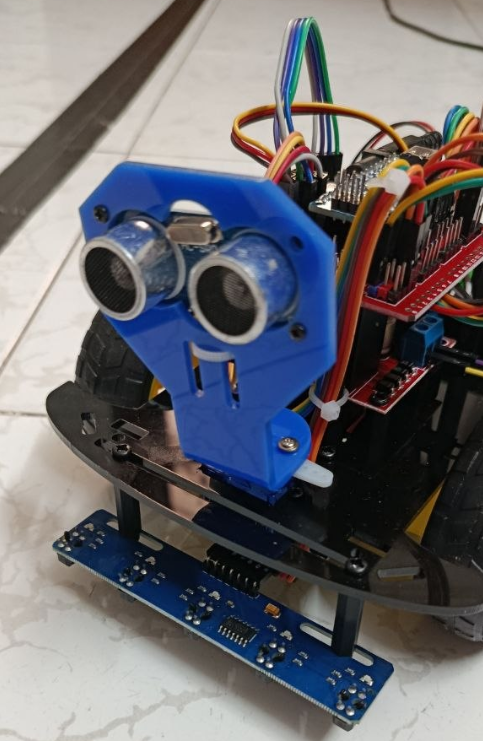
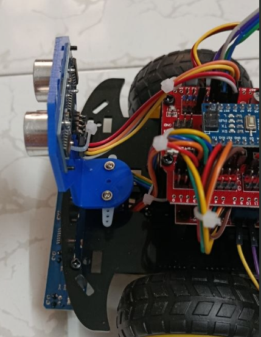
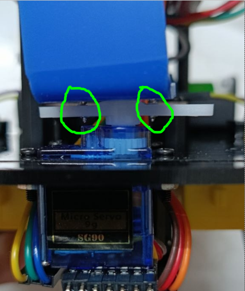

# Lắp cảm biến khi nhận robot và thực hành đấu nối

**Mục tiêu:** lắp lại phần tháo khi vận chuyển theo tài liệu bàn giao; sau đó có thể học đấu mạch với Nano riêng.

## Lắp lại cảm biến robot

Theo [HD lắp đặt khi nhận hàng](https://docs.google.com/document/d/1v15Tzh_bDJ4Tez326MCeS8L-1pQc-sz2sl5fraLJJmo/edit), cảm biến được tháo để bảo đảm vận chuyển. Tắt nguồn, lắp HC-SR04 và gá servo ở đầu xe, cảm biến dò line phía dưới đầu xe như ảnh gốc:

{ width="420" }

{ width="420" }

Siết ốc gá siêu âm vừa đủ giữ gá. Không vặn quá sâu vì ốc có thể chạm vỏ servo, khiến servo kẹt khi quay. Kiểm tra khoảng hở như ảnh:

{ width="420" }

Nối lại dây theo [bảng chân robot](08-su-dung-robot.md). Không suy ra chân từ màu dây. Kiểm tra dây không vướng bánh/cụm servo trước khi cấp nguồn.

## Mạch rời với Nano riêng

!!! warning "Không cắm LED/nút vào robot đang đấu sẵn"
    D4 điều khiển driver, D2 đọc encoder trong bộ mã bàn giao. Mạch dưới chỉ dùng khi đã tháo Nano khỏi board robot và ngắt mọi kết nối robot. Sau bài học, tháo mạch rời và khôi phục sơ đồ sản phẩm.

## Đấu LED

Rút USB và tắt nguồn trước khi đổi dây:

```text
Nano D4 → điện trở 330 Ω–1 kΩ → anode LED
cathode LED → Nano GND
```

LED mới thường có chân dài là anode (+), chân ngắn là cathode (−); mép phẳng thường đánh dấu cathode. Nếu chân đã cắt, xem dấu hoặc kiểm tra bằng đồng hồ. Điện trở mắc nối tiếp để hạn dòng; không nối LED trực tiếp từ GPIO xuống GND.

## Đấu nút nhấn

Nối hai phía tiếp điểm của nút với **D2** và **GND**. Mã sẽ dùng `INPUT_PULLUP`, không cần nối nút lên 5V.

Nút bốn chân có hai cặp nối sẵn. Xác định bằng đồng hồ hoặc sơ đồ linh kiện; nếu chọn hai chân cùng cặp, mã luôn thấy nút đang nhấn. Có thể dùng hai dây chạm nhau để kiểm tra trước.

## Kiểm tra trước khi cấp điện

- Hai hàng chân Nano không nằm cùng nhóm nối trên breadboard.
- LED có điện trở nối tiếp, cathode về GND.
- D2 chỉ nối với GND khi nhấn nút.
- 5V không chạm GND, nguồn động cơ vẫn ngắt.

**Kết quả:** mạch sẵn sàng cho bài tiếp. LED chưa sáng khi chưa có mã điều khiển là bình thường.

[Bài trước](06-cai-thu-vien.md) · [Bài tiếp: Lập trình](04-lap-trinh.md)
