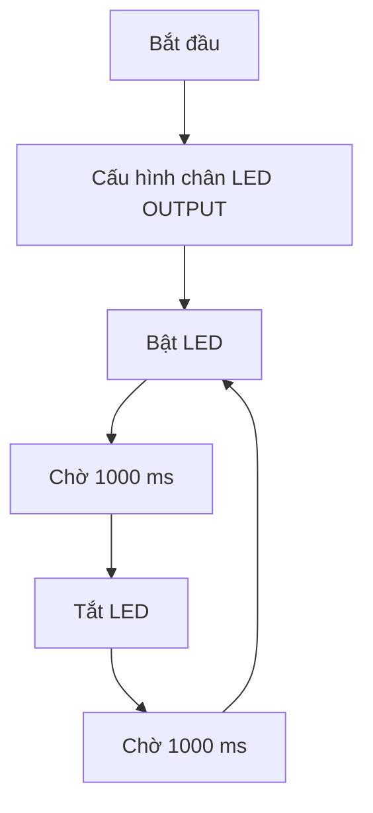

# Bài 3: Điều khiển đèn LED bằng Arduino Nano

## 1. Giới thiệu

Trong bài học trước, chúng ta đã làm quen với cấu trúc chương trình Arduino, cách nạp chương trình và sử dụng Serial Monitor để theo dõi dữ liệu.

Ở bài học này, chúng ta sẽ bắt đầu thực hành **điều khiển thiết bị đầu ra bằng Arduino Nano** thông qua một ví dụ đơn giản: bật, tắt và điều khiển đèn LED nhấp nháy.

Thông qua bài học, chúng ta sẽ tìm hiểu:

- Nguyên lý hoạt động cơ bản của đèn LED.
- Cách sử dụng đèn LED tích hợp trên Arduino Nano.
- Cách cấu hình chân Digital ở chế độ OUTPUT.
- Cách sử dụng `digitalWrite()` để điều khiển tín hiệu HIGH và LOW.
- Cách sử dụng `delay()` để điều chỉnh thời gian bật, tắt.
- Cách tạo các hiệu ứng nhấp nháy LED đơn giản.

Sau khi hoàn thành, bạn sẽ hiểu được cách Arduino điều khiển một thiết bị đầu ra thông qua các chân Digital.

## 2. Chuẩn bị

Để thực hiện bài học, chúng ta cần chuẩn bị:

- Board Arduino Nano.
- Máy tính đã cài đặt Arduino IDE.
- Cáp USB có khả năng truyền dữ liệu.

Trong bài học này, chúng ta sử dụng **đèn LED tích hợp trên Arduino Nano**, vì vậy chưa cần kết nối thêm linh kiện bên ngoài.

Nếu Arduino Nano đang được lắp trên xe robot, nên thực hành với Nano độc lập. Trường hợp giữ Nano trên xe, cần đảm bảo động cơ không được cấp nguồn và các chân D0, D1 đã được ngắt khỏi driver để tránh ảnh hưởng đến quá trình nạp chương trình.

## 3. Tìm hiểu về đèn LED

### 3.1. LED là gì?

LED (Light Emitting Diode) là một loại diode có khả năng phát sáng khi có dòng điện chạy qua theo chiều thuận.

LED được sử dụng phổ biến trong các mạch điện tử để:

- Hiển thị trạng thái hoạt động của thiết bị.
- Báo hiệu khi có sự kiện xảy ra.
- Hiển thị trạng thái kết nối hoặc truyền dữ liệu.
- Hỗ trợ kiểm tra và tìm lỗi chương trình.

Trên các hệ thống robot, LED có thể được sử dụng để báo trạng thái nguồn, chế độ điều khiển hoặc cảnh báo khi phát hiện vật cản.

### 3.2. Các đèn LED trên Arduino Nano

Trên Arduino Nano thường có một số đèn LED với chức năng khác nhau.

| Đèn LED | Chức năng |
|---|---|
| PWR | Báo trạng thái cấp nguồn |
| TX | Báo hoạt động truyền dữ liệu Serial |
| RX | Báo hoạt động nhận dữ liệu Serial |
| L | Đèn LED tích hợp có thể điều khiển bằng chương trình |

Trong bài học này, chúng ta sẽ sử dụng đèn **L**.

<AsyncImage query="Arduino Nano classic ATmega328P board close up built in L LED D13 labels" aspectRatio="5:3" maxWidth="420px"/>

Trên Arduino Nano classic, đèn LED L được kết nối với chân Digital D13 thông qua mạch điện trở hạn dòng trên board.

Vì vậy, chúng ta có thể điều khiển đèn mà không cần đấu nối thêm LED hoặc điện trở bên ngoài.

## 4. Nguyên lý điều khiển LED bằng Arduino

Arduino Nano có thể điều khiển trạng thái các chân Digital thông qua chương trình.

Khi một chân được cấu hình ở chế độ OUTPUT, Arduino có thể xuất hai mức tín hiệu:

| Mức tín hiệu | Điện áp logic | Ý nghĩa |
|---|---|---|
| HIGH | Gần 5V | Mức logic cao |
| LOW | Gần 0V | Mức logic thấp |

Đối với LED L trên Arduino Nano classic:

- Khi xuất HIGH, đèn LED sáng.
- Khi xuất LOW, đèn LED tắt.

Để thực hiện điều này, chúng ta sử dụng hai hàm cơ bản:

**Hàm pinMode()**

```cpp
pinMode(LED_BUILTIN, OUTPUT);
```

Hàm này cấu hình chân kết nối LED thành chân đầu ra.

Trong đó:

- `LED_BUILTIN`: Hằng số đại diện cho chân LED tích hợp trên board.
- `OUTPUT`: Chế độ xuất tín hiệu.

Trên Arduino Nano classic, `LED_BUILTIN` tương ứng với chân D13.

**Hàm digitalWrite()**

```cpp
digitalWrite(LED_BUILTIN, HIGH);
```

Hàm này đưa chân điều khiển LED lên mức HIGH.

Để tắt đèn, sử dụng:

```cpp
digitalWrite(LED_BUILTIN, LOW);
```

Hai hàm `pinMode()` và `digitalWrite()` là những lệnh cơ bản được sử dụng rất nhiều khi lập trình Arduino.

## 5. Ví dụ 1: Bật đèn LED liên tục

Trong ví dụ đầu tiên, chúng ta sẽ lập trình để đèn LED L sáng liên tục sau khi Arduino được cấp nguồn.

### 5.1. Chương trình mẫu

Tạo chương trình mới trong Arduino IDE và nhập đoạn mã sau:

```cpp
void setup() {
  pinMode(LED_BUILTIN, OUTPUT);
  digitalWrite(LED_BUILTIN, HIGH);
}

void loop() {

}
```

### 5.2. Giải thích chương trình

Trong hàm `setup()`, chúng ta thực hiện hai lệnh:

```cpp
pinMode(LED_BUILTIN, OUTPUT);
```

Cấu hình chân LED tích hợp thành chân đầu ra.

```cpp
digitalWrite(LED_BUILTIN, HIGH);
```

Xuất mức HIGH để bật đèn LED.

Hàm `loop()` không chứa lệnh nào, vì vậy Arduino không thực hiện thêm thao tác thay đổi trạng thái đèn.

Kết quả là đèn LED tiếp tục sáng sau khi được bật trong hàm `setup()`.

### 5.3. Nạp và kiểm tra

Thực hiện các bước:

1. Kết nối Arduino Nano với máy tính.
2. Chọn đúng Board và Port trong Arduino IDE.
3. Nhấn Verify để kiểm tra chương trình.
4. Nhấn Upload để nạp chương trình.
5. Quan sát đèn LED L trên Arduino.

**Kết quả:** Đèn LED L sáng liên tục.

Tiếp theo, hãy thay đổi:

```cpp
digitalWrite(LED_BUILTIN, HIGH);
```

Thành:

```cpp
digitalWrite(LED_BUILTIN, LOW);
```

Nạp lại chương trình.

**Kết quả:** Đèn LED L tắt.

Qua ví dụ này, chúng ta đã biết cách điều khiển trạng thái bật và tắt của một chân Digital.

## 6. Ví dụ 2: Điều khiển LED nhấp nháy

Trong ví dụ tiếp theo, chúng ta sẽ lập trình để đèn LED tự động bật và tắt liên tục theo một khoảng thời gian xác định.

### 6.1. Chương trình mẫu

```cpp
void setup() {
  pinMode(LED_BUILTIN, OUTPUT);
}

void loop() {
  digitalWrite(LED_BUILTIN, HIGH);
  delay(1000);

  digitalWrite(LED_BUILTIN, LOW);
  delay(1000);
}
```

### 6.2. Giải thích chương trình

Trong hàm `setup()`:

```cpp
pinMode(LED_BUILTIN, OUTPUT);
```

Arduino cấu hình chân LED thành đầu ra.

Trong hàm `loop()`, các lệnh được thực hiện lần lượt.

**Bước 1: Bật đèn**

```cpp
digitalWrite(LED_BUILTIN, HIGH);
```

Arduino xuất mức HIGH, làm đèn LED sáng.

**Bước 2: Chờ một giây**

```cpp
delay(1000);
```

Chương trình tạm dừng trong 1000 ms, tương đương một giây.

Trong khoảng thời gian này, đèn vẫn giữ trạng thái sáng.

**Bước 3: Tắt đèn**

```cpp
digitalWrite(LED_BUILTIN, LOW);
```

Arduino xuất mức LOW, làm đèn LED tắt.

**Bước 4: Chờ một giây**

```cpp
delay(1000);
```

Chương trình tiếp tục chờ một giây trong khi đèn đang tắt.

Sau khi kết thúc hàm `loop()`, Arduino quay lại bước đầu tiên và tiếp tục thực hiện.

### 6.3. Nguyên lý hoạt động



### 6.4. Quan sát kết quả

Sau khi nạp chương trình, đèn LED sẽ:

- Sáng trong một giây.
- Tắt trong một giây.
- Tiếp tục lặp lại quá trình trên.

<box border radius="lg" padding={3} gap={2}>
  <text weight="medium" size="sm">Mô phỏng tín hiệu điều khiển LED</text>
  <svg viewBox="0 0 340 140" width="100%" xmlns="http://www.w3.org/2000/svg">
    <g stroke="currentColor" strokeWidth="0.8" opacity="0.18">
      {#each [45,110,175,240,305] as x}
        <line x1={x} y1="15" x2={x} y2="115"/>
      {/each}
    </g>
    <g fill="currentColor" fontSize="11">
      <text x="4" y="34">HIGH</text>
      <text x="8" y="93">LOW</text>
      <text x="45" y="130" textAnchor="middle">0</text>
      <text x="110" y="130" textAnchor="middle">1s</text>
      <text x="175" y="130" textAnchor="middle">2s</text>
      <text x="240" y="130" textAnchor="middle">3s</text>
      <text x="305" y="130" textAnchor="middle">4s</text>
    </g>
    <path d="M45 90 V30 H110 V90 H175 V30 H240 V90 H305 V30 H327" stroke="#16A34A" strokeWidth="3" fill="none" strokeLinejoin="round"/>
  </svg>
  <caption>Mỗi chu kỳ gồm 1 giây bật và 1 giây tắt, tổng cộng 2 giây.</caption>
</box>

## 7. Ví dụ 3: Thay đổi tốc độ nhấp nháy

Tốc độ nhấp nháy của LED phụ thuộc vào thời gian chờ được thiết lập trong hàm `delay()`.

Ví dụ, nếu sử dụng:

```cpp
delay(1000);
```

Đèn sẽ giữ mỗi trạng thái trong một giây.

Nếu thay thành:

```cpp
delay(200);
```

Đèn sẽ thay đổi trạng thái sau mỗi 0,2 giây.

### 7.1. Chương trình nhấp nháy nhanh

```cpp
void setup() {
  pinMode(LED_BUILTIN, OUTPUT);
}

void loop() {
  digitalWrite(LED_BUILTIN, HIGH);
  delay(200);

  digitalWrite(LED_BUILTIN, LOW);
  delay(200);
}
```

**Kết quả:** Đèn LED nhấp nháy nhanh hơn so với chương trình trước.

### 7.2. Chương trình nhấp nháy không đều

Chúng ta cũng có thể thiết lập thời gian bật và tắt khác nhau.

Ví dụ:

```cpp
void setup() {
  pinMode(LED_BUILTIN, OUTPUT);
}

void loop() {
  digitalWrite(LED_BUILTIN, HIGH);
  delay(200);

  digitalWrite(LED_BUILTIN, LOW);
  delay(1000);
}
```

Trong chương trình này:

- Đèn sáng trong 0,2 giây.
- Đèn tắt trong 1 giây.
- Quá trình được lặp lại liên tục.

Như vậy, bằng cách thay đổi hai giá trị `delay()`, chúng ta có thể tạo ra nhiều kiểu nhấp nháy khác nhau.

## 8. Ví dụ 4: Điều khiển LED bằng biến

Ở bài học trước, chúng ta đã tìm hiểu cách khai báo và sử dụng biến.

Trong ví dụ này, chúng ta sẽ sử dụng biến để lưu thời gian bật và tắt LED.

### 8.1. Chương trình mẫu

```cpp
int thoiGianBat = 500;
int thoiGianTat = 1000;

void setup() {
  pinMode(LED_BUILTIN, OUTPUT);
}

void loop() {
  digitalWrite(LED_BUILTIN, HIGH);
  delay(thoiGianBat);

  digitalWrite(LED_BUILTIN, LOW);
  delay(thoiGianTat);
}
```

### 8.2. Giải thích chương trình

Đầu tiên, chúng ta khai báo hai biến:

```cpp
int thoiGianBat = 500;
int thoiGianTat = 1000;
```

Trong đó:

- `thoiGianBat`: Thời gian LED sáng, tính bằng mili giây.
- `thoiGianTat`: Thời gian LED tắt, tính bằng mili giây.

Trong hàm `loop()`, thay vì nhập trực tiếp các giá trị thời gian, chúng ta sử dụng tên biến:

```cpp
delay(thoiGianBat);
```

và:

```cpp
delay(thoiGianTat);
```

**Kết quả:** Đèn sáng trong 0,5 giây và tắt trong một giây.

Cách sử dụng biến giúp chương trình dễ đọc và thuận tiện hơn khi cần thay đổi các thông số.

Trong những bài học tiếp theo, chúng ta sẽ sử dụng cách tương tự để lưu các giá trị như tốc độ động cơ, góc servo và khoảng cách vật cản.

## 9. Tìm hiểu thêm về chân Digital

Trong các ví dụ trên, chúng ta sử dụng:

```cpp
LED_BUILTIN
```

Đây là hằng số được Arduino định nghĩa sẵn để đại diện cho chân kết nối LED tích hợp.

Đối với Arduino Nano classic, chân này là D13.

Vì vậy, chúng ta cũng có thể viết:

```cpp
pinMode(13, OUTPUT);
digitalWrite(13, HIGH);
```

Hai cách viết có cùng tác dụng trên Arduino Nano classic.

Tuy nhiên, sử dụng `LED_BUILTIN` được khuyến khích khi điều khiển LED tích hợp, vì vị trí chân LED có thể khác nhau giữa các dòng Arduino.

### 9.1. Điều khiển LED bên ngoài

Ngoài LED tích hợp, Arduino có thể điều khiển các LED được kết nối với chân Digital khác.

Ví dụ, để điều khiển một LED ngoài bằng chân D4, chúng ta có thể sử dụng:

```cpp
const int LED_PIN = 4;

void setup() {
  pinMode(LED_PIN, OUTPUT);
}

void loop() {
  digitalWrite(LED_PIN, HIGH);
  delay(1000);

  digitalWrite(LED_PIN, LOW);
  delay(1000);
}
```

Khi sử dụng LED ngoài, cần kết nối đúng cực và sử dụng điện trở hạn dòng.

Ví dụ với LED thông thường:

```text
Arduino D4
    |
Điện trở 330 Ohm
    |
Chân dương LED (+)
    |
Chân âm LED (-)
    |
   GND
```

**Lưu ý:** Chân D4 đang được sử dụng trong sơ đồ điều khiển động cơ của xe. Vì vậy, ví dụ LED ngoài chỉ nên thực hiện trên Arduino Nano độc lập, không kết nối đồng thời với driver động cơ.

## 10. Một số lỗi thường gặp

Trong quá trình thực hành, có thể gặp các lỗi sau:

| Hiện tượng | Nguyên nhân và cách xử lý |
|---|---|
| LED không sáng | Kiểm tra đã nạp chương trình thành công và đang quan sát đúng đèn L |
| LED sáng liên tục, không nhấp nháy | Kiểm tra các lệnh `digitalWrite()` và `delay()` trong `loop()` |
| LED vẫn nhấp nháy theo chương trình cũ | Kiểm tra quá trình Upload đã hoàn tất |
| Chương trình báo lỗi biên dịch | Kiểm tra dấu ngoặc, dấu chấm phẩy và tên hàm |
| LED ngoài không sáng | Kiểm tra cực LED, điện trở và dây kết nối |
| Không nạp được chương trình | Kiểm tra Board, Port, Processor và các kết nối D0/D1 |

Khi gặp lỗi, nên kiểm tra chương trình và kết nối từng bước trước khi thay đổi nhiều phần cùng lúc.

## 11. Bài tập thực hành

Sau khi hoàn thành các ví dụ, hãy thực hiện những bài tập sau.

**Bài tập 1: Điều chỉnh thời gian**

Viết chương trình để đèn LED:

- Sáng trong hai giây.
- Tắt trong một giây.
- Lặp lại liên tục.

**Bài tập 2: Nhấp nháy nhanh**

Viết chương trình để LED sáng và tắt với thời gian 100 ms cho mỗi trạng thái.

Quan sát sự khác biệt so với chương trình sử dụng `delay(1000)`.

**Bài tập 3: Tạo hiệu ứng nhấp nháy**

Viết chương trình để LED thực hiện chuỗi hành động:

1. Sáng 200 ms.
2. Tắt 200 ms.
3. Sáng 200 ms.
4. Tắt 2000 ms.
5. Lặp lại từ đầu.

Kết quả mong muốn: Đèn nhấp nháy nhanh hai lần, sau đó nghỉ hai giây rồi tiếp tục.

**Bài tập 4: Sử dụng biến**

Chỉnh sửa bài tập 3 để sử dụng hai biến:

```cpp
int nhayNhanh = 200;
int thoiGianNghi = 2000;
```

Thay đổi giá trị các biến và quan sát kết quả.

## 12. Tổng kết

Qua bài học này, chúng ta đã tìm hiểu và thực hành:

- Nguyên lý điều khiển LED bằng tín hiệu Digital.
- Cách sử dụng LED tích hợp trên Arduino Nano.
- Cấu hình chân đầu ra bằng `pinMode()`.
- Điều khiển trạng thái HIGH và LOW bằng `digitalWrite()`.
- Sử dụng `delay()` để tạo khoảng thời gian chờ.
- Điều chỉnh tốc độ và kiểu nhấp nháy LED.
- Sử dụng biến để quản lý các thông số điều khiển.

Đây là những kiến thức cơ bản để tiếp tục điều khiển các thiết bị khác trên robot.

Ở bài tiếp theo, chúng ta sẽ tìm hiểu **động cơ Servo SG90 và cách điều khiển góc quay bằng Arduino Nano**, qua đó thực hành điều khiển một cơ cấu chuyển động thực tế trên xe robot.