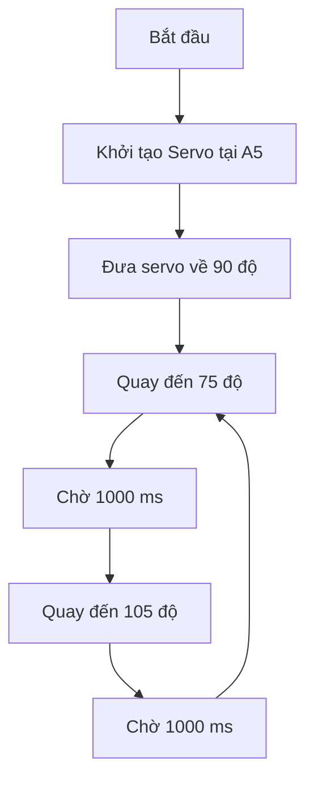
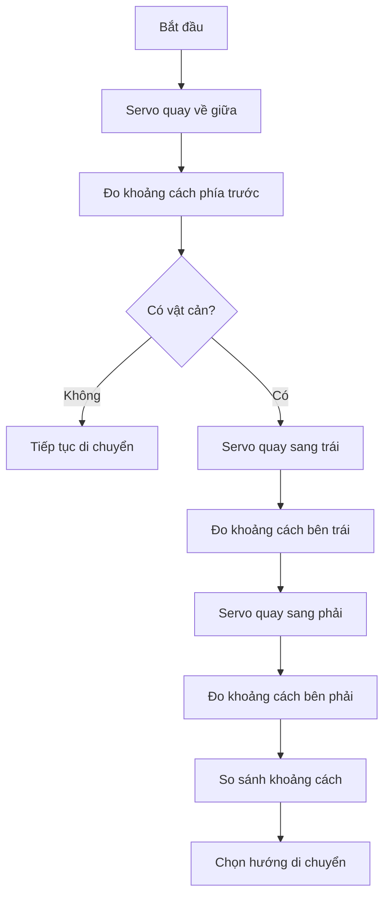

# Bài 4: Điều khiển động cơ Servo SG90 bằng Arduino Nano

## 1. Giới thiệu

Trong các bài học trước, chúng ta đã làm quen với cách lập trình Arduino Nano và điều khiển các thiết bị đầu ra thông qua tín hiệu Digital.

Ở bài học này, chúng ta sẽ tìm hiểu và thực hành điều khiển **động cơ Servo SG90**, một loại động cơ có khả năng quay đến vị trí góc xác định.

Trên xe robot Arduino, servo được sử dụng để xoay cảm biến siêu âm HC-SR04 sang các hướng khác nhau, giúp xe đo khoảng cách và phát hiện vật cản ở phía trước, bên trái và bên phải.

Thông qua bài học, chúng ta sẽ tìm hiểu:

- Cấu tạo và nguyên lý hoạt động của động cơ servo.
- Sự khác biệt giữa servo và động cơ DC thông thường.
- Cách kết nối servo SG90 với Arduino Nano.
- Cách sử dụng thư viện Servo trong Arduino IDE.
- Cách điều khiển servo đến một góc xác định.
- Cách lập trình servo quay qua lại giữa nhiều vị trí.
- Ứng dụng servo để xoay cảm biến siêu âm trên xe robot.

Sau khi hoàn thành, bạn sẽ có thể điều khiển servo SG90 bằng Arduino Nano và sử dụng servo trong các ứng dụng điều khiển chuyển động đơn giản.

## 2. Tìm hiểu về động cơ Servo SG90

### 2.1. Servo là gì?

Servo là loại động cơ được tích hợp cơ cấu điều khiển vị trí, cho phép điều chỉnh trục quay đến một góc xác định.

Khác với động cơ DC thông thường có thể quay liên tục, servo vị trí được thiết kế để di chuyển đến một vị trí góc theo tín hiệu điều khiển.

Ví dụ:

- Khi yêu cầu góc 0°, servo di chuyển về một đầu hành trình.
- Khi yêu cầu góc 90°, servo di chuyển về vị trí giữa.
- Khi yêu cầu góc 180°, servo di chuyển về đầu hành trình còn lại, nếu loại servo và cơ cấu lắp đặt cho phép.

Servo thường được sử dụng trong các ứng dụng:

- Điều khiển cánh tay robot.
- Điều khiển cơ cấu gắp vật.
- Xoay cảm biến.
- Điều khiển các khớp chuyển động.
- Điều khiển góc lái của robot.

### 2.2. Động cơ Servo SG90

<AsyncImage query="SG90 9g blue micro servo motor three wire cable servo horn white product photo" aspectRatio="5:3" maxWidth="420px"/>

**SG90** là loại servo kích thước nhỏ, thường được sử dụng trong các dự án Arduino và robot học tập.

Một số thông số cơ bản:

| Thông số | Giá trị |
|---|---|
| Tên động cơ | Micro Servo SG90 |
| Điện áp hoạt động | Thường 4,8–6V, tùy phiên bản |
| Góc quay | Thường khoảng 0–180° |
| Tín hiệu điều khiển | Xung điều khiển servo |
| Số dây kết nối | 3 dây |
| Khối lượng | Khoảng 9g |

Góc quay thực tế có thể khác nhau giữa các phiên bản servo. Không nên ép servo quay vượt quá giới hạn cơ khí của thiết bị.

### 2.3. Cấu tạo của servo

Một servo vị trí thông thường bao gồm các thành phần chính:

- **Động cơ DC:** Tạo chuyển động quay.
- **Bộ bánh răng giảm tốc:** Giảm tốc độ và tăng mô-men xoắn.
- **Cảm biến vị trí:** Xác định vị trí hiện tại của trục quay.
- **Mạch điều khiển:** Nhận tín hiệu và điều chỉnh động cơ đến vị trí yêu cầu.

Khi Arduino gửi lệnh điều khiển, mạch bên trong servo sẽ xác định vị trí cần di chuyển và điều khiển động cơ quay đến vị trí đó.

Nhờ cơ chế phản hồi vị trí bên trong, servo có thể duy trì góc quay đã được thiết lập trong giới hạn mô-men giữ của nó.

## 3. Nguyên lý điều khiển Servo

### 3.1. Tín hiệu điều khiển servo

Servo SG90 được điều khiển thông qua các xung tín hiệu có độ rộng thay đổi.

Với servo thông dụng, tín hiệu thường có chu kỳ khoảng 20 ms, tương đương tần số 50 Hz.

Độ rộng xung quyết định vị trí góc mà servo cần di chuyển đến.

Ví dụ, các giá trị tham khảo thường gặp:

| Độ rộng xung | Vị trí góc tham khảo |
|---|---|
| 1,0 ms | Gần một đầu hành trình |
| 1,5 ms | Gần vị trí giữa |
| 2,0 ms | Gần đầu hành trình còn lại |

Các giá trị trên chỉ mang tính minh họa. Mối quan hệ giữa độ rộng xung và góc quay thực tế phụ thuộc vào từng servo.

**Minh họa tín hiệu điều khiển Servo**

```text
Xung 1,0 ms:
HIGH  ┌─┐
      │ │
LOW   ┘ └───────────────────────

Xung 1,5 ms:
HIGH  ┌──┐
      │  │
LOW   ┘  └──────────────────────

Xung 2,0 ms:
HIGH  ┌───┐
      │   │
LOW   ┘   └─────────────────────
```

Các tín hiệu trên có chu kỳ tham khảo khoảng 20 ms. Độ rộng xung HIGH thay đổi để yêu cầu servo di chuyển đến những vị trí góc khác nhau.

*Hình minh họa không theo đúng tỷ lệ thời gian thực tế.*

Trong bài học này, chúng ta không cần tự tạo các xung điều khiển bằng tay.

Thay vào đó, thư viện `Servo.h` sẽ hỗ trợ Arduino tạo tín hiệu điều khiển phù hợp.

### 3.2. Sự khác biệt giữa servo và động cơ DC

| Đặc điểm | Động cơ DC | Servo vị trí SG90 |
|---|---|---|
| Chuyển động | Quay liên tục | Quay đến vị trí góc |
| Điều khiển chính | Tốc độ và chiều quay | Vị trí góc |
| Mạch điều khiển | Thường cần driver | Tích hợp trong servo |
| Phản hồi vị trí | Cần cảm biến ngoài nếu muốn đo | Có cơ chế phản hồi bên trong |
| Ứng dụng trên xe | Điều khiển bánh xe | Xoay cảm biến siêu âm |

Như vậy, động cơ DC phù hợp để tạo chuyển động cho bánh xe, trong khi servo phù hợp với các cơ cấu cần điều khiển vị trí.

## 4. Kết nối Servo SG90 với Arduino Nano

### 4.1. Các chân kết nối

Servo SG90 có ba dây kết nối:

| Dây servo | Chức năng | Kết nối |
|---|---|---|
| Nâu hoặc đen | GND | GND chung |
| Đỏ | VCC | Nguồn servo phù hợp, thường 5V ổn áp |
| Cam, vàng hoặc trắng | Signal | Arduino A5 |

Trên bộ xe robot của chúng ta, **chân điều khiển servo được kết nối với A5 của Arduino Nano**.

<AsyncImage query="SG90 servo motor three wire connector brown red orange close up" aspectRatio="5:3" maxWidth="360px"/>

### 4.2. Sơ đồ kết nối

```text
Arduino Nano                  Servo SG90
────────────                  ──────────
A5  ────────────────────────  Signal

GND ────────────────┐
                    │
Nguồn servo GND ────┴───────  GND

Nguồn servo +5V ────────────  VCC
```

Trong sơ đồ này:

- Arduino Nano được cấp nguồn qua USB.
- Servo sử dụng nguồn 5V ổn áp phù hợp với dòng tiêu thụ.
- GND của nguồn servo và GND của Arduino được nối chung.
- Chân A5 của Arduino gửi tín hiệu điều khiển đến servo.

**Lưu ý quan trọng:**

- Không cấp trực tiếp điện áp pin của xe vào servo nếu vượt quá giới hạn điện áp cho phép.
- Không cấp nguồn servo từ chân Digital của Arduino.
- Khi sử dụng nguồn servo riêng, cần nối GND chung với Arduino.
- Không nối trực tiếp cực dương của nguồn servo riêng vào chân 5V của Nano đang cấp qua USB trong sơ đồ thực hành này nếu chưa xác minh mạch phân phối nguồn.
- Khi thử nghiệm lần đầu, nên để servo không mang tải hoặc đảm bảo gá cảm biến không bị cản trở.

## 5. Cài đặt thư viện Servo

Để điều khiển servo bằng Arduino, chúng ta sử dụng thư viện **Servo**.

Thư viện này cung cấp các hàm giúp điều khiển góc quay mà không cần lập trình trực tiếp độ rộng xung.

### 5.1. Kiểm tra thư viện

Mở Arduino IDE, chọn:

`Sketch → Include Library → Manage Libraries`

Trong ô tìm kiếm, nhập:

`Servo`

Tìm thư viện **Servo by Arduino**.

Nếu thư viện chưa được cài đặt, nhấn Install.

Nếu đã có thư viện, chúng ta có thể sử dụng trực tiếp.

### 5.2. Khai báo thư viện

Để sử dụng thư viện trong chương trình, thêm dòng:

```cpp
#include <Servo.h>
```

Sau đó tạo một đối tượng servo:

```cpp
Servo myServo;
```

Đối tượng `myServo` sẽ được sử dụng để điều khiển động cơ servo trong chương trình.

## 6. Ví dụ 1: Điều khiển servo đến góc 90°

Trong ví dụ đầu tiên, chúng ta sẽ điều khiển servo quay đến vị trí giữa, tương ứng với góc yêu cầu 90°.

### 6.1. Chương trình mẫu

Tạo một chương trình mới trong Arduino IDE và nhập đoạn mã sau:

```cpp
#include <Servo.h>

#define SERVO_PIN A5

Servo myServo;

void setup() {
  myServo.attach(SERVO_PIN);
  myServo.write(90);
}

void loop() {

}
```

### 6.2. Giải thích chương trình

**Khai báo thư viện**

```cpp
#include <Servo.h>
```

Cho phép chương trình sử dụng các hàm điều khiển servo.

**Khai báo chân kết nối**

```cpp
#define SERVO_PIN A5
```

Định nghĩa chân A5 là chân tín hiệu điều khiển servo.

Việc sử dụng `#define` giúp chúng ta dễ dàng thay đổi chân kết nối khi cần thiết.

**Khởi tạo đối tượng servo**

```cpp
Servo myServo;
```

Tạo đối tượng có tên `myServo` để quản lý servo.

**Thiết lập chân điều khiển**

```cpp
myServo.attach(SERVO_PIN);
```

Liên kết đối tượng servo với chân A5.

Sau khi thực hiện lệnh này, thư viện có thể tạo tín hiệu điều khiển trên chân đã chọn.

**Điều khiển góc quay**

```cpp
myServo.write(90);
```

Yêu cầu servo di chuyển đến vị trí góc 90°.

### 6.3. Nạp và kiểm tra

Thực hiện các bước:

1. Kiểm tra kết nối servo với Arduino Nano.
2. Đảm bảo servo có nguồn điện phù hợp.
3. Chọn đúng Board và Port trong Arduino IDE.
4. Nhấn Verify để kiểm tra chương trình.
5. Nhấn Upload để nạp chương trình.
6. Quan sát chuyển động của servo.

**Kết quả:** Servo di chuyển đến vị trí gần giữa hành trình và giữ tại vị trí đó.

Nếu servo đã ở gần góc 90° từ trước, có thể không quan sát thấy chuyển động đáng kể.

## 7. Ví dụ 2: Điều khiển servo quay giữa hai góc

Trong ví dụ tiếp theo, chúng ta sẽ lập trình servo tự động quay qua lại giữa hai vị trí.

Để đảm bảo an toàn khi thử nghiệm, trước tiên chỉ sử dụng khoảng góc nhỏ từ 75° đến 105°.

### 7.1. Chương trình mẫu

```cpp
#include <Servo.h>

#define SERVO_PIN A5

Servo myServo;

void setup() {
  myServo.attach(SERVO_PIN);
  myServo.write(90);
  delay(1000);
}

void loop() {
  myServo.write(75);
  delay(1000);

  myServo.write(105);
  delay(1000);
}
```

### 7.2. Giải thích chương trình

Trong hàm `setup()`, Arduino khởi tạo servo và yêu cầu di chuyển về vị trí giữa.

```cpp
myServo.attach(SERVO_PIN);
myServo.write(90);
delay(1000);
```

Sau đó, trong hàm `loop()`, servo được điều khiển lần lượt đến hai góc.

**Bước 1: Quay đến góc 75°**

```cpp
myServo.write(75);
delay(1000);
```

Servo nhận lệnh di chuyển đến góc 75°.

Chương trình chờ một giây trước khi thực hiện lệnh tiếp theo.

**Bước 2: Quay đến góc 105°**

```cpp
myServo.write(105);
delay(1000);
```

Servo nhận lệnh di chuyển đến góc 105°.

Sau một giây, chương trình quay lại đầu hàm `loop()` và tiếp tục thực hiện.

### 7.3. Nguyên lý hoạt động



**Kết quả:** Servo liên tục di chuyển giữa hai vị trí 75° và 105°.

Khoảng chênh lệch giữa hai góc yêu cầu là 30°.

Lưu ý rằng `delay(1000)` là thời gian chờ giữa các lệnh, không phải lệnh yêu cầu servo hoàn thành chuyển động trong đúng một giây.

## 8. Ví dụ 3: Điều khiển servo quét nhiều góc

Sau khi đã kiểm tra servo hoạt động bình thường trong khoảng góc nhỏ, chúng ta có thể lập trình để servo di chuyển qua nhiều vị trí.

Ví dụ, điều khiển servo lần lượt đến các góc 60°, 90° và 120°.

Chỉ thực hiện khi đã xác nhận gá cảm biến có đủ không gian chuyển động.

### 8.1. Chương trình mẫu

```cpp
#include <Servo.h>

#define SERVO_PIN A5

Servo myServo;

void setup() {
  myServo.attach(SERVO_PIN);
  myServo.write(90);
  delay(1000);
}

void loop() {
  myServo.write(60);
  delay(1000);

  myServo.write(90);
  delay(1000);

  myServo.write(120);
  delay(1000);

  myServo.write(90);
  delay(1000);
}
```

### 8.2. Giải thích chương trình

Trong chương trình này, servo lần lượt di chuyển qua bốn vị trí:

1. Góc 60°.
2. Góc 90°.
3. Góc 120°.
4. Trở về góc 90°.

Sau đó quá trình được lặp lại liên tục.

**Kết quả:** Servo thực hiện chuyển động quét qua các vị trí khác nhau.

Đây là nguyên lý cơ bản để xoay cảm biến siêu âm HC-SR04 trên xe robot.

## 9. Ví dụ 4: Điều khiển servo quay từng bước

Trong các ví dụ trước, chúng ta gửi trực tiếp lệnh đến một góc xác định.

Ở ví dụ này, chúng ta sẽ lập trình để servo thay đổi góc từng bước nhỏ, tạo chuyển động quét liên tục.

### 9.1. Chương trình mẫu

```cpp
#include <Servo.h>

#define SERVO_PIN A5

Servo myServo;

void setup() {
  myServo.attach(SERVO_PIN);
  myServo.write(90);
  delay(1000);
}

void loop() {

  // Quay từ 60 đến 120 độ
  for (int goc = 60; goc <= 120; goc++) {
    myServo.write(goc);
    delay(20);
  }

  // Quay từ 120 về 60 độ
  for (int goc = 120; goc >= 60; goc--) {
    myServo.write(goc);
    delay(20);
  }
}
```

### 9.2. Giải thích chương trình

Trong ví dụ này, chúng ta sử dụng vòng lặp `for`.

**Vòng lặp thứ nhất**

```cpp
for (int goc = 60; goc <= 120; goc++) {
  myServo.write(goc);
  delay(20);
}
```

Trong đó:

- `int goc = 60`: Khởi tạo biến góc bằng 60.
- `goc <= 120`: Tiếp tục lặp khi góc chưa vượt quá 120.
- `goc++`: Tăng giá trị góc thêm 1 sau mỗi lần lặp.

Mỗi lần lặp, Arduino gửi lệnh thay đổi góc thêm 1° và chờ 20 ms.

**Vòng lặp thứ hai**

```cpp
for (int goc = 120; goc >= 60; goc--) {
  myServo.write(goc);
  delay(20);
}
```

Vòng lặp này thực hiện quá trình ngược lại, giảm dần góc từ 120° về 60°.

**Kết quả:** Servo thực hiện chuyển động quét qua lại thay vì chuyển trực tiếp giữa hai góc.

Các bước thay đổi góc nhỏ giúp chuyển động có xu hướng mượt hơn. Tuy nhiên, tốc độ và độ mượt thực tế vẫn phụ thuộc vào khả năng đáp ứng của servo và tải cơ khí.

## 10. Ứng dụng servo trên xe robot Arduino

Trên xe robot, servo SG90 được sử dụng để điều khiển hướng của cảm biến siêu âm HC-SR04.

Khi xe cần phát hiện vật cản, Arduino có thể điều khiển servo để đo khoảng cách ở nhiều hướng.

Ví dụ:

1. Đưa servo về vị trí giữa để đo khoảng cách phía trước.
2. Quay servo sang trái để đo khoảng cách bên trái.
3. Quay servo sang phải để đo khoảng cách bên phải.
4. So sánh các giá trị khoảng cách.
5. Lựa chọn hướng di chuyển phù hợp.



Đây là một trong những ứng dụng cơ bản của servo trong robot tự động tránh vật cản.

Ở bài học về HC-SR04, chúng ta sẽ tìm hiểu cách đo khoảng cách và kết hợp dữ liệu cảm biến với chuyển động của servo.

## 11. Một số lưu ý khi sử dụng Servo SG90

### 11.1. Không ép servo vượt giới hạn

Servo SG90 có giới hạn góc quay cơ khí.

Không nên yêu cầu servo quay đến các góc quá lớn khi chưa kiểm tra khả năng chuyển động của cơ cấu.

Đối với xe robot có gá cảm biến, cần đảm bảo:

- Servo không va chạm với thân xe.
- Dây cảm biến không bị kéo căng.
- Tay đòn không bị cản trở.
- Các vít cố định không chạm vào phần chuyển động.

Nếu servo phát ra tiếng kêu lớn, rung mạnh hoặc bị kẹt, cần ngắt nguồn và kiểm tra cơ cấu trước khi tiếp tục.

### 11.2. Sử dụng nguồn phù hợp

Servo có thể tiêu thụ dòng điện tương đối lớn khi bắt đầu chuyển động hoặc khi chịu tải.

Nếu nguồn điện không đủ, có thể xuất hiện các hiện tượng:

- Servo rung hoặc hoạt động không ổn định.
- Arduino tự khởi động lại.
- Servo không quay đến vị trí yêu cầu.

Vì vậy, khi thực hành với servo, nên sử dụng nguồn 5V ổn áp có khả năng cung cấp đủ dòng điện cho tải.

### 11.3. Lưu ý khi sử dụng thư viện Servo

Trên Arduino Nano sử dụng ATmega328P, thư viện Servo sử dụng tài nguyên bộ định thời Timer1.

Khi thư viện Servo hoạt động, chức năng PWM thông thường trên chân D9 và D10 có thể bị ảnh hưởng.

Trong bộ xe của chúng ta, các chân PWM điều khiển động cơ được sử dụng là D5 và D6, vì vậy không bị ảnh hưởng trực tiếp bởi việc thư viện Servo sử dụng Timer1.

Tuy nhiên, khi kết hợp nhiều thư viện trong một chương trình, cần chú ý đến việc sử dụng chung tài nguyên phần cứng của Arduino.

## 12. Một số lỗi thường gặp

| Hiện tượng | Nguyên nhân và cách xử lý |
|---|---|
| Servo không quay | Kiểm tra chân Signal A5, nguồn và GND chung |
| Servo quay sai vị trí | Kiểm tra góc yêu cầu và vị trí lắp tay đòn |
| Servo rung liên tục | Kiểm tra nguồn điện, tải và cơ cấu gá |
| Arduino tự khởi động lại | Nguồn có thể không đủ dòng khi servo hoạt động |
| Servo kêu nhưng không quay | Kiểm tra cơ cấu có bị kẹt hoặc chạm vật cản |
| Báo lỗi `Servo.h` | Kiểm tra thư viện Servo đã được cài đặt |
| Servo không quay hết 180° | Có thể do giới hạn cơ khí của servo hoặc gá lắp |

Khi gặp lỗi, nên kiểm tra nguồn điện và kết nối trước khi thay đổi chương trình.

## 13. Bài tập thực hành

Sau khi hoàn thành các ví dụ, hãy thực hiện những bài tập sau.

**Bài tập 1: Điều khiển vị trí**

Viết chương trình để servo lần lượt di chuyển đến các góc:

- 80°.
- 90°.
- 100°.
- Trở về 90°.

Mỗi vị trí được giữ trong một giây.

**Bài tập 2: Thay đổi thời gian**

Chỉnh sửa chương trình để servo di chuyển giữa hai góc 75° và 105°, với thời gian chờ hai giây giữa các lệnh.

Quan sát sự khác biệt so với chương trình ban đầu.

**Bài tập 3: Điều khiển góc bằng biến**

Khai báo hai biến:

```cpp
int gocTrai = 70;
int gocPhai = 110;
```

Sử dụng các biến này để điều khiển servo quay qua lại.

Thay đổi giá trị của biến và quan sát kết quả.

**Bài tập 4: Quét góc tự động**

Sử dụng vòng lặp `for` để điều khiển servo quét từ 80° đến 100° và quay ngược trở lại.

Thử thay đổi thời gian chờ giữa các bước để quan sát độ mượt và tốc độ chuyển động.

## 14. Tổng kết

Qua bài học này, chúng ta đã tìm hiểu và thực hành:

- Cấu tạo và nguyên lý hoạt động của servo SG90.
- Sự khác biệt giữa servo và động cơ DC.
- Cách kết nối servo với Arduino Nano.
- Cách sử dụng thư viện `Servo.h`.
- Điều khiển servo đến một góc xác định bằng `write()`.
- Điều khiển servo quay qua lại giữa nhiều vị trí.
- Sử dụng vòng lặp `for` để tạo chuyển động quét.
- Ứng dụng servo trong hệ thống phát hiện và tránh vật cản.

Servo là một cơ cấu chấp hành quan trọng trong robot, đặc biệt đối với những ứng dụng cần điều khiển vị trí hoặc hướng của thiết bị.

Ở bài tiếp theo, chúng ta sẽ tìm hiểu **điều khiển động cơ DC bằng module L298N**, qua đó bắt đầu lập trình các chuyển động tiến, lùi và rẽ của xe robot Arduino.