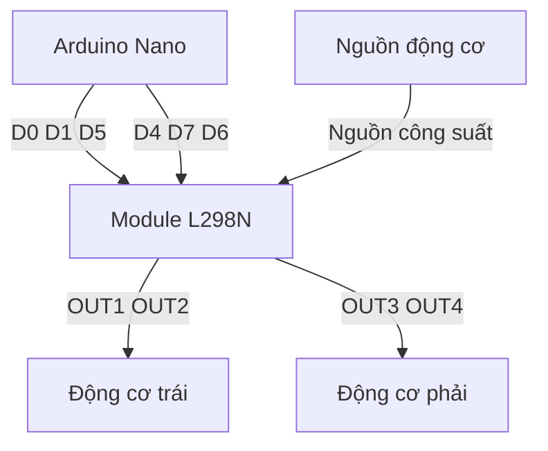
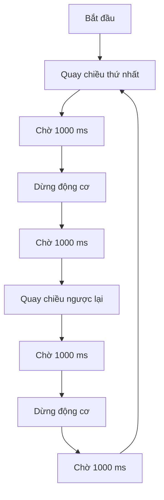

# Bài 5: Điều khiển động cơ DC bằng module L298N

## 1. Giới thiệu

Trong các bài học trước, chúng ta đã tìm hiểu cách điều khiển đèn LED và động cơ Servo SG90 bằng Arduino Nano.

Ở bài học này, chúng ta sẽ bắt đầu lập trình **điều khiển chuyển động của xe robot** thông qua hai động cơ giảm tốc DC và module điều khiển động cơ L298N.

Khác với servo được sử dụng để điều khiển vị trí góc, động cơ DC có khả năng quay liên tục và được sử dụng để tạo chuyển động cho các bánh xe.

Thông qua bài học, chúng ta sẽ tìm hiểu:

- Nguyên lý hoạt động của động cơ DC.
- Chức năng và nguyên lý điều khiển của module L298N.
- Cách kết nối L298N với Arduino Nano.
- Cách điều khiển động cơ quay thuận và quay ngược.
- Cách điều chỉnh tốc độ động cơ bằng tín hiệu PWM.
- Cách điều khiển hai động cơ độc lập.
- Cách lập trình xe tiến, lùi, rẽ trái, rẽ phải và quay tại chỗ.

Sau khi hoàn thành, bạn sẽ có thể lập trình các chuyển động cơ bản của xe robot Arduino Nano.

## 2. Tìm hiểu về động cơ DC

### 2.1. Động cơ DC là gì?

Động cơ DC (Direct Current Motor) là loại động cơ điện sử dụng nguồn điện một chiều để tạo chuyển động quay.

Khi cấp điện vào hai cực của động cơ, dòng điện chạy qua các cuộn dây tạo ra lực điện từ, làm trục động cơ quay.

Chiều quay của động cơ phụ thuộc vào chiều điện áp đặt lên hai cực.

Ví dụ:

- Cấp điện theo một chiều: Động cơ quay thuận.
- Đảo cực nguồn điện: Động cơ quay ngược.
- Ngắt nguồn điện: Động cơ giảm tốc và dừng do ma sát.

Động cơ DC được sử dụng phổ biến trong robot di động, xe mô hình, băng tải và các cơ cấu truyền động.

### 2.2. Động cơ giảm tốc DC trên xe robot

<AsyncImage query="yellow TT DC geared motor Arduino robot car plastic gearbox yellow motor" aspectRatio="5:3" maxWidth="420px"/>

Xe robot của chúng ta sử dụng **hai động cơ giảm tốc DC màu vàng**, thường được gọi là động cơ TT.

Mỗi động cơ được kết nối với một bánh xe.

Bên trong động cơ có bộ bánh răng giảm tốc, giúp:

- Giảm tốc độ quay của trục đầu ra.
- Tăng mô-men xoắn so với trục động cơ trước giảm tốc.
- Phù hợp hơn với chuyển động của xe robot.

Hai động cơ được điều khiển độc lập để tạo ra các chuyển động khác nhau.

| Động cơ trái | Động cơ phải | Chuyển động |
|---|---|---|
| Tiến | Tiến | Xe tiến |
| Lùi | Lùi | Xe lùi |
| Dừng | Tiến | Xe rẽ trái |
| Tiến | Dừng | Xe rẽ phải |
| Lùi | Tiến | Xe quay trái tại chỗ |
| Tiến | Lùi | Xe quay phải tại chỗ |
| Dừng | Dừng | Xe dừng |

**Lưu ý:** Hai động cơ trên xe không tích hợp encoder. Việc đo tốc độ và quãng đường sẽ được thực hiện bằng hai module encoder ngoài trong bài học tiếp theo.

## 3. Tìm hiểu module điều khiển động cơ L298N

### 3.1. Tại sao cần sử dụng L298N?

Các chân Digital của Arduino Nano chỉ có khả năng cung cấp dòng điện nhỏ, không đủ để cấp nguồn trực tiếp cho động cơ DC.

Nếu kết nối động cơ trực tiếp với chân Arduino, dòng điện tiêu thụ có thể vượt quá khả năng chịu tải và làm hỏng vi điều khiển.

Vì vậy, chúng ta sử dụng module **L298N** để điều khiển động cơ.

<AsyncImage query="L298N dual H bridge motor driver module heatsink ENA ENB IN1 IN2 IN3 IN4 OUT1 OUT2 OUT3 OUT4" aspectRatio="5:3" maxWidth="420px"/>

L298N là mạch điều khiển động cơ sử dụng cấu trúc cầu H, cho phép điều khiển hai động cơ DC độc lập.

Module có các chức năng:

- Điều khiển chiều quay của động cơ.
- Điều chỉnh tốc độ động cơ bằng PWM.
- Điều khiển hai động cơ độc lập.
- Cấp dòng cho động cơ từ nguồn công suất riêng.

Arduino chỉ cần gửi tín hiệu điều khiển đến L298N, còn nguồn điện cung cấp cho động cơ sẽ được đưa qua mạch driver.

### 3.2. Các chân kết nối của L298N

Module L298N thường có các nhóm chân sau:

| Chân | Chức năng |
|---|---|
| IN1 | Điều khiển chiều quay động cơ A |
| IN2 | Điều khiển chiều quay động cơ A |
| ENA | Cho phép hoạt động và điều chỉnh PWM động cơ A |
| IN3 | Điều khiển chiều quay động cơ B |
| IN4 | Điều khiển chiều quay động cơ B |
| ENB | Cho phép hoạt động và điều chỉnh PWM động cơ B |
| OUT1, OUT2 | Kết nối động cơ A |
| OUT3, OUT4 | Kết nối động cơ B |
| Motor Supply | Đầu vào nguồn cấp cho động cơ |
| GND | Chân nối đất chung |
| 5V | Đường nguồn logic, chức năng cấp vào hoặc cấp ra tùy cấu hình module |

Trên một số module, đầu nguồn động cơ có thể được in nhãn `12V`. Đây là tên đầu nối, không có nghĩa mọi động cơ đều phải sử dụng nguồn 12V.

Điện áp cấp cần phù hợp với động cơ và giới hạn hoạt động của driver.

### 3.3. Nguyên lý cầu H

L298N sử dụng cấu trúc cầu H để thay đổi chiều dòng điện đi qua động cơ.

Đối với động cơ A, hai chân IN1 và IN2 quyết định chiều quay.

| IN1 | IN2 | Trạng thái động cơ A |
|---|---|---|
| HIGH | LOW | Quay theo chiều thứ nhất |
| LOW | HIGH | Quay theo chiều ngược lại |
| LOW | LOW | Hai đầu ra ở cùng mức thấp khi kênh được enable |
| HIGH | HIGH | Hai đầu ra ở cùng mức cao khi kênh được enable |

Khi ENA được kích hoạt, driver điều khiển đầu ra theo trạng thái IN1 và IN2.

Khi ENA ở mức LOW, đầu ra của kênh bị vô hiệu hóa và động cơ có thể quay theo quán tính trước khi dừng.

Đối với động cơ B, nguyên lý tương tự với hai chân IN3 và IN4.

## 4. Kết nối L298N với Arduino Nano

### 4.1. Sơ đồ chân điều khiển

Trong bộ xe robot, các chân kết nối được cấu hình như sau:

| Chân L298N | Chân Arduino Nano | Chức năng |
|---|---|---|
| ENA | D5 | PWM động cơ trái |
| IN1 | D0 | Điều khiển chiều động cơ trái |
| IN2 | D1 | Điều khiển chiều động cơ trái |
| ENB | D6 | PWM động cơ phải |
| IN3 | D4 | Điều khiển chiều động cơ phải |
| IN4 | D7 | Điều khiển chiều động cơ phải |
| OUT1, OUT2 | Động cơ trái | Đầu ra công suất |
| OUT3, OUT4 | Động cơ phải | Đầu ra công suất |
| GND | GND Arduino và nguồn động cơ | Nối đất chung |

### 4.2. Sơ đồ kết nối tổng thể



Trong sơ đồ này:

- Arduino Nano gửi tín hiệu điều khiển đến L298N.
- L298N sử dụng nguồn công suất để cấp điện cho động cơ.
- Hai động cơ được điều khiển độc lập.
- GND của Arduino và nguồn động cơ phải được nối chung.

### 4.3. Lưu ý khi đấu nối

Trước khi cấp nguồn, cần kiểm tra:

- Đúng các chân IN1, IN2, IN3, IN4.
- Đúng chân PWM ENA và ENB.
- Động cơ được kết nối vào đúng nhóm đầu ra.
- Nguồn động cơ có điện áp phù hợp.
- GND giữa Arduino và driver được nối chung.

Nếu module L298N có jumper trên ENA và ENB, cần tháo các jumper này khi muốn điều khiển PWM từ Arduino.

Không nhầm jumper ENA/ENB với jumper cấu hình nguồn logic `5V_EN` trên module.

**Lưu ý về chân D0 và D1:** Trên Arduino Nano, hai chân này đồng thời được sử dụng cho giao tiếp Serial qua USB. Vì vậy, khi nạp chương trình, nên ngắt nguồn động cơ và tạm thời tháo kết nối IN1/IN2 khỏi D0/D1 nếu cần. Chỉ đấu nối lại sau khi đã tắt nguồn và hoàn thành quá trình nạp.

Trong các ví dụ điều khiển động cơ dưới đây, chúng ta không sử dụng `Serial.begin()`.

## 5. Khai báo các chân điều khiển động cơ

Trước khi viết chương trình, chúng ta cần khai báo các chân kết nối giữa Arduino Nano và L298N.

```cpp
// Dong co trai
#define ENA 5
#define IN1 0
#define IN2 1

// Dong co phai
#define ENB 6
#define IN3 4
#define IN4 7
```

Trong đó:

- `ENA`, `ENB`: Các chân điều khiển PWM.
- `IN1`, `IN2`: Các chân điều khiển chiều quay động cơ trái.
- `IN3`, `IN4`: Các chân điều khiển chiều quay động cơ phải.

Trong hàm `setup()`, chúng ta cấu hình các chân này thành đầu ra.

```cpp
void setup() {
  pinMode(ENA, OUTPUT);
  pinMode(IN1, OUTPUT);
  pinMode(IN2, OUTPUT);

  pinMode(ENB, OUTPUT);
  pinMode(IN3, OUTPUT);
  pinMode(IN4, OUTPUT);
}
```

Các chân này sẽ được sử dụng trong toàn bộ những ví dụ tiếp theo.

## 6. Ví dụ 1: Điều khiển một động cơ quay

Trong ví dụ đầu tiên, chúng ta sẽ điều khiển động cơ bên trái quay trong một giây, sau đó dừng lại.

Để đảm bảo an toàn, cần kê bánh xe lên khỏi mặt đất trước khi thử nghiệm.

### 6.1. Chương trình mẫu

```cpp
// Dong co trai
#define ENA 5
#define IN1 0
#define IN2 1

// Dong co phai
#define ENB 6
#define IN3 4
#define IN4 7

void setup() {
  pinMode(ENA, OUTPUT);
  pinMode(IN1, OUTPUT);
  pinMode(IN2, OUTPUT);

  pinMode(ENB, OUTPUT);
  pinMode(IN3, OUTPUT);
  pinMode(IN4, OUTPUT);

  // Tat hai dong co ban dau
  analogWrite(ENA, 0);
  analogWrite(ENB, 0);

  digitalWrite(IN1, LOW);
  digitalWrite(IN2, LOW);
  digitalWrite(IN3, LOW);
  digitalWrite(IN4, LOW);

  delay(1000);

  // Cho dong co trai quay
  digitalWrite(IN1, HIGH);
  digitalWrite(IN2, LOW);
  analogWrite(ENA, 120);

  delay(1000);

  // Dung dong co trai
  analogWrite(ENA, 0);
  digitalWrite(IN1, LOW);
  digitalWrite(IN2, LOW);
}

void loop() {

}
```

### 6.2. Giải thích chương trình

Đầu tiên, chúng ta cấu hình các chân điều khiển thành đầu ra.

```cpp
pinMode(ENA, OUTPUT);
pinMode(IN1, OUTPUT);
pinMode(IN2, OUTPUT);
```

Sau đó đưa hai động cơ về trạng thái không hoạt động:

```cpp
analogWrite(ENA, 0);
analogWrite(ENB, 0);
```

Để động cơ trái quay theo một chiều, chúng ta sử dụng:

```cpp
digitalWrite(IN1, HIGH);
digitalWrite(IN2, LOW);
analogWrite(ENA, 120);
```

Trong đó:

- `IN1 = HIGH`, `IN2 = LOW`: Chọn một chiều quay.
- `analogWrite(ENA, 120)`: Đặt mức điều khiển PWM bằng 120.

Sau một giây, chương trình dừng động cơ:

```cpp
analogWrite(ENA, 0);
digitalWrite(IN1, LOW);
digitalWrite(IN2, LOW);
```

Hàm `loop()` không chứa lệnh nào, vì vậy động cơ chỉ thực hiện một lượt thử khi chương trình bắt đầu chạy.

### 6.3. Nạp và kiểm tra

Thực hiện các bước:

1. Kê bánh xe lên khỏi mặt đất.
2. Ngắt nguồn động cơ trước khi nạp.
3. Nạp chương trình vào Arduino Nano.
4. Tắt nguồn trước khi khôi phục các dây đã tháo.
5. Kiểm tra kết nối và cấp nguồn cho hệ thống.
6. Khởi động lại Arduino khi nguồn động cơ đã sẵn sàng.

**Kết quả:** Sau khoảng một giây, động cơ trái quay trong một giây rồi dừng. Động cơ phải không quay.

Nếu Arduino đã thực hiện xong lượt thử trước khi nguồn động cơ được bật, cần khởi động lại Arduino để quan sát đầy đủ quá trình.

## 7. Ví dụ 2: Điều khiển động cơ quay thuận và quay ngược

Để thay đổi chiều quay của động cơ, chúng ta chỉ cần đảo trạng thái hai chân điều khiển.

Ví dụ:

**Chiều thứ nhất**

```cpp
digitalWrite(IN1, HIGH);
digitalWrite(IN2, LOW);
```

**Chiều ngược lại**

```cpp
digitalWrite(IN1, LOW);
digitalWrite(IN2, HIGH);
```

### 7.1. Chương trình mẫu

Trong ví dụ này, động cơ trái sẽ quay theo một chiều, dừng, sau đó quay theo chiều ngược lại.

```cpp
#define ENA 5
#define IN1 0
#define IN2 1

void setup() {
  pinMode(ENA, OUTPUT);
  pinMode(IN1, OUTPUT);
  pinMode(IN2, OUTPUT);

  analogWrite(ENA, 0);
  digitalWrite(IN1, LOW);
  digitalWrite(IN2, LOW);
}

void loop() {
  // Quay chieu thu nhat
  digitalWrite(IN1, HIGH);
  digitalWrite(IN2, LOW);
  analogWrite(ENA, 120);

  delay(1000);

  // Dung dong co
  analogWrite(ENA, 0);
  digitalWrite(IN1, LOW);
  digitalWrite(IN2, LOW);

  delay(1000);

  // Quay chieu nguoc lai
  digitalWrite(IN1, LOW);
  digitalWrite(IN2, HIGH);
  analogWrite(ENA, 120);

  delay(1000);

  // Dung dong co
  analogWrite(ENA, 0);
  digitalWrite(IN1, LOW);
  digitalWrite(IN2, LOW);

  delay(1000);
}
```

### 7.2. Nguyên lý hoạt động



**Kết quả:** Động cơ trái quay luân phiên theo hai chiều, mỗi chiều một giây và có khoảng dừng giữa các lần đảo chiều.

Việc dừng động cơ trước khi đảo chiều giúp hạn chế thay đổi chiều quay đột ngột khi động cơ còn đang chuyển động.

## 8. Điều chỉnh tốc độ động cơ bằng PWM

### 8.1. PWM là gì?

PWM (Pulse Width Modulation) là phương pháp điều khiển công suất trung bình bằng cách thay đổi tỷ lệ thời gian bật và tắt của tín hiệu.

Thay vì thay đổi trực tiếp điện áp nguồn, Arduino tạo ra tín hiệu xung có tỷ lệ thời gian ở mức HIGH khác nhau.

Tỷ lệ này được gọi là **Duty Cycle**.

Ví dụ:

- Duty Cycle 0%: Tín hiệu luôn ở mức LOW.
- Duty Cycle 25%: Tín hiệu ở mức HIGH trong 25% thời gian.
- Duty Cycle 50%: Tín hiệu ở mức HIGH trong 50% thời gian.
- Duty Cycle 100%: Tín hiệu luôn ở mức HIGH.

<box border radius="lg" padding={3} gap={2}>
  <text weight="medium" size="sm">Minh họa tín hiệu PWM</text>
  {@body const duty=[{p:25,y:18},{p:50,y:65},{p:75,y:112}]}
  <svg viewBox="0 0 340 158" width="100%">
    {#each duty as d}
      <text x="4" y={d.y+19} fontSize="11" fill="currentColor">{d.p}%</text>
      {#each [0,1,2,3] as i}
        <path d={`M${55+i*68} ${d.y+27} V${d.y+5} H${55+i*68+60*d.p/100} V${d.y+27} H${55+(i+1)*68}`} stroke="#16A34A" strokeWidth="2" fill="none"/>
      {/each}
    {/each}
  </svg>
  <caption>Duty Cycle càng lớn, tỷ lệ thời gian tín hiệu ở mức HIGH càng nhiều.</caption>
</box>

### 8.2. Hàm analogWrite()

Trên Arduino Nano classic, chúng ta sử dụng hàm:

```cpp
analogWrite(ENA, 120);
```

Giá trị PWM nằm trong khoảng từ 0 đến 255.

| Giá trị PWM | Duty Cycle xấp xỉ |
|---|---|
| 0 | 0% |
| 64 | 25% |
| 128 | 50% |
| 192 | 75% |
| 255 | 100% |

Giá trị PWM càng lớn thường làm tăng điện áp trung bình đặt lên động cơ và giúp động cơ quay nhanh hơn.

Tuy nhiên, tốc độ thực tế còn phụ thuộc vào điện áp nguồn, tải, ma sát, đặc tính động cơ và tổn hao trên L298N.

Vì vậy, PWM không phải giá trị tốc độ thực tế của bánh xe.

### 8.3. Ví dụ 3: Thay đổi mức PWM

Trong ví dụ này, chúng ta sẽ điều khiển động cơ trái hoạt động lần lượt với ba mức PWM.

```cpp
#define ENA 5
#define IN1 0
#define IN2 1

void setup() {
  pinMode(ENA, OUTPUT);
  pinMode(IN1, OUTPUT);
  pinMode(IN2, OUTPUT);

  analogWrite(ENA, 0);
  digitalWrite(IN1, LOW);
  digitalWrite(IN2, LOW);
}

void loop() {
  digitalWrite(IN1, HIGH);
  digitalWrite(IN2, LOW);

  // Muc PWM thap
  analogWrite(ENA, 100);
  delay(2000);

  // Muc PWM trung binh
  analogWrite(ENA, 150);
  delay(2000);

  // Muc PWM cao
  analogWrite(ENA, 200);
  delay(2000);

  // Dung dong co
  analogWrite(ENA, 0);
  digitalWrite(IN1, LOW);
  digitalWrite(IN2, LOW);

  delay(2000);
}
```

**Kết quả:** Động cơ lần lượt nhận các mức PWM 100, 150 và 200, sau đó dừng.

Khi quan sát, bạn có thể nhận thấy tốc độ quay thay đổi theo mức PWM.

Ở mức PWM thấp, một số động cơ có thể không quay do chưa đủ mô-men để thắng ma sát ban đầu.

## 9. Xây dựng các hàm điều khiển động cơ

Trong những ví dụ trước, chúng ta điều khiển động cơ bằng cách viết trực tiếp các lệnh `digitalWrite()` và `analogWrite()`.

Tuy nhiên, khi lập trình xe robot, chúng ta cần thực hiện các chuyển động tiến, lùi và rẽ nhiều lần.

Vì vậy, nên xây dựng các hàm điều khiển riêng để chương trình dễ đọc và dễ sử dụng lại.

### 9.1. Hàm điều khiển động cơ trái

```cpp
void motorLeft(int speed, bool forward) {
  if (speed <= 0) {
    analogWrite(ENA, 0);
    digitalWrite(IN1, LOW);
    digitalWrite(IN2, LOW);
    return;
  }

  speed = constrain(speed, 0, 255);

  if (forward) {
    digitalWrite(IN1, HIGH);
    digitalWrite(IN2, LOW);
  } else {
    digitalWrite(IN1, LOW);
    digitalWrite(IN2, HIGH);
  }

  analogWrite(ENA, speed);
}
```

Trong đó:

- `speed`: Mức PWM từ 0 đến 255.
- `forward`: Chiều quay đã quy ước là chiều tiến của bánh trái.
- `constrain()`: Giới hạn giá trị trong khoảng cho phép.

Khi `speed` bằng 0, chương trình vô hiệu hóa kênh động cơ.

### 9.2. Hàm điều khiển động cơ phải

```cpp
void motorRight(int speed, bool forward) {
  if (speed <= 0) {
    analogWrite(ENB, 0);
    digitalWrite(IN3, LOW);
    digitalWrite(IN4, LOW);
    return;
  }

  speed = constrain(speed, 0, 255);

  if (forward) {
    digitalWrite(IN3, HIGH);
    digitalWrite(IN4, LOW);
  } else {
    digitalWrite(IN3, LOW);
    digitalWrite(IN4, HIGH);
  }

  analogWrite(ENB, speed);
}
```

Hai hàm trên có nguyên lý tương tự nhau, chỉ khác các chân điều khiển.

**Lưu ý:** Chiều quay thực tế phụ thuộc vào cách lắp động cơ và đấu dây. Nếu một bánh quay ngược chiều mong muốn, cần kiểm tra và điều chỉnh quy ước chiều quay của bánh đó.

## 10. Ví dụ 4: Điều khiển xe tiến, lùi và rẽ

Sau khi đã kiểm tra từng động cơ, chúng ta sẽ kết hợp hai động cơ để điều khiển chuyển động của xe.

Trong ví dụ này, chúng ta xây dựng các hàm:

- `moveForward()`: Xe tiến.
- `moveBackward()`: Xe lùi.
- `turnLeft()`: Xe rẽ trái.
- `turnRight()`: Xe rẽ phải.
- `stopMotors()`: Xe dừng.

### 10.1. Chương trình mẫu

```cpp
#include <Arduino.h>

// ================= MOTOR PINS =================
// Dong co trai
#define ENA 5
#define IN1 0
#define IN2 1

// Dong co phai
#define ENB 6
#define IN3 4
#define IN4 7

// ================= SETTINGS =================
const int MOTOR_SPEED = 140;

// Doi thanh false neu banh tuong ung quay nguoc
const bool LEFT_FORWARD_HIGH = true;
const bool RIGHT_FORWARD_HIGH = true;

// ================= MOTOR CONTROL =================
void setMotor(int en, int inA, int inB,
              int pwm, bool forward, bool forwardHigh) {

  pwm = constrain(pwm, 0, 255);

  // Tat PWM truoc khi thay doi chieu
  analogWrite(en, 0);

  if (pwm == 0) {
    digitalWrite(inA, LOW);
    digitalWrite(inB, LOW);
    return;
  }

  bool inAHigh = (forward == forwardHigh);

  digitalWrite(inA, inAHigh ? HIGH : LOW);
  digitalWrite(inB, inAHigh ? LOW : HIGH);

  analogWrite(en, pwm);
}

void motorLeft(int pwm, bool forward) {
  setMotor(ENA, IN1, IN2, pwm, forward, LEFT_FORWARD_HIGH);
}

void motorRight(int pwm, bool forward) {
  setMotor(ENB, IN3, IN4, pwm, forward, RIGHT_FORWARD_HIGH);
}

void stopMotors() {
  analogWrite(ENA, 0);
  analogWrite(ENB, 0);

  digitalWrite(IN1, LOW);
  digitalWrite(IN2, LOW);
  digitalWrite(IN3, LOW);
  digitalWrite(IN4, LOW);
}

// ================= MOVEMENT =================
void moveForward(int pwm) {
  motorLeft(pwm, true);
  motorRight(pwm, true);
}

void moveBackward(int pwm) {
  motorLeft(pwm, false);
  motorRight(pwm, false);
}

void turnLeft(int pwm) {
  motorLeft(0, true);
  motorRight(pwm, true);
}

void turnRight(int pwm) {
  motorLeft(pwm, true);
  motorRight(0, true);
}

// ================= SETUP =================
void setup() {
  pinMode(ENA, OUTPUT);
  pinMode(IN1, OUTPUT);
  pinMode(IN2, OUTPUT);

  pinMode(ENB, OUTPUT);
  pinMode(IN3, OUTPUT);
  pinMode(IN4, OUTPUT);

  stopMotors();
  delay(2000);
}

// ================= LOOP =================
void loop() {
  // Xe tien
  moveForward(MOTOR_SPEED);
  delay(1000);

  stopMotors();
  delay(1000);

  // Xe lui
  moveBackward(MOTOR_SPEED);
  delay(1000);

  stopMotors();
  delay(1000);

  // Re trai
  turnLeft(MOTOR_SPEED);
  delay(1000);

  stopMotors();
  delay(1000);

  // Re phai
  turnRight(MOTOR_SPEED);
  delay(1000);

  stopMotors();
  delay(2000);
}
```

### 10.2. Giải thích chương trình

**Khai báo tốc độ**

```cpp
const int MOTOR_SPEED = 140;
```

Biến `MOTOR_SPEED` được sử dụng để thiết lập mức PWM cho các chuyển động.

**Hàm moveForward()**

```cpp
void moveForward(int pwm) {
  motorLeft(pwm, true);
  motorRight(pwm, true);
}
```

Hàm này điều khiển cả hai bánh quay theo chiều tiến đã được quy ước.

**Hàm moveBackward()**

```cpp
void moveBackward(int pwm) {
  motorLeft(pwm, false);
  motorRight(pwm, false);
}
```

Hàm này điều khiển hai bánh quay theo chiều lùi.

**Hàm turnLeft()**

```cpp
void turnLeft(int pwm) {
  motorLeft(0, true);
  motorRight(pwm, true);
}
```

Khi bánh trái dừng và bánh phải quay tiến, xe có xu hướng rẽ sang trái.

**Hàm turnRight()**

```cpp
void turnRight(int pwm) {
  motorLeft(pwm, true);
  motorRight(0, true);
}
```

Khi bánh phải dừng và bánh trái quay tiến, xe có xu hướng rẽ sang phải.

**Hàm stopMotors()**

```cpp
void stopMotors() {
  analogWrite(ENA, 0);
  analogWrite(ENB, 0);

  digitalWrite(IN1, LOW);
  digitalWrite(IN2, LOW);
  digitalWrite(IN3, LOW);
  digitalWrite(IN4, LOW);
}
```

Hàm này vô hiệu hóa hai kênh động cơ và đưa các chân điều khiển chiều về LOW.

Động cơ có thể tiếp tục quay một khoảng ngắn do quán tính trước khi dừng hẳn.

### 10.3. Kiểm tra chiều quay thực tế

Do hai động cơ được lắp ở hai phía đối diện của xe, cùng một tổ hợp tín hiệu điều khiển chưa chắc làm cả hai bánh quay theo chiều tiến của xe.

Vì vậy, trước khi đặt xe xuống mặt đất, cần kiểm tra chiều quay của từng bánh.

Trong chương trình, hai biến sau được sử dụng để quy ước chiều tiến:

```cpp
const bool LEFT_FORWARD_HIGH = true;
const bool RIGHT_FORWARD_HIGH = true;
```

Nếu bánh trái quay ngược chiều tiến mong muốn, thay:

```cpp
const bool LEFT_FORWARD_HIGH = false;
```

Nếu bánh phải quay ngược chiều tiến mong muốn, thay:

```cpp
const bool RIGHT_FORWARD_HIGH = false;
```

Sau đó nạp lại chương trình và kiểm tra trên bánh kê.

Chỉ khi cả hai bánh quay đúng chiều mới thực hiện thử nghiệm trên mặt đất.

## 11. Điều khiển xe quay tại chỗ

Ngoài các chuyển động tiến, lùi và rẽ theo cung, xe hai bánh chủ động còn có thể quay tại chỗ.

Nguyên lý là điều khiển hai bánh quay theo hai chiều ngược nhau.

Ví dụ:

**Quay trái tại chỗ**

```cpp
void rotateLeft(int pwm) {
  motorLeft(pwm, false);
  motorRight(pwm, true);
}
```

**Quay phải tại chỗ**

```cpp
void rotateRight(int pwm) {
  motorLeft(pwm, true);
  motorRight(pwm, false);
}
```

Khi sử dụng các hàm này, xe có thể quay quanh vùng giữa hai bánh chủ động, tùy theo kết cấu và độ bám của bánh xe.

**Lưu ý:** Khi thay đổi trực tiếp từ quay tiến sang quay lùi, nên dừng động cơ và chờ một khoảng thời gian để giảm tốc trước khi đảo chiều. Các hàm trên chỉ thực hiện điều khiển chiều và PWM, chưa tích hợp cơ chế giảm tốc theo thời gian.

## 12. Một số lưu ý khi điều khiển động cơ

### 12.1. Kiểm tra nguồn điện

Động cơ DC có thể tiêu thụ dòng điện lớn, đặc biệt khi bắt đầu quay hoặc khi bánh bị kẹt.

Vì vậy, cần đảm bảo:

- Nguồn điện có điện áp phù hợp.
- Nguồn có khả năng cung cấp đủ dòng.
- Driver không bị quá tải.
- Các dây nguồn được kết nối chắc chắn.

Không sử dụng chân 5V của Arduino Nano để cấp nguồn trực tiếp cho động cơ.

### 12.2. Không đảo chiều đột ngột

Khi động cơ đang quay nhanh, việc đảo chiều ngay lập tức có thể tạo dòng điện lớn và gây tải cơ khí lên hộp số.

Trong quá trình thử nghiệm, nên:

1. Giảm PWM về 0.
2. Chờ động cơ giảm tốc hoặc dừng.
3. Thay đổi chiều quay.
4. Tăng PWM trở lại.

Đối với những bài học nâng cao, chúng ta có thể xây dựng cơ chế tăng tốc và giảm tốc theo thời gian để chuyển động mượt hơn.

### 12.3. Hai động cơ có thể quay không đều

Ngay cả khi cấp cùng một giá trị PWM, tốc độ thực tế của hai động cơ vẫn có thể khác nhau.

Nguyên nhân có thể đến từ:

- Sai số chế tạo giữa hai động cơ.
- Ma sát của hộp số.
- Tải trọng phân bố không đều.
- Điện áp và tổn hao trên driver.
- Đặc tính cơ khí của bánh xe.

Vì vậy, điều khiển hai động cơ bằng cùng giá trị PWM không đảm bảo xe luôn di chuyển thẳng.

Để khắc phục, chúng ta có thể sử dụng encoder để đo tốc độ thực tế và áp dụng thuật toán điều khiển PID.

## 13. Một số lỗi thường gặp

| Hiện tượng | Nguyên nhân và cách xử lý |
|---|---|
| Cả hai động cơ không quay | Kiểm tra nguồn động cơ, công tắc và GND chung |
| Chỉ một động cơ quay | Kiểm tra các chân IN, EN và dây OUT của nhóm tương ứng |
| Động cơ quay ngược chiều | Kiểm tra quy ước chiều quay và dây động cơ |
| Không thay đổi được tốc độ | Kiểm tra jumper ENA/ENB và chân PWM |
| Động cơ quay yếu | Kiểm tra nguồn điện, tải và mức PWM |
| Arduino không nạp được chương trình | Kiểm tra kết nối D0/D1, Board và Port |
| Động cơ hoặc driver nóng bất thường | Ngắt nguồn, kiểm tra tải, kẹt cơ khí và thông số nguồn |
| Xe không đi thẳng | Hai động cơ có thể có tốc độ thực tế khác nhau |

Khi gặp lỗi, nên kiểm tra từng động cơ độc lập trước khi chạy chương trình điều khiển hai bánh.

## 14. Bài tập thực hành

Sau khi hoàn thành các ví dụ, hãy thực hiện những bài tập sau.

**Bài tập 1: Điều khiển từng động cơ**

Viết chương trình để:

1. Động cơ trái quay trong hai giây.
2. Dừng một giây.
3. Động cơ phải quay trong hai giây.
4. Dừng cả hai động cơ.

**Bài tập 2: Điều chỉnh PWM**

Viết chương trình để động cơ trái lần lượt hoạt động ở các mức PWM:

- 100.
- 150.
- 200.

Mỗi mức được giữ trong hai giây.

Quan sát sự thay đổi tốc độ quay.

**Bài tập 3: Điều khiển xe tiến và lùi**

Viết chương trình để xe thực hiện:

1. Tiến trong hai giây.
2. Dừng một giây.
3. Lùi trong hai giây.
4. Dừng hai giây.
5. Lặp lại.

**Bài tập 4: Điều khiển xe quay tại chỗ**

Bổ sung hai hàm:

```cpp
void rotateLeft(int pwm);
void rotateRight(int pwm);
```

Sau đó lập trình để xe quay trái và quay phải tại chỗ.

Thực hiện thử nghiệm trên bánh kê trước khi cho xe di chuyển trên mặt đất.

## 15. Tổng kết

Qua bài học này, chúng ta đã tìm hiểu và thực hành:

- Nguyên lý hoạt động của động cơ DC.
- Chức năng của module điều khiển động cơ L298N.
- Cách kết nối L298N với Arduino Nano.
- Điều khiển chiều quay động cơ bằng các chân IN.
- Điều chỉnh mức điều khiển động cơ bằng PWM.
- Điều khiển hai động cơ độc lập.
- Xây dựng các hàm điều khiển xe tiến, lùi, rẽ và quay tại chỗ.
- Các lưu ý về nguồn điện, chiều quay và an toàn khi vận hành.

Đây là những kiến thức nền tảng để xây dựng các chức năng di chuyển của xe robot.

Ở bài tiếp theo, chúng ta sẽ tìm hiểu **cảm biến siêu âm HC-SR04 và cách đo khoảng cách bằng Arduino Nano**, từ đó bắt đầu xây dựng chức năng phát hiện và tránh vật cản.