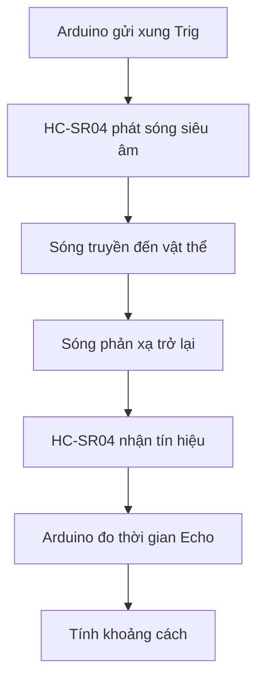
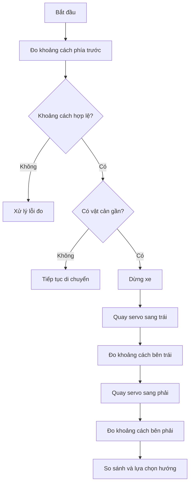

# Bài 6: Đọc khoảng cách từ cảm biến siêu âm HC-SR04

## 1. Giới thiệu

Trong các bài học trước, chúng ta đã tìm hiểu cách điều khiển động cơ Servo SG90 và động cơ DC bằng Arduino Nano.

Ở bài học này, chúng ta sẽ tìm hiểu và thực hành sử dụng **cảm biến siêu âm HC-SR04** để đo khoảng cách từ xe robot đến các vật thể phía trước.

Cảm biến HC-SR04 là một trong những loại cảm biến phổ biến trong các dự án robot Arduino. Cảm biến cho phép xác định khoảng cách đến vật cản mà không cần tiếp xúc trực tiếp với vật thể.

Trên xe robot, dữ liệu khoảng cách có thể được sử dụng để phát hiện vật cản, dừng xe hoặc lựa chọn hướng di chuyển phù hợp.

Thông qua bài học, chúng ta sẽ tìm hiểu:

- Cấu tạo và nguyên lý hoạt động của cảm biến HC-SR04.
- Cách kết nối HC-SR04 với Arduino Nano.
- Cách tạo tín hiệu kích hoạt phép đo.
- Cách đọc thời gian phản hồi từ cảm biến.
- Cách tính khoảng cách từ thời gian phản hồi.
- Cách hiển thị kết quả đo bằng Serial Monitor.
- Cách phát hiện vật cản dựa trên ngưỡng khoảng cách.

Sau khi hoàn thành, bạn sẽ có thể sử dụng HC-SR04 để đo khoảng cách và xây dựng chương trình phát hiện vật cản đơn giản.

## 2. Tìm hiểu về cảm biến HC-SR04

### 2.1. Cảm biến HC-SR04 là gì?

HC-SR04 là cảm biến đo khoảng cách sử dụng sóng siêu âm.

Cảm biến phát ra sóng âm có tần số cao, sau đó nhận tín hiệu phản xạ từ vật thể để xác định khoảng cách.

<AsyncImage query="HC-SR04 ultrasonic distance sensor module front view two transducers VCC Trig Echo GND pins" aspectRatio="5:3" maxWidth="420px"/>

HC-SR04 thường được sử dụng trong các ứng dụng:

- Phát hiện vật cản trên robot.
- Đo khoảng cách đến vật thể.
- Hỗ trợ robot tránh va chạm.
- Đo mức chất lỏng trong một số điều kiện phù hợp.
- Phát hiện sự hiện diện của vật thể trong phạm vi đo.

Trên xe robot Arduino Nano, cảm biến HC-SR04 được lắp trên servo SG90 để có thể thay đổi hướng đo khoảng cách.

### 2.2. Các thành phần chính

Cảm biến HC-SR04 có hai đầu dò hình tròn:

- **Bộ phát siêu âm:** Phát sóng âm về phía trước.
- **Bộ thu siêu âm:** Nhận sóng âm phản xạ từ vật thể.

Ngoài ra, module còn có mạch điện tử xử lý tín hiệu và bốn chân kết nối.

### 2.3. Thông số kỹ thuật

Một số thông số thường gặp của HC-SR04:

| Thông số | Giá trị tham khảo |
|---|---|
| Điện áp hoạt động | 5V DC |
| Tần số siêu âm | 40 kHz |
| Phạm vi đo danh định | Khoảng 2–400 cm |
| Độ chính xác công bố | Khoảng ±3 mm trong điều kiện phù hợp |
| Góc đo tham khảo | Khoảng 15° |
| Tín hiệu kích hoạt | Xung HIGH tối thiểu 10 µs |
| Số chân kết nối | 4 chân |

Các thông số trên là giá trị tham khảo. Kết quả thực tế phụ thuộc vào bề mặt vật thể, góc phản xạ, môi trường và chất lượng module.

## 3. Nguyên lý hoạt động của HC-SR04

### 3.1. Quá trình đo khoảng cách

HC-SR04 hoạt động dựa trên nguyên lý đo thời gian truyền và phản xạ của sóng siêu âm.

Quá trình đo gồm các bước:

1. Arduino gửi một xung kích hoạt đến chân Trig.
2. HC-SR04 phát một chuỗi xung siêu âm tần số 40 kHz.
3. Sóng siêu âm truyền trong không khí và gặp vật thể.
4. Một phần sóng được phản xạ trở lại cảm biến.
5. Cảm biến nhận tín hiệu phản xạ và tạo tín hiệu trên chân Echo.
6. Arduino đo thời gian Echo ở mức HIGH để tính khoảng cách.



Thời gian đo được tương ứng với quá trình sóng siêu âm truyền từ cảm biến đến vật thể và phản xạ trở lại.

Vì vậy, khoảng cách thực tế chỉ bằng một nửa quãng đường sóng đã truyền.

### 3.2. Công thức tính khoảng cách

Khoảng cách được tính theo công thức:

\[
d=\frac{v\times t}{2}
\]

Trong đó:

- \(d\): Khoảng cách từ cảm biến đến vật thể.
- \(v\): Vận tốc truyền âm trong không khí.
- \(t\): Thời gian sóng siêu âm truyền đi và phản xạ trở lại.

Ở nhiệt độ khoảng 20°C, vận tốc âm thanh trong không khí xấp xỉ 343 m/s.

Nếu thời gian được đo bằng micro giây (µs) và khoảng cách tính bằng centimet, ta có:

\[
d\;(\text{cm})\approx\frac{t\;(\mu s)}{58}
\]

Đây là công thức gần đúng thường được sử dụng khi lập trình HC-SR04.

Ví dụ:

| Thời gian Echo | Khoảng cách xấp xỉ |
|---|---|
| 580 µs | 10 cm |
| 1160 µs | 20 cm |
| 1740 µs | 30 cm |
| 2900 µs | 50 cm |

Trong thực tế, vận tốc âm thanh thay đổi theo nhiệt độ và điều kiện môi trường, vì vậy kết quả có thể có sai số.

## 4. Kết nối HC-SR04 với Arduino Nano

### 4.1. Các chân kết nối

Cảm biến HC-SR04 có bốn chân:

| Chân HC-SR04 | Chức năng | Kết nối Arduino Nano |
|---|---|---|
| VCC | Cấp nguồn | 5V |
| Trig | Kích hoạt phép đo | A0 |
| Echo | Trả tín hiệu thời gian đo | A1 |
| GND | Nối đất | GND |

Trong bộ xe robot của chúng ta:

- **A0:** Chân điều khiển Trig.
- **A1:** Chân đọc Echo.

Hai chân A0 và A1 được sử dụng như các chân Digital trong bài học này.

Mặc dù tên chân bắt đầu bằng chữ A, chúng ta vẫn có thể sử dụng `digitalWrite()` và `pulseIn()` trên các chân này.

### 4.2. Sơ đồ kết nối

```text
Arduino Nano              HC-SR04
────────────              ───────

5V   ──────────────────── VCC

A0   ──────────────────── Trig

A1   ──────────────────── Echo

GND  ──────────────────── GND
```

**Lưu ý:**

- Kiểm tra đúng chân VCC và GND trước khi cấp nguồn.
- Không đảo nhầm chân Trig và Echo.
- Cảm biến HC-SR04 chuẩn sử dụng nguồn 5V.
- Chân Echo có thể xuất tín hiệu logic 5V, phù hợp với Arduino Nano classic nhưng không được nối trực tiếp sang các vi điều khiển chỉ chịu mức 3,3V nếu không có mạch chuyển mức phù hợp.

Trong bài học này, chúng ta chỉ đo khoảng cách và hiển thị kết quả trên máy tính, chưa cần điều khiển servo hoặc động cơ.

## 5. Tìm hiểu các lệnh sử dụng trong chương trình

Trước khi viết chương trình, chúng ta sẽ làm quen với một số lệnh cần thiết để giao tiếp với HC-SR04.

### 5.1. Hàm pinMode()

Hàm `pinMode()` được sử dụng để cấu hình chế độ hoạt động của chân tín hiệu.

Ví dụ:

```cpp
pinMode(A0, OUTPUT);
pinMode(A1, INPUT);
```

Trong đó:

- `OUTPUT`: Chân xuất tín hiệu.
- `INPUT`: Chân nhận tín hiệu.

Đối với HC-SR04:

- Trig được cấu hình là OUTPUT.
- Echo được cấu hình là INPUT.

### 5.2. Hàm digitalWrite()

Hàm `digitalWrite()` được sử dụng để đưa một chân Digital lên mức HIGH hoặc LOW.

Ví dụ:

```cpp
digitalWrite(A0, HIGH);
```

Lệnh này đưa chân A0 lên mức HIGH.

Để đưa chân về mức LOW:

```cpp
digitalWrite(A0, LOW);
```

Trong quá trình đo khoảng cách, chúng ta sử dụng các lệnh này để tạo xung kích hoạt cảm biến.

### 5.3. Hàm delayMicroseconds()

Hàm `delayMicroseconds()` được sử dụng để tạo khoảng thời gian chờ tính bằng micro giây.

Ví dụ:

```cpp
delayMicroseconds(10);
```

Lệnh trên làm chương trình chờ 10 micro giây.

Đơn vị micro giây nhỏ hơn mili giây:

\[
1\text{ ms}=1000\;\mu s
\]

HC-SR04 cần một xung HIGH tối thiểu 10 µs trên chân Trig để bắt đầu phép đo.

### 5.4. Hàm pulseIn()

Hàm `pulseIn()` được sử dụng để đo độ rộng của một xung tín hiệu.

Ví dụ:

```cpp
unsigned long thoiGian = pulseIn(A1, HIGH, 25000);
```

Trong đó:

- `A1`: Chân nhận tín hiệu Echo.
- `HIGH`: Đo thời gian tín hiệu ở mức HIGH.
- `25000`: Thời gian chờ tối đa, tính bằng micro giây.
- `thoiGian`: Biến lưu kết quả đo.

Nếu không nhận được xung hoàn chỉnh trong thời gian cho phép, hàm trả về giá trị 0.

Việc sử dụng thời gian chờ giúp chương trình không phải đợi quá lâu khi cảm biến không nhận được tín hiệu phản xạ.

## 6. Ví dụ 1: Đọc khoảng cách bằng HC-SR04

Trong ví dụ đầu tiên, chúng ta sẽ lập trình Arduino Nano đọc khoảng cách từ HC-SR04 và hiển thị kết quả trên Serial Monitor.

### 6.1. Chương trình mẫu

Tạo chương trình mới trong Arduino IDE với tên `NanoKhoangCach`.

Nhập đoạn mã sau:

```cpp
// ================= HC-SR04 =================
#define TRIG_PIN A0
#define ECHO_PIN A1

void setup() {
  pinMode(TRIG_PIN, OUTPUT);
  pinMode(ECHO_PIN, INPUT);

  digitalWrite(TRIG_PIN, LOW);

  Serial.begin(9600);
}

void loop() {
  // Tao xung kich hoat HC-SR04
  digitalWrite(TRIG_PIN, LOW);
  delayMicroseconds(2);

  digitalWrite(TRIG_PIN, HIGH);
  delayMicroseconds(10);

  digitalWrite(TRIG_PIN, LOW);

  // Doc thoi gian Echo
  unsigned long thoiGian = pulseIn(ECHO_PIN, HIGH, 25000);

  if (thoiGian == 0) {
    Serial.println("Khong co so do hop le");
  } else {
    // Tinh khoang cach theo cm
    float khoangCach = thoiGian / 58.0;

    Serial.print("Khoang cach: ");
    Serial.print(khoangCach);
    Serial.println(" cm");
  }

  delay(100);
}
```

### 6.2. Giải thích chương trình

**Khai báo chân kết nối**

```cpp
#define TRIG_PIN A0
#define ECHO_PIN A1
```

Hai dòng lệnh trên định nghĩa chân Trig và Echo tương ứng với A0 và A1 của Arduino Nano.

**Khởi tạo cảm biến**

```cpp
pinMode(TRIG_PIN, OUTPUT);
pinMode(ECHO_PIN, INPUT);
```

Chân Trig được sử dụng để xuất tín hiệu kích hoạt, còn chân Echo được sử dụng để nhận tín hiệu phản hồi.

**Tạo xung kích hoạt**

```cpp
digitalWrite(TRIG_PIN, LOW);
delayMicroseconds(2);

digitalWrite(TRIG_PIN, HIGH);
delayMicroseconds(10);

digitalWrite(TRIG_PIN, LOW);
```

Arduino đưa chân Trig lên mức HIGH trong 10 µs, sau đó đưa về LOW.

Xung này yêu cầu HC-SR04 bắt đầu một phép đo mới.

**Đọc thời gian Echo**

```cpp
unsigned long thoiGian = pulseIn(ECHO_PIN, HIGH, 25000);
```

Hàm `pulseIn()` đo thời gian Echo ở mức HIGH và lưu kết quả vào biến `thoiGian`.

**Kiểm tra kết quả đo**

```cpp
if (thoiGian == 0) {
  Serial.println("Khong co so do hop le");
}
```

Nếu không nhận được xung hợp lệ, chương trình hiển thị thông báo.

Giá trị 0 ở đây không phải là khoảng cách 0 cm mà thể hiện phép đo không thu được kết quả hợp lệ.

**Tính khoảng cách**

```cpp
float khoangCach = thoiGian / 58.0;
```

Lệnh này chuyển thời gian đo được thành khoảng cách theo đơn vị centimet.

**Hiển thị kết quả**

```cpp
Serial.print("Khoang cach: ");
Serial.print(khoangCach);
Serial.println(" cm");
```

Arduino gửi kết quả về máy tính thông qua giao tiếp Serial.

### 6.3. Nạp và kiểm tra chương trình

Thực hiện các bước:

1. Kiểm tra kết nối HC-SR04 với Arduino Nano.
2. Ngắt nguồn động cơ của xe.
3. Nếu Nano đang kết nối với L298N, ngắt IN1/IN2 khỏi D0/D1 để sử dụng Serial.
4. Kết nối Arduino Nano với máy tính.
5. Chọn đúng Board và Port trong Arduino IDE.
6. Nhấn Verify để kiểm tra chương trình.
7. Nhấn Upload để nạp chương trình.
8. Mở Serial Monitor và chọn tốc độ 9600 baud.

**Kết quả:** Serial Monitor hiển thị dữ liệu tương tự:

```text
Khoang cach: 15.24 cm
Khoang cach: 15.31 cm
Khoang cach: 15.28 cm
Khoang cach: 15.19 cm
```

Các giá trị trên chỉ là ví dụ. Kết quả thực tế phụ thuộc vào khoảng cách đến vật thể.

## 7. Thực hành đo khoảng cách

Sau khi nạp chương trình thành công, chúng ta sẽ tiến hành kiểm tra hoạt động của cảm biến.

### 7.1. Đo khoảng cách với vật thể cố định

Chuẩn bị một tấm bìa phẳng hoặc một vật có bề mặt tương đối phẳng.

Đặt vật thể phía trước cảm biến ở các khoảng cách khác nhau.

Ví dụ:

| Khoảng cách đặt vật | Kết quả mong đợi |
|---|---|
| 15 cm | Giá trị đo gần 15 cm |
| 30 cm | Giá trị đo gần 30 cm |
| 50 cm | Giá trị đo gần 50 cm |

Trong quá trình đo, nên giữ cảm biến và vật thể cố định để hạn chế sai số.

### 7.2. Quan sát sự thay đổi khoảng cách

Thực hiện lần lượt:

1. Đặt vật thể cách cảm biến khoảng 15 cm.
2. Quan sát giá trị trên Serial Monitor.
3. Di chuyển vật thể ra xa đến khoảng 30 cm.
4. Quan sát sự thay đổi.
5. Tiếp tục đưa vật thể đến khoảng 50 cm.

**Kết quả:** Khi vật thể di chuyển ra xa, giá trị khoảng cách nhìn chung tăng lên. Khi đưa vật thể lại gần, giá trị khoảng cách giảm xuống.

### 7.3. Một số yếu tố ảnh hưởng đến kết quả đo

Kết quả đo của HC-SR04 có thể bị ảnh hưởng bởi:

- Bề mặt vật thể không phản xạ âm tốt.
- Vật thể đặt nghiêng so với hướng đo.
- Khoảng cách nằm ngoài phạm vi hoạt động.
- Cảm biến hoặc vật thể đang rung.
- Nguồn điện không ổn định.
- Có nhiều vật thể trong vùng đo gây phản xạ không mong muốn.

Vì vậy, trong các ứng dụng robot thực tế, dữ liệu từ cảm biến thường cần được kiểm tra và xử lý trước khi sử dụng để điều khiển chuyển động.

## 8. Ví dụ 2: Phát hiện vật cản theo khoảng cách

Sau khi đã đo được khoảng cách, chúng ta có thể sử dụng câu lệnh điều kiện `if` để xác định vật thể có nằm trong phạm vi cảnh báo hay không.

Ví dụ, nếu khoảng cách nhỏ hơn 20 cm, Arduino sẽ hiển thị thông báo phát hiện vật cản.

### 8.1. Chương trình mẫu

```cpp
// ================= HC-SR04 =================
#define TRIG_PIN A0
#define ECHO_PIN A1

// ================= SETTINGS =================
const float KHOANG_CACH_CANH_BAO = 20.0;

void setup() {
  pinMode(TRIG_PIN, OUTPUT);
  pinMode(ECHO_PIN, INPUT);

  digitalWrite(TRIG_PIN, LOW);

  Serial.begin(9600);
}

void loop() {
  // Tao xung Trig
  digitalWrite(TRIG_PIN, LOW);
  delayMicroseconds(2);

  digitalWrite(TRIG_PIN, HIGH);
  delayMicroseconds(10);

  digitalWrite(TRIG_PIN, LOW);

  // Doc Echo
  unsigned long thoiGian = pulseIn(ECHO_PIN, HIGH, 25000);

  if (thoiGian == 0) {
    Serial.println("Khong co so do hop le");
  } else {
    float khoangCach = thoiGian / 58.0;

    Serial.print("Khoang cach: ");
    Serial.print(khoangCach);
    Serial.println(" cm");

    if (khoangCach < KHOANG_CACH_CANH_BAO) {
      Serial.println("Canh bao: Vat can o gan!");
    }
  }

  delay(100);
}
```

### 8.2. Giải thích chương trình

Đầu tiên, chúng ta khai báo ngưỡng cảnh báo:

```cpp
const float KHOANG_CACH_CANH_BAO = 20.0;
```

Giá trị này được sử dụng để xác định khoảng cách cần cảnh báo.

Sau khi đọc và tính khoảng cách, chương trình kiểm tra:

```cpp
if (khoangCach < KHOANG_CACH_CANH_BAO) {
  Serial.println("Canh bao: Vat can o gan!");
}
```

Nếu khoảng cách đo được nhỏ hơn 20 cm, Arduino sẽ gửi thêm thông báo cảnh báo.

Ví dụ:

```text
Khoang cach: 35.20 cm
Khoang cach: 28.41 cm
Khoang cach: 19.62 cm
Canh bao: Vat can o gan!
Khoang cach: 15.34 cm
Canh bao: Vat can o gan!
```

**Kết quả:** Khi vật thể được đưa vào phạm vi dưới 20 cm, chương trình hiển thị thông báo cảnh báo.

Trong ví dụ này, Arduino mới chỉ phát hiện và thông báo vật cản, chưa điều khiển động cơ dừng xe.

## 9. Xây dựng hàm đọc khoảng cách

Trong các chương trình điều khiển robot, chúng ta thường cần đọc khoảng cách nhiều lần.

Vì vậy, thay vì viết lại toàn bộ các lệnh kích hoạt và đọc Echo, chúng ta có thể xây dựng một hàm riêng để đo khoảng cách.

### 9.1. Hàm đọc khoảng cách

```cpp
float readDistance() {
  // Tao xung Trig
  digitalWrite(TRIG_PIN, LOW);
  delayMicroseconds(2);

  digitalWrite(TRIG_PIN, HIGH);
  delayMicroseconds(10);

  digitalWrite(TRIG_PIN, LOW);

  // Doc thoi gian Echo
  unsigned long duration = pulseIn(ECHO_PIN, HIGH, 25000);

  if (duration == 0) {
    return -1.0;
  }

  return duration / 58.0;
}
```

Hàm `readDistance()` thực hiện:

1. Gửi xung kích hoạt HC-SR04.
2. Đọc thời gian Echo.
3. Kiểm tra kết quả.
4. Tính và trả về khoảng cách theo centimet.

Nếu không nhận được xung hợp lệ, hàm trả về `-1.0` để chương trình có thể nhận biết lỗi đo.

### 9.2. Chương trình hoàn chỉnh

```cpp
// ================= HC-SR04 =================
#define TRIG_PIN A0
#define ECHO_PIN A1

// ================= FUNCTION =================
float readDistance() {
  digitalWrite(TRIG_PIN, LOW);
  delayMicroseconds(2);

  digitalWrite(TRIG_PIN, HIGH);
  delayMicroseconds(10);

  digitalWrite(TRIG_PIN, LOW);

  unsigned long duration = pulseIn(ECHO_PIN, HIGH, 25000);

  if (duration == 0) {
    return -1.0;
  }

  return duration / 58.0;
}

// ================= SETUP =================
void setup() {
  pinMode(TRIG_PIN, OUTPUT);
  pinMode(ECHO_PIN, INPUT);

  digitalWrite(TRIG_PIN, LOW);

  Serial.begin(9600);
}

// ================= LOOP =================
void loop() {
  float distance = readDistance();

  if (distance < 0) {
    Serial.println("Khong co so do hop le");
  } else {
    Serial.print("Khoang cach: ");
    Serial.print(distance);
    Serial.println(" cm");
  }

  delay(100);
}
```

### 9.3. Ưu điểm của việc sử dụng hàm

Khi sử dụng hàm `readDistance()`, chương trình trở nên ngắn gọn và dễ đọc hơn.

Ví dụ, để lấy giá trị khoảng cách, chúng ta chỉ cần gọi:

```cpp
float distance = readDistance();
```

Sau đó có thể sử dụng giá trị này trong các điều kiện điều khiển.

```cpp
if (distance > 0 && distance < 20) {
  // Phat hien vat can trong pham vi 20 cm
}
```

Việc chia chương trình thành các hàm riêng cũng giúp dễ dàng kết hợp cảm biến HC-SR04 với servo và động cơ trong những bài học tiếp theo.

## 10. Ứng dụng HC-SR04 trên xe robot Arduino

Trên xe robot, cảm biến HC-SR04 được gắn trên servo SG90.

Nhờ đó, Arduino có thể điều khiển cảm biến quay sang các hướng khác nhau để đo khoảng cách.

Ví dụ:

- Góc 90°: Đo khoảng cách phía trước.
- Góc 60°: Đo khoảng cách về một phía.
- Góc 120°: Đo khoảng cách về phía còn lại.

Các góc trên là ví dụ và cần được điều chỉnh theo hướng lắp đặt thực tế của servo.

### 10.1. Nguyên lý phát hiện và tránh vật cản



Đây là nguyên lý cơ bản để xây dựng chức năng tránh vật cản.

Trong thực tế, cần bổ sung các điều kiện xử lý lỗi đo, giới hạn tốc độ và kiểm tra vùng an toàn trước khi điều khiển xe tự động.

**Lưu ý:** Khi HC-SR04 không nhận được Echo, không được mặc định rằng phía trước không có vật cản. Trường hợp này cần được xử lý riêng để tránh đưa ra quyết định di chuyển dựa trên dữ liệu không hợp lệ.

## 11. Một số lưu ý khi sử dụng HC-SR04

### 11.1. Giới hạn khoảng cách đo

HC-SR04 có phạm vi đo danh định khoảng 2–400 cm.

Tuy nhiên, trong thực tế, cảm biến có thể hoạt động kém ổn định ở những khoảng cách quá gần hoặc quá xa.

Vì vậy, nên thử nghiệm trong khoảng cách phù hợp trước khi sử dụng dữ liệu để điều khiển robot.

### 11.2. Ảnh hưởng của bề mặt vật thể

Sóng siêu âm có thể phản xạ khác nhau tùy theo vật liệu và hình dạng vật thể.

Ví dụ:

- Bề mặt phẳng, cứng thường phản xạ tốt.
- Bề mặt mềm hoặc hấp thụ âm có thể làm tín hiệu phản xạ yếu.
- Bề mặt nghiêng có thể phản xạ sóng ra khỏi hướng cảm biến.

Do đó, kết quả đo không phải lúc nào cũng phản ánh chính xác khoảng cách đến mọi vật thể.

### 11.3. Thời gian giữa các lần đo

Sau mỗi phép đo, nên có khoảng thời gian chờ phù hợp trước khi kích hoạt phép đo tiếp theo.

Việc kích hoạt quá nhanh có thể làm tín hiệu phản xạ từ lần đo trước ảnh hưởng đến kết quả lần đo sau.

Trong các ví dụ của bài học, chúng ta sử dụng:

```cpp
delay(100);
```

Tương đương khoảng chờ 100 ms sau mỗi lượt xử lý.

Khoảng thời gian này phù hợp cho các bài thực hành đo khoảng cách cơ bản.

### 11.4. Ảnh hưởng của nguồn điện và chuyển động

Khi HC-SR04 được lắp trên xe robot, rung động từ động cơ và sự thay đổi nguồn điện có thể ảnh hưởng đến kết quả đo.

Vì vậy, cần:

- Cố định cảm biến chắc chắn.
- Sử dụng nguồn điện ổn định.
- Tránh để dây kết nối bị lỏng.
- Hạn chế đo khi servo đang chuyển động mạnh.
- Kiểm tra dữ liệu trước khi sử dụng để điều khiển xe.

## 12. Một số lỗi thường gặp

| Hiện tượng | Nguyên nhân và cách xử lý |
|---|---|
| Luôn báo không có số đo hợp lệ | Kiểm tra chân Trig, Echo, nguồn và GND |
| Khoảng cách luôn bằng một giá trị | Kiểm tra chương trình, vật thể phản xạ và hướng cảm biến |
| Kết quả đo thay đổi liên tục | Kiểm tra rung động, nguồn điện và bề mặt vật thể |
| Khoảng cách sai lệch lớn | Kiểm tra góc đặt vật, vùng đo và điều kiện môi trường |
| Serial Monitor không hiển thị | Kiểm tra Port, tốc độ baud và chương trình đã Upload |
| Không nạp được chương trình | Kiểm tra D0/D1 có đang kết nối với driver động cơ hay không |

Khi gặp lỗi, nên thử cảm biến với một tấm phẳng ở khoảng cách khoảng 20–30 cm trước khi kiểm tra các tình huống phức tạp hơn.

## 13. Bài tập thực hành

Sau khi hoàn thành các ví dụ, hãy thực hiện những bài tập sau.

**Bài tập 1: Đo khoảng cách**

Viết chương trình hiển thị khoảng cách từ HC-SR04 về Serial Monitor sau mỗi 500 ms.

Thử đặt vật thể ở các khoảng cách 15 cm, 30 cm và 50 cm.

**Bài tập 2: Phát hiện vật cản**

Viết chương trình để:

- Nếu khoảng cách nhỏ hơn 15 cm, hiển thị `Vat can gan`.
- Nếu khoảng cách từ 15 cm trở lên và phép đo hợp lệ, hiển thị `Khoang cach an toan`.
- Nếu không nhận được Echo, hiển thị `Loi do khoang cach`.

**Bài tập 3: Sử dụng hàm**

Viết chương trình sử dụng hàm `readDistance()` để lấy khoảng cách.

Sau đó sử dụng câu lệnh `if` để kiểm tra vật cản trong phạm vi 20 cm.

**Bài tập 4: Thay đổi ngưỡng cảnh báo**

Khai báo biến:

```cpp
float nguongCanhBao = 20.0;
```

Sử dụng biến này để kiểm tra khoảng cách.

Thử thay đổi ngưỡng thành 10 cm, 15 cm và 30 cm rồi quan sát kết quả.

## 14. Tổng kết

Qua bài học này, chúng ta đã tìm hiểu và thực hành:

- Cấu tạo và nguyên lý hoạt động của cảm biến HC-SR04.
- Cách kết nối HC-SR04 với Arduino Nano.
- Cách tạo xung Trig để kích hoạt phép đo.
- Cách sử dụng `pulseIn()` để đọc thời gian Echo.
- Cách tính khoảng cách theo đơn vị centimet.
- Cách hiển thị kết quả đo bằng Serial Monitor.
- Cách phát hiện vật cản dựa trên ngưỡng khoảng cách.
- Cách xây dựng hàm `readDistance()` để sử dụng lại trong chương trình.

HC-SR04 là cảm biến quan trọng giúp robot nhận biết khoảng cách đến các vật thể trong môi trường.

Ở bài tiếp theo, chúng ta sẽ tìm hiểu **cảm biến dò line TCRT5000 5 mắt**, qua đó thực hành đọc tín hiệu cảm biến và xác định vị trí đường line bên dưới xe robot.