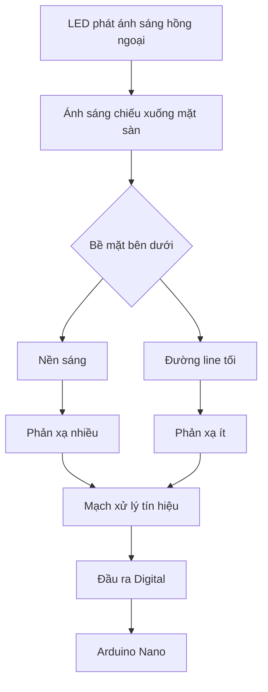
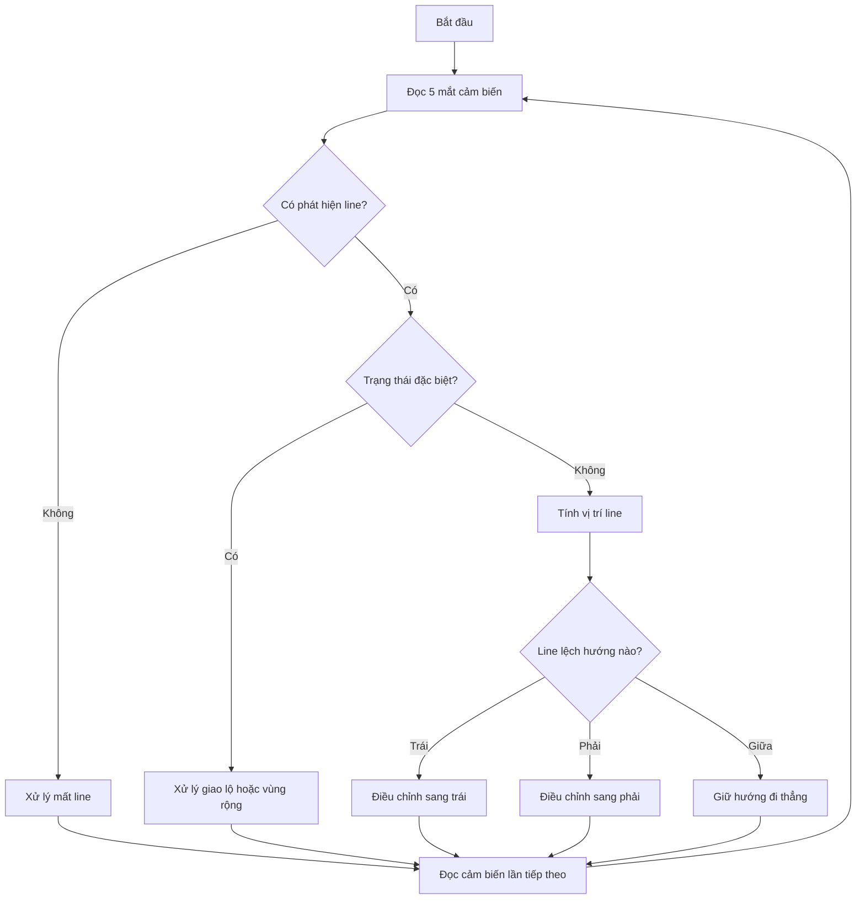

# Bài 7: Đọc cảm biến dò line TCRT5000 5 kênh

## 1. Giới thiệu

Trong các bài học trước, chúng ta đã tìm hiểu cách điều khiển động cơ DC bằng L298N và sử dụng cảm biến siêu âm HC-SR04 để đo khoảng cách đến vật cản.

Ở bài học này, chúng ta sẽ tìm hiểu và thực hành sử dụng **cảm biến dò line TCRT5000 5 kênh** để nhận biết vị trí đường line trên mặt sàn.

Cảm biến dò line là một trong những thành phần quan trọng của xe robot di động. Nhờ cảm biến này, robot có thể nhận biết đường dẫn được tạo sẵn trên mặt đất và điều chỉnh hướng di chuyển để bám theo đường dẫn đó.

Thông qua bài học, chúng ta sẽ tìm hiểu:

- Cấu tạo và nguyên lý hoạt động của cảm biến TCRT5000.
- Chức năng của module dò line 5 kênh.
- Cách kết nối cảm biến với Arduino Nano.
- Cách đọc tín hiệu Digital từ từng mắt cảm biến.
- Cách đọc đồng thời cả năm mắt cảm biến.
- Cách xác định vị trí đường line dựa trên tín hiệu cảm biến.
- Nguyên lý điều khiển xe robot bám theo đường line.

Sau khi hoàn thành, bạn sẽ có thể đọc và phân tích tín hiệu từ cảm biến dò line 5 kênh, làm cơ sở để xây dựng chương trình điều khiển xe tự động bám line.

## 2. Tìm hiểu về cảm biến dò line TCRT5000

### 2.1. Cảm biến TCRT5000 là gì?

TCRT5000 là cảm biến quang phản xạ sử dụng ánh sáng hồng ngoại để nhận biết sự khác biệt về khả năng phản xạ ánh sáng của các bề mặt.

Cảm biến thường được sử dụng để phân biệt bề mặt sáng và tối, đặc biệt trong các ứng dụng robot dò đường line.

<AsyncImage query="TCRT5000 infrared reflective optical sensor component black package infrared emitter receiver" aspectRatio="5:3" maxWidth="420px"/>

Một phần tử cảm biến TCRT5000 gồm hai bộ phận chính:

- **LED phát hồng ngoại:** Phát ánh sáng hồng ngoại về phía bề mặt cần kiểm tra.
- **Bộ thu quang:** Nhận ánh sáng hồng ngoại phản xạ từ bề mặt.

Khi đặt cảm biến gần mặt sàn, lượng ánh sáng phản xạ phụ thuộc vào đặc điểm của bề mặt bên dưới.

Thông thường:

- Bề mặt sáng phản xạ nhiều ánh sáng hồng ngoại hơn.
- Bề mặt tối hấp thụ nhiều ánh sáng hơn và phản xạ ít hơn.

Dựa vào sự khác biệt này, mạch cảm biến có thể xác định vị trí đường line.

### 2.2. Module cảm biến dò line 5 kênh

<AsyncImage query="five channel TCRT5000 infrared line tracking sensor array module five infrared sensors robot" aspectRatio="5:3" maxWidth="420px"/>

Module dò line 5 kênh sử dụng năm phần tử cảm biến được bố trí thành một hàng ngang.

Mỗi phần tử cảm biến tương ứng với một kênh tín hiệu riêng.

Trên xe robot, năm mắt cảm biến được bố trí theo chiều ngang so với hướng di chuyển.

Chúng ta quy ước vị trí như sau:

| Kênh | Vị trí | Chức năng |
|---|---|---|
| LINE_1 | Trái ngoài | Phát hiện line ở phía trái ngoài |
| LINE_2 | Trái trong | Phát hiện line ở phía trái gần tâm xe |
| LINE_3 | Giữa | Phát hiện line ở giữa xe |
| LINE_4 | Phải trong | Phát hiện line ở phía phải gần tâm xe |
| LINE_5 | Phải ngoài | Phát hiện line ở phía phải ngoài |

Khi robot di chuyển, Arduino liên tục đọc trạng thái của năm mắt để xác định đường line đang nằm ở vị trí nào so với xe.

**Lưu ý:** Vị trí trái và phải được xác định theo hướng tiến của robot. Nếu module được lắp ngược hoặc thứ tự dây thay đổi, cần kiểm tra lại thứ tự các kênh trước khi lập trình.

## 3. Nguyên lý hoạt động của cảm biến dò line

### 3.1. Nguyên lý phản xạ hồng ngoại

Khi hoạt động, LED hồng ngoại trên cảm biến phát ánh sáng xuống mặt sàn.

Ánh sáng phản xạ từ mặt sàn được bộ thu quang tiếp nhận.

Tín hiệu thu được phụ thuộc vào đặc điểm của bề mặt.

Ví dụ, khi sử dụng đường line màu đen trên nền trắng:

- Nền trắng thường phản xạ nhiều ánh sáng hồng ngoại.
- Đường line màu đen thường phản xạ ít ánh sáng hồng ngoại.

Mạch xử lý trên module sẽ chuyển tín hiệu phản xạ thành tín hiệu Digital để Arduino có thể đọc được.



### 3.2. Tín hiệu Digital của cảm biến

Trong bài học này, chúng ta sử dụng đầu ra Digital của module cảm biến.

Mỗi mắt cảm biến trả về một trong hai mức tín hiệu:

- `HIGH`: Mức logic 1.
- `LOW`: Mức logic 0.

Theo quy ước của bộ xe robot đang sử dụng:

| Trạng thái cảm biến | Tín hiệu Digital |
|---|---|
| Phát hiện đường line | LOW (0) |
| Không phát hiện đường line | HIGH (1) |

Như vậy, khi một mắt cảm biến nằm trên đường line, Arduino sẽ đọc được giá trị `0` tại kênh tương ứng.

Ngược lại, khi mắt cảm biến nằm ngoài đường line, Arduino sẽ đọc được giá trị `1`.

**Lưu ý:** Không phải mọi module dò line đều có cùng quy ước HIGH/LOW. Một số module có thể cho tín hiệu ngược lại. Vì vậy, cần thực hành kiểm tra trạng thái thực tế trước khi sử dụng trong chương trình điều khiển robot.

### 3.3. Ảnh hưởng của khoảng cách đến mặt sàn

Khả năng nhận biết đường line không chỉ phụ thuộc vào màu sắc mà còn phụ thuộc vào khoảng cách giữa cảm biến và mặt sàn.

Nếu đặt cảm biến quá cao, lượng ánh sáng phản xạ nhận được có thể không đủ để phân biệt hai bề mặt.

Nếu đặt cảm biến quá gần, module có thể va chạm với mặt sàn hoặc hoạt động không ổn định tùy cấu tạo.

Vì vậy, khi thực hành cần giữ module ở độ cao phù hợp theo thông số và hướng dẫn của module đang sử dụng.

Nên thử nghiệm với đường line tối trên nền sáng có độ tương phản rõ trước khi sử dụng những bề mặt phức tạp hơn.

## 4. Kết nối cảm biến dò line với Arduino Nano

### 4.1. Các chân kết nối

Module dò line 5 kênh có năm đầu ra tín hiệu Digital, cùng các chân cấp nguồn.

Trong bộ xe robot Arduino Nano, chúng ta sử dụng bảng chân sau:

| Chân cảm biến | Chân Arduino Nano | Vị trí |
|---|---|---|
| OUT1 | D8 | Trái ngoài |
| OUT2 | D9 | Trái trong |
| OUT3 | D10 | Giữa |
| OUT4 | D11 | Phải trong |
| OUT5 | D12 | Phải ngoài |
| VCC | Nguồn phù hợp module | Cấp nguồn |
| GND | GND | Nối đất chung |

Các chân D8 đến D12 được sử dụng để đọc tín hiệu từ năm mắt cảm biến.

### 4.2. Sơ đồ kết nối

```text
Arduino Nano           Line Sensor 5 Kenh
────────────           ──────────────────

D8   ───────────────── OUT1

D9   ───────────────── OUT2

D10  ───────────────── OUT3

D11  ───────────────── OUT4

D12  ───────────────── OUT5

5V   ───────────────── VCC
                        (neu module ho tro 5V)

GND  ───────────────── GND
```

Trước khi cấp nguồn, cần xác nhận điện áp hoạt động được ghi trên module.

Không đấu nối chỉ dựa vào màu dây, vì thứ tự chân và màu dây có thể khác nhau giữa các bộ cảm biến.

### 4.3. Chuẩn bị trước khi thực hành

Để thực hành đọc cảm biến, chúng ta cần:

- Arduino Nano.
- Module dò line 5 kênh.
- Cáp USB truyền dữ liệu.
- Máy tính đã cài Arduino IDE.
- Một đoạn đường line tối trên nền sáng.
- Dây kết nối phù hợp.

Trong bài học này, chúng ta chỉ đọc tín hiệu cảm biến và hiển thị kết quả trên máy tính, chưa điều khiển động cơ.

Nếu sử dụng Nano đang lắp trên xe, cần ngắt nguồn động cơ và tạm thời ngắt các dây từ D0/D1 đến IN1/IN2 của L298N để sử dụng Serial Monitor.

## 5. Đọc tín hiệu từ một mắt cảm biến

Trước khi đọc đồng thời cả năm mắt, chúng ta sẽ thực hành đọc riêng mắt cảm biến ở giữa.

Mục đích là kiểm tra kết nối và xác định mức tín hiệu tương ứng với đường line.

### 5.1. Chương trình mẫu

Tạo chương trình mới với tên `NanoLineMotMat`.

Nhập đoạn mã sau:

```cpp
// Cam bien line o giua
#define LINE_3 10

void setup() {
  pinMode(LINE_3, INPUT);

  Serial.begin(9600);
}

void loop() {
  int trangThai = digitalRead(LINE_3);

  Serial.println(trangThai);

  delay(200);
}
```

### 5.2. Giải thích chương trình

**Khai báo chân cảm biến**

```cpp
#define LINE_3 10
```

Chúng ta sử dụng chân D10 để đọc tín hiệu từ mắt cảm biến ở giữa.

**Cấu hình chân đầu vào**

```cpp
pinMode(LINE_3, INPUT);
```

Lệnh này cấu hình D10 thành chân nhận tín hiệu Digital.

**Đọc trạng thái cảm biến**

```cpp
int trangThai = digitalRead(LINE_3);
```

Hàm `digitalRead()` đọc mức logic hiện tại của chân D10.

Giá trị trả về có thể là:

- `HIGH`, tương ứng số 1.
- `LOW`, tương ứng số 0.

**Hiển thị kết quả**

```cpp
Serial.println(trangThai);
```

Lệnh này gửi trạng thái cảm biến về Serial Monitor.

**Thời gian đọc**

```cpp
delay(200);
```

Chương trình chờ 200 ms trước khi thực hiện lượt đọc tiếp theo.

### 5.3. Nạp và kiểm tra

Thực hiện các bước:

1. Kết nối cảm biến với Arduino Nano.
2. Nạp chương trình vào Arduino.
3. Mở Serial Monitor.
4. Chọn tốc độ 9600 baud.
5. Đặt mắt cảm biến giữa lên phần nền sáng.
6. Quan sát giá trị hiển thị.
7. Đưa mắt cảm biến lên đường line tối.
8. Quan sát sự thay đổi.

Với module sử dụng quy ước LOW là phát hiện line, kết quả mong đợi là:

| Vị trí cảm biến | Giá trị đọc |
|---|---|
| Nằm trên nền sáng | 1 |
| Nằm trên đường line tối | 0 |

**Kết quả:** Khi di chuyển mắt cảm biến giữa nền và line, giá trị trên Serial Monitor thay đổi tương ứng giữa 1 và 0.

Nếu giá trị không thay đổi, cần kiểm tra lại nguồn điện, chân tín hiệu, độ cao cảm biến và độ tương phản giữa hai bề mặt.

## 6. Đọc đồng thời năm mắt cảm biến

Sau khi đã kiểm tra thành công một mắt, chúng ta sẽ mở rộng chương trình để đọc đồng thời cả năm kênh.

### 6.1. Khai báo chân cảm biến

```cpp
#define LINE_1 8
#define LINE_2 9
#define LINE_3 10
#define LINE_4 11
#define LINE_5 12
```

Năm chân tương ứng với năm vị trí cảm biến từ trái sang phải theo hướng tiến của xe.

### 6.2. Chương trình mẫu

Tạo chương trình mới với tên `NanoLineNamMat`.

```cpp
// ================= LINE SENSOR =================
#define LINE_1 8
#define LINE_2 9
#define LINE_3 10
#define LINE_4 11
#define LINE_5 12

void setup() {
  pinMode(LINE_1, INPUT);
  pinMode(LINE_2, INPUT);
  pinMode(LINE_3, INPUT);
  pinMode(LINE_4, INPUT);
  pinMode(LINE_5, INPUT);

  Serial.begin(9600);
}

void loop() {
  int s1 = digitalRead(LINE_1);
  int s2 = digitalRead(LINE_2);
  int s3 = digitalRead(LINE_3);
  int s4 = digitalRead(LINE_4);
  int s5 = digitalRead(LINE_5);

  Serial.print(s1);
  Serial.print(" ");

  Serial.print(s2);
  Serial.print(" ");

  Serial.print(s3);
  Serial.print(" ");

  Serial.print(s4);
  Serial.print(" ");

  Serial.println(s5);

  delay(200);
}
```

### 6.3. Giải thích chương trình

Trong hàm `loop()`, Arduino đọc trạng thái của năm mắt cảm biến:

```cpp
int s1 = digitalRead(LINE_1);
int s2 = digitalRead(LINE_2);
int s3 = digitalRead(LINE_3);
int s4 = digitalRead(LINE_4);
int s5 = digitalRead(LINE_5);
```

Mỗi biến lưu trạng thái của một mắt.

Sau đó, chương trình gửi các giá trị về Serial Monitor theo thứ tự từ trái sang phải.

Ví dụ:

```text
1 1 0 1 1
1 0 0 1 1
0 0 1 1 1
1 1 1 0 0
1 1 1 1 1
```

Mỗi dòng gồm năm giá trị, tương ứng với năm mắt cảm biến.

### 6.4. Phân tích kết quả

Theo quy ước `0` là phát hiện line, chúng ta có một số trạng thái cơ bản:

| Trạng thái | Ý nghĩa |
|---|---|
| `1 1 0 1 1` | Mắt giữa phát hiện line |
| `1 0 1 1 1` | Mắt trái trong phát hiện line |
| `0 1 1 1 1` | Mắt trái ngoài phát hiện line |
| `1 1 1 0 1` | Mắt phải trong phát hiện line |
| `1 1 1 1 0` | Mắt phải ngoài phát hiện line |
| `1 1 1 1 1` | Không mắt nào phát hiện line |
| `0 0 0 0 0` | Cả năm mắt cùng phát hiện vùng tương ứng với line |

Khi đường line có độ rộng lớn, nhiều mắt có thể cùng phát hiện line.

Ví dụ:

```text
1 0 0 1 1
```

Trong trường hợp này, mắt trái trong và mắt giữa cùng phát hiện đường line.

Vì vậy, chương trình điều khiển robot cần xem xét cả tổ hợp tín hiệu, không chỉ trạng thái của một mắt.

## 7. Xác định vị trí đường line

Sau khi đọc được năm mắt cảm biến, chúng ta có thể sử dụng các giá trị này để xác định vị trí tương đối của đường line so với robot.

### 7.1. Quy ước vị trí

Chúng ta quy ước năm mắt theo thứ tự:

```text
      HUONG XE TIEN
            ↑

TRAI                    PHAI

LINE_1 LINE_2 LINE_3 LINE_4 LINE_5
   |      |      |      |      |
  -2     -1      0      1      2
```

Trong đó:

- `-2`: Vị trí trái ngoài.
- `-1`: Vị trí trái trong.
- `0`: Vị trí giữa.
- `1`: Vị trí phải trong.
- `2`: Vị trí phải ngoài.

Các giá trị này là vị trí quy ước, không phải đơn vị khoảng cách thực tế.

### 7.2. Xác định line nằm bên nào

Ví dụ:

| Trạng thái cảm biến | Vị trí line |
|---|---|
| `1 1 0 1 1` | Giữa |
| `1 0 1 1 1` | Lệch trái |
| `0 1 1 1 1` | Lệch trái nhiều |
| `1 1 1 0 1` | Lệch phải |
| `1 1 1 1 0` | Lệch phải nhiều |

Khi line nằm ở giữa, xe có thể tiếp tục di chuyển thẳng.

Khi line lệch sang trái, xe cần điều chỉnh hướng về bên trái để đưa cảm biến trở lại vị trí trung tâm của line.

Ngược lại, khi line lệch sang phải, xe cần điều chỉnh về bên phải.

### 7.3. Tính vị trí trung bình của line

Khi nhiều mắt cùng phát hiện line, chúng ta có thể tính vị trí trung bình của các mắt đang nhận biết đường line.

Ví dụ, nếu hai mắt trái trong và giữa cùng phát hiện line:

```text
1 0 0 1 1
```

Hai vị trí tương ứng là `-1` và `0`.

Vị trí trung bình được tính như sau:

**Vị trí line = (-1 + 0) / 2 = -0,5**

Kết quả âm cho biết line đang lệch về phía trái.

Tương tự, nếu hai mắt giữa và phải trong phát hiện line:

```text
1 1 0 0 1
```

Ta có:

**Vị trí line = (0 + 1) / 2 = 0,5**

Kết quả dương cho biết line đang lệch về phía phải.

Cách tính này giúp biểu diễn vị trí line bằng một giá trị số, thuận tiện cho các thuật toán điều khiển bám line nâng cao.

**Lưu ý:** Chỉ tính trung bình khi có ít nhất một mắt phát hiện line và tổ hợp tín hiệu phù hợp với một đường line liên tục. Các trường hợp mất line, giao lộ hoặc nhiều vùng tối tách biệt cần được xử lý riêng.

## 8. Ví dụ: Xác định hướng lệch của đường line

Trong ví dụ này, chúng ta sẽ xây dựng chương trình đọc năm mắt cảm biến và hiển thị hướng lệch của line.

Chương trình chỉ hiển thị thông tin, chưa điều khiển động cơ.

### 8.1. Chương trình mẫu

```cpp
// ================= LINE SENSOR =================
#define LINE_1 8
#define LINE_2 9
#define LINE_3 10
#define LINE_4 11
#define LINE_5 12

void setup() {
  pinMode(LINE_1, INPUT);
  pinMode(LINE_2, INPUT);
  pinMode(LINE_3, INPUT);
  pinMode(LINE_4, INPUT);
  pinMode(LINE_5, INPUT);

  Serial.begin(9600);
}

void loop() {
  int s1 = digitalRead(LINE_1);
  int s2 = digitalRead(LINE_2);
  int s3 = digitalRead(LINE_3);
  int s4 = digitalRead(LINE_4);
  int s5 = digitalRead(LINE_5);

  // LOW = phat hien line
  int n1 = (s1 == LOW);
  int n2 = (s2 == LOW);
  int n3 = (s3 == LOW);
  int n4 = (s4 == LOW);
  int n5 = (s5 == LOW);

  int soMat = n1 + n2 + n3 + n4 + n5;

  if (soMat == 0) {
    Serial.println("Mat line");
  } else if (soMat == 5) {
    Serial.println("Tat ca mat phat hien line");
  } else {
    int tongViTri =
        n1 * (-2) +
        n2 * (-1) +
        n3 * 0 +
        n4 * 1 +
        n5 * 2;

    float viTri = (float)tongViTri / soMat;

    Serial.print("Vi tri line: ");
    Serial.println(viTri);

    if (viTri < -0.25) {
      Serial.println("Line lech trai");
    } else if (viTri > 0.25) {
      Serial.println("Line lech phai");
    } else {
      Serial.println("Line gan giua");
    }
  }

  delay(200);
}
```

### 8.2. Giải thích chương trình

Đầu tiên, chương trình chuyển tín hiệu LOW thành trạng thái phát hiện line:

```cpp
int n1 = (s1 == LOW);
```

Biểu thức `s1 == LOW` trả về:

- `1` nếu mắt đang phát hiện line.
- `0` nếu mắt không phát hiện line.

Các biến `n1` đến `n5` vì vậy biểu diễn trạng thái phát hiện line theo cách thuận tiện cho việc tính toán.

**Đếm số mắt phát hiện line**

```cpp
int soMat = n1 + n2 + n3 + n4 + n5;
```

Biến `soMat` cho biết có bao nhiêu mắt đang phát hiện line.

Nếu `soMat` bằng 0, chương trình thông báo mất line.

Nếu cả năm mắt cùng phát hiện line, chương trình hiển thị một trạng thái riêng.

**Tính vị trí line**

```cpp
int tongViTri =
    n1 * (-2) +
    n2 * (-1) +
    n3 * 0 +
    n4 * 1 +
    n5 * 2;

float viTri = (float)tongViTri / soMat;
```

Mỗi mắt được gán một vị trí từ `-2` đến `2`.

Chương trình cộng các vị trí của những mắt phát hiện line, sau đó chia cho số mắt đang phát hiện.

**Xác định hướng lệch**

```cpp
if (viTri < -0.25) {
  Serial.println("Line lech trai");
} else if (viTri > 0.25) {
  Serial.println("Line lech phai");
} else {
  Serial.println("Line gan giua");
}
```

Chương trình sử dụng giá trị vị trí để xác định line đang lệch trái, lệch phải hay gần giữa.

Ngưỡng `0.25` trong ví dụ chỉ dùng để phân loại trạng thái khi thực hành, không phải thông số bắt buộc của cảm biến.

### 8.3. Kết quả mong đợi

Khi đặt line dưới mắt giữa:

```text
Vi tri line: 0.00
Line gan giua
```

Khi đặt line dưới mắt trái trong:

```text
Vi tri line: -1.00
Line lech trai
```

Khi đặt line dưới mắt phải ngoài:

```text
Vi tri line: 2.00
Line lech phai
```

Khi không có mắt nào phát hiện line:

```text
Mat line
```

**Lưu ý:** Ví dụ này giả định đường line tạo thành một vùng liên tục dưới dãy cảm biến. Với các mẫu tín hiệu bất thường hoặc nhiều vùng line tách biệt, giá trị trung bình có thể không phản ánh đúng vị trí cần bám.

## 9. Nguyên lý điều khiển xe robot bám line

Sau khi đã xác định được vị trí đường line, Arduino có thể sử dụng thông tin này để điều chỉnh tốc độ hai động cơ.

Đối với xe robot sử dụng hai bánh chủ động, hướng di chuyển được điều chỉnh bằng cách thay đổi tốc độ tương đối giữa bánh trái và bánh phải.

### 9.1. Các trạng thái cơ bản

| Trạng thái line | Hướng điều chỉnh |
|---|---|
| Line ở giữa | Xe tiếp tục đi thẳng |
| Line lệch trái | Xe điều chỉnh sang trái |
| Line lệch phải | Xe điều chỉnh sang phải |
| Mất line | Dừng hoặc thực hiện thuật toán tìm lại line |
| Nhiều mắt cùng thấy line | Kiểm tra giao lộ hoặc vùng line rộng |

Ví dụ:

- Khi line lệch trái, có thể giảm tốc bánh trái và tăng tương đối tốc bánh phải.
- Khi line lệch phải, có thể giảm tốc bánh phải và tăng tương đối tốc bánh trái.
- Khi line nằm giữa, hai bánh có thể được điều khiển ở mức tốc độ gần bằng nhau.

Các quy tắc trên là nguyên lý điều khiển cơ bản. Chương trình thực tế cần xét thêm độ rộng line, trạng thái cảm biến và khả năng chuyển động của xe.

### 9.2. Sơ đồ nguyên lý bám line



Trong các bài học nâng cao, chúng ta có thể sử dụng thuật toán PID để điều chỉnh tốc độ động cơ dựa trên sai lệch vị trí line.

Tuy nhiên, trước khi xây dựng thuật toán bám line, cần đảm bảo cả năm mắt cảm biến hoạt động đúng và được lắp theo đúng thứ tự.

## 10. Một số lưu ý khi sử dụng cảm biến dò line

### 10.1. Kiểm tra thứ tự cảm biến

Khi lắp module dưới xe, cần xác định chính xác vị trí trái và phải theo hướng tiến.

Để kiểm tra, lần lượt đặt đường line dưới từng mắt từ trái sang phải và quan sát giá trị trên Serial Monitor.

Nếu thứ tự tín hiệu bị đảo, cần kiểm tra lại dây kết nối hoặc hướng lắp module.

Không nên sửa thuật toán rẽ trước khi xác nhận chính xác thứ tự cảm biến.

### 10.2. Điều chỉnh độ cao cảm biến

Cảm biến cần được lắp ở độ cao phù hợp so với mặt sàn.

Nếu module quá cao hoặc quá thấp, tín hiệu có thể không ổn định.

Nên kiểm tra với bề mặt thử nghiệm thực tế trước khi cố định vị trí lắp đặt.

### 10.3. Điều chỉnh ngưỡng phát hiện

Một số module dò line có biến trở dùng để điều chỉnh ngưỡng so sánh tín hiệu.

Nếu cảm biến luôn báo cùng một trạng thái, cần kiểm tra:

- Nguồn cấp.
- Khoảng cách đến mặt sàn.
- Độ tương phản của line và nền.
- Ngưỡng phát hiện của module, nếu có thể điều chỉnh.

Khi điều chỉnh, nên thay đổi từng yếu tố và quan sát kết quả trước khi tiếp tục.

### 10.4. Ảnh hưởng của ánh sáng môi trường

Ánh sáng môi trường, đặc biệt ánh sáng mạnh hoặc nguồn có thành phần hồng ngoại, có thể ảnh hưởng đến khả năng nhận biết của cảm biến.

Do đó, nên thử nghiệm cảm biến trong điều kiện ánh sáng tương tự môi trường mà robot sẽ hoạt động.

## 11. Một số lỗi thường gặp

| Hiện tượng | Nguyên nhân và cách xử lý |
|---|---|
| Cả năm mắt luôn báo 1 | Kiểm tra nguồn, độ cao, nền/line và ngưỡng phát hiện |
| Cả năm mắt luôn báo 0 | Kiểm tra vị trí đặt cảm biến, ngưỡng và các đầu ra |
| Một mắt luôn báo cùng trạng thái | Kiểm tra riêng mắt đó, dây OUT và mạch cảm biến |
| Thứ tự trái/phải bị đảo | Kiểm tra hướng lắp module và thứ tự dây |
| Tín hiệu thay đổi không ổn định | Kiểm tra khoảng cách đến sàn, ánh sáng và nguồn |
| Serial Monitor không hiển thị | Kiểm tra chương trình, Port và tốc độ baud |
| Không nạp được chương trình | Kiểm tra kết nối D0/D1 với driver động cơ |

Khi gặp lỗi, nên kiểm tra từng mắt cảm biến độc lập trước khi thử chương trình đọc đồng thời năm kênh.

## 12. Bài tập thực hành

Sau khi hoàn thành các ví dụ, hãy thực hiện những bài tập sau.

**Bài tập 1: Kiểm tra từng mắt cảm biến**

Viết chương trình đọc lần lượt năm mắt và hiển thị trạng thái của từng mắt trên Serial Monitor.

Đưa đường line dưới từng mắt để kiểm tra kết quả.

**Bài tập 2: Xác định vị trí line**

Viết chương trình đọc năm mắt và hiển thị một trong các thông báo:

- `Line o giua`.
- `Line lech trai`.
- `Line lech phai`.
- `Mat line`.

**Bài tập 3: Đếm số mắt phát hiện line**

Viết chương trình đếm số mắt đang phát hiện đường line.

Ví dụ:

```text
So mat phat hien line: 1
So mat phat hien line: 2
So mat phat hien line: 3
```

**Bài tập 4: Tính vị trí trung bình**

Sử dụng quy ước vị trí `-2, -1, 0, 1, 2` để tính vị trí trung bình của đường line.

Thử nghiệm với các trạng thái:

```text
1 1 0 1 1
1 0 0 1 1
1 1 0 0 1
0 0 1 1 1
1 1 1 0 0
```

So sánh kết quả tính toán với vị trí line thực tế.

## 13. Tổng kết

Qua bài học này, chúng ta đã tìm hiểu và thực hành:

- Cấu tạo và nguyên lý hoạt động của cảm biến TCRT5000.
- Chức năng của module dò line 5 kênh.
- Cách kết nối cảm biến với Arduino Nano.
- Cách đọc tín hiệu Digital từ từng mắt cảm biến.
- Cách đọc đồng thời năm mắt cảm biến.
- Cách phân tích trạng thái để xác định vị trí đường line.
- Cách tính vị trí trung bình của đường line.
- Nguyên lý điều khiển xe robot bám line.

Cảm biến dò line cung cấp thông tin về vị trí đường dẫn, giúp robot có thể điều chỉnh hướng di chuyển khi kết hợp với hệ thống điều khiển động cơ.

Ở bài tiếp theo, chúng ta sẽ tìm hiểu **cảm biến encoder và cách đếm xung bằng Arduino Nano**, từ đó đo tốc độ quay của bánh xe và hỗ trợ điều khiển chuyển động chính xác hơn.