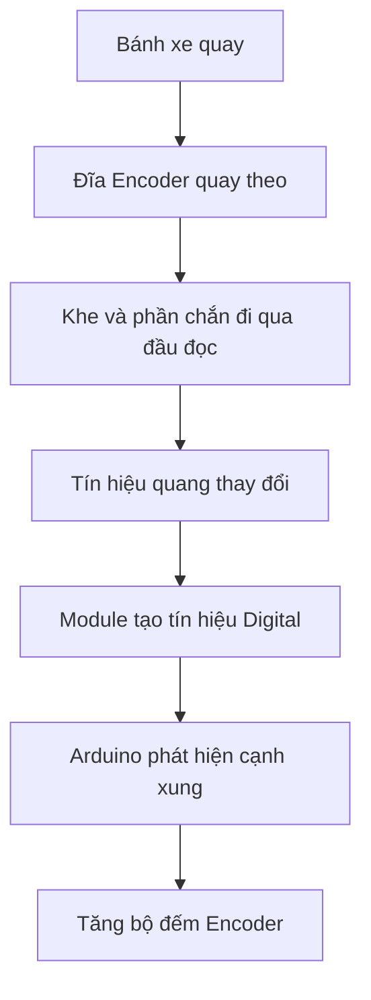
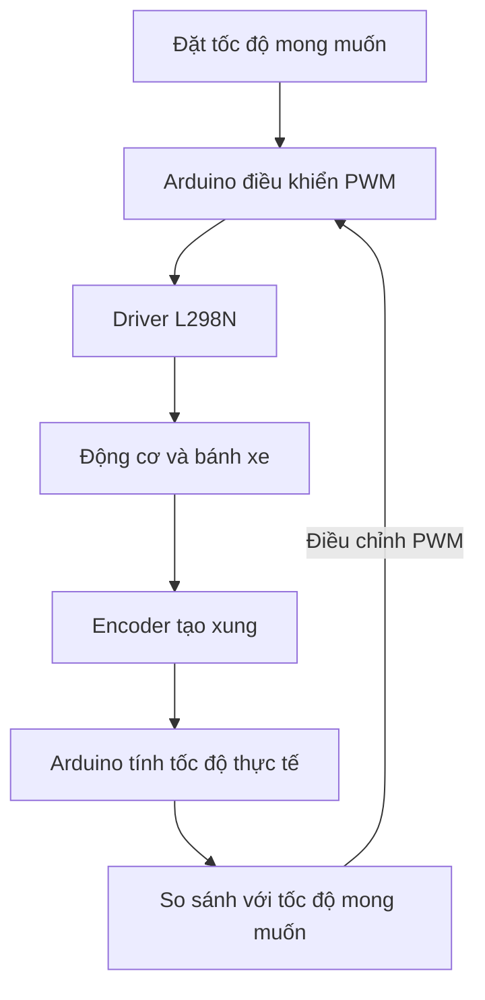

# Bài 8: Đọc cảm biến Encoder và đo tốc độ bánh xe

## 1. Giới thiệu

Trong các bài học trước, chúng ta đã tìm hiểu cách điều khiển động cơ DC bằng L298N và sử dụng các cảm biến để nhận biết môi trường xung quanh robot.

Tuy nhiên, khi điều khiển động cơ bằng PWM, Arduino chỉ thay đổi mức điều khiển cấp cho động cơ mà chưa biết chính xác bánh xe đang quay nhanh hay chậm.

Ví dụ, khi đặt cùng một giá trị PWM cho hai động cơ, tốc độ quay thực tế của hai bánh có thể khác nhau do đặc tính động cơ, ma sát, tải trọng và nguồn điện.

Để xác định chuyển động thực tế của bánh xe, chúng ta có thể sử dụng **cảm biến Encoder**.

Encoder cho phép Arduino đếm số xung sinh ra khi bánh xe quay. Từ số xung này, chương trình có thể ước lượng số vòng quay, tốc độ quay và quãng đường di chuyển của bánh xe.

Thông qua bài học, chúng ta sẽ tìm hiểu:

- Cảm biến Encoder là gì và nguyên lý hoạt động.
- Cấu tạo của Encoder quang sử dụng đĩa có khe.
- Cách kết nối hai cảm biến Encoder với Arduino Nano.
- Cách đọc tín hiệu Digital từ Encoder.
- Cách sử dụng ngắt ngoài để đếm xung.
- Cách xác định số xung trên một vòng bánh xe.
- Cách tính tốc độ quay theo đơn vị RPM.
- Cách ước lượng vận tốc và quãng đường di chuyển của bánh xe.

Sau khi hoàn thành bài học, bạn sẽ có thể đọc và xử lý tín hiệu từ hai cảm biến Encoder, làm cơ sở cho các bài điều khiển tốc độ và chuyển động của robot.

## 2. Tìm hiểu về cảm biến Encoder

### 2.1. Encoder là gì?

Encoder là thiết bị được sử dụng để chuyển đổi chuyển động quay hoặc chuyển động tịnh tiến thành tín hiệu điện.

Trong các hệ thống điều khiển động cơ, Encoder thường được sử dụng để đo số vòng quay, tốc độ quay hoặc vị trí chuyển động.

Đối với xe robot Arduino Nano, chúng ta sử dụng Encoder để theo dõi chuyển động của bánh xe.

Khi bánh xe quay, Encoder tạo ra các xung tín hiệu Digital. Arduino đếm số xung này để xác định mức độ chuyển động của bánh.

### 2.2. Cấu tạo Encoder trên xe robot

Bộ xe robot trong bài học sử dụng **hai module Encoder quang rời**, tương ứng với hai bánh xe.

Mỗi bộ Encoder gồm:

- Đĩa Encoder có các khe hoặc vùng chắn sáng.
- Module cảm biến quang để phát hiện sự thay đổi khi đĩa quay.
- Mạch xử lý và đầu ra tín hiệu Digital.
- Dây kết nối với Arduino Nano.

<AsyncImage query="Arduino robot wheel optical speed encoder slotted disc with infrared photo interrupter sensor module" aspectRatio="5:3" maxWidth="420px"/>

Đĩa Encoder được gắn với trục hoặc cơ cấu quay của bánh xe.

Khi đĩa quay, các khe và vùng chắn lần lượt đi qua đầu đọc quang, làm tín hiệu đầu ra thay đổi giữa hai mức HIGH và LOW.

**Lưu ý:** Động cơ DC trên bộ xe là loại động cơ giảm tốc thông thường. Encoder là module cảm biến được lắp riêng, không phải Encoder tích hợp bên trong động cơ.

### 2.3. Các ứng dụng của Encoder

Encoder thường được sử dụng trong những ứng dụng sau:

- Đếm số vòng quay của bánh xe.
- Đo tốc độ quay của động cơ.
- Ước lượng quãng đường robot di chuyển.
- So sánh tốc độ giữa hai bánh xe.
- Hỗ trợ điều khiển xe đi thẳng.
- Hỗ trợ điều khiển xe di chuyển theo khoảng cách đặt trước.
- Hỗ trợ ước lượng góc quay của robot khi kết hợp dữ liệu từ hai bánh.

Encoder là thành phần quan trọng trong các hệ thống điều khiển chuyển động có phản hồi.

## 3. Nguyên lý hoạt động của Encoder quang

### 3.1. Nguyên lý phát hiện khe đĩa

Encoder quang hoạt động dựa trên sự thay đổi ánh sáng khi đĩa Encoder quay qua đầu đọc.

Đối với loại Encoder sử dụng đĩa có khe, đầu đọc thường gồm:

- Bộ phát ánh sáng hồng ngoại.
- Bộ thu ánh sáng hồng ngoại.

Khi một khe trên đĩa đi qua đầu đọc, ánh sáng có thể truyền từ bộ phát đến bộ thu.

Khi phần chắn của đĩa đi qua, ánh sáng bị ngăn lại.

Sự thay đổi này được mạch cảm biến chuyển thành tín hiệu Digital.



### 3.2. Tín hiệu xung Encoder

Khi đĩa Encoder quay, đầu ra Digital thay đổi liên tục giữa HIGH và LOW.

Ví dụ:

```text
HIGH     ┌────┐    ┌────┐    ┌────┐
         │    │    │    │    │    │
LOW  ────┘    └────┘    └────┘    └────

         ↑         ↑         ↑
       Cạnh lên  Cạnh lên  Cạnh lên
```

Trong hình minh họa, mỗi lần tín hiệu chuyển từ LOW lên HIGH được gọi là một **cạnh lên (RISING)**.

Nếu Arduino được cấu hình đếm cạnh lên, mỗi lần xuất hiện cạnh RISING, bộ đếm Encoder sẽ tăng thêm một đơn vị.

Ví dụ, khi Arduino phát hiện 20 cạnh lên, bộ đếm sẽ tăng thêm 20 xung.

### 3.3. Các chế độ phát hiện xung

Arduino hỗ trợ nhiều chế độ phát hiện thay đổi tín hiệu:

| Chế độ | Ý nghĩa |
|---|---|
| RISING | Phát hiện khi tín hiệu chuyển từ LOW lên HIGH |
| FALLING | Phát hiện khi tín hiệu chuyển từ HIGH xuống LOW |
| CHANGE | Phát hiện cả hai loại chuyển mức |

Trong bài học này, chúng ta sử dụng **RISING** để đếm xung Encoder.

Cách này giúp mỗi chu kỳ tín hiệu lý tưởng chỉ được đếm một lần.

Nếu sử dụng CHANGE, số lần đếm có thể tăng khoảng hai lần so với RISING, do cả cạnh lên và cạnh xuống đều được tính.

Vì vậy, khi xác định số xung trên một vòng bánh xe, cần sử dụng cùng một chế độ đếm.

### 3.4. Encoder một kênh có xác định được chiều quay không?

Encoder trên bộ xe sử dụng một tín hiệu đầu ra cho mỗi bánh.

Với một kênh tín hiệu, Arduino có thể đếm số xung phát sinh khi bánh xe quay nhưng không thể tự xác định chiều quay thực tế.

Ví dụ:

- Quay bánh theo chiều tiến: Bộ đếm tăng.
- Quay bánh theo chiều lùi: Bộ đếm vẫn tăng.

Để xác định trực tiếp chiều quay từ tín hiệu Encoder, các hệ thống thường sử dụng Encoder hai kênh A/B với tín hiệu lệch pha.

Trong bộ xe hiện tại, chiều quay có thể được suy ra từ lệnh điều khiển động cơ trong một số điều kiện, nhưng cách này không xác nhận được chiều quay thực tế nếu bánh bị trượt hoặc động cơ không quay đúng lệnh.

## 4. Kết nối Encoder với Arduino Nano

### 4.1. Các chân kết nối

Bộ xe sử dụng hai cảm biến Encoder:

- Encoder trái: Theo dõi chuyển động của bánh trái.
- Encoder phải: Theo dõi chuyển động của bánh phải.

Bảng kết nối như sau:

| Chân Encoder | Arduino Nano | Chức năng |
|---|---|---|
| DO Encoder trái | D2 | Tín hiệu xung bánh trái |
| DO Encoder phải | D3 | Tín hiệu xung bánh phải |
| VCC | Nguồn phù hợp module | Cấp nguồn cảm biến |
| GND | GND Nano | Nối đất chung |

D2 và D3 là hai chân hỗ trợ ngắt ngoài trên Arduino Nano classic.

Chúng ta sử dụng hai chân này để phát hiện xung Encoder mà không cần liên tục kiểm tra tín hiệu trong chương trình chính.

### 4.2. Sơ đồ kết nối

```text
Arduino Nano              Encoder Trai
────────────              ────────────

D2   ──────────────────── DO

5V   ──────────────────── VCC
                           (neu module ho tro 5V)

GND  ──────────────────── GND


Arduino Nano              Encoder Phai
────────────              ────────────

D3   ──────────────────── DO

5V   ──────────────────── VCC
                           (neu module ho tro 5V)

GND  ──────────────────── GND
```

Một số module ghi đầu ra Digital là `D0` hoặc `DO`.

Cần phân biệt:

- `DO` hoặc `D0` trên module Encoder là chân tín hiệu đầu ra của module.
- `D0` trên Arduino Nano là chân Digital 0, đồng thời là chân RX của giao tiếp Serial.

Trong bài học này, hai tín hiệu Encoder được kết nối với D2 và D3 của Nano, không phải D0.

### 4.3. Chuẩn bị trước khi thực hành

Để thực hành, chúng ta cần:

- Arduino Nano.
- Hai module Encoder quang.
- Hai đĩa Encoder được lắp đúng vị trí.
- Cáp USB truyền dữ liệu.
- Máy tính đã cài Arduino IDE.
- Dây kết nối phù hợp.

Trong bài học này, chúng ta quay bánh xe bằng tay để kiểm tra Encoder, chưa cần điều khiển động cơ.

Trước khi thực hiện:

1. Tắt nguồn động cơ.
2. Kê xe để hai bánh có thể quay tự do.
3. Kiểm tra đĩa Encoder nằm đúng vị trí đầu đọc.
4. Đảm bảo đĩa không cọ xát hoặc bị kẹt.
5. Ngắt dây IN1/IN2 của L298N khỏi D0/D1 để sử dụng Serial Monitor.

## 5. Ví dụ 1: Đọc tín hiệu Digital từ Encoder

Trước khi sử dụng ngắt để đếm xung, chúng ta sẽ kiểm tra tín hiệu Digital của một Encoder.

### 5.1. Chương trình mẫu

Tạo chương trình mới với tên `NanoEncoderTinHieu`.

```cpp
// ================= ENCODER =================
#define ENC_L 2

void setup() {
  pinMode(ENC_L, INPUT_PULLUP);

  Serial.begin(9600);
}

void loop() {
  int trangThai = digitalRead(ENC_L);

  Serial.println(trangThai);

  delay(50);
}
```

### 5.2. Giải thích chương trình

**Khai báo chân Encoder**

```cpp
#define ENC_L 2
```

Encoder trái được kết nối với chân D2 của Arduino Nano.

**Cấu hình đầu vào**

```cpp
pinMode(ENC_L, INPUT_PULLUP);
```

Lệnh này cấu hình chân D2 thành đầu vào và kích hoạt điện trở kéo lên bên trong Arduino.

Điện trở kéo lên giúp chân đầu vào có mức xác định khi sử dụng loại đầu ra phù hợp, chẳng hạn đầu ra cực thu hở.

Nếu module có đầu ra chủ động hoặc yêu cầu cách đấu khác, cần đối chiếu thông số module trước khi sử dụng.

**Đọc tín hiệu Encoder**

```cpp
int trangThai = digitalRead(ENC_L);
```

Arduino đọc trạng thái hiện tại của Encoder.

Giá trị có thể là:

- `0`: LOW.
- `1`: HIGH.

**Hiển thị kết quả**

```cpp
Serial.println(trangThai);
```

Arduino gửi trạng thái Encoder về Serial Monitor.

### 5.3. Nạp và kiểm tra

Thực hiện các bước:

1. Kết nối Encoder trái với Arduino Nano.
2. Nạp chương trình.
3. Mở Serial Monitor.
4. Chọn tốc độ 9600 baud.
5. Quay bánh trái thật chậm bằng tay.
6. Quan sát trạng thái tín hiệu.

Ví dụ:

```text
0
0
1
1
0
1
0
```

**Kết quả:** Khi đĩa Encoder quay qua các vùng khe và chắn, tín hiệu thay đổi giữa 0 và 1.

Do chương trình chỉ đọc tín hiệu mỗi 50 ms, một số lần chuyển mức có thể không được quan sát nếu bánh quay nhanh.

Vì vậy, phương pháp này phù hợp để kiểm tra hoạt động ban đầu của cảm biến, nhưng chưa phù hợp để đếm chính xác số xung khi bánh quay liên tục.

## 6. Tìm hiểu về ngắt ngoài trên Arduino

### 6.1. Vì sao cần sử dụng ngắt?

Giả sử Encoder tạo ra nhiều xung trong một giây.

Nếu chương trình chỉ đọc tín hiệu sau mỗi 50 ms, nhiều xung có thể xuất hiện và kết thúc giữa hai lần đọc.

Khi đó, Arduino có thể bỏ lỡ các xung này.

Để hạn chế tình trạng đó, chúng ta sử dụng **ngắt ngoài (External Interrupt)**.

Ngắt ngoài cho phép Arduino thực hiện một hàm xử lý khi phát hiện sự kiện thay đổi tín hiệu tại chân được cấu hình.

Ví dụ:

- Encoder tạo ra một cạnh RISING.
- Arduino thực hiện hàm đếm xung.
- Bộ đếm tăng thêm 1.
- Arduino quay lại chương trình đang thực hiện.

### 6.2. Hàm attachInterrupt()

Arduino sử dụng hàm `attachInterrupt()` để cấu hình ngắt ngoài.

Ví dụ:

```cpp
attachInterrupt(
  digitalPinToInterrupt(2),
  demTrai,
  RISING
);
```

Trong đó:

- `digitalPinToInterrupt(2)`: Xác định ngắt tương ứng với chân D2.
- `demTrai`: Tên hàm được gọi khi có ngắt.
- `RISING`: Kích hoạt khi tín hiệu chuyển từ LOW lên HIGH.

Hàm được gọi khi có ngắt thường được gọi là **hàm phục vụ ngắt (ISR)**.

Ví dụ:

```cpp
void demTrai() {
  xungTrai++;
}
```

Mỗi lần có cạnh RISING trên chân D2, biến `xungTrai` tăng thêm một đơn vị.

Trong hàm ngắt, nên thực hiện các thao tác ngắn gọn. Không sử dụng `delay()` hoặc gửi dữ liệu Serial trực tiếp trong hàm ngắt.

## 7. Ví dụ 2: Đếm xung Encoder của hai bánh xe

Trong ví dụ này, chúng ta sẽ sử dụng ngắt ngoài để đếm xung của cả hai Encoder.

### 7.1. Chương trình mẫu

Tạo chương trình mới với tên `NanoEncoderDem`.

```cpp
// ================= ENCODER =================
#define ENC_L 2
#define ENC_R 3

// ================= COUNTERS =================
volatile unsigned long xungTrai = 0;
volatile unsigned long xungPhai = 0;

// ================= INTERRUPTS =================
void demTrai() {
  xungTrai++;
}

void demPhai() {
  xungPhai++;
}

// ================= SETUP =================
void setup() {
  pinMode(ENC_L, INPUT_PULLUP);
  pinMode(ENC_R, INPUT_PULLUP);

  Serial.begin(9600);

  attachInterrupt(
    digitalPinToInterrupt(ENC_L),
    demTrai,
    RISING
  );

  attachInterrupt(
    digitalPinToInterrupt(ENC_R),
    demPhai,
    RISING
  );
}

// ================= LOOP =================
void loop() {
  unsigned long trai;
  unsigned long phai;

  noInterrupts();

  trai = xungTrai;
  phai = xungPhai;

  interrupts();

  Serial.print("Trai: ");
  Serial.print(trai);

  Serial.print(" | Phai: ");
  Serial.println(phai);

  delay(500);
}
```

### 7.2. Giải thích chương trình

**Khai báo biến đếm**

```cpp
volatile unsigned long xungTrai = 0;
volatile unsigned long xungPhai = 0;
```

Hai biến được sử dụng để lưu số xung của bánh trái và bánh phải.

Trong đó:

- `unsigned long`: Kiểu số nguyên không âm có khả năng lưu giá trị lớn.
- `volatile`: Thông báo cho trình biên dịch rằng giá trị biến có thể thay đổi ngoài luồng thực thi thông thường, chẳng hạn trong hàm ngắt.

**Hàm xử lý ngắt**

```cpp
void demTrai() {
  xungTrai++;
}

void demPhai() {
  xungPhai++;
}
```

Mỗi lần phát hiện cạnh RISING tại Encoder tương ứng, Arduino tăng bộ đếm thêm một đơn vị.

**Cấu hình ngắt**

```cpp
attachInterrupt(
  digitalPinToInterrupt(ENC_L),
  demTrai,
  RISING
);
```

Lệnh này gắn hàm `demTrai()` với sự kiện cạnh lên tại chân Encoder trái.

Encoder phải được cấu hình tương tự.

**Đọc giá trị bộ đếm**

```cpp
noInterrupts();

trai = xungTrai;
phai = xungPhai;

interrupts();
```

Arduino Nano classic sử dụng vi điều khiển 8-bit, trong khi biến `unsigned long` chiếm nhiều byte.

Vì vậy, chương trình tạm thời tắt ngắt để sao chép các bộ đếm một cách nhất quán, sau đó bật ngắt trở lại ngay.

Các thao tác in Serial được thực hiện sau khi ngắt đã được bật lại.

### 7.3. Kiểm tra kết quả

Nạp chương trình và mở Serial Monitor ở tốc độ 9600 baud.

Khi hai bánh đứng yên, kết quả có thể là:

```text
Trai: 0 | Phai: 0
Trai: 0 | Phai: 0
Trai: 0 | Phai: 0
```

Khi quay bánh trái bằng tay:

```text
Trai: 5 | Phai: 0
Trai: 12 | Phai: 0
Trai: 20 | Phai: 0
```

Khi quay bánh phải:

```text
Trai: 20 | Phai: 4
Trai: 20 | Phai: 10
Trai: 20 | Phai: 18
```

**Kết quả mong đợi:**

- Quay bánh trái: Bộ đếm trái tăng.
- Quay bánh phải: Bộ đếm phải tăng.
- Hai bánh đứng yên: Bộ đếm giữ nguyên.
- Quay bánh theo chiều ngược lại: Bộ đếm vẫn tăng.

Các giá trị trên chỉ mang tính minh họa.

## 8. Xác định số xung trên một vòng bánh xe

### 8.1. Khái niệm PPR

**PPR (Pulses Per Revolution)** là số xung được đếm trong một vòng quay.

Trong bài học này, chúng ta quy ước PPR là số xung Arduino đếm được khi **bánh xe quay đúng một vòng**, với chế độ đếm RISING.

Cần phân biệt số xung trên một vòng bánh xe với số xung trên một vòng trục động cơ, vì động cơ giảm tốc có tỷ số truyền giữa trục động cơ và bánh xe.

### 8.2. Cách xác định PPR thực tế

Để xác định PPR, thực hiện:

1. Đánh dấu một vị trí trên bánh xe.
2. Mở Serial Monitor và ghi lại bộ đếm ban đầu.
3. Quay bánh xe đúng một vòng bằng tay.
4. Ghi lại bộ đếm sau khi quay.
5. Lấy giá trị sau trừ giá trị ban đầu.
6. Lặp lại phép đo để kiểm tra độ ổn định.

Ví dụ:

| Thông số | Giá trị |
|---|---|
| Số xung ban đầu | 12 |
| Số xung sau một vòng | 32 |
| Số xung tăng thêm | 20 |

Ta có:

**PPR = 32 - 12 = 20 xung/vòng**

Đây chỉ là ví dụ minh họa, không phải thông số cố định của bộ xe.

PPR thực tế phụ thuộc vào số khe đĩa, vị trí lắp đĩa, cơ cấu truyền động và chế độ đếm xung.

### 8.3. Kiểm tra độ ổn định của phép đếm

Sau khi đo được PPR, tiếp tục quay bánh xe hai hoặc ba vòng.

Ví dụ, nếu PPR thực tế bằng 20 xung/vòng:

- Một vòng: Khoảng 20 xung.
- Hai vòng: Khoảng 40 xung.
- Ba vòng: Khoảng 60 xung.

Nếu kết quả giữa các lần đo khác nhau nhiều, cần kiểm tra lại cảm biến, đĩa Encoder, nguồn điện và tín hiệu đầu ra.

## 9. Tính tốc độ quay của bánh xe

### 9.1. Khái niệm RPM

RPM là viết tắt của **Revolutions Per Minute**, nghĩa là số vòng quay trong một phút.

Ví dụ:

- 30 RPM: Bánh xe quay 30 vòng trong một phút.
- 60 RPM: Bánh xe quay 60 vòng trong một phút.
- 120 RPM: Bánh xe quay 120 vòng trong một phút.

Encoder cho phép Arduino tính RPM bằng cách đếm số xung xuất hiện trong một khoảng thời gian xác định.

### 9.2. Công thức tính RPM

Công thức:

**RPM = (Số xung tăng thêm × 60) / (PPR × Thời gian đo)**

Trong đó:

- **Số xung tăng thêm:** Số xung phát sinh trong khoảng đo.
- **PPR:** Số xung trên một vòng bánh xe.
- **Thời gian đo:** Khoảng thời gian tính bằng giây.
- **RPM:** Tốc độ quay của bánh xe, tính bằng vòng/phút.

Ví dụ:

Giả sử:

- PPR = 20 xung/vòng.
- Trong một giây, Encoder đếm thêm 10 xung.

Ta có:

**RPM = (10 × 60) / (20 × 1) = 30 vòng/phút**

Như vậy, bánh xe đang quay với tốc độ trung bình khoảng 30 RPM trong khoảng thời gian đo.

### 9.3. Chương trình tính RPM

Sau khi đã xác định PPR thực tế, chúng ta có thể xây dựng chương trình tính tốc độ quay của hai bánh xe.

Trong ví dụ dưới đây, PPR được đặt bằng 20 để minh họa. Cần thay bằng giá trị đã đo trên bộ xe của bạn.

```cpp
// ================= ENCODER =================
#define ENC_L 2
#define ENC_R 3

// ================= SETTINGS =================
const float PPR = 20.0;
const unsigned long SAMPLE_TIME = 1000;

// ================= COUNTERS =================
volatile unsigned long xungTrai = 0;
volatile unsigned long xungPhai = 0;

unsigned long xungTraiCu = 0;
unsigned long xungPhaiCu = 0;

unsigned long thoiGianCu = 0;

// ================= INTERRUPTS =================
void demTrai() {
  xungTrai++;
}

void demPhai() {
  xungPhai++;
}

// ================= SETUP =================
void setup() {
  pinMode(ENC_L, INPUT_PULLUP);
  pinMode(ENC_R, INPUT_PULLUP);

  Serial.begin(9600);

  attachInterrupt(
    digitalPinToInterrupt(ENC_L),
    demTrai,
    RISING
  );

  attachInterrupt(
    digitalPinToInterrupt(ENC_R),
    demPhai,
    RISING
  );

  thoiGianCu = millis();
}

// ================= LOOP =================
void loop() {
  unsigned long hienTai = millis();
  unsigned long deltaTime = hienTai - thoiGianCu;

  if (deltaTime >= SAMPLE_TIME) {
    unsigned long trai;
    unsigned long phai;

    noInterrupts();
    trai = xungTrai;
    phai = xungPhai;
    interrupts();

    unsigned long deltaTrai = trai - xungTraiCu;
    unsigned long deltaPhai = phai - xungPhaiCu;

    float rpmTrai =
        (deltaTrai * 60000.0) / (PPR * deltaTime);

    float rpmPhai =
        (deltaPhai * 60000.0) / (PPR * deltaTime);

    Serial.print("RPM Trai: ");
    Serial.print(rpmTrai);

    Serial.print(" | RPM Phai: ");
    Serial.println(rpmPhai);

    xungTraiCu = trai;
    xungPhaiCu = phai;
    thoiGianCu = hienTai;
  }
}
```

### 9.4. Giải thích chương trình

**Khai báo PPR**

```cpp
const float PPR = 20.0;
```

Giá trị PPR được sử dụng để chuyển đổi số xung thành số vòng quay.

Cần thay giá trị này bằng số xung trên một vòng bánh xe đã đo thực tế.

**Thiết lập chu kỳ đo**

```cpp
const unsigned long SAMPLE_TIME = 1000;
```

Chương trình tính tốc độ sau mỗi khoảng thời gian tối thiểu 1000 ms.

**Đo thời gian**

```cpp
unsigned long hienTai = millis();
unsigned long deltaTime = hienTai - thoiGianCu;
```

Hàm `millis()` trả về thời gian tính bằng mili giây kể từ khi Arduino bắt đầu chạy chương trình.

Biến `deltaTime` lưu khoảng thời gian thực tế giữa hai lần tính tốc độ.

**Tính số xung tăng thêm**

```cpp
unsigned long deltaTrai = trai - xungTraiCu;
unsigned long deltaPhai = phai - xungPhaiCu;
```

Chương trình lấy bộ đếm hiện tại trừ bộ đếm ở lần đo trước.

Kết quả là số xung phát sinh trong khoảng thời gian vừa qua.

**Tính tốc độ RPM**

```cpp
float rpmTrai =
    (deltaTrai * 60000.0) / (PPR * deltaTime);
```

Vì `deltaTime` được tính bằng mili giây, chương trình sử dụng hệ số 60000 để chuyển đổi sang đơn vị vòng/phút.

### 9.5. Kết quả mong đợi

Khi bánh xe đứng yên:

```text
RPM Trai: 0.00 | RPM Phai: 0.00
```

Khi quay bánh xe bằng tay:

```text
RPM Trai: 15.00 | RPM Phai: 0.00
RPM Trai: 30.00 | RPM Phai: 12.00
RPM Trai: 10.00 | RPM Phai: 25.00
```

Các giá trị trên chỉ mang tính minh họa.

Do chương trình tính tốc độ trung bình trong từng khoảng đo, kết quả sẽ phụ thuộc vào số xung và thời gian thực tế.

Khi quay bánh chậm, số xung trong một giây có thể rất ít, làm kết quả RPM thay đổi theo từng bước khá lớn.

## 10. Ước lượng vận tốc và quãng đường di chuyển

Ngoài tốc độ quay, Encoder còn có thể được sử dụng để ước lượng quãng đường bánh xe đã di chuyển.

### 10.1. Chu vi bánh xe

Nếu bánh xe có đường kính D, chu vi được tính theo công thức:

**C = π × D**

Trong đó:

- **C:** Chu vi bánh xe.
- **D:** Đường kính bánh xe.
- **π:** Xấp xỉ 3,1416.

Ví dụ, bánh xe có đường kính 6,5 cm:

**C = 3,1416 × 6,5 ≈ 20,42 cm**

Như vậy, khi bánh xe quay một vòng và lăn không trượt, quãng đường tương ứng xấp xỉ 20,42 cm.

### 10.2. Tính quãng đường từ số xung

Công thức:

**Quãng đường = (Số xung / PPR) × Chu vi bánh xe**

Ví dụ:

- PPR = 20 xung/vòng.
- Số xung đếm được = 100 xung.
- Chu vi bánh xe = 20 cm.

Số vòng quay:

**Số vòng = 100 / 20 = 5 vòng**

Quãng đường:

**Quãng đường = 5 × 20 = 100 cm**

Như vậy, bánh xe đã quay tương đương quãng đường lăn khoảng 1 m.

### 10.3. Tính vận tốc di chuyển

Vận tốc được tính theo công thức:

**Vận tốc = Quãng đường / Thời gian**

Hoặc tính trực tiếp từ Encoder:

**Vận tốc = (Số xung tăng thêm × Chu vi bánh xe) / (PPR × Thời gian đo)**

Ví dụ:

- PPR = 20.
- Trong một giây đếm thêm 10 xung.
- Chu vi bánh xe = 0,20 m.

Ta có:

**Vận tốc = (10 × 0,20) / (20 × 1) = 0,10 m/s**

Đây là vận tốc tiếp tuyến của bánh xe theo giả định bánh lăn không trượt.

Trong thực tế, robot có thể bị trượt bánh, vì vậy quãng đường ước lượng từ Encoder không phải lúc nào cũng bằng quãng đường thực tế của xe.

## 11. Ứng dụng Encoder trong điều khiển xe robot

### 11.1. Điều khiển xe đi thẳng

Khi xe robot sử dụng hai động cơ độc lập, tốc độ thực tế của hai bánh có thể khác nhau ngay cả khi cùng nhận một giá trị PWM.

Ví dụ:

| Bánh xe | Giá trị PWM | Tốc độ thực tế |
|---|---|---|
| Trái | 140 | 95 RPM |
| Phải | 140 | 105 RPM |

Trong trường hợp này, hai bánh quay với tốc độ khác nhau, khiến xe có xu hướng lệch hướng khi di chuyển.

Nếu sử dụng Encoder, Arduino có thể đo tốc độ thực tế của từng bánh và điều chỉnh PWM để giảm sai lệch.

### 11.2. Điều khiển tốc độ có phản hồi

Nguyên lý điều khiển tốc độ sử dụng Encoder:



Đây là nguyên lý của hệ thống điều khiển vòng kín.

Trong các bài học nâng cao, chúng ta có thể sử dụng bộ điều khiển PID để tự động điều chỉnh PWM dựa trên sai lệch tốc độ.

### 11.3. Điều khiển xe di chuyển theo quãng đường

Nếu biết PPR và chu vi bánh xe, Arduino có thể tính số xung cần thiết để bánh quay tương ứng với một quãng đường đặt trước.

Ví dụ, để bánh xe lăn tương đương 50 cm:

- Chu vi bánh xe: 20 cm.
- PPR: 20 xung/vòng.

Số vòng cần quay:

**Số vòng = 50 / 20 = 2,5 vòng**

Số xung tương ứng:

**Số xung = 2,5 × 20 = 50 xung**

Arduino có thể sử dụng số xung này làm mục tiêu điều khiển.

Tuy nhiên, để xe thực sự di chuyển đúng quãng đường, cần xét thêm sai số trượt bánh, độ lệch giữa hai bánh và quá trình giảm tốc trước khi dừng.

### 11.4. Ước lượng góc quay của robot

Với xe robot hai bánh chủ động, Encoder còn có thể hỗ trợ ước lượng góc quay của thân xe.

Nguyên lý là so sánh quãng đường lăn của bánh trái và bánh phải.

Ví dụ:

- Hai bánh lăn quãng đường gần bằng nhau theo cùng chiều: Xe có xu hướng đi thẳng.
- Bánh trái lăn ít hơn bánh phải: Xe có xu hướng quay về bên trái.
- Hai bánh lăn theo hai chiều ngược nhau: Xe có thể quay tại chỗ.

Để tính góc quay, cần biết thêm khoảng cách giữa hai bánh và chiều chuyển động của từng bánh.

Vì Encoder của bộ xe chỉ có một kênh cho mỗi bánh, việc ước lượng góc quay cần kết hợp thông tin chiều điều khiển động cơ hoặc các cảm biến khác.

## 12. Một số lưu ý khi sử dụng Encoder

### 12.1. Kiểm tra vị trí lắp đĩa Encoder

Đĩa Encoder phải nằm đúng vị trí đầu đọc.

Nếu đĩa lệch khỏi vùng cảm biến, Arduino có thể không nhận được xung hoặc số xung bị thiếu.

Cần đảm bảo:

- Đĩa quay tự do.
- Đĩa không chạm đầu đọc.
- Các khe đi qua đúng vùng phát hiện.
- Module được cố định chắc chắn.

### 12.2. Kiểm tra nhiễu tín hiệu

Nếu bánh xe đứng yên nhưng bộ đếm vẫn tăng, có thể tín hiệu Encoder đang bị nhiễu hoặc dao động tại ngưỡng chuyển mức.

Các nguyên nhân cần kiểm tra gồm:

- Dây tín hiệu lỏng.
- Nguồn cấp không ổn định.
- Rung động cơ khí.
- Đầu đọc hoặc đĩa Encoder lắp chưa đúng.
- Nhiễu điện từ động cơ.

Trong các ứng dụng thực tế, có thể bổ sung cơ chế lọc nhiễu hoặc giới hạn thời gian giữa các xung khi đã xác định được đặc điểm tín hiệu.

Không nên đặt thời gian lọc quá lớn vì có thể làm mất các xung hợp lệ khi bánh quay nhanh.

### 12.3. Chọn chế độ đếm phù hợp

Khi sử dụng RISING, Arduino chỉ đếm cạnh lên.

Khi sử dụng CHANGE, Arduino đếm cả cạnh lên và cạnh xuống.

Do đó, nếu thay đổi chế độ đếm, cần xác định lại PPR.

Không sử dụng PPR đo ở chế độ RISING cho chương trình đếm CHANGE mà không hiệu chỉnh.

### 12.4. Giới hạn của Encoder một kênh

Encoder một kênh có thể đo số xung và tốc độ quay theo độ lớn, nhưng không tự xác định được chiều quay.

Trong các ứng dụng cần xác định chính xác chiều chuyển động, có thể sử dụng Encoder hai kênh hoặc kết hợp với những nguồn thông tin khác.

## 13. Một số lỗi thường gặp

| Hiện tượng | Nguyên nhân và cách xử lý |
|---|---|
| Bộ đếm luôn bằng 0 | Kiểm tra nguồn, dây tín hiệu và vị trí đĩa Encoder |
| Quay bánh nhưng tín hiệu không đổi | Kiểm tra khe đĩa, đầu đọc và chân D2/D3 |
| Quay bánh trái nhưng bộ đếm phải tăng | Kiểm tra lại dây Encoder trái/phải |
| Bánh đứng yên nhưng bộ đếm vẫn tăng | Kiểm tra nhiễu tín hiệu, nguồn và rung động |
| Số xung mỗi vòng không ổn định | Kiểm tra đĩa, đầu đọc, dây và chế độ đếm |
| RPM hiển thị không đúng | Kiểm tra PPR và thời gian lấy mẫu |
| Serial Monitor không hiển thị | Kiểm tra Port, tốc độ baud và chương trình |
| Không nạp được chương trình | Kiểm tra kết nối D0/D1 với driver động cơ |

Khi gặp lỗi, nên quay lại chương trình đọc tín hiệu Digital ở Ví dụ 1 để kiểm tra hoạt động cơ bản của Encoder trước khi kiểm tra phần đếm xung hoặc tính RPM.

## 14. Bài tập thực hành

**Bài tập 1: Đọc tín hiệu Encoder**

Viết chương trình đọc trạng thái Digital của Encoder trái.

Quay bánh bằng tay và quan sát sự thay đổi giữa HIGH và LOW.

**Bài tập 2: Đếm xung hai bánh**

Viết chương trình sử dụng ngắt ngoài để đếm xung của hai Encoder.

Hiển thị số xung trên Serial Monitor sau mỗi 500 ms.

**Bài tập 3: Xác định PPR**

Đánh dấu vị trí trên bánh xe và quay đúng một vòng.

Ghi lại số xung tăng thêm.

Lặp lại ba lần để xác định PPR thực tế.

**Bài tập 4: Tính tốc độ RPM**

Sử dụng PPR đã đo để tính RPM của bánh trái và bánh phải.

Thử quay bánh bằng tay ở các tốc độ khác nhau và quan sát kết quả.

**Bài tập 5: Tính quãng đường**

Đo đường kính bánh xe.

Tính chu vi bánh và số xung tương ứng khi bánh lăn một quãng đường 50 cm theo giả định không trượt.

So sánh kết quả lý thuyết với số xung đo được khi quay bánh bằng tay.

## 15. Tổng kết

Qua bài học này, chúng ta đã tìm hiểu và thực hành:

- Cấu tạo và nguyên lý hoạt động của Encoder quang.
- Cách kết nối hai Encoder với Arduino Nano.
- Cách đọc tín hiệu Digital từ Encoder.
- Cách sử dụng ngắt ngoài để đếm xung.
- Cách xác định số xung trên một vòng bánh xe.
- Cách tính tốc độ quay theo đơn vị RPM.
- Cách ước lượng vận tốc và quãng đường di chuyển.
- Nguyên lý sử dụng Encoder trong điều khiển tốc độ và chuyển động của robot.

Encoder cung cấp thông tin phản hồi về chuyển động thực tế của bánh xe, giúp Arduino có thể thực hiện các chức năng điều khiển chính xác hơn so với việc chỉ sử dụng giá trị PWM.

Ở bài tiếp theo, chúng ta sẽ tìm hiểu **module Bluetooth HM-10 và cách điều khiển xe robot bằng ứng dụng Dabble trên điện thoại**, từ đó thực hành gửi lệnh điều khiển không dây đến Arduino Nano.