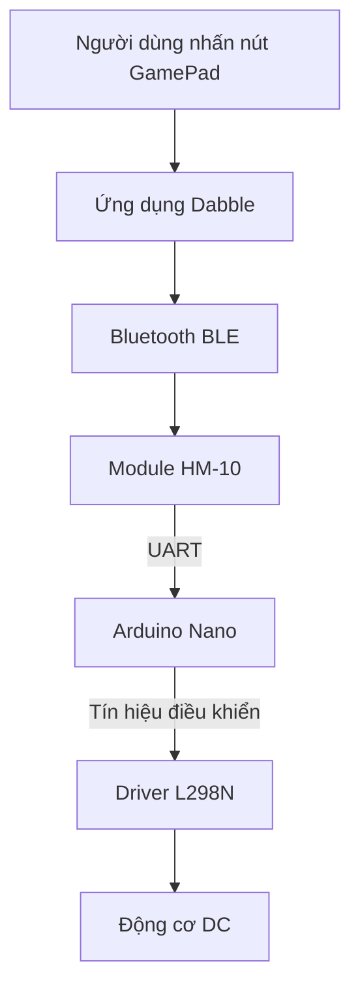

# Bài 9: Điều khiển xe Arduino Nano bằng Bluetooth HM-10 và ứng dụng Dabble

## 1. Giới thiệu

Trong các bài học trước, chúng ta đã tìm hiểu cách điều khiển động cơ DC, servo và đọc dữ liệu từ các cảm biến trên xe robot Arduino Nano.

Các chương trình này chủ yếu hoạt động tự động theo những lệnh đã được nạp sẵn vào Arduino.

Trong bài học này, chúng ta sẽ tìm hiểu cách **điều khiển robot không dây bằng điện thoại thông qua Bluetooth**.

Bằng cách sử dụng module Bluetooth HM-10 và ứng dụng Dabble, người dùng có thể gửi các lệnh điều khiển từ điện thoại đến Arduino Nano mà không cần kết nối dây trực tiếp.

Thông qua bài học, chúng ta sẽ tìm hiểu:

- Module Bluetooth HM-10 là gì và nguyên lý hoạt động.
- Cách kết nối HM-10 với Arduino Nano.
- Cách cài đặt thư viện Dabble trong Arduino IDE.
- Cách kết nối điện thoại với module Bluetooth.
- Cách đọc trạng thái các nút trên GamePad.
- Cách sử dụng lệnh Bluetooth để điều khiển động cơ.
- Các lưu ý an toàn khi điều khiển xe robot không dây.

Sau khi hoàn thành bài học, bạn có thể sử dụng điện thoại để gửi lệnh tiến, lùi, rẽ trái, rẽ phải và dừng xe robot.

## 2. Tìm hiểu về module Bluetooth HM-10

### 2.1. Bluetooth HM-10 là gì?

HM-10 là module giao tiếp không dây sử dụng công nghệ **Bluetooth Low Energy (BLE)**.

BLE là một chuẩn Bluetooth được thiết kế để trao đổi dữ liệu với mức tiêu thụ năng lượng thấp, thường được sử dụng trong các thiết bị IoT, cảm biến và hệ thống điều khiển không dây.

Module HM-10 cho phép Arduino giao tiếp với điện thoại hoặc các thiết bị Bluetooth tương thích.

<AsyncImage query="HM-10 Bluetooth BLE 4.0 module breakout board six pin Arduino" aspectRatio="5:3" maxWidth="420px"/>

Trong xe robot Arduino Nano, HM-10 đóng vai trò là cầu nối truyền dữ liệu giữa điện thoại và vi điều khiển.

Ví dụ:

1. Người dùng nhấn nút tiến trên điện thoại.
2. Ứng dụng Dabble gửi dữ liệu qua Bluetooth.
3. Module HM-10 nhận dữ liệu.
4. Arduino Nano đọc dữ liệu từ HM-10.
5. Arduino xác định lệnh và điều khiển động cơ thông qua L298N.

### 2.2. Các chân của module HM-10

Module HM-10 thường có các chân giao tiếp cơ bản sau:

| Chân | Chức năng |
|---|---|
| VCC | Cấp nguồn cho module |
| GND | Chân nối đất |
| TXD | Truyền dữ liệu từ HM-10 đến Arduino |
| RXD | Nhận dữ liệu từ Arduino |

Một số phiên bản module có thêm các chân như STATE hoặc EN/BRK tùy thiết kế.

**Lưu ý về nguồn điện:** Chip HM-10 sử dụng logic 3,3 V. Một số bo mạch mở rộng có bộ ổn áp cho phép cấp nguồn 5 V, nhưng không phải tất cả đều hỗ trợ. Cần kiểm tra đúng phiên bản module trước khi cấp nguồn.

### 2.3. Nguyên lý giao tiếp UART

HM-10 trao đổi dữ liệu với Arduino thông qua giao tiếp nối tiếp UART.

UART sử dụng hai đường tín hiệu chính:

- **TX (Transmit):** Chân truyền dữ liệu.
- **RX (Receive):** Chân nhận dữ liệu.

Khi kết nối hai thiết bị, chân TX của thiết bị này phải nối với chân RX của thiết bị kia.

Ví dụ:

```text
Arduino Nano                 Bluetooth HM-10
────────────                 ───────────────

TX  ───────────────────────► RX

RX  ◄─────────────────────── TX

GND ──────────────────────── GND
```

Hai thiết bị phải sử dụng tốc độ truyền dữ liệu tương thích, thường được gọi là **baud rate**.

Trong các ví dụ của bài học, chúng ta sử dụng tốc độ 9600 baud. Cần đảm bảo module HM-10 thực tế cũng được cấu hình ở tốc độ này.

## 3. Tìm hiểu về ứng dụng Dabble

### 3.1. Dabble là gì?

Dabble là ứng dụng cho phép điện thoại giao tiếp với các bo mạch lập trình thông qua những module kết nối được hỗ trợ.

Ứng dụng cung cấp nhiều giao diện điều khiển, giúp người dùng thực hiện các bài thực hành robot mà không cần tự xây dựng ứng dụng điện thoại.

<AsyncImage query="STEMpedia Dabble app GamePad module digital controls smartphone screenshot" aspectRatio="4:3" maxWidth="420px"/>

Trong bài học này, chúng ta sử dụng chức năng **GamePad** để điều khiển xe robot.

GamePad cung cấp các nút điều hướng và nút chức năng để gửi lệnh đến Arduino.

### 3.2. Các nút điều khiển trên GamePad

Các nút thường được sử dụng gồm:

| Nút | Chức năng dự kiến |
|---|---|
| Up | Điều khiển xe tiến |
| Down | Điều khiển xe lùi |
| Left | Điều khiển xe rẽ trái |
| Right | Điều khiển xe rẽ phải |
| Start | Có thể sử dụng cho một chức năng bổ sung |
| Cross | Có thể sử dụng để điều khiển servo |
| Triangle | Có thể sử dụng để điều khiển servo |

Chức năng thực tế của từng nút phụ thuộc vào chương trình được nạp trên Arduino.

Ví dụ, cùng một nút Cross có thể được lập trình để tăng góc servo hoặc thực hiện một chức năng khác.

### 3.3. Sơ đồ hoạt động của hệ thống



Arduino không nhận trực tiếp thao tác chạm trên điện thoại. Dữ liệu được truyền qua HM-10, sau đó chương trình sử dụng thư viện Dabble để xác định nút đang được nhấn.

## 4. Kết nối Bluetooth HM-10 với Arduino Nano

### 4.1. Sơ đồ kết nối

Theo cấu hình sử dụng trong bài học, module HM-10 được kết nối với Arduino Nano như sau:

| Chân HM-10 | Chân Arduino Nano | Chức năng |
|---|---|---|
| TXD | A3 | Arduino nhận dữ liệu Bluetooth |
| RXD | A2 | Arduino gửi dữ liệu đến Bluetooth |
| GND | GND | Nối đất chung |
| VCC | Nguồn phù hợp module | Cấp nguồn cho HM-10 |

Hai chân A2 và A3 được sử dụng làm đường giao tiếp nối tiếp bằng phần mềm.

Trong đó:

- A3 là chân RX của Arduino.
- A2 là chân TX của Arduino.

Cần lưu ý rằng Arduino Nano classic sử dụng mức logic 5 V, trong khi đầu vào RX của chip HM-10 thường sử dụng mức logic 3,3 V.

Nếu module không có sẵn mạch chuyển mức, cần sử dụng bộ chuyển mức logic hoặc mạch chia áp phù hợp trên đường Nano TX → HM-10 RX.

Ví dụ, có thể sử dụng cầu chia áp gồm điện trở 1 kΩ nối tiếp từ A2 đến HM-10 RX và điện trở 2 kΩ từ HM-10 RX xuống GND. Cách này tạo mức xấp xỉ 3,3 V từ tín hiệu HIGH 5 V.

### 4.2. Phân biệt giao tiếp Bluetooth và Serial Monitor

Arduino Nano có hai chân UART phần cứng:

- D0: RX.
- D1: TX.

Tuy nhiên, trên bộ xe robot, D0 và D1 được sử dụng để điều khiển driver L298N.

Vì vậy, trong bài học này, HM-10 sử dụng A3 và A2 để tránh xung đột với các chân điều khiển động cơ.

Khi kiểm tra Bluetooth bằng Serial Monitor, Arduino sử dụng hai đường giao tiếp khác nhau:

| Giao tiếp | Chân Arduino | Mục đích |
|---|---|---|
| Serial phần cứng | D0/D1 | Gửi thông báo đến máy tính qua USB |
| Serial phần mềm | A3/A2 | Trao đổi dữ liệu với HM-10 |

**Lưu ý:** Khi dùng Serial Monitor, cần ngắt dây điều khiển L298N khỏi D0/D1 để tránh xung đột tín hiệu.

Sau khi hoàn thành bước kiểm tra, chương trình điều khiển xe có thể sử dụng lại D0/D1 cho động cơ và không dùng Serial Monitor trong lúc vận hành.

## 5. Cài đặt thư viện Dabble

Để Arduino có thể xử lý dữ liệu từ ứng dụng Dabble, chúng ta cần sử dụng thư viện Dabble của STEMpedia.

### 5.1. Cài đặt thư viện

Mở Arduino IDE và thực hiện:

1. Chọn **Sketch → Include Library → Manage Libraries**.
2. Nhập từ khóa `Dabble` vào ô tìm kiếm.
3. Tìm thư viện Dabble của STEMpedia.
4. Chọn Install để cài đặt.
5. Chờ Arduino IDE hoàn tất quá trình cài đặt.

Nếu thư viện đã được cài đặt, có thể bỏ qua bước này.

### 5.2. Khai báo thư viện trong chương trình

Để sử dụng GamePad, thêm các dòng sau vào đầu chương trình:

```cpp
#define CUSTOM_SETTINGS
#define INCLUDE_GAMEPAD_MODULE

#include <Dabble.h>
```

Trong đó:

- `CUSTOM_SETTINGS`: Cho phép lựa chọn các module chức năng cần sử dụng.
- `INCLUDE_GAMEPAD_MODULE`: Kích hoạt phần xử lý GamePad.
- `#include <Dabble.h>`: Khai báo thư viện Dabble.

Hai dòng `#define` phải được đặt trước dòng `#include <Dabble.h>`.

**Lưu ý:** Các ví dụ tiếp theo sử dụng biến thể thư viện Dabble hỗ trợ cú pháp `Dabble.begin(9600, A3, A2)` trên Arduino Nano. Cần kiểm tra phiên bản thư viện đang cài có hỗ trợ cú pháp này; không sử dụng thư viện Dabble dành riêng cho ESP32 để biên dịch chương trình Nano.

## 6. Ví dụ 1: Nhận lệnh GamePad và hiển thị trên Serial Monitor

Trước khi điều khiển động cơ, chúng ta cần kiểm tra Arduino có nhận đúng lệnh từ điện thoại hay không.

Trong ví dụ này, Arduino chỉ hiển thị tên lệnh lên Serial Monitor, chưa điều khiển bánh xe.

### 6.1. Chương trình mẫu

Tạo sketch mới với tên `NanoBluetoothDocLenh`.

```cpp
#define CUSTOM_SETTINGS
#define INCLUDE_GAMEPAD_MODULE

#include <Dabble.h>

// ================= BLUETOOTH =================
#define BT_RX A3
#define BT_TX A2

// ================= SETUP =================
void setup() {
  Serial.begin(9600);

  Dabble.begin(9600, BT_RX, BT_TX);
}

// ================= LOOP =================
void loop() {
  Dabble.processInput();

  if (GamePad.isUpPressed()) {
    Serial.println("Tien");
  }
  else if (GamePad.isDownPressed()) {
    Serial.println("Lui");
  }
  else if (GamePad.isLeftPressed()) {
    Serial.println("Trai");
  }
  else if (GamePad.isRightPressed()) {
    Serial.println("Phai");
  }
  else {
    Serial.println("Dung");
  }

  delay(100);
}
```

### 6.2. Giải thích chương trình

**Khai báo chân Bluetooth**

```cpp
#define BT_RX A3
#define BT_TX A2
```

Hai chân A3 và A2 được sử dụng để giao tiếp với module HM-10.

**Khởi tạo giao tiếp**

```cpp
Serial.begin(9600);

Dabble.begin(9600, BT_RX, BT_TX);
```

Trong đó:

- `Serial.begin(9600)`: Khởi tạo giao tiếp Serial với máy tính.
- `Dabble.begin(...)`: Khởi tạo giao tiếp giữa Arduino và HM-10.

**Cập nhật dữ liệu từ Dabble**

```cpp
Dabble.processInput();
```

Hàm này xử lý dữ liệu nhận được từ ứng dụng Dabble để cập nhật trạng thái các nút điều khiển.

Cần gọi hàm thường xuyên trong `loop()`.

**Kiểm tra nút tiến**

```cpp
if (GamePad.isUpPressed()) {
  Serial.println("Tien");
}
```

Nếu nút Up đang được nhấn, Arduino gửi thông báo `Tien` đến Serial Monitor.

Các nút Down, Left và Right được xử lý tương tự.

**Xử lý khi không có nút hướng nào được nhấn**

```cpp
else {
  Serial.println("Dung");
}
```

Nếu không có nút hướng nào được phát hiện, chương trình hiển thị `Dung`.

Thông báo này chỉ phản ánh trạng thái nút mà chương trình đang đọc. Nó không tự chứng minh rằng điện thoại đang kết nối Bluetooth.

## 7. Kết nối điện thoại với HM-10

### 7.1. Chuẩn bị

Trước khi kết nối, cần đảm bảo:

- Arduino Nano đã được nạp chương trình.
- HM-10 được cấp nguồn đúng.
- Điện thoại đã cài ứng dụng Dabble.
- Bluetooth trên điện thoại đã được bật.
- Ứng dụng được cấp các quyền kết nối cần thiết.

### 7.2. Các bước kết nối

Thực hiện:

1. Mở ứng dụng Dabble trên điện thoại.
2. Chọn chức năng kết nối thiết bị.
3. Tìm module Bluetooth HM-10.
4. Chọn đúng module của xe robot.
5. Chờ ứng dụng thông báo kết nối thành công.
6. Mở chức năng **GamePad**.
7. Chọn chế độ điều khiển bằng các nút hướng.

Tên thiết bị hiển thị có thể khác nhau tùy cấu hình module.

Không mặc định HM-10 có cùng tên hoặc mật khẩu với các module Bluetooth Classic như HC-05.

### 7.3. Kiểm tra các nút điều khiển

Sau khi kết nối, mở Serial Monitor trong Arduino IDE và chọn 9600 baud.

Lần lượt nhấn các nút trên GamePad.

| Nút nhấn | Thông báo trên Serial Monitor |
|---|---|
| Up | Tien |
| Down | Lui |
| Left | Trai |
| Right | Phai |
| Không nhấn nút hướng | Dung |

Ví dụ khi nhấn nút Up:

```text
Tien
Tien
Tien
Tien
```

Khi thả nút:

```text
Dung
Dung
Dung
```

**Kết quả mong đợi:** Thông báo trên Serial Monitor thay đổi tương ứng với nút đang được nhấn trên điện thoại.

Nếu chương trình chỉ liên tục hiển thị `Dung`, cần kiểm tra kết nối Bluetooth, chân TX/RX, tốc độ baud và chế độ GamePad.

## 8. Ví dụ 2: Điều khiển động cơ bằng GamePad

Sau khi đã kiểm tra Arduino nhận đúng các nút điều khiển, chúng ta có thể sử dụng dữ liệu Bluetooth để điều khiển động cơ DC.

Trong ví dụ này, Arduino nhận lệnh từ Dabble và gửi tín hiệu điều khiển đến L298N.

### 8.1. Bảng chân điều khiển động cơ

Theo cấu hình của bộ xe:

| Chức năng | Chân Arduino Nano |
|---|---|
| ENA – PWM động cơ trái | D5 |
| IN1 – Chiều động cơ trái | D0 |
| IN2 – Chiều động cơ trái | D1 |
| ENB – PWM động cơ phải | D6 |
| IN3 – Chiều động cơ phải | D4 |
| IN4 – Chiều động cơ phải | D7 |
| Bluetooth RX | A3 |
| Bluetooth TX | A2 |

Do D0 và D1 đang được sử dụng cho L298N, chương trình điều khiển xe không sử dụng `Serial.begin()` để in thông báo qua USB.

### 8.2. Chương trình mẫu

Tạo sketch mới với tên `NanoBluetoothMotor`.

```cpp
#define CUSTOM_SETTINGS
#define INCLUDE_GAMEPAD_MODULE

#include <Dabble.h>

// ================= BLUETOOTH =================
#define BT_RX A3
#define BT_TX A2

// ================= L298N =================
#define ENA 5
#define IN1 0
#define IN2 1

#define ENB 6
#define IN3 4
#define IN4 7

// ================= SPEED =================
int tocDo = 140;

// ================= MOTOR CONTROL =================
void dungXe() {
  analogWrite(ENA, 0);
  analogWrite(ENB, 0);

  digitalWrite(IN1, LOW);
  digitalWrite(IN2, LOW);

  digitalWrite(IN3, LOW);
  digitalWrite(IN4, LOW);
}

void tien() {
  digitalWrite(IN1, HIGH);
  digitalWrite(IN2, LOW);

  digitalWrite(IN3, HIGH);
  digitalWrite(IN4, LOW);

  analogWrite(ENA, tocDo);
  analogWrite(ENB, tocDo);
}

void lui() {
  digitalWrite(IN1, LOW);
  digitalWrite(IN2, HIGH);

  digitalWrite(IN3, LOW);
  digitalWrite(IN4, HIGH);

  analogWrite(ENA, tocDo);
  analogWrite(ENB, tocDo);
}

void reTrai() {
  analogWrite(ENA, 0);

  digitalWrite(IN1, LOW);
  digitalWrite(IN2, LOW);

  digitalWrite(IN3, HIGH);
  digitalWrite(IN4, LOW);

  analogWrite(ENB, tocDo);
}

void rePhai() {
  digitalWrite(IN1, HIGH);
  digitalWrite(IN2, LOW);

  analogWrite(ENA, tocDo);

  analogWrite(ENB, 0);

  digitalWrite(IN3, LOW);
  digitalWrite(IN4, LOW);
}

// ================= SETUP =================
void setup() {
  pinMode(ENA, OUTPUT);
  pinMode(IN1, OUTPUT);
  pinMode(IN2, OUTPUT);

  pinMode(ENB, OUTPUT);
  pinMode(IN3, OUTPUT);
  pinMode(IN4, OUTPUT);

  dungXe();

  Dabble.begin(9600, BT_RX, BT_TX);
}

// ================= LOOP =================
void loop() {
  Dabble.processInput();

  if (GamePad.isUpPressed()) {
    tien();
  }
  else if (GamePad.isDownPressed()) {
    lui();
  }
  else if (GamePad.isLeftPressed()) {
    reTrai();
  }
  else if (GamePad.isRightPressed()) {
    rePhai();
  }
  else {
    dungXe();
  }

  delay(20);
}
```

### 8.3. Giải thích chương trình

**Khai báo tốc độ động cơ**

```cpp
int tocDo = 140;
```

Biến `tocDo` lưu giá trị PWM điều khiển động cơ.

Trên Arduino Nano, giá trị PWM thường nằm trong khoảng 0 đến 255.

Trong bài này, giá trị 140 được sử dụng làm mức thử ban đầu. Có thể điều chỉnh tùy đặc tính động cơ và nguồn cấp.

**Hàm điều khiển xe tiến**

```cpp
void tien() {
  digitalWrite(IN1, HIGH);
  digitalWrite(IN2, LOW);

  digitalWrite(IN3, HIGH);
  digitalWrite(IN4, LOW);

  analogWrite(ENA, tocDo);
  analogWrite(ENB, tocDo);
}
```

Hàm này điều khiển hai nhóm động cơ quay theo chiều đã quy ước là tiến.

**Lưu ý:** Chiều quay thực tế còn phụ thuộc vào cách đấu dây động cơ. Cần kiểm tra từng bánh theo bài điều khiển L298N trước khi chạy xe trên mặt đất.

**Hàm điều khiển xe lùi**

```cpp
void lui() {
  digitalWrite(IN1, LOW);
  digitalWrite(IN2, HIGH);

  digitalWrite(IN3, LOW);
  digitalWrite(IN4, HIGH);

  analogWrite(ENA, tocDo);
  analogWrite(ENB, tocDo);
}
```

Hai nhóm động cơ được đảo chiều so với lệnh tiến.

**Hàm rẽ trái**

```cpp
void reTrai() {
  analogWrite(ENA, 0);

  digitalWrite(IN1, LOW);
  digitalWrite(IN2, LOW);

  digitalWrite(IN3, HIGH);
  digitalWrite(IN4, LOW);

  analogWrite(ENB, tocDo);
}
```

Động cơ trái được dừng điều khiển, trong khi động cơ phải tiếp tục quay tiến.

Xe sẽ có xu hướng rẽ sang trái.

**Hàm dừng xe**

```cpp
void dungXe() {
  analogWrite(ENA, 0);
  analogWrite(ENB, 0);

  digitalWrite(IN1, LOW);
  digitalWrite(IN2, LOW);

  digitalWrite(IN3, LOW);
  digitalWrite(IN4, LOW);
}
```

Hàm này ngừng cấp PWM và đặt các chân điều khiển chiều về LOW.

Bánh xe có thể tiếp tục quay trong thời gian ngắn do quán tính.

### 8.4. Quy trình kiểm tra an toàn

Trước khi thử điều khiển xe:

1. Ngắt nguồn động cơ.
2. Kiểm tra dây kết nối L298N.
3. Nạp chương trình vào Arduino Nano.
4. Kê xe để hai bánh không chạm mặt đất.
5. Kết nối điện thoại với HM-10.
6. Cấp nguồn động cơ.
7. Thử từng nút điều khiển trong thời gian ngắn.
8. Kiểm tra chiều quay của từng bánh.
9. Ngắt nguồn nếu bánh quay sai hướng hoặc xe không dừng như mong đợi.

Chỉ đặt xe xuống mặt đất khi đã xác nhận đúng các chức năng tiến, lùi, rẽ và dừng.

**Giới hạn của chương trình mẫu:** Chương trình điều khiển theo trạng thái nút do Dabble cung cấp, nhưng chưa có cơ chế watchdog độc lập để đảm bảo dừng motor khi mất kết nối hoặc dữ liệu Bluetooth ngừng cập nhật. Vì vậy, không sử dụng chương trình này như một giải pháp dừng an toàn khi mất sóng. Khi thử nghiệm cần có cách ngắt nguồn motor trực tiếp.

Ngoài ra, chương trình chưa bổ sung khoảng dừng bảo vệ khi chuyển trực tiếp giữa tiến và lùi. Khi thử nghiệm, cần thả nút và chờ bánh dừng trước khi đảo chiều.

## 9. Mở rộng: Điều khiển servo bằng GamePad

Ngoài điều khiển động cơ, GamePad còn có thể được sử dụng để điều khiển servo SG90.

Trong bộ xe, servo được kết nối với chân A5 của Arduino Nano.

Ví dụ, có thể quy định:

- Nút Cross: Tăng góc servo.
- Nút Triangle: Giảm góc servo.
- Nút Start: Đưa servo về vị trí giữa 90°.

### 9.1. Khai báo thư viện Servo

Thêm vào đầu chương trình:

```cpp
#include <Servo.h>
```

Khai báo đối tượng Servo:

```cpp
Servo myServo;

int servoAngle = 90;
```

### 9.2. Khởi tạo Servo

Trong `setup()`, thêm:

```cpp
myServo.attach(A5);
myServo.write(90);
```

### 9.3. Kiểm tra các nút điều khiển Servo

Ví dụ:

```cpp
if (GamePad.isCrossPressed()) {
  servoAngle += 5;

  if (servoAngle > 180) {
    servoAngle = 180;
  }

  myServo.write(servoAngle);
}

if (GamePad.isTrianglePressed()) {
  servoAngle -= 5;

  if (servoAngle < 0) {
    servoAngle = 0;
  }

  myServo.write(servoAngle);
}

if (GamePad.isStartPressed()) {
  servoAngle = 90;
  myServo.write(servoAngle);
}
```

Trong ví dụ này, mỗi lần chương trình phát hiện nút đang được giữ, góc servo thay đổi 5°.

Nếu giữ nút liên tục, chương trình có thể tăng hoặc giảm góc nhiều lần. Khi xây dựng chương trình hoàn chỉnh, có thể bổ sung giới hạn tốc độ cập nhật để servo di chuyển phù hợp hơn.

Các giới hạn 0° và 180° chỉ là giới hạn giá trị lệnh của ví dụ. Khi lắp trên robot, cần sử dụng khoảng góc an toàn theo cơ cấu gá thực tế, tránh làm servo hoặc dây cảm biến bị kẹt.

## 10. Một số lưu ý khi sử dụng Bluetooth HM-10

### 10.1. Phân biệt Bluetooth BLE và Bluetooth Classic

HM-10 sử dụng Bluetooth Low Energy.

Trong khi đó, các module như HC-05 thường sử dụng Bluetooth Classic.

Hai loại này không hoàn toàn tương đương về cách kết nối và giao thức sử dụng.

Vì vậy, cần chọn đúng loại thiết bị trong ứng dụng Dabble và đảm bảo điện thoại hỗ trợ kết nối tương ứng.

### 10.2. Kiểm tra tốc độ baud

Trong chương trình:

```cpp
Dabble.begin(9600, BT_RX, BT_TX);
```

Giá trị 9600 là tốc độ giao tiếp UART giữa Arduino và HM-10.

Nếu module đang được cấu hình ở tốc độ khác, Arduino có thể không nhận được dữ liệu chính xác.

Khi gặp lỗi, cần kiểm tra cấu hình UART của module thay vì chỉ thay đổi tốc độ Serial Monitor.

### 10.3. Không nhầm chân TX và RX

Nguyên tắc kết nối:

- HM-10 TX → Arduino RX.
- Arduino TX → HM-10 RX.

Nếu nối TX với TX hoặc RX với RX, dữ liệu thường sẽ không được truyền đúng.

### 10.4. Đảm bảo nguồn cấp ổn định

Khi động cơ hoạt động, dòng điện tiêu thụ có thể thay đổi lớn.

Nếu nguồn cấp không ổn định, Arduino hoặc module Bluetooth có thể bị reset, mất kết nối hoặc hoạt động không ổn định.

Cần sử dụng nguồn phù hợp và bố trí đường GND chung đúng cách.

### 10.5. Xử lý mất kết nối Bluetooth

Trong hệ thống điều khiển robot thực tế, cần có cơ chế dừng động cơ khi không nhận được lệnh hợp lệ trong một khoảng thời gian nhất định.

Cơ chế này thường được gọi là **communication timeout** hoặc **watchdog giao tiếp**.

Ví dụ, chương trình có thể yêu cầu nhận được dữ liệu điều khiển mới trong một khoảng thời gian xác định. Nếu hết thời gian mà không có dữ liệu hợp lệ, robot phải chuyển về trạng thái dừng.

Để triển khai chính xác, cần sử dụng thông tin về thời điểm nhận gói dữ liệu hoặc trạng thái kết nối thực tế của thư viện/module. Chỉ kiểm tra `GamePad.isUpPressed()` hay các trạng thái nút khác là chưa đủ để phát hiện mọi trường hợp mất kết nối.

## 11. Một số lỗi thường gặp

| Hiện tượng | Nguyên nhân và cách xử lý |
|---|---|
| Arduino báo thiếu `Dabble.h` | Kiểm tra và cài đặt đúng thư viện Dabble |
| Không tìm thấy HM-10 | Kiểm tra nguồn module, Bluetooth và quyền ứng dụng |
| Điện thoại kết nối nhưng Arduino không nhận lệnh | Kiểm tra chân A3/A2, TX/RX và tốc độ baud |
| Serial Monitor chỉ hiển thị `Dung` | Kiểm tra chế độ GamePad và dữ liệu Bluetooth |
| Serial Monitor hiển thị ký tự lạ | Kiểm tra tốc độ baud của Serial Monitor |
| Xe không chạy dù đã nhận lệnh | Kiểm tra nguồn motor, L298N và dây điều khiển |
| Xe chạy sai hướng | Kiểm tra chiều quay thực tế của hai động cơ |
| Xe không dừng khi mất kết nối | Chương trình chưa có watchdog giao tiếp; cần ngắt nguồn motor và bổ sung cơ chế bảo vệ |
| Arduino reset khi động cơ hoạt động | Kiểm tra nguồn điện và khả năng cấp dòng |

Khi gặp lỗi, nên kiểm tra từng phần theo thứ tự:

1. Kết nối điện thoại với HM-10.
2. Kiểm tra Arduino nhận đúng lệnh bằng Serial Monitor.
3. Kiểm tra từng động cơ bằng chương trình L298N.
4. Ghép điều khiển Bluetooth với động cơ.

Không nên sửa đồng thời nhiều phần khi chưa xác định được nguyên nhân.

## 12. Bài tập thực hành

**Bài tập 1: Kiểm tra kết nối Bluetooth**

Viết chương trình nhận dữ liệu từ GamePad và hiển thị các lệnh tiến, lùi, trái, phải trên Serial Monitor.

**Bài tập 2: Điều khiển một động cơ**

Sử dụng nút Up để quay động cơ trái theo một chiều và nút Down để quay theo chiều ngược lại.

Thả nút để dừng động cơ.

**Bài tập 3: Điều khiển hai động cơ**

Sử dụng bốn nút hướng để điều khiển xe tiến, lùi, rẽ trái và rẽ phải.

Kiểm tra hoạt động khi bánh xe được kê khỏi mặt đất.

**Bài tập 4: Thay đổi tốc độ động cơ**

Thay đổi giá trị PWM từ 140 xuống 110 và tăng lên 160.

Quan sát sự thay đổi tốc độ quay của bánh xe.

**Bài tập 5: Điều khiển servo**

Sử dụng các nút Cross, Triangle và Start để thay đổi góc servo và đưa servo về vị trí giữa.

Chỉ thử trong khoảng góc an toàn của cơ cấu gá.

## 13. Tổng kết

Qua bài học này, chúng ta đã tìm hiểu và thực hành:

- Nguyên lý hoạt động của module Bluetooth HM-10.
- Giao tiếp UART giữa HM-10 và Arduino Nano.
- Cách sử dụng ứng dụng Dabble.
- Cách kết nối điện thoại với Arduino qua Bluetooth.
- Cách đọc trạng thái các nút GamePad.
- Cách điều khiển động cơ DC thông qua L298N.
- Cách mở rộng điều khiển servo bằng điện thoại.
- Các lưu ý về nguồn điện, tín hiệu và mất kết nối.

Bluetooth HM-10 và ứng dụng Dabble giúp người dùng điều khiển robot Arduino Nano từ điện thoại mà không cần xây dựng giao diện điều khiển riêng.

Đây là cơ sở để phát triển các chức năng điều khiển từ xa và kết hợp điều khiển thủ công với các chế độ tự động của robot.

Ở bài tiếp theo, chúng ta sẽ tìm hiểu **nguyên lý điều khiển PID**, một phương pháp giúp robot sử dụng dữ liệu phản hồi từ Encoder để điều chỉnh tốc độ động cơ chính xác hơn.

---

[Bài trước](08-encoder.md) · [Lộ trình](../index.md) · [Bài tiếp: Làm quen PID](10-pid.md)