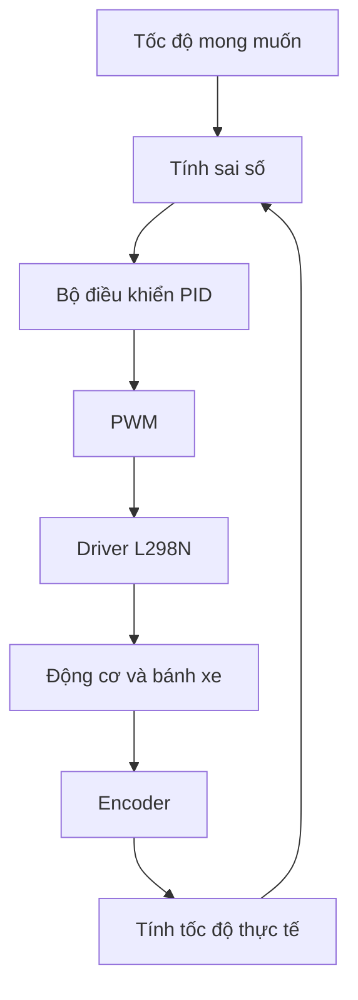
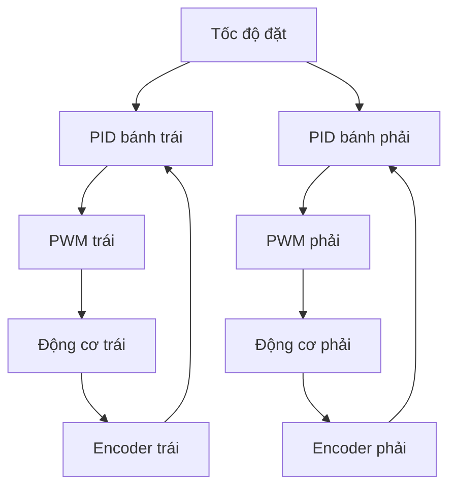
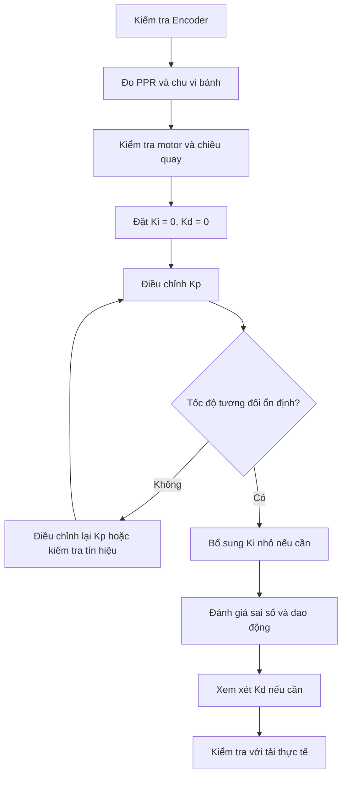

# Bài 10: Làm quen với điều khiển tốc độ động cơ bằng PID

## 1. Giới thiệu

Trong các bài học trước, chúng ta đã tìm hiểu cách điều khiển động cơ DC bằng L298N và sử dụng cảm biến Encoder để đo tốc độ quay của bánh xe.

Khi điều khiển động cơ bằng PWM, Arduino có thể thay đổi tốc độ quay bằng cách tăng hoặc giảm giá trị PWM. Tuy nhiên, việc đặt một giá trị PWM cố định không đảm bảo động cơ luôn quay với tốc độ mong muốn.

Ví dụ, khi đặt PWM bằng 140 cho hai động cơ, tốc độ thực tế của hai bánh có thể khác nhau do:

- Đặc tính của từng động cơ không hoàn toàn giống nhau.
- Ma sát giữa bánh xe và mặt sàn.
- Tải trọng tác động lên động cơ.
- Điện áp nguồn thay đổi trong quá trình hoạt động.
- Sự khác biệt của hộp giảm tốc và cơ cấu truyền động.

Để giải quyết vấn đề này, chúng ta có thể sử dụng **bộ điều khiển PID (Proportional – Integral – Derivative)**.

PID là một phương pháp điều khiển có phản hồi. Arduino liên tục đo tốc độ thực tế bằng Encoder, so sánh với tốc độ mong muốn và điều chỉnh PWM để giảm sai lệch.

Thông qua bài học, chúng ta sẽ tìm hiểu:

- Sự khác biệt giữa điều khiển vòng hở và vòng kín.
- Khái niệm sai số trong điều khiển tốc độ.
- Nguyên lý hoạt động của bộ điều khiển PID.
- Vai trò của ba thành phần P, I và D.
- Cách mô phỏng bộ điều khiển P trên Arduino Nano.
- Cách đo tốc độ thực tế bằng Encoder.
- Cách xây dựng chương trình PID điều khiển hai động cơ.
- Cách điều chỉnh các hệ số PID và kiểm tra hoạt động thực tế.

Sau khi hoàn thành bài học, bạn sẽ hiểu nguyên lý PID và có thể thực hành điều khiển tốc độ hai bánh xe dựa trên tín hiệu phản hồi từ Encoder.

## 2. Điều khiển vòng hở và điều khiển vòng kín

### 2.1. Điều khiển vòng hở

Điều khiển vòng hở là phương pháp điều khiển mà chương trình gửi lệnh đến thiết bị nhưng không sử dụng thông tin phản hồi để tự điều chỉnh kết quả.

Ví dụ, khi điều khiển động cơ bằng L298N:

```cpp
analogWrite(ENA, 140);
```

Arduino gửi giá trị PWM bằng 140 đến chân ENA của driver.

Tuy nhiên, Arduino không biết động cơ đang quay với tốc độ bao nhiêu nếu không có cảm biến đo tốc độ.

Khi tải trọng thay đổi, tốc độ động cơ có thể thay đổi mặc dù PWM vẫn giữ nguyên.

Sơ đồ điều khiển vòng hở:


Ưu điểm của điều khiển vòng hở là đơn giản, dễ lập trình và không cần cảm biến phản hồi.

Tuy nhiên, phương pháp này khó duy trì tốc độ chính xác khi điều kiện hoạt động thay đổi.

### 2.2. Điều khiển vòng kín

Điều khiển vòng kín sử dụng thông tin phản hồi từ hệ thống để điều chỉnh tín hiệu điều khiển.

Đối với xe robot Arduino Nano, Encoder được sử dụng để đo tốc độ quay thực tế của bánh xe.

Arduino thực hiện các bước:

1. Xác định tốc độ mong muốn.
2. Đọc số xung Encoder trong một khoảng thời gian.
3. Tính tốc độ thực tế của bánh xe.
4. So sánh tốc độ thực tế với tốc độ mong muốn.
5. Tính mức điều chỉnh PWM.
6. Gửi PWM mới đến driver L298N.
7. Tiếp tục đo và điều chỉnh ở chu kỳ tiếp theo.

Sơ đồ điều khiển vòng kín:



Khi tốc độ thực tế thấp hơn tốc độ mong muốn, bộ điều khiển có thể tăng PWM.

Ngược lại, khi tốc độ thực tế cao hơn tốc độ mong muốn, bộ điều khiển có thể giảm PWM.

Đây là nguyên lý cơ bản của điều khiển tốc độ có phản hồi.

### 2.3. So sánh hai phương pháp

| Tiêu chí | Điều khiển vòng hở | Điều khiển vòng kín |
|---|---|---|
| Tín hiệu điều khiển | PWM đặt trước | PWM được điều chỉnh |
| Sử dụng Encoder | Không bắt buộc | Có |
| Đo tốc độ thực tế | Không | Có |
| Bù sai lệch tốc độ | Không tự động | Có thể tự động |
| Độ phức tạp | Thấp | Cao hơn |
| Ứng dụng | Điều khiển cơ bản | Điều khiển tốc độ chính xác hơn |

Đối với xe robot cần đi thẳng, di chuyển theo quãng đường hoặc duy trì tốc độ ổn định, điều khiển vòng kín thường phù hợp hơn.

## 3. Khái niệm sai số trong điều khiển PID

### 3.1. Tốc độ đặt và tốc độ thực tế

Trong điều khiển tốc độ, chúng ta cần phân biệt hai giá trị:

- **Tốc độ đặt (Setpoint):** Tốc độ mong muốn của bánh xe.
- **Tốc độ thực tế (Measured Speed):** Tốc độ đo được từ Encoder.

Ví dụ:

- Tốc độ đặt: 0,15 m/s.
- Tốc độ thực tế: 0,10 m/s.

Trong trường hợp này, bánh xe đang quay chậm hơn tốc độ mong muốn.

Bộ điều khiển cần xác định mức sai lệch để điều chỉnh PWM.

### 3.2. Công thức tính sai số

Sai số được tính theo công thức:

**Sai số = Tốc độ đặt − Tốc độ thực tế**

Hay viết ngắn gọn:

**e = SP − PV**

Trong đó:

- `e`: Sai số điều khiển.
- `SP`: Tốc độ đặt (Setpoint).
- `PV`: Tốc độ đo thực tế (Process Variable).

Ví dụ với tốc độ đặt bằng 0,15 m/s:

| Tốc độ thực tế | Sai số | Ý nghĩa |
|---|---|---|
| 0,10 m/s | +0,05 m/s | Bánh quay chậm hơn mong muốn |
| 0,15 m/s | 0 | Bánh đạt tốc độ mong muốn |
| 0,20 m/s | −0,05 m/s | Bánh quay nhanh hơn mong muốn |

Như vậy:

- Sai số dương: Cần có xu hướng tăng tín hiệu điều khiển.
- Sai số âm: Cần có xu hướng giảm tín hiệu điều khiển.
- Sai số bằng 0: Tốc độ đo bằng tốc độ đặt tại thời điểm tính.

**Lưu ý:** Tốc độ đặt và tốc độ thực tế phải sử dụng cùng đơn vị. Không được lấy tốc độ đặt theo m/s trừ trực tiếp tốc độ đo theo RPM hoặc số xung Encoder.

## 4. Nguyên lý hoạt động của bộ điều khiển PID

PID gồm ba thành phần:

- **P – Proportional:** Điều khiển tỷ lệ.
- **I – Integral:** Điều khiển tích phân.
- **D – Derivative:** Điều khiển vi phân.

Mỗi thành phần có vai trò khác nhau trong quá trình điều chỉnh tín hiệu điều khiển.

### 4.1. Thành phần P – Điều khiển tỷ lệ

Thành phần P tạo ra tín hiệu điều chỉnh tỷ lệ với sai số hiện tại.

Công thức:

**P = Kp × e**

Trong đó:

- `P`: Thành phần điều khiển tỷ lệ.
- `Kp`: Hệ số tỷ lệ.
- `e`: Sai số hiện tại.

Ví dụ:

Giả sử:

- Tốc độ đặt: 0,15 m/s.
- Tốc độ thực tế: 0,10 m/s.
- Kp = 100.

Sai số:

**e = 0,15 − 0,10 = 0,05**

Thành phần P:

**P = 100 × 0,05 = 5**

Nếu PWM cơ sở bằng 120, PWM đề xuất là:

**PWM = 120 + 5 = 125**

Như vậy, khi bánh quay chậm hơn tốc độ mong muốn, thành phần P tạo ra mức điều chỉnh làm tăng PWM.

Nếu tốc độ thực tế tăng lên 0,20 m/s:

**e = 0,15 − 0,20 = −0,05**

Khi đó:

**P = 100 × (−0,05) = −5**

PWM đề xuất:

**PWM = 120 − 5 = 115**

Trong ví dụ này, bộ điều khiển giảm PWM khi bánh quay nhanh hơn tốc độ đặt.

#### Ảnh hưởng của hệ số Kp

Hệ số Kp quyết định mức độ phản ứng của bộ điều khiển đối với sai số.

- Kp nhỏ: Điều chỉnh nhẹ, có thể phản ứng chậm.
- Kp lớn: Điều chỉnh mạnh, có thể phản ứng nhanh hơn.
- Kp quá lớn: Hệ thống có thể dao động hoặc mất ổn định.

Ví dụ với cùng sai số 0,05 m/s:

| Kp | Thành phần P |
|---|---|
| 50 | 2,5 |
| 100 | 5 |
| 200 | 10 |
| 400 | 20 |

Các hệ số trên chỉ phục vụ minh họa phép tính, chưa phải hệ số được hiệu chỉnh cho xe robot.

### 4.2. Thành phần I – Điều khiển tích phân

Thành phần I được sử dụng để xử lý sai số tích lũy theo thời gian.

Trong một số trường hợp, bộ điều khiển P có thể duy trì tốc độ gần giá trị mong muốn nhưng vẫn tồn tại một sai số nhỏ kéo dài.

Thành phần I cộng dồn sai số qua các chu kỳ để tạo thêm mức điều chỉnh.

Trong chương trình điều khiển số, có thể tính:

**Tích phân mới = Tích phân cũ + e × dt**

Thành phần điều khiển I:

**I = Ki × Tích phân**

Trong đó:

- `Ki`: Hệ số tích phân.
- `e`: Sai số hiện tại.
- `dt`: Thời gian giữa hai lần cập nhật, tính bằng giây.

Ví dụ:

Giả sử sai số luôn bằng 0,05 m/s và bộ điều khiển cập nhật mỗi 0,2 giây.

Mỗi lần cập nhật:

**e × dt = 0,05 × 0,2 = 0,01**

Sau năm lần cập nhật:

**Tích phân = 5 × 0,01 = 0,05**

Nếu Ki = 20:

**I = 20 × 0,05 = 1**

Thành phần I bổ sung thêm một mức điều chỉnh vào tín hiệu PWM.

#### Ảnh hưởng của hệ số Ki

- Ki nhỏ: Khả năng loại bỏ sai số kéo dài có thể chậm.
- Ki lớn: Tích lũy sai số nhanh hơn.
- Ki quá lớn: Có thể gây dao động và hiện tượng tích lũy quá mức.

Hiện tượng tích lũy quá mức thường được gọi là **Integral Windup**.

Ví dụ, khi PWM đã đạt giới hạn lớn nhất nhưng bánh vẫn chưa đạt tốc độ đặt, thành phần I có thể tiếp tục tăng. Khi điều kiện tải thay đổi, giá trị tích lũy lớn có thể khiến hệ thống phản ứng quá mức.

Để hạn chế hiện tượng này, chương trình cần giới hạn hoặc kiểm soát quá trình tích lũy.

### 4.3. Thành phần D – Điều khiển vi phân

Thành phần D phản ứng với tốc độ thay đổi của sai số.

Trong chương trình điều khiển số, có thể tính:

**D = Kd × (e hiện tại − e trước đó) / dt**

Trong đó:

- `Kd`: Hệ số vi phân.
- `e hiện tại`: Sai số ở chu kỳ hiện tại.
- `e trước đó`: Sai số ở chu kỳ trước.
- `dt`: Khoảng thời gian giữa hai chu kỳ.

Ví dụ:

- Sai số trước đó: 0,05.
- Sai số hiện tại: 0,02.
- Thời gian cập nhật: 0,2 giây.

Tốc độ thay đổi sai số:

**(0,02 − 0,05) / 0,2 = −0,15**

Nếu Kd = 10:

**D = 10 × (−0,15) = −1,5**

Thành phần D tạo ra mức điều chỉnh âm, giúp giảm tác động điều khiển khi sai số đang giảm nhanh trong ví dụ này.

#### Ảnh hưởng của hệ số Kd

- Kd nhỏ: Tác động của thành phần D yếu.
- Kd lớn: Phản ứng mạnh hơn với sự thay đổi sai số.
- Kd quá lớn: Dễ khuếch đại nhiễu từ tín hiệu đo.

Với Encoder có số xung thấp, tốc độ đo có thể thay đổi theo từng bước giữa các chu kỳ lấy mẫu. Vì vậy, thành phần D cần được sử dụng thận trọng.

Trong nhiều bài toán điều khiển tốc độ động cơ DC, có thể bắt đầu với P hoặc PI trước khi xem xét bổ sung D.

### 4.4. Công thức PID tổng quát

Tín hiệu điều khiển PID được tính bằng tổng ba thành phần:

**PID = P + I + D**

Trong đó:

- **P = Kp × e**
- **I = Ki × tổng(e × dt)**
- **D = Kd × (e hiện tại − e trước đó) / dt**

Nếu sử dụng thêm PWM cơ sở:

**PWM = PWM cơ sở + P + I + D**

Giá trị PWM cuối cùng phải được giới hạn trong khoảng cho phép của chương trình.

Ví dụ:

```cpp
pwm = constrain(pwm, 0, 200);
```

Lệnh này giới hạn giá trị PWM trong khoảng từ 0 đến 200.

**Lưu ý:** PWM cơ sở, các hệ số PID và giới hạn PWM cần được lựa chọn theo đặc tính thực tế của động cơ. Không có một bộ hệ số PID cố định phù hợp với mọi xe robot.

## 5. Ví dụ 1: Mô phỏng bộ điều khiển P trên Arduino Nano

Trước khi điều khiển động cơ thực tế, chúng ta sẽ xây dựng chương trình mô phỏng thành phần P.

Chương trình sử dụng tốc độ đặt và tốc độ đo được khai báo sẵn, sau đó tính mức PWM đề xuất.

Trong ví dụ này:

- Không sử dụng Encoder.
- Không điều khiển L298N.
- Không làm bánh xe quay.
- Chỉ hiển thị kết quả tính toán trên Serial Monitor.

### 5.1. Chương trình mẫu

Tạo sketch mới với tên `NanoPThuNghiem`.

```cpp
// ================= SPEED =================
float tocDoDat = 0.15;
float tocDoDo = 0.10;

// ================= P CONTROLLER =================
float Kp = 100.0;

int pwmBanDau = 120;

// ================= SETUP =================
void setup() {
  Serial.begin(9600);
}

// ================= LOOP =================
void loop() {
  float saiSo = tocDoDat - tocDoDo;

  float mucSua = Kp * saiSo;

  float pwmTinhToan = pwmBanDau + mucSua;

  int pwmMoi = constrain(
    (int)pwmTinhToan,
    0,
    200
  );

  Serial.print("Toc do dat: ");
  Serial.print(tocDoDat);

  Serial.print(" | Toc do do: ");
  Serial.print(tocDoDo);

  Serial.print(" | Sai so: ");
  Serial.print(saiSo);

  Serial.print(" | PWM: ");
  Serial.println(pwmMoi);

  delay(1000);
}
```

### 5.2. Giải thích chương trình

**Khai báo tốc độ**

```cpp
float tocDoDat = 0.15;
float tocDoDo = 0.10;
```

Trong đó:

- `tocDoDat`: Tốc độ mong muốn.
- `tocDoDo`: Tốc độ giả lập.

Cả hai giá trị được biểu diễn theo đơn vị m/s.

**Khai báo hệ số P**

```cpp
float Kp = 100.0;
```

Hệ số Kp quyết định mức thay đổi PWM tương ứng với sai số.

**Tính sai số**

```cpp
float saiSo = tocDoDat - tocDoDo;
```

Arduino lấy tốc độ đặt trừ tốc độ đo.

**Tính mức điều chỉnh**

```cpp
float mucSua = Kp * saiSo;
```

Mức điều chỉnh tỷ lệ với sai số.

**Tính PWM mới**

```cpp
float pwmTinhToan = pwmBanDau + mucSua;
```

Chương trình cộng phần điều chỉnh với PWM cơ sở.

**Giới hạn PWM**

```cpp
int pwmMoi = constrain(
  (int)pwmTinhToan,
  0,
  200
);
```

Giá trị PWM được giới hạn trong khoảng từ 0 đến 200.

### 5.3. Kiểm tra kết quả

Nạp chương trình và mở Serial Monitor ở tốc độ 9600 baud.

Kết quả dự kiến:

```text
Toc do dat: 0.15 | Toc do do: 0.10 | Sai so: 0.05 | PWM: 125
```

Thay đổi giá trị:

```cpp
float tocDoDo = 0.15;
```

Khi đó:

```text
Toc do dat: 0.15 | Toc do do: 0.15 | Sai so: 0.00 | PWM: 120
```

Tiếp tục thay:

```cpp
float tocDoDo = 0.20;
```

Kết quả:

```text
Toc do dat: 0.15 | Toc do do: 0.20 | Sai so: -0.05 | PWM: 115
```

### 5.4. Nhận xét

Qua ví dụ này, chúng ta thấy:

- Khi tốc độ thực tế thấp hơn tốc độ đặt, PWM được tăng.
- Khi tốc độ thực tế bằng tốc độ đặt, PWM bằng mức cơ sở.
- Khi tốc độ thực tế cao hơn tốc độ đặt, PWM được giảm.

Đây là nguyên lý cơ bản của bộ điều khiển P.

Tuy nhiên, tốc độ đo trong chương trình đang là giá trị giả lập. Để điều khiển động cơ thực tế, chúng ta cần sử dụng Encoder để đo tốc độ bánh xe.

## 6. Sử dụng Encoder để đo tốc độ thực tế

### 6.1. Nguyên lý đo tốc độ

Trong Bài 8, chúng ta đã sử dụng ngắt ngoài để đếm số xung Encoder.

Để tính tốc độ, Arduino cần biết:

- Số xung Encoder tăng thêm.
- Số xung trên một vòng bánh xe (PPR).
- Chu vi bánh xe.
- Khoảng thời gian đo.

Công thức tính vận tốc bánh xe:

**v = (N × C) / (PPR × dt)**

Trong đó:

- `v`: Vận tốc bánh xe, đơn vị m/s.
- `N`: Số xung tăng thêm trong khoảng đo.
- `C`: Chu vi bánh xe, đơn vị m.
- `PPR`: Số xung trên một vòng bánh xe.
- `dt`: Thời gian đo, đơn vị giây.

### 6.2. Ví dụ tính tốc độ

Giả sử:

- PPR = 20 xung/vòng.
- Chu vi bánh xe = 0,2042 m.
- Thời gian đo = 0,2 giây.
- Số xung tăng thêm = 3 xung.

Ta có:

**v = (3 × 0,2042) / (20 × 0,2)**

Kết quả:

**v ≈ 0,153 m/s**

Như vậy, tốc độ trung bình của bánh xe trong khoảng đo xấp xỉ 0,153 m/s.

Các thông số PPR và chu vi trong ví dụ chỉ mang tính minh họa. Khi thực hành, cần thay bằng giá trị đã đo trên bánh xe thực tế.

### 6.3. Lựa chọn chu kỳ lấy mẫu

Chu kỳ lấy mẫu là khoảng thời gian giữa hai lần tính tốc độ và cập nhật bộ điều khiển.

Ví dụ:

| Chu kỳ lấy mẫu | Số lần cập nhật lý thuyết mỗi giây |
|---|---|
| 100 ms | 10 lần |
| 200 ms | 5 lần |
| 500 ms | 2 lần |
| 1000 ms | 1 lần |

Chu kỳ lấy mẫu quá ngắn có thể khiến số xung thu được trong mỗi lần đo rất ít, làm tốc độ tính toán thay đổi theo từng bước lớn.

Ngược lại, chu kỳ quá dài khiến bộ điều khiển phản ứng chậm với sự thay đổi tốc độ.

Trong bài học này, chúng ta sử dụng chu kỳ **200 ms** để minh họa nguyên lý điều khiển.

Giá trị này chưa được xác nhận là chu kỳ tối ưu cho xe robot.

## 7. Xây dựng bộ điều khiển PID trên Arduino

### 7.1. Các biến cần sử dụng

Một bộ điều khiển PID tốc độ cần các thông số chính:

| Biến | Chức năng |
|---|---|
| `tocDoDat` | Tốc độ mong muốn |
| `tocDoDo` | Tốc độ thực tế từ Encoder |
| `saiSo` | Chênh lệch tốc độ |
| `Kp` | Hệ số tỷ lệ |
| `Ki` | Hệ số tích phân |
| `Kd` | Hệ số vi phân |
| `tichPhan` | Giá trị sai số tích lũy |
| `saiSoCu` | Sai số ở chu kỳ trước |
| `dt` | Thời gian cập nhật |
| `pwm` | Tín hiệu điều khiển động cơ |

### 7.2. Hàm tính PID

Ví dụ về hàm tính PID:

```cpp
float tinhPID(
  float tocDoDat,
  float tocDoDo,
  float dt
) {
  float saiSo = tocDoDat - tocDoDo;

  tichPhan += saiSo * dt;

  float daoHam = (saiSo - saiSoCu) / dt;

  float output =
      Kp * saiSo +
      Ki * tichPhan +
      Kd * daoHam;

  saiSoCu = saiSo;

  return output;
}
```

Trong đó, các biến `Kp`, `Ki`, `Kd`, `tichPhan` và `saiSoCu` cần được khai báo và khởi tạo trước khi sử dụng.

Đây là ví dụ minh họa công thức, chưa phải một chương trình Arduino hoàn chỉnh. Khi sử dụng thực tế, cần kiểm tra `dt` lớn hơn 0, giới hạn đầu ra và bổ sung cơ chế chống tích lũy quá mức.

### 7.3. Vì sao cần hai bộ điều khiển PID?

Xe robot sử dụng hai động cơ độc lập.

Mỗi động cơ có thể có tốc độ thực tế khác nhau dù cùng nhận một giá trị PWM.

Do đó, khi điều khiển tốc độ hai bánh, chúng ta nên sử dụng hai bộ điều khiển riêng:

- PID trái: Điều khiển tốc độ bánh trái.
- PID phải: Điều khiển tốc độ bánh phải.

Hai bộ điều khiển có thể sử dụng cùng tốc độ đặt nhưng nhận phản hồi từ hai Encoder khác nhau.



## 8. Ví dụ 2: Điều khiển tốc độ hai bánh bằng PID

Sau khi hiểu nguyên lý P, I, D và cách đo tốc độ bằng Encoder, chúng ta sẽ xây dựng chương trình kết hợp:

- Arduino Nano.
- Driver L298N.
- Hai động cơ DC.
- Hai cảm biến Encoder.
- Hai bộ điều khiển tốc độ PID.

Chương trình điều khiển hai bánh quay tiến với tốc độ đặt trước trong thời gian giới hạn.

### 8.1. Bảng chân kết nối

Theo cấu hình bộ xe Arduino Nano:

| Chức năng | Chân Arduino |
|---|---|
| ENA – PWM động cơ trái | D5 |
| IN1 – Chiều động cơ trái | D0 |
| IN2 – Chiều động cơ trái | D1 |
| ENB – PWM động cơ phải | D6 |
| IN3 – Chiều động cơ phải | D4 |
| IN4 – Chiều động cơ phải | D7 |
| Encoder trái | D2 |
| Encoder phải | D3 |

Trong chương trình này, D0 và D1 được sử dụng để điều khiển động cơ, vì vậy không sử dụng `Serial.begin()` hoặc Serial Monitor.

### 8.2. Các thông số thử nghiệm

Chương trình sử dụng các thông số minh họa:

| Thông số | Giá trị |
|---|---|
| PPR | 20 xung/vòng |
| Chu vi bánh xe | 0,2042 m |
| Tốc độ đặt | 0,15 m/s |
| Chu kỳ PID | 200 ms |
| PWM cơ sở | 100 |
| PWM tối đa | 200 |
| Kp | 120 |
| Ki | 15 |
| Kd | 0 |
| Thời gian chạy tối đa | 8 giây |
| Thời gian không có xung để dừng | 2 giây |

**Lưu ý:** Đây là các giá trị thử nghiệm để minh họa chương trình, không phải bộ thông số PID đã được hiệu chỉnh cho xe thực tế.

Đặc biệt, cần đo lại PPR và chu vi bánh xe trước khi sử dụng.

### 8.3. Chương trình mẫu

Tạo sketch mới với tên `NanoPIDHaiBanh`.

```cpp
#include <Arduino.h>

// ================= MOTOR PINS =================
#define ENA 5
#define IN1 0
#define IN2 1

#define ENB 6
#define IN3 4
#define IN4 7

// ================= ENCODER PINS =================
#define ENC_L 2
#define ENC_R 3

// ================= ROBOT SETTINGS =================
const float PPR = 20.0f;
const float CHU_VI = 0.2042f;

const float TOC_DO_DAT = 0.15f;

// ================= PID SETTINGS =================
const float KP = 120.0f;
const float KI = 15.0f;
const float KD = 0.0f;

const float PWM_CO_SO = 100.0f;
const int PWM_MAX = 200;

const unsigned long PID_INTERVAL = 200;
const unsigned long RUN_TIME = 8000;
const unsigned long ENCODER_TIMEOUT = 2000;

// ================= ENCODER COUNTERS =================
volatile unsigned long xungTrai = 0;
volatile unsigned long xungPhai = 0;

// ================= PID STATE =================
float tichPhanTrai = 0.0f;
float tichPhanPhai = 0.0f;

float saiSoCuTrai = 0.0f;
float saiSoCuPhai = 0.0f;

// ================= TIME STATE =================
unsigned long thoiGianBatDau = 0;
unsigned long thoiGianPID = 0;

unsigned long matXungTrai = 0;
unsigned long matXungPhai = 0;

bool daDung = false;

// ================= INTERRUPTS =================
void demTrai() {
  xungTrai++;
}

void demPhai() {
  xungPhai++;
}

// ================= MOTOR CONTROL =================
void dieuKhienMotor(
  int en,
  int inA,
  int inB,
  int pwm
) {
  pwm = constrain(pwm, 0, PWM_MAX);

  if (pwm == 0) {
    analogWrite(en, 0);

    digitalWrite(inA, LOW);
    digitalWrite(inB, LOW);

    return;
  }

  digitalWrite(inA, HIGH);
  digitalWrite(inB, LOW);

  analogWrite(en, pwm);
}

void dieuKhienHaiBanh(int pwmTrai, int pwmPhai) {
  dieuKhienMotor(ENA, IN1, IN2, pwmTrai);
  dieuKhienMotor(ENB, IN3, IN4, pwmPhai);
}

void dungXe() {
  dieuKhienHaiBanh(0, 0);
}

// ================= READ ENCODER =================
void layXung(
  unsigned long &trai,
  unsigned long &phai
) {
  noInterrupts();

  trai = xungTrai;
  phai = xungPhai;

  xungTrai = 0;
  xungPhai = 0;

  interrupts();
}

// ================= PID CONTROLLER =================
int tinhPID(
  float tocDoDo,
  float dt,
  float &tichPhan,
  float &saiSoCu
) {
  float saiSo = TOC_DO_DAT - tocDoDo;

  float tichPhanMoi =
      constrain(
        tichPhan + saiSo * dt,
        -1.0f,
        1.0f
      );

  float daoHam = (saiSo - saiSoCu) / dt;

  float pwmTam =
      PWM_CO_SO +
      KP * saiSo +
      KI * tichPhanMoi +
      KD * daoHam;

  // Chong tich luy khi PWM vuot gioi han
  if (!((pwmTam > PWM_MAX && saiSo > 0) ||
        (pwmTam < 0 && saiSo < 0))) {
    tichPhan = tichPhanMoi;
  }

  saiSoCu = saiSo;

  float pwm =
      PWM_CO_SO +
      KP * saiSo +
      KI * tichPhan +
      KD * daoHam;

  return constrain((int)pwm, 0, PWM_MAX);
}

// ================= SETUP =================
void setup() {
  pinMode(ENA, OUTPUT);
  pinMode(IN1, OUTPUT);
  pinMode(IN2, OUTPUT);

  pinMode(ENB, OUTPUT);
  pinMode(IN3, OUTPUT);
  pinMode(IN4, OUTPUT);

  dungXe();

  pinMode(ENC_L, INPUT_PULLUP);
  pinMode(ENC_R, INPUT_PULLUP);

  attachInterrupt(
    digitalPinToInterrupt(ENC_L),
    demTrai,
    RISING
  );

  attachInterrupt(
    digitalPinToInterrupt(ENC_R),
    demPhai,
    RISING
  );

  thoiGianBatDau = millis();
  thoiGianPID = thoiGianBatDau;
}

// ================= LOOP =================
void loop() {
  if (daDung) {
    dungXe();
    return;
  }

  unsigned long hienTai = millis();

  // Gioi han thoi gian chay
  if (hienTai - thoiGianBatDau >= RUN_TIME) {
    dungXe();
    daDung = true;
    return;
  }

  unsigned long dtMs = hienTai - thoiGianPID;

  if (dtMs < PID_INTERVAL) {
    return;
  }

  thoiGianPID = hienTai;

  // Lay so xung trong chu ky
  unsigned long xungL;
  unsigned long xungR;

  layXung(xungL, xungR);

  // Kiem tra mat xung Encoder
  if (xungL == 0) {
    matXungTrai += dtMs;
  } else {
    matXungTrai = 0;
  }

  if (xungR == 0) {
    matXungPhai += dtMs;
  } else {
    matXungPhai = 0;
  }

  if (matXungTrai >= ENCODER_TIMEOUT ||
      matXungPhai >= ENCODER_TIMEOUT) {
    dungXe();
    daDung = true;
    return;
  }

  // Doi thoi gian sang giay
  float dt = dtMs / 1000.0f;

  // Tinh toc do thuc te
  float tocDoTrai =
      (xungL * CHU_VI) / (PPR * dt);

  float tocDoPhai =
      (xungR * CHU_VI) / (PPR * dt);

  // Tinh PWM cho tung banh
  int pwmTrai = tinhPID(
    tocDoTrai,
    dt,
    tichPhanTrai,
    saiSoCuTrai
  );

  int pwmPhai = tinhPID(
    tocDoPhai,
    dt,
    tichPhanPhai,
    saiSoCuPhai
  );

  // Dieu khien dong co
  dieuKhienHaiBanh(pwmTrai, pwmPhai);
}
```

### 8.4. Giải thích chương trình

**Đếm xung Encoder**

```cpp
void demTrai() {
  xungTrai++;
}

void demPhai() {
  xungPhai++;
}
```

Hai hàm ngắt được gọi khi phát hiện cạnh RISING trên tín hiệu Encoder.

**Đọc và đặt lại bộ đếm**

```cpp
void layXung(
  unsigned long &trai,
  unsigned long &phai
) {
  noInterrupts();

  trai = xungTrai;
  phai = xungPhai;

  xungTrai = 0;
  xungPhai = 0;

  interrupts();
}
```

Hàm này lấy số xung phát sinh trong chu kỳ vừa qua và đặt lại bộ đếm để chuẩn bị cho chu kỳ tiếp theo.

Việc đọc và đặt lại được thực hiện trong một vùng bảo vệ ngắn để tránh dữ liệu bị thay đổi giữa chừng bởi ngắt.

**Tính tốc độ bánh xe**

```cpp
float tocDoTrai =
    (xungL * CHU_VI) / (PPR * dt);
```

Chương trình chuyển số xung thành vận tốc bánh xe theo đơn vị m/s.

Bánh phải được tính tương tự.

**Tính PWM bằng PID**

```cpp
int pwmTrai = tinhPID(
  tocDoTrai,
  dt,
  tichPhanTrai,
  saiSoCuTrai
);
```

Bộ điều khiển PID tính PWM dựa trên sai số tốc độ của bánh trái.

Bánh phải sử dụng một bộ trạng thái PID riêng.

**Giới hạn PWM**

```cpp
return constrain((int)pwm, 0, PWM_MAX);
```

PWM được giới hạn trong khoảng từ 0 đến giá trị tối đa đã khai báo.

**Giới hạn thời gian chạy**

```cpp
if (hienTai - thoiGianBatDau >= RUN_TIME) {
  dungXe();
  daDung = true;
  return;
}
```

Chương trình tự dừng sau khoảng thời gian thử nghiệm.

**Kiểm tra mất xung Encoder**

```cpp
if (matXungTrai >= ENCODER_TIMEOUT ||
    matXungPhai >= ENCODER_TIMEOUT) {
  dungXe();
  daDung = true;
  return;
}
```

Nếu một bánh không tạo ra xung trong thời gian quy định, chương trình chuyển sang trạng thái dừng.

Cơ chế này giúp hạn chế việc tiếp tục điều khiển động cơ khi Encoder không cung cấp dữ liệu.

Tuy nhiên, không có xung Encoder chưa chắc đồng nghĩa với cảm biến bị hỏng. Nguyên nhân cũng có thể do động cơ chưa khởi động được, bánh bị kẹt hoặc tốc độ quá thấp.

### 8.5. Quy trình kiểm tra an toàn

Trước khi thử chương trình:

1. Xác nhận hai Encoder đếm đúng xung.
2. Đo PPR thực tế của từng bánh.
3. Đo chu vi bánh xe.
4. Kiểm tra chiều quay tiến của từng động cơ.
5. Kiểm tra nguồn cấp và dây kết nối L298N.
6. Kê xe để hai bánh không chạm mặt đất.
7. Nạp chương trình khi nguồn motor đã ngắt.
8. Cấp nguồn motor và quan sát hoạt động trong thời gian thử.
9. Ngắt nguồn ngay nếu bánh quay sai chiều, rung giật mạnh hoặc có dấu hiệu bất thường.

Chỉ thử nghiệm trên mặt sàn sau khi đã xác nhận hoạt động cơ bản khi kê bánh.

**Lưu ý:** Chương trình này là ví dụ học tập. Các cơ chế giới hạn thời gian và kiểm tra mất xung không thay thế cho công tắc ngắt nguồn motor hoặc hệ thống dừng khẩn cấp.

## 9. Hướng dẫn điều chỉnh hệ số PID

### 9.1. Vì sao cần điều chỉnh hệ số PID?

Mỗi hệ thống động cơ có đặc tính khác nhau.

Các yếu tố ảnh hưởng gồm:

- Công suất và tốc độ định mức của động cơ.
- Tỷ số truyền hộp giảm tốc.
- Đường kính bánh xe.
- Tải trọng robot.
- Nguồn điện.
- Ma sát và điều kiện mặt sàn.
- Độ phân giải của Encoder.
- Chu kỳ cập nhật bộ điều khiển.

Do đó, hệ số PID cần được điều chỉnh dựa trên kết quả thực nghiệm.

### 9.2. Bắt đầu với thành phần P

Để kiểm tra thành phần P, đặt:

```cpp
const float KI = 0.0f;
const float KD = 0.0f;
```

Sau đó, sử dụng một giá trị Kp nhỏ để bắt đầu thử nghiệm.

Quan sát:

- Bánh xe có đạt gần tốc độ mong muốn không?
- Tốc độ có dao động mạnh không?
- PWM có thường xuyên chạm giới hạn không?
- Hai bánh có phản ứng tương tự nhau không?

Tăng Kp từng bước nhỏ nếu hệ thống phản ứng quá yếu.

Nếu tốc độ dao động mạnh, cần giảm Kp hoặc kiểm tra lại chất lượng tín hiệu Encoder.

### 9.3. Bổ sung thành phần I

Sau khi thành phần P hoạt động tương đối ổn định, có thể bổ sung Ki để giảm sai số kéo dài.

Bắt đầu với Ki nhỏ.

Nếu Ki quá lớn, PWM có thể tiếp tục tăng hoặc giảm mạnh dù tốc độ đã gần giá trị mong muốn.

Cần theo dõi khả năng tích lũy và giới hạn tích phân.

### 9.4. Xem xét thành phần D

Thành phần D có thể hỗ trợ giảm dao động trong một số hệ thống.

Tuy nhiên, nếu tín hiệu tốc độ từ Encoder thay đổi mạnh giữa các chu kỳ, D có thể làm tín hiệu PWM dao động nhiều hơn.

Vì vậy, chỉ bổ sung Kd khi đã kiểm tra chất lượng tín hiệu đo và hiểu rõ tác động của hai thành phần P, I.

### 9.5. Quy trình điều chỉnh đề xuất



Không nên thay đổi đồng thời nhiều hệ số khi chưa xác định được ảnh hưởng của từng hệ số.

## 10. Ứng dụng PID trong xe robot

### 10.1. Điều khiển xe đi thẳng

Khi điều khiển xe đi thẳng, hai bánh cần có tốc độ phù hợp với nhau.

Nếu chỉ đặt cùng PWM, hai bánh có thể quay với tốc độ khác nhau.

Khi sử dụng PID, Arduino có thể đặt cùng tốc độ mục tiêu cho hai bánh và điều chỉnh PWM riêng cho từng động cơ.

Ví dụ:

| Thông số | Bánh trái | Bánh phải |
|---|---|---|
| Tốc độ đặt | 0,15 m/s | 0,15 m/s |
| Tốc độ thực tế ban đầu | 0,13 m/s | 0,17 m/s |
| Sai số | +0,02 m/s | −0,02 m/s |
| Hướng điều chỉnh | Tăng PWM | Giảm PWM |

Nhờ đó, tốc độ hai bánh có thể tiến gần đến giá trị mong muốn.

Tuy nhiên, tốc độ hai bánh bằng nhau không đảm bảo xe đi thẳng tuyệt đối vì vẫn có thể tồn tại sai số cơ khí và hiện tượng trượt bánh.

### 10.2. Điều khiển xe rẽ

Đối với xe hai bánh chủ động, robot có thể rẽ bằng cách đặt tốc độ khác nhau cho hai bánh.

Ví dụ:

| Chuyển động | Tốc độ đặt bánh trái | Tốc độ đặt bánh phải |
|---|---|---|
| Đi thẳng | 0,15 m/s | 0,15 m/s |
| Rẽ trái | 0,08 m/s | 0,15 m/s |
| Rẽ phải | 0,15 m/s | 0,08 m/s |

Mỗi bộ PID sẽ điều chỉnh PWM để bánh tương ứng tiến gần đến tốc độ đặt.

Để quay tại chỗ theo hai chiều ngược nhau, chương trình cần hỗ trợ tốc độ có dấu và xác định chiều chuyển động. Ví dụ PID trong bài hiện chỉ điều khiển hai bánh theo chiều tiến.

### 10.3. Kết hợp PID với cảm biến dò line

Trong bài cảm biến dò line, chúng ta đã tìm hiểu cách xác định vị trí đường line so với xe.

Khi kết hợp với điều khiển tốc độ, chương trình có thể sử dụng sai lệch vị trí line để tạo tốc độ đặt riêng cho hai bánh.

Ví dụ:

- Line nằm giữa: Hai bánh có tốc độ đặt gần bằng nhau.
- Line lệch trái: Giảm tốc độ đặt bánh trái so với bánh phải.
- Line lệch phải: Giảm tốc độ đặt bánh phải so với bánh trái.

Sau đó, PID tốc độ sử dụng Encoder để điều chỉnh PWM cho từng bánh.

Cần phân biệt hai bài toán:

- **PID dò line:** Điều chỉnh hướng dựa trên sai lệch vị trí line.
- **PID tốc độ:** Điều chỉnh PWM dựa trên sai lệch tốc độ bánh xe.

Hai bộ điều khiển có thể phối hợp trong một hệ thống điều khiển robot hoàn chỉnh.

## 11. Một số lưu ý khi sử dụng PID

### 11.1. Chất lượng tín hiệu Encoder

PID phụ thuộc trực tiếp vào tốc độ đo được từ Encoder.

Nếu Encoder bị mất xung, nhiễu hoặc có PPR không chính xác, bộ điều khiển có thể tính sai tốc độ và điều chỉnh PWM không phù hợp.

Vì vậy, cần kiểm tra Encoder trước khi điều chỉnh PID.

### 11.2. Chu kỳ cập nhật

Chu kỳ cập nhật cần đủ ngắn để hệ thống phản ứng với thay đổi tốc độ nhưng cũng phải đủ dài để thu được số xung có ý nghĩa.

Không nên thay đổi chu kỳ cập nhật mà giữ nguyên kết luận về chất lượng PID nếu chưa kiểm tra lại kết quả.

### 11.3. Giới hạn PWM

Giá trị PWM trên Arduino Nano thường nằm trong khoảng 0–255.

Trong chương trình ví dụ, PWM được giới hạn từ 0 đến 200 để phục vụ thử nghiệm.

Giới hạn này không phải mức an toàn chung cho mọi động cơ. Cần lựa chọn theo nguồn điện, driver và đặc tính động cơ thực tế.

### 11.4. Tích lũy sai số

Nếu thành phần I tiếp tục cộng dồn trong khi PWM đã đạt giới hạn, hệ thống có thể xuất hiện hiện tượng Integral Windup.

Cần sử dụng cơ chế giới hạn tích phân hoặc chống tích lũy khi đầu ra bão hòa.

### 11.5. Khởi động và dừng động cơ

PID không tự giải quyết tất cả các vấn đề khi khởi động và dừng động cơ.

Trong thực tế, có thể cần thêm:

- Giới hạn tốc độ tăng PWM.
- Giới hạn gia tốc.
- Khoảng dừng khi đảo chiều.
- Phát hiện bánh bị kẹt.
- Dừng khi Encoder không hoạt động.
- Cơ chế ngắt nguồn động cơ khi có sự cố.

Các chức năng này cần được thiết kế riêng, không nên coi PID là cơ chế an toàn duy nhất.

## 12. Một số lỗi thường gặp

| Hiện tượng | Nguyên nhân và cách xử lý |
|---|---|
| Bánh xe không đạt tốc độ đặt | Kiểm tra nguồn, tải, PWM tối đa và hệ số PID |
| PWM luôn đạt giới hạn | Kiểm tra tốc độ đặt có khả thi và Encoder có đo đúng không |
| Tốc độ dao động mạnh | Kiểm tra Kp, Ki, chu kỳ đo và nhiễu Encoder |
| Hai bánh có tốc độ khác nhau | Kiểm tra hai Encoder và bộ điều khiển riêng |
| Bánh đứng yên nhưng PID tăng PWM | Kiểm tra Encoder, động cơ bị kẹt và cơ chế bảo vệ |
| PID phản ứng chậm | Kiểm tra hệ số và chu kỳ cập nhật |
| Tốc độ đo thay đổi theo từng bước lớn | Kiểm tra PPR và thời gian lấy mẫu |
| Xe đi lệch dù tốc độ hai bánh gần bằng nhau | Kiểm tra cơ khí, đường kính bánh và trượt bánh |
| Xe không dừng khi có sự cố | Kiểm tra logic dừng và hệ thống ngắt nguồn motor |

Khi gặp lỗi, nên kiểm tra theo thứ tự:

1. Encoder.
2. Động cơ và driver.
3. Công thức tính tốc độ.
4. Chu kỳ cập nhật.
5. Giới hạn PWM.
6. Hệ số PID.

Không nên điều chỉnh hệ số PID để che giấu lỗi cảm biến hoặc lỗi phần cứng.

## 13. Bài tập thực hành

**Bài tập 1: Tính sai số**

Cho tốc độ đặt bằng 0,15 m/s.

Tính sai số khi tốc độ thực tế lần lượt bằng:

- 0,10 m/s.
- 0,12 m/s.
- 0,15 m/s.
- 0,18 m/s.

Giải thích khi nào PWM cần tăng hoặc giảm.

**Bài tập 2: Tính thành phần P**

Cho:

- Kp = 100.
- PWM cơ sở = 120.
- Tốc độ đặt = 0,15 m/s.
- Tốc độ đo = 0,12 m/s.

Tính PWM đề xuất.

Kết quả:

**e = 0,15 − 0,12 = 0,03**

**P = 100 × 0,03 = 3**

**PWM = 120 + 3 = 123**

**Bài tập 3: Mô phỏng thay đổi Kp**

Sử dụng chương trình ở Ví dụ 1.

Lần lượt thay đổi Kp thành:

- 50.
- 100.
- 200.

Quan sát sự thay đổi của PWM đề xuất.

**Bài tập 4: Tính tốc độ từ Encoder**

Cho:

- PPR = 20.
- Chu vi bánh = 0,20 m.
- Thời gian đo = 0,2 giây.
- Số xung tăng thêm = 4.

Tính vận tốc bánh xe.

**Bài tập 5: Phân tích điều khiển hai bánh**

Giả sử:

- Tốc độ đặt hai bánh: 0,15 m/s.
- Tốc độ thực tế bánh trái: 0,12 m/s.
- Tốc độ thực tế bánh phải: 0,17 m/s.

Hãy xác định hướng điều chỉnh PWM của từng bánh.

## 14. Tổng kết

Qua bài học này, chúng ta đã tìm hiểu:

- Sự khác biệt giữa điều khiển vòng hở và vòng kín.
- Khái niệm tốc độ đặt, tốc độ thực tế và sai số.
- Nguyên lý hoạt động của bộ điều khiển PID.
- Vai trò của các thành phần P, I và D.
- Cách mô phỏng bộ điều khiển P trên Arduino Nano.
- Cách sử dụng Encoder để đo tốc độ thực tế.
- Cách xây dựng bộ điều khiển PID cho hai động cơ.
- Cách điều chỉnh hệ số PID và kiểm tra hoạt động.
- Ứng dụng PID trong điều khiển tốc độ, đi thẳng và bám line.

PID là một phương pháp quan trọng trong điều khiển tự động, cho phép hệ thống điều chỉnh tín hiệu điều khiển dựa trên sai số giữa giá trị mong muốn và giá trị thực tế.

Đối với xe robot Arduino Nano, việc kết hợp PID với Encoder giúp cải thiện khả năng duy trì tốc độ bánh xe khi điều kiện hoạt động thay đổi.

Để điều khiển hiệu quả, cần đảm bảo tín hiệu Encoder chính xác, lựa chọn chu kỳ cập nhật phù hợp và hiệu chỉnh các hệ số dựa trên thử nghiệm thực tế.

---

[Bài trước](09-bluetooth.md) · [Lộ trình](../index.md) · [Hướng dẫn sử dụng robot](../08-su-dung-robot.md)