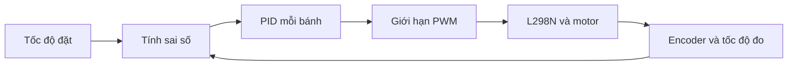

# Bài 10: Điều khiển tốc độ xe Arduino Nano với PID

## Mục tiêu bài học

Sau bài này, bạn có thể:

- Phân biệt PWM đặt trước và điều khiển có phản hồi.
- Tính sai số tốc độ từ encoder và hiểu P/I/D.
- Thử hai bộ điều khiển tốc độ với giới hạn PWM, thời gian và mất xung.

**Trước khi bắt đầu:** Lệnh điều khiển qua Bluetooth — [mở bài trước](09-bluetooth.md). Mỗi mã chạy thử là một sketch độc lập; Upload sẽ thay chương trình đang chạy. Giữ bản mã robot gốc để nạp lại sau khi học.

## 1. Nguyên lý và kiến thức cần biết

Cùng PWM, hai bánh có thể quay khác tốc độ do tải/ma sát. Điều khiển phản hồi đo tốc độ, tính sai số `e = v_đặt − v_đo`, rồi sửa PWM.

| Thành phần | Vai trò | Khi đặt quá lớn |
| --- | --- | --- |
| P: Kp × e | Phản ứng với sai số hiện tại | Dao động, giật |
| I: Ki × tổng(e × dt) | Bù sai số kéo dài | Tích lũy quá mức, vượt mục tiêu |
| D: Kd × thay đổi e / dt | Phản ứng với sai số thay đổi | Nhạy nhiễu đo |



Ví dụ bắt đầu với **PI**, Kd=0; chỉ thêm D sau khi đo ổn định. Có hai vòng tốc độ bánh, chưa phải PID bám line: PID bám line dùng vị trí line làm sai số và tạo tốc độ đặt cho từng bánh.

## 2. Chuẩn bị, bảng chân và đấu nối

| L298N | Arduino Nano | Chức năng |
| --- | --- | --- |
| ENA / ENB | 5 / 6 | PWM nhóm motor trái / phải theo mã |
| IN1 / IN2 | 0 / 1 | Chiều nhóm motor A |
| IN3 / IN4 | 4 / 7 | Chiều nhóm motor B |
| OUT1 / OUT2 | Hai dây motor A | Đầu ra công suất |
| OUT3 / OUT4 | Hai dây motor B | Đầu ra công suất |
| GND | GND bo và nguồn motor | Mốc tín hiệu chung |

Chân số trong bảng là tên D/GPIO, không phải thứ tự đếm chân. Đối chiếu [sơ đồ sản phẩm](../08-su-dung-robot.md) và chiều lắp động cơ.

Để dùng PWM ngoài, tháo jumper **ENA/ENB** nếu module đang nối cố định hai chân này lên HIGH. Jumper **5V_EN** là phần nguồn logic khác: kiểm tra hướng dẫn đúng module trước khi giữ/tháo, không nối hai nguồn 5 V đối đầu. Cấp nguồn motor theo thông số motor và board nguồn; nhãn “12V” trên một số module không bắt buộc cấp đúng 12 V. Không cấp motor từ chân GPIO/5V của bo.

Bộ Drive dùng D0/D1 cho motor: không thêm Serial.begin() vào sketch điều khiển này, ngắt IN1/IN2 khi nạp nếu ảnh hưởng USB rồi nối lại khi đã tắt nguồn. Sơ đồ gốc có chú thích L9110s nhưng mã dùng giao diện L298N; xác nhận module thật có ENA/ENB trước khi làm.

Kê bánh khỏi sàn, chuẩn bị công tắc nguồn motor. Ví dụ bên dưới chạy ngay sau khi khởi động bo.

Encoder trái/phải nối 2/3 như bài 8. Xác nhận PPR với **RISING** và đo chu vi bánh trước; các số trong mã chỉ là thông số thử. Tháo các tải servo không cần thiết trong bài này. Kê bánh và xác nhận đúng chiều/xung trước khi chạy vòng phản hồi. Không giữ hoặc chặn bánh bằng tay khi motor đang cấp điện.

## 3. Mã chạy thử hoàn chỉnh

Tạo sketch riêng có tên thư mục trùng tên tệp `.ino`, chép toàn bộ mã sau, chọn đúng board/COM rồi Verify và Upload:

```cpp
const int ENA = 5, ENB = 6;
const int IN1 = 0, IN2 = 1;
const int IN3 = 4, IN4 = 7;

void motor(int en, int a, int b, int pwm) {
  pwm = constrain(pwm, -255, 255);
  digitalWrite(a, pwm > 0 ? HIGH : LOW);
  digitalWrite(b, pwm < 0 ? HIGH : LOW);
  analogWrite(en, abs(pwm));
}

void drive(int left, int right) {
  motor(ENA, IN1, IN2, left);
  motor(ENB, IN3, IN4, right);
}

void setupMotors() {
  pinMode(ENA, OUTPUT); pinMode(ENB, OUTPUT);
  pinMode(IN1, OUTPUT); pinMode(IN2, OUTPUT);
  pinMode(IN3, OUTPUT); pinMode(IN4, OUTPUT);
  drive(0, 0);
}

volatile unsigned long xungL = 0, xungR = 0;
void demL() { xungL++; }
void demR() { xungR++; }

void layXung(unsigned long &l, unsigned long &r) {
  noInterrupts();
  l = xungL; r = xungR;
  xungL = 0; xungR = 0;
  interrupts();
}

const float PPR = 20.0f;       // hieu chuan voi RISING
const float CHU_VI = 0.2042f;  // vi du ban kinh 0.0325 m
const float V_DAT = 0.15f;     // m/s, gia tri thu
const float KP = 120.0f, KI = 15.0f, KD = 0.0f;
float iL = 0, iR = 0, eCuL = 0, eCuR = 0;
unsigned long batDau, moc, matXungL = 0, matXungR = 0;
bool ketThuc = false;

int pid(float v, float dt, float &tichPhan, float &eCu) {
  float e = V_DAT - v;
  float ungVien = constrain(tichPhan + e * dt, -1.0f, 1.0f);
  float daoHam = (e - eCu) / dt;
  float u = 100.0f + KP * e + KI * ungVien + KD * daoHam;
  // Khong tich luy them theo huong day dau ra vuot gioi han.
  if (!((u > 200 && e > 0) || (u < 0 && e < 0))) tichPhan = ungVien;
  eCu = e;
  u = 100.0f + KP * e + KI * tichPhan + KD * daoHam;
  return (int)constrain(u, 0.0f, 200.0f);
}

void setup() {
  setupMotors();
  pinMode(2, INPUT_PULLUP);
  pinMode(3, INPUT_PULLUP);
  attachInterrupt(digitalPinToInterrupt(2), demL, RISING);
  attachInterrupt(digitalPinToInterrupt(3), demR, RISING);
  batDau = moc = millis();
}

void loop() {
  unsigned long now = millis();
  if (ketThuc || now - batDau >= 8000) {
    drive(0, 0);
    ketThuc = true;
    return;
  }
  unsigned long dtMs = now - moc;
  if (dtMs < 200) return;
  moc = now;
  unsigned long l, r;
  layXung(l, r);
  matXungL = l == 0 ? matXungL + dtMs : 0;
  matXungR = r == 0 ? matXungR + dtMs : 0;
  if (matXungL >= 2000 || matXungR >= 2000) {
    drive(0, 0);
    ketThuc = true;
    return;
  }
  float dt = dtMs / 1000.0f;
  float vL = l * CHU_VI / (PPR * dt);
  float vR = r * CHU_VI / (PPR * dt);
  drive(pid(vL, dt, iL, eCuL), pid(vR, dt, iR, eCuR));
}
```

## 4. Giải thích chương trình

Mỗi 200 ms, mã lấy/reset số xung trong vùng bảo vệ, tính tốc độ m/s theo thời gian thật rồi cập nhật PWM. Mức 100 là bù PWM ban đầu, không phải hằng số dùng được cho mọi motor. Giới hạn đầu ra 0–200 và chống tích lũy khi vượt giới hạn giảm hiện tượng windup.

Ví dụ chỉ chạy tiến, tự dừng sau 8 giây hoặc khi một encoder không có xung liên tục 2 giây; không phải bộ giám sát mọi lỗi cảm biến. PPR, chu vi, PWM bù và hệ số cần đo/hiệu chỉnh cho xe thật. Một kênh encoder chỉ đo độ lớn tốc độ; hướng đang lấy theo lệnh tiến.

## 5. Chạy thử và kết quả mong đợi

Giữ bản gốc, kê bánh, bật motor với công tắc sẵn để ngắt. Bánh chạy thử một lần rồi dừng; cần khởi động lại để thử nữa. Trước đó dùng bài encoder riêng đo tốc độ ở nhiều PWM, ghi làm cơ sở hiệu chỉnh; không khẳng định PID chính xác chỉ từ quan sát bằng mắt. Sketch không in Serial để tương thích chân motor của Nano.

## 6. Lỗi thường gặp

| Hiện tượng | Cách kiểm tra |
| --- | --- |
| Dừng sau khoảng 2 giây | Encoder, PPR, PWM đủ vượt ma sát, không tăng hệ số tùy tiện |
| Dao động | Giảm Kp/Ki, kiểm tra nhiễu và cửa sổ đo |
| Tốc độ tính sai | Chu vi bánh, PPR, RISING/CHANGE |
| PWM chạm giới hạn | Tốc độ đặt, nguồn, tải, mức bù; chưa kết luận cảm biến đúng |

## 7. Bài tập thực hành

1. Đặt Ki=0, Kd=0; hiệu chỉnh Kp bằng các lần thử ngắn, ghi tốc độ đo.
2. Thêm Ki nhỏ để bù sai số kéo dài, kiểm tra bão hòa.
3. Giải thích mất xung 2 giây có thể là encoder lỗi hoặc bánh chưa quay.
4. Vẽ luồng bám line: đọc line → vị trí/sai số → đặt tốc độ hai bánh → PID tốc độ → PWM. Chỉ ghép sau khi từng khối chạy đúng.

**Điều kiện học tiếp:** thực hiện được mục tiêu của bài và giải thích được kết quả quan sát.

[Bài trước](09-bluetooth.md) · [Lộ trình](../index.md) · [Bài tiếp: Sử dụng bộ mã robot bàn giao](../08-su-dung-robot.md)
