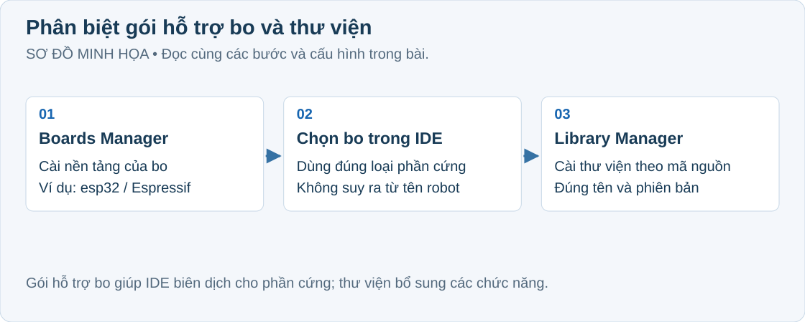

# Cài board ESP32 trong Arduino IDE

Arduino IDE cần bộ công cụ của Espressif để biên dịch và nạp chương trình cho ESP32-S3.

## 1. Thêm đường dẫn board ESP32

<!-- tutorial-figure:goi-board-va-thu-vien -->
<figure class="tutorial-figure" markdown>

[](../../assets/illustrations/goi-board-va-thu-vien.svg)

<figcaption>Gói hỗ trợ bo và thư viện có nhiệm vụ khác nhau. Cài đúng thành phần được yêu cầu trong bài, không thay thế hai loại cho nhau. Nhấp hình để xem lớn.</figcaption>
</figure>
<!-- /tutorial-figure:goi-board-va-thu-vien -->

1. Mở Arduino IDE.
2. Chọn **File → Preferences**.
3. Tìm ô **Additional Board Manager URLs**.
4. Thêm đường dẫn sau:

```text
https://espressif.github.io/arduino-esp32/package_esp32_index.json
```

5. Nhấn **OK** để lưu.

Nếu ô này đã có một đường dẫn khác, nhấn nút bên cạnh ô và thêm đường dẫn ESP32 thành một dòng riêng. Không xóa các đường dẫn đang được sử dụng cho board khác.

## 2. Cài gói board

1. Chọn **Tools → Board → Boards Manager**.
2. Gõ `esp32` vào ô tìm kiếm.
3. Chọn gói **esp32 by Espressif Systems**.
4. Nhấn **Install**.
5. Chờ quá trình tải và cài đặt hoàn tất.

## Xử lý lỗi DEADLINE EXCEEDED

Nếu xuất hiện lỗi sau:

```text
Error: 4 DEADLINE_EXCEEDED: context deadline exceeded
(Client.Timeout or context cancellation while reading body)
```

thực hiện như sau:

1. Đóng hoàn toàn Arduino IDE.
2. Nhấn `Windows + R`.
3. Nhập đường dẫn sau và nhấn Enter:

```text
%USERPROFILE%\.arduinoIDE
```

4. Mở tệp `arduino-cli.yaml` bằng Notepad.
5. Nếu tệp chưa có mục `network`, thêm vào cuối tệp:

```yaml
network:
  connection_timeout: 600s
```

Nếu tệp đã có dòng `network:`, chỉ thêm hoặc sửa `connection_timeout` bên dưới mục đó. Không tạo hai mục `network:` trùng nhau.

6. Lưu và đóng tệp.
7. Mở lại Arduino IDE.
8. Vào lại **Boards Manager**, tìm `esp32` và nhấn **Install**.

Nếu vẫn lỗi, kiểm tra kết nối Internet rồi thử lại. Bước cài board cần Internet và có thể mất vài phút.

