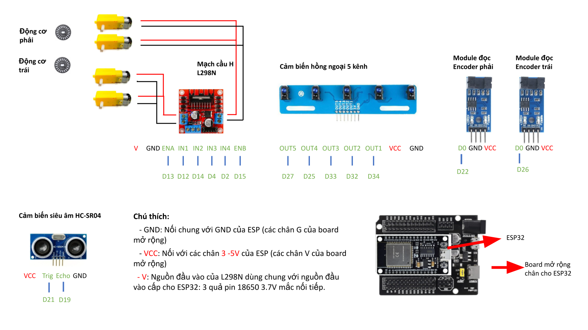

# Sử dụng Robot ESP32 theo bộ tài liệu bàn giao

**Mục tiêu:** lắp ráp, nạp project `main`, điều khiển qua Wi-Fi và chạy dò line. Đây là hướng dẫn chung cho Robot ESP32, không chia bài theo số bánh.

Nguồn: [thư mục ESP32 Robovis](https://drive.google.com/drive/folders/12f-LH2PU0DGoAqXQk_d91QdnKpCADnDt), [hướng dẫn nạp](https://docs.google.com/document/d/1kt_3J2K9uy3t73HraCWzz_dliXwaGpwbH0eBLzfxwZQ/edit), [sử dụng phần mềm](https://docs.google.com/document/d/1D-wqE2x5lxk8KD9A8h0K3K3QPJ3MYHezht5JuPhYdig/edit), [xử lý lỗi](https://docs.google.com/document/d/1j4c4cuyZ6She5PE_y6iRa2XHlQhCYCTDqzXxScZGdfg/edit), [sơ đồ chân đang cập nhật](https://docs.google.com/presentation/d/13HJUg_3JhX71b_is4DSMyEu9Msa4tFEZKVTWZXxgskU/edit) và ba tệp trong [thư mục main](https://drive.google.com/drive/folders/1HeAZaW--JOkl67SG3IJOWxS1aPKAO5UB).

## 1. Lắp ráp và kiểm tra nguồn

Bộ tài liệu có [hướng dẫn lắp ráp bằng ảnh](https://drive.google.com/file/d/1Tu1aiRez8NBzwQ63apHPXwV0UD9wpH0b/view). Làm theo ảnh của đúng khung xe đang dùng, theo trình tự:

1. Gắn động cơ vào khung, mặt có dây hướng vào trong.
2. Gắn trụ và L298N, nối dây động cơ vào các đầu OUT theo ảnh.
3. Gắn trụ và board mở rộng ESP32, nối nguồn với L298N đúng cực.
4. Lắp đĩa encoder, trụ có đệm đai ốc theo ảnh và module encoder; đĩa phải đi qua khe đọc.
5. Gắn HC-SR04 vào gá, gắn cảm biến dò line phía dưới đầu xe.
6. Đấu dây bus theo bảng chân bên dưới, gắn đế pin/công tắc, cố định dây không vướng bánh.
7. Kiểm tra toàn bộ dây rồi mới cắm ESP32 vào board mở rộng và cấp nguồn.

Sơ đồ bàn giao dùng **3 pin 18650 3,7 V mắc nối tiếp**, cấp vào đầu nguồn của **board mở rộng phù hợp** và nguồn công suất L298N. Không đưa điện áp cả bộ pin vào chân 3V3, 5V hoặc GPIO của ESP32. Kiểm tra đúng đầu nguồn, cực và điện áp cho phép của board trước khi nối; tắt nguồn khi đổi dây.

GND các mạch nối chung. Chú thích VCC “3–5V” trong sơ đồ không có nghĩa mọi cảm biến hoặc GPIO đều nhận được 5 V. HC-SR04 loại 5 V cần chuyển mức Echo xuống phù hợp GPIO ESP32; module line/encoder cũng cần kiểm tra mức đầu ra. Không cấp nguồn ngoài đồng thời USB nếu chưa xác định cách phân phối nguồn của board mở rộng.

## 2. Bảng chân theo sơ đồ và mã



| Tín hiệu | GPIO ESP32 |
| --- | --- |
| L298N IN1 / IN2 / IN3 / IN4 | 12 / 14 / 4 / 2 |
| L298N ENA / ENB | 13 / 15 |
| HC-SR04 Trig / Echo | 21 / 19 |
| Dò line OUT1 / OUT2 / OUT3 / OUT4 / OUT5 | 34 / 32 / 33 / 25 / 27 |
| Encoder trái / phải | 26 / 22 |
| Servo bộ gắp, nếu có | 18, theo SERVO_PIN trong main.ino; sơ đồ trên chưa vẽ bộ gắp |

`D21` trong hình là GPIO21, không phải chân thứ 21. Mã dò line coi GPIO34 là cảm biến trái ngoài, GPIO27 là phải ngoài; xác nhận hướng lắp thực tế. GPIO34 là đầu vào, không chuyển thành chân LED/PWM. Bảng theo các khai báo thực sự trong mã; comment mở đầu `do_line.cpp` còn ghi thứ tự motor cũ, nên kiểm tra chiều quay từng nhóm IN/EN trước khi chạy.

## 3. Cài công cụ và nạp project

Thực hiện [cài IDE/CH340/core ESP32](03-cai-arduino-ide.md) và [thư viện](05-cai-thu-vien.md). Thư viện ngoài cần cho project là **AsyncTCP**, **ESPAsyncWebServer**, **ESP32Servo**; WiFi đi cùng core. ESPAsyncTCP trong danh sách gốc dành cho ESP8266, không thay AsyncTCP của ESP32.

Tải đủ ba tệp và giữ cùng một thư mục:

```text
main/
├── main.ino
├── do_line.cpp
└── do_line.h
```

Ngắt nguồn động cơ, dùng USB dữ liệu, mở `main/main.ino`, chọn **ESP32 Dev Module** và đúng COM. Verify rồi Upload, **không bấm BOOT/RST trong quá trình nạp** theo hướng dẫn bàn giao. Đợi báo hoàn tất; `Hard resetting via RTS pin...` xuất hiện cuối quá trình nạp thành công. Monitor **115200 baud** có dòng `Hotspot IP:` khi bo khởi động.

Các sketch Serial/LED trong bài học là chương trình riêng; nạp chúng sẽ thay chương trình robot. Nạp lại project `main` để khôi phục Wi-Fi và giao diện web.

## 4. Kết nối và điều khiển Manual

1. Bật robot, dùng điện thoại/laptop kết nối Wi-Fi **ESP32-Car**.
2. Nhập mật khẩu mặc định của bộ mã: **12345678**.
3. Giữ kết nối khi thiết bị báo **không có Internet**; đây là mạng cục bộ của robot.
4. Mở trình duyệt, nhập **http://192.168.4.1** vào thanh địa chỉ.
5. Giao diện khởi động ở **Manual**. Kê bánh khỏi sàn, thử các hướng và nút dừng trước khi đặt xe xuống.

| Điều khiển | Tác dụng |
| --- | --- |
| Mũi tên lên/xuống | Tiến/lùi khi giữ nút |
| Mũi tên trái/phải | Quay tại chỗ |
| Mũi tên chéo | Di chuyển theo cung |
| Thả nút hướng / nút vuông giữa | Gửi lệnh dừng trong Manual |
| Lin + / Lin − | Tăng/giảm tốc độ tịnh tiến |
| Rot + / Rot − | Tăng/giảm tốc độ quay |
| OPEN / CLOSE | Điều khiển servo gắp khi có bộ gắp tương ứng |

Giá trị Lin/Rot hiển thị là mức điều khiển PWM của Manual, không phải tốc độ đo m/s. Trong mã, mỗi lần đổi tăng/giảm 10, giới hạn 60–255. `OPEN_ANGLE = 120`, `CLOSE_ANGLE = 175` là cấu hình servo trong mã; chỉ thử nếu cơ cấu thực tế phù hợp và không bị ép kẹt.

Giao diện gửi dừng khi thả nút, nhưng mã hiện tại không có thời hạn tự dừng khi mất Wi-Fi hoặc không nhận lệnh mới. Thử ở phạm vi gần và giữ công tắc nguồn dễ tiếp cận; không dùng thao tác đóng trình duyệt làm lệnh dừng.

## 5. Chạy Line follow

Chuẩn bị nền sáng và đường line tương phản. Theo tài liệu gốc, khi cảm biến nằm trên line, đèn kênh tắt; ngoài line, đèn sáng. Kiểm tra từng kênh trước khi chạy. Mã `onLine()` nhận **LOW** là thấy line; nếu module thật phản ứng khác, kiểm tra đấu dây/hiệu chỉnh cảm biến trước.

Đặt cảm biến giữa lên line, chọn **Chế độ / Robot Mode → Line follow**. Điều khiển tay, chỉnh tốc độ tay và bộ gắp bị khóa trong chế độ này. Muốn điều khiển tay lại, chọn **Manual**.

!!! note "Dừng khi đang chạy tự động"
    Giao diện khóa cả nút dừng tay ở Line follow; hãy chuyển về Manual để yêu cầu dừng. Bộ mã hiện có vòng quay/tiến chờ encoder, và lời gọi do_line_abort() ở nhánh chuyển Manual đang bị comment. Vì vậy chuyển chế độ không bảo đảm thoát ngay mọi thao tác tự động; nếu xe tiếp tục chạy, dùng công tắc nguồn động cơ.

Mã dò line có xử lý tránh vật cản và tìm lại line. Kiểm tra siêu âm/encoder trước khi thử vật cản, bắt đầu từ đoạn thẳng rồi thêm góc rẽ. Tài liệu đề nghị góc rẽ line lớn hơn 90° để xe ổn định hơn.

## 6. Chỉnh theo tài liệu xử lý lỗi

Sao lưu **cả thư mục main**; sửa `do_line.cpp` trong project, nạp lại để thay đổi có hiệu lực. Thử một thay đổi mỗi lần:

- **Xe lắc:** tài liệu đề nghị giảm `v_base` từ `0.4f` xuống `0.35f`, rồi thử lại. Mã hiện có `vF = v_base * 0.90f`; không giả định còn hệ số 1.0 như ảnh hướng dẫn cũ. Lin/Rot trên web chỉnh Manual, không thay `v_base` của Line follow.
- **Không quay/dừng ở điểm rẽ:** kiểm tra pin, bánh và encoder trước; chưa tăng PWM để che nguồn yếu hoặc encoder mất xung.
- **Tránh vật cản không về line:** tài liệu mô tả quay trái → tiến → quay phải → tiến → quay phải → tìm line. Trong `avoidObstacle()`, hai lần quay phải hiện là 40° và 50°; nếu lần thứ hai quay thiếu, có thể thử thay `spin_right_deg(50.0, TURN_PWM)` thành 60.0 theo tài liệu, rồi kiểm tra lại. Mã còn quay trái 15° ở cuối; góc thực tế phụ thuộc hiệu chỉnh encoder/cơ khí.

**Hoàn thành:** nạp đủ ba tệp, kết nối được trang web, dùng Manual, chuyển Line follow và biết kiểm tra nguồn/cảm biến trước khi chỉnh mã.

[Lộ trình ESP32](index.md) · [Xử lý lỗi](07-chay-thu-va-xu-ly-loi.md) · [Tải tài liệu](../tai-xuong/robot-esp32.md)
