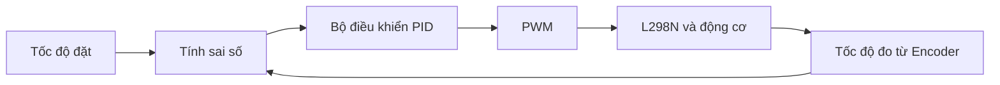
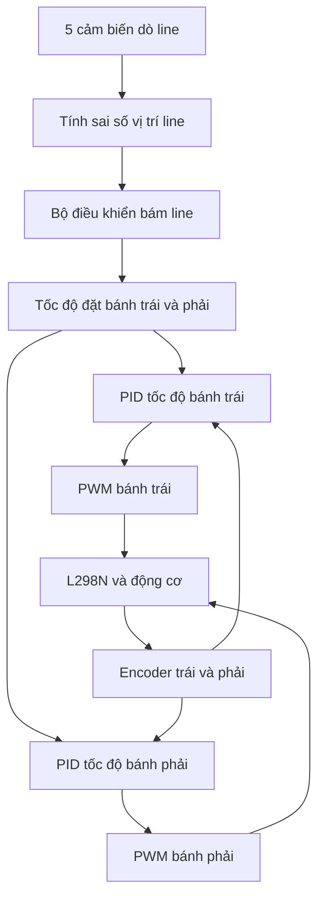

# Bài 10: Điều khiển tốc độ động cơ DC bằng PID với ESP32

## 1. Giới thiệu

Trong các bài học trước, chúng ta đã tìm hiểu cách điều khiển động cơ DC thông qua L298N, đọc xung Encoder để đo tốc độ bánh xe và điều khiển robot qua Wi-Fi.

Khi sử dụng L298N, chúng ta có thể thay đổi tốc độ động cơ bằng tín hiệu PWM. Tuy nhiên, **cùng một giá trị PWM không có nghĩa hai bánh xe sẽ quay cùng tốc độ**.

Ví dụ, khi cấp PWM = 150 cho cả hai động cơ:

- Bánh trái có thể quay 80 vòng/phút.
- Bánh phải có thể quay 95 vòng/phút.

Sự khác biệt có thể đến từ đặc tính động cơ, ma sát, tải trọng, nguồn điện hoặc điều kiện vận hành.

Nếu robot sử dụng hai bánh chủ động, sự chênh lệch tốc độ có thể khiến robot bị lệch hướng ngay cả khi chúng ta muốn xe đi thẳng.

Để giải quyết vấn đề này, chúng ta cần một phương pháp điều khiển có khả năng **đo tốc độ thực tế và tự động điều chỉnh PWM**.

Một trong những phương pháp phổ biến là bộ điều khiển PID.

Trong bài học này, chúng ta sẽ xây dựng hai bộ điều khiển tốc độ độc lập, sử dụng dữ liệu Encoder của bánh trái và bánh phải để điều chỉnh PWM cấp cho L298N.

## 2. Mục tiêu bài học

Sau bài học này, bạn có thể:

- Phân biệt điều khiển vòng hở và điều khiển vòng kín.
- Hiểu nguyên lý điều khiển phản hồi.
- Hiểu ý nghĩa của bộ điều khiển PID.
- Phân biệt vai trò của ba thành phần P, I và D.
- Tính sai số giữa tốc độ đặt và tốc độ đo.
- Sử dụng Encoder để đo tốc độ thực tế của hai bánh.
- Xây dựng bộ điều khiển PI/PID cho từng bánh xe.
- Điều chỉnh PWM dựa trên sai số tốc độ.
- Giới hạn PWM và hạn chế tích lũy sai số.
- Thiết lập chu kỳ cập nhật bộ điều khiển.
- Dừng động cơ khi hết thời gian thử nghiệm hoặc không nhận được xung Encoder.
- Phân biệt PID điều khiển tốc độ và PID dò line.

---

## 3. Điều khiển vòng hở và vòng kín

### 3.1. Điều khiển vòng hở

Điều khiển vòng hở (*Open-loop Control*) là phương pháp điều khiển mà bộ điều khiển không sử dụng thông tin phản hồi từ đầu ra để điều chỉnh lệnh.

Ví dụ:

```cpp
analogWrite(ENA, 150);
analogWrite(ENB, 150);
```

Chương trình cấp cùng giá trị PWM cho hai động cơ.

Tuy nhiên, ESP32 không biết hai bánh đang quay nhanh hay chậm.

Sơ đồ:

```text
       PWM đặt trước
             │
             ▼
           L298N
             │
             ▼
          Động cơ
             │
             ▼
          Bánh xe
```

Ưu điểm:

- Chương trình đơn giản.
- Dễ triển khai.
- Không bắt buộc có Encoder.

Hạn chế:

- Không tự bù khi tải thay đổi.
- Không bảo đảm hai bánh quay cùng tốc độ.
- Không kiểm soát trực tiếp tốc độ thực tế.

### 3.2. Điều khiển vòng kín

Điều khiển vòng kín (*Closed-loop Control*) sử dụng thông tin phản hồi để điều chỉnh đầu ra.

Trong robot, Encoder cung cấp dữ liệu tốc độ bánh xe.

ESP32 so sánh tốc độ đo với tốc độ mong muốn và điều chỉnh PWM để giảm sai số.



Ví dụ:

- Tốc độ đặt: 0,15 m/s.
- Tốc độ đo: 0,12 m/s.
- Sai số: +0,03 m/s.

Bộ điều khiển sẽ điều chỉnh PWM theo hướng tăng tốc độ bánh xe.

Ngược lại, nếu tốc độ đo lớn hơn tốc độ đặt, bộ điều khiển sẽ giảm PWM.

### 3.3. So sánh hai phương pháp

| Tiêu chí | Vòng hở | Vòng kín |
|---|---|---|
| Điều khiển bằng PWM | Có | Có |
| Đọc tốc độ Encoder | Không bắt buộc | Có |
| Phản hồi khi tải thay đổi | Không tự bù | Có khả năng tự bù |
| Duy trì tốc độ đặt | Không bảo đảm | Có thể cải thiện |
| Độ phức tạp | Thấp | Cao hơn |
| Cần hiệu chỉnh thông số | Ít | Có |

Điều khiển vòng kín không tự động bảo đảm kết quả chính xác. Chất lượng điều khiển còn phụ thuộc vào độ chính xác Encoder, khả năng động cơ và các hệ số điều khiển.

---

## 4. Nguyên lý bộ điều khiển PID

### 4.1. Sai số điều khiển

PID là viết tắt của:

- **P – Proportional:** Thành phần tỷ lệ.
- **I – Integral:** Thành phần tích phân.
- **D – Derivative:** Thành phần vi phân.

Trước tiên, bộ điều khiển tính sai số:

\[
e(t)=v_{set}(t)-v_{measured}(t)
\]

Trong đó:

- \(e(t)\): Sai số tốc độ.
- \(v_{set}\): Tốc độ mong muốn.
- \(v_{measured}\): Tốc độ đo bằng Encoder.

Ví dụ:

| Tốc độ đặt | Tốc độ đo | Sai số |
|---|---|---|
| 0,15 m/s | 0,10 m/s | +0,05 m/s |
| 0,15 m/s | 0,15 m/s | 0 |
| 0,15 m/s | 0,18 m/s | -0,03 m/s |

Sai số dương cho biết bánh đang quay chậm hơn mục tiêu.

Sai số âm cho biết bánh đang quay nhanh hơn mục tiêu.

### 4.2. Công thức PID

Bộ điều khiển PID có dạng:

\[
u(t)=K_p e(t)+K_i\int e(t)\,dt+K_d\frac{de(t)}{dt}
\]

Trong đó:

- \(u(t)\): Tín hiệu điều khiển.
- \(K_p\): Hệ số tỷ lệ.
- \(K_i\): Hệ số tích phân.
- \(K_d\): Hệ số vi phân.

Trong bài thực hành, đầu ra PID được sử dụng để hiệu chỉnh PWM của động cơ.

### 4.3. Thành phần P

Thành phần P phản ứng trực tiếp với sai số hiện tại:

\[
P=K_p e
\]

Nếu bánh quay chậm hơn tốc độ đặt, sai số dương và thành phần P tăng đầu ra điều khiển.

Nếu bánh quay nhanh hơn tốc độ đặt, sai số âm và thành phần P giảm đầu ra điều khiển.

Hệ số \(K_p\) càng lớn thì phản ứng với sai số càng mạnh.

Tuy nhiên, nếu \(K_p\) quá lớn, tốc độ có thể dao động quanh giá trị đặt.

### 4.4. Thành phần I

Thành phần I tích lũy sai số theo thời gian:

\[
I=K_i\int e(t)\,dt
\]

Giả sử bánh xe liên tục quay chậm hơn tốc độ đặt một lượng nhỏ.

Thành phần P có thể chưa tạo đủ PWM để loại bỏ hoàn toàn sai số này.

Thành phần I sẽ tích lũy sai số và bổ sung tín hiệu điều khiển.

Vai trò chính của I là giảm sai số kéo dài.

Tuy nhiên, nếu tích lũy quá lớn, động cơ có thể bị vượt tốc độ mục tiêu hoặc dao động.

Hiện tượng tích lũy quá mức này được gọi là **Integral Windup**.

### 4.5. Thành phần D

Thành phần D phản ứng với tốc độ thay đổi của sai số:

\[
D=K_d\frac{de(t)}{dt}
\]

Thành phần D có thể giúp hạn chế phản ứng quá mạnh khi sai số thay đổi nhanh.

Tuy nhiên, dữ liệu tốc độ Encoder thường có dao động, đặc biệt khi số xung trong mỗi chu kỳ đo ít.

Nếu sử dụng D với hệ số quá lớn, nhiễu đo có thể khiến PWM thay đổi liên tục.

Vì vậy, trong bài thực hành đầu tiên, chúng ta sử dụng **PI**, tức là đặt:

```cpp
KD = 0.0f;
```

Chỉ nên thử thành phần D sau khi phép đo tốc độ đã ổn định và hai thành phần P, I được hiệu chỉnh phù hợp.

### 4.6. Tổng hợp vai trò P, I và D

| Thành phần | Vai trò | Khi hệ số quá lớn |
|---|---|---|
| P | Phản ứng với sai số hiện tại | Dễ dao động, giật |
| I | Bù sai số kéo dài | Dễ vượt mục tiêu, tích lũy quá mức |
| D | Phản ứng với thay đổi sai số | Nhạy với nhiễu Encoder |

---

## 5. PID tốc độ và PID dò line khác nhau thế nào?

Trong robot dò line, có thể sử dụng PID cho nhiều mục đích khác nhau.

### 5.1. PID điều khiển tốc độ

PID tốc độ sử dụng Encoder để đo tốc độ thực tế của bánh xe.

Đầu vào:

- Tốc độ mong muốn.
- Tốc độ đo từ Encoder.

Đầu ra:

- PWM điều khiển động cơ.

Mục tiêu là giúp bánh xe bám theo tốc độ đặt.

### 5.2. PID dò line

PID dò line sử dụng vị trí vạch line để xác định sai số hướng di chuyển.

Đầu vào:

- Vị trí line đo được.
- Vị trí line mong muốn, thường là chính giữa cảm biến.

Đầu ra có thể là:

- Giá trị hiệu chỉnh tốc độ hai bánh.
- Hoặc trực tiếp giá trị PWM hai bánh, tùy kiến trúc chương trình.

Ví dụ:

```text
        Sai số vị trí line
                 │
                 ▼
             PID line
                 │
                 ▼
       Hiệu chỉnh hướng
                 │
          ┌──────┴──────┐
          ▼             ▼
     Tốc độ trái   Tốc độ phải
```

### 5.3. Kết hợp hai vòng điều khiển

Trong hệ thống nâng cao, PID dò line có thể tạo tốc độ đặt cho từng bánh, còn hai bộ PID tốc độ điều khiển động cơ bám theo các giá trị đó.



**Trong bài học này, chúng ta chỉ xây dựng hai vòng điều khiển tốc độ bánh xe, chưa tích hợp PID dò line.**

---

## 6. Chuẩn bị thiết bị

### 6.1. Danh sách thiết bị

| STT | Thiết bị | Số lượng |
|---|---|---|
| 1 | ESP32 CH340 Type-C 30 chân | 1 |
| 2 | Board mở rộng ESP32 30P | 1 |
| 3 | Module L298N | 1 |
| 4 | Động cơ DC có bánh xe | 2 |
| 5 | Cảm biến Encoder | 2 |
| 6 | Nguồn cấp phù hợp cho động cơ | 1 |
| 7 | Dây kết nối | Theo nhu cầu |
| 8 | Máy tính cài Arduino IDE | 1 |
| 9 | Cáp USB Type-C có truyền dữ liệu | 1 |

### 6.2. Bảng kết nối L298N

Sử dụng cấu hình chân của robot ESP32 đã thực hành ở các bài trước.

| L298N | GPIO ESP32 | Chức năng |
|---|---|---|
| ENA | GPIO13 | PWM động cơ trái |
| IN1 | GPIO12 | Chiều động cơ trái |
| IN2 | GPIO14 | Chiều động cơ trái |
| ENB | GPIO15 | PWM động cơ phải |
| IN3 | GPIO4 | Chiều động cơ phải |
| IN4 | GPIO2 | Chiều động cơ phải |
| OUT1, OUT2 | Động cơ trái | Đầu ra công suất |
| OUT3, OUT4 | Động cơ phải | Đầu ra công suất |
| GND | GND chung | Mốc điện áp chung |

Các GPIO12, GPIO2 và GPIO15 có liên quan đến cấu hình khởi động của ESP32. Nếu ESP32 không khởi động được, cần kiểm tra ảnh hưởng của mạch ngoài lên các chân này.

**Lưu ý:** Thứ tự chiều quay thực tế phụ thuộc vào cách đấu hai dây động cơ. Cần xác nhận chiều tiến của từng bánh trước khi chạy PID.

### 6.3. Bảng kết nối Encoder

| Encoder | GPIO ESP32 |
|---|---|
| D0 Encoder trái | GPIO26 |
| D0 Encoder phải | GPIO22 |
| VCC | Nguồn phù hợp với module |
| GND | GND chung |

ESP32 sử dụng mức logic 3,3 V. Không đưa tín hiệu Encoder 5 V trực tiếp vào GPIO.

Nếu Encoder được cấp nguồn 5 V, cần kiểm tra điện áp đầu ra D0 và sử dụng giải pháp chuyển mức khi cần.

### 6.4. Lưu ý về jumper L298N

Một số module L298N có jumper ENA và ENB.

Nếu jumper đang nối cố định chân ENA/ENB lên mức HIGH, cần tháo jumper để ESP32 có thể điều khiển PWM qua hai chân này.

Không nhầm jumper ENA/ENB với jumper `5V_EN` của phần nguồn logic.

Việc sử dụng jumper `5V_EN` phụ thuộc vào phiên bản module và điện áp cấp. Cần kiểm tra sơ đồ nguồn của module trước khi đấu nối.

Không cấp nguồn động cơ trực tiếp từ GPIO hoặc chân 3V3 của ESP32.

### 6.5. An toàn trước khi thực hành

Trước khi chạy chương trình:

1. Lưu lại chương trình robot gốc.
2. Ngắt nguồn động cơ khi kiểm tra dây.
3. Kê hai bánh xe khỏi mặt sàn.
4. Xác nhận đúng chiều quay của hai động cơ.
5. Kiểm tra Encoder trái và phải hoạt động.
6. Xác định PPR thực tế.
7. Chuẩn bị công tắc để ngắt nguồn động cơ khi cần.

Chương trình ví dụ sẽ chạy động cơ sau khi ESP32 khởi động và tự dừng sau một khoảng thời gian giới hạn.

Không giữ hoặc chặn bánh bằng tay khi động cơ đang được cấp điện.

---

## 7. Đo tốc độ bánh xe bằng Encoder

Trước khi sử dụng PID, chúng ta cần tính được tốc độ thực tế của hai bánh.

### 7.1. Công thức tính tốc độ

Gọi:

- \(N\): Số xung Encoder trong khoảng đo.
- \(PPR\): Số xung trên một vòng bánh.
- \(C\): Chu vi bánh xe, đơn vị mét.
- \(T\): Thời gian đo, đơn vị giây.

Tốc độ tuyến tính:

\[
v=\frac{N\times C}{PPR\times T}
\]

Ví dụ:

- PPR = 20.
- Chu vi bánh = 0,2042 m.
- Số xung = 3.
- Thời gian đo = 0,2 giây.

Khi đó:

\[
v=\frac{3\times0{,}2042}{20\times0{,}2}
\]

\[
v\approx0{,}1532\text{ m/s}
\]

Đây là tốc độ trung bình suy ra từ Encoder trong khoảng 200 ms.

### 7.2. Hiệu chuẩn PPR

Trong ví dụ chương trình, chúng ta sử dụng:

```cpp
const float PPR = 20.0f;
```

Giá trị này chỉ để minh họa.

Cần xác định PPR thực tế bằng cách quay đúng một vòng bánh xe và đếm số xung.

Do chương trình sử dụng ngắt `RISING`, PPR cũng phải được hiệu chuẩn theo chế độ `RISING`.

Nếu Encoder nằm trên trục động cơ trước hộp giảm tốc, phải tính đến tỷ số truyền khi xác định số xung trên một vòng bánh.

### 7.3. Chu vi bánh xe

Chu vi bánh xe được tính bằng:

\[
C=\pi D
\]

Trong đó \(D\) là đường kính bánh xe.

Ví dụ, bánh có đường kính 65 mm:

\[
C=\pi\times0{,}065\approx0{,}2042\text{ m}
\]

Trong chương trình:

```cpp
const float CHU_VI = 0.2042f;
```

Cần thay giá trị này bằng chu vi bánh thực tế.

---

## 8. Thiết kế bộ điều khiển tốc độ

### 8.1. Tốc độ đặt

Trong ví dụ, chúng ta muốn hai bánh quay với tốc độ:

```cpp
const float V_DAT = 0.15f;
```

Nghĩa là 0,15 m/s.

Hai bánh sử dụng cùng một tốc độ đặt để thử khả năng duy trì tốc độ.

### 8.2. Hai bộ điều khiển độc lập

Chúng ta sử dụng:

- Một bộ PID cho bánh trái.
- Một bộ PID cho bánh phải.

Mỗi bộ có:

- Tốc độ đo riêng.
- Sai số riêng.
- Giá trị tích phân riêng.
- Sai số chu kỳ trước riêng.
- PWM đầu ra riêng.

Điều này cho phép ESP32 tăng hoặc giảm PWM từng bánh độc lập.

### 8.3. PWM cơ sở

Trong chương trình ví dụ:

```cpp
const float PWM_BASE = 100.0f;
```

PWM cơ sở là giá trị bù ban đầu.

Bộ điều khiển sử dụng công thức:

\[
PWM=PWM_{base}+P+I+D
\]

Giá trị PWM cơ sở không phải thông số cố định cho mọi động cơ.

Cần đo thực tế để chọn giá trị phù hợp với động cơ, nguồn điện và tải.

### 8.4. Giới hạn PWM

Trong bài thực hành, chúng ta giới hạn PWM:

```cpp
const int PWM_MAX = 200;
```

Tín hiệu điều khiển nằm trong khoảng:

```text
0 đến 200
```

Mặc dù PWM 8-bit có thể sử dụng giá trị từ 0 đến 255, chúng ta giới hạn thấp hơn để thử nghiệm ban đầu.

Đây là giới hạn phần mềm, không thay thế việc kiểm tra dòng điện và khả năng chịu tải của động cơ.

### 8.5. Chống tích lũy quá mức

Nếu động cơ không thể đạt tốc độ đặt, sai số có thể duy trì trong thời gian dài.

Khi đó, thành phần tích phân tiếp tục tăng.

Để hạn chế hiện tượng này, chương trình sử dụng:

- Giới hạn giá trị tích phân.
- Không tiếp tục tích lũy theo hướng làm đầu ra vượt giới hạn PWM.

Cơ chế này được gọi là *Anti-windup*.

### 8.6. Chu kỳ cập nhật

Bộ điều khiển được cập nhật mỗi khoảng:

```cpp
const unsigned long SAMPLE_TIME_MS = 200;
```

Tức khoảng 200 ms.

Ở mỗi chu kỳ, chương trình:

1. Đọc số xung Encoder.
2. Tính thời gian đo thực tế.
3. Tính tốc độ hai bánh.
4. Tính sai số tốc độ.
5. Tính PWM mới.
6. Gửi PWM đến L298N.

---

## 9. Chương trình điều khiển tốc độ bằng PID

### 9.1. Chức năng chương trình

Chương trình thực hành có các chức năng:

- Điều khiển hai động cơ DC bằng L298N.
- Đếm xung Encoder bằng ngắt.
- Đọc và đặt lại bộ đếm an toàn.
- Tính tốc độ hai bánh theo m/s.
- Sử dụng hai bộ điều khiển PI độc lập.
- Giới hạn PWM.
- Hạn chế tích lũy sai số.
- Dừng sau 8 giây thử nghiệm.
- Dừng nếu một Encoder không có xung liên tục trong 2 giây khi đang yêu cầu bánh quay.

Trong ví dụ này, động cơ chỉ chạy theo chiều tiến.

### 9.2. Tạo chương trình mới

Mở Arduino IDE.

Chọn **File → New Sketch**.

Lưu chương trình với tên:

```text
ESP32_PID_Speed
```

Cấu trúc thư mục:

```text
ESP32_PID_Speed/
└── ESP32_PID_Speed.ino
```

### 9.3. Chương trình hoàn chỉnh

```cpp
#include <Arduino.h>

// ================= MOTOR PINS =================

// Motor trai
const int ENA = 13;
const int IN1 = 12;
const int IN2 = 14;

// Motor phai
const int ENB = 15;
const int IN3 = 4;
const int IN4 = 2;

// ================= ENCODER PINS =================

const int ENC_L = 26;
const int ENC_R = 22;

// ================= THONG SO BANH XE =================

// Phai hieu chuan theo Encoder thuc te
const float PPR = 20.0f;

// Chu vi banh xe, don vi met
// Vi du duong kinh 65 mm
const float CHU_VI = 0.2042f;

// ================= THONG SO PID =================

// Toc do dat: m/s
const float V_DAT = 0.15f;

// He so thu nghiem
const float KP = 120.0f;
const float KI = 15.0f;
const float KD = 0.0f;

// PWM co so
const float PWM_BASE = 100.0f;

// Gioi han PWM
const int PWM_MAX = 200;

// Gioi han tich phan
const float I_LIMIT = 1.0f;

// ================= THOI GIAN =================

// Chu ky dieu khien
const unsigned long SAMPLE_TIME_MS = 200;

// Thoi gian chay thu
const unsigned long RUN_TIME_MS = 8000;

// Thoi gian mat xung
const unsigned long ENCODER_TIMEOUT_MS = 2000;

// ================= ENCODER COUNTERS =================

volatile unsigned long xungL = 0;
volatile unsigned long xungR = 0;

portMUX_TYPE khoaXung = portMUX_INITIALIZER_UNLOCKED;

// ================= PID STATE =================

float iL = 0.0f;
float iR = 0.0f;

float eCuL = 0.0f;
float eCuR = 0.0f;

// ================= TIME STATE =================

unsigned long batDau = 0;
unsigned long moc = 0;

unsigned long matXungL = 0;
unsigned long matXungR = 0;

bool ketThuc = false;

// ================= MOTOR CONTROL =================

void motor(int en, int a, int b, int pwm) {

  pwm = constrain(pwm, -255, 255);

  if (pwm > 0) {
    digitalWrite(a, HIGH);
    digitalWrite(b, LOW);
  }
  else if (pwm < 0) {
    digitalWrite(a, LOW);
    digitalWrite(b, HIGH);
  }
  else {
    digitalWrite(a, LOW);
    digitalWrite(b, LOW);
  }

  analogWrite(en, abs(pwm));
}

void drive(int left, int right) {

  motor(ENA, IN1, IN2, left);
  motor(ENB, IN3, IN4, right);
}

void setupMotors() {

  pinMode(ENA, OUTPUT);
  pinMode(ENB, OUTPUT);

  pinMode(IN1, OUTPUT);
  pinMode(IN2, OUTPUT);
  pinMode(IN3, OUTPUT);
  pinMode(IN4, OUTPUT);

  drive(0, 0);
}

// ================= ENCODER INTERRUPTS =================

void ARDUINO_ISR_ATTR demL() {

  portENTER_CRITICAL_ISR(&khoaXung);

  xungL++;

  portEXIT_CRITICAL_ISR(&khoaXung);
}

void ARDUINO_ISR_ATTR demR() {

  portENTER_CRITICAL_ISR(&khoaXung);

  xungR++;

  portEXIT_CRITICAL_ISR(&khoaXung);
}

// ================= READ ENCODER =================

void layXung(unsigned long &l,
            unsigned long &r) {

  portENTER_CRITICAL(&khoaXung);

  l = xungL;
  r = xungR;

  xungL = 0;
  xungR = 0;

  portEXIT_CRITICAL(&khoaXung);
}

// ================= PID CONTROLLER =================

int pid(float v,
        float dt,
        float &tichPhan,
        float &eCu) {

  // Sai so toc do
  float e = V_DAT - v;

  // Tich phan ung vien
  float iMoi = tichPhan + e * dt;

  iMoi = constrain(
    iMoi,
    -I_LIMIT,
    I_LIMIT
  );

  // Thanh phan vi phan
  float d = (e - eCu) / dt;

  // Dau ra PID du kien
  float u = PWM_BASE
          + KP * e
          + KI * iMoi
          + KD * d;

  // Anti-windup
  if (!((u > PWM_MAX && e > 0) ||
        (u < 0 && e < 0))) {

    tichPhan = iMoi;
  }

  // Luu sai so truoc
  eCu = e;

  // Tinh lai voi tich phan duoc chap nhan
  u = PWM_BASE
    + KP * e
    + KI * tichPhan
    + KD * d;

  // Gioi han dau ra
  u = constrain(
    u,
    0.0f,
    (float)PWM_MAX
  );

  return (int)u;
}

// ================= STOP =================

void stopRobot() {

  drive(0, 0);
  ketThuc = true;
}

// ================= SETUP =================

void setup() {

  // Khoi tao motor
  setupMotors();

  // Khoi tao Encoder
  pinMode(ENC_L, INPUT_PULLUP);
  pinMode(ENC_R, INPUT_PULLUP);

  attachInterrupt(
    digitalPinToInterrupt(ENC_L),
    demL,
    RISING
  );

  attachInterrupt(
    digitalPinToInterrupt(ENC_R),
    demR,
    RISING
  );

  // Khoi tao thoi gian
  batDau = millis();
  moc = batDau;
}

// ================= LOOP =================

void loop() {

  if (ketThuc) {
    return;
  }

  unsigned long now = millis();

  // Gioi han thoi gian chay thu
  if (now - batDau >= RUN_TIME_MS) {

    stopRobot();
    return;
  }

  // Tinh thoi gian tu lan cap nhat truoc
  unsigned long dtMs = now - moc;

  if (dtMs < SAMPLE_TIME_MS) {
    return;
  }

  moc = now;

  // Doc so xung
  unsigned long l;
  unsigned long r;

  layXung(l, r);

  // Theo doi mat xung
  if (l == 0) {
    matXungL += dtMs;
  }
  else {
    matXungL = 0;
  }

  if (r == 0) {
    matXungR += dtMs;
  }
  else {
    matXungR = 0;
  }

  // Dung khi mat xung qua lau
  if (matXungL >= ENCODER_TIMEOUT_MS ||
      matXungR >= ENCODER_TIMEOUT_MS) {

    stopRobot();
    return;
  }

  // Doi thoi gian sang giay
  float dt = dtMs / 1000.0f;

  // Tinh toc do thuc te
  float vL = l * CHU_VI / (PPR * dt);
  float vR = r * CHU_VI / (PPR * dt);

  // Tinh PWM bang PID
  int pwmL = pid(vL, dt, iL, eCuL);
  int pwmR = pid(vR, dt, iR, eCuR);

  // Dieu khien hai motor
  drive(pwmL, pwmR);
}
```

**Lưu ý:** Chương trình sử dụng `analogWrite()` theo Arduino-ESP32 core có hỗ trợ hàm này. Các giá trị PPR, chu vi bánh, tốc độ đặt và hệ số PID là thông số thử nghiệm, không phải giá trị đã được hiệu chuẩn cho mọi bộ robot.

---

## 10. Giải thích chương trình

### 10.1. Khai báo tốc độ đặt

```cpp
const float V_DAT = 0.15f;
```

Giá trị này yêu cầu cả hai bánh đạt tốc độ tuyến tính 0,15 m/s.

Trong bài học, tốc độ đặt là giá trị dương nên chương trình chỉ điều khiển theo chiều tiến.

### 10.2. Khai báo hệ số PID

```cpp
const float KP = 120.0f;
const float KI = 15.0f;
const float KD = 0.0f;
```

Đây là các hệ số khởi đầu để thử nghiệm.

Vì `KD = 0`, chương trình thực chất đang sử dụng bộ điều khiển PI.

Các hệ số cần được hiệu chỉnh dựa trên kết quả đo thực tế.

### 10.3. Đếm xung Encoder

```cpp
void ARDUINO_ISR_ATTR demL() {

  portENTER_CRITICAL_ISR(&khoaXung);

  xungL++;

  portEXIT_CRITICAL_ISR(&khoaXung);
}
```

Mỗi lần xuất hiện sườn RISING tại GPIO26, bộ đếm Encoder trái tăng một đơn vị.

Encoder phải hoạt động tương tự tại GPIO22.

Việc sử dụng ngắt giúp ESP32 đếm xung mà không phải liên tục đọc chân Encoder trong `loop()`.

### 10.4. Đọc và đặt lại bộ đếm

```cpp
layXung(l, r);
```

Hàm này:

1. Khóa vùng dữ liệu dùng chung.
2. Đọc số xung bánh trái.
3. Đọc số xung bánh phải.
4. Đặt lại hai bộ đếm.
5. Mở khóa.

Nhờ đó, việc đọc và đặt lại bộ đếm được thực hiện nhất quán.

### 10.5. Tính tốc độ thực tế

```cpp
float vL = l * CHU_VI / (PPR * dt);
float vR = r * CHU_VI / (PPR * dt);
```

Tốc độ được tính từ:

- Số xung trong khoảng đo.
- Chu vi bánh.
- PPR.
- Thời gian đo thực tế.

Việc sử dụng `dt` thực tế giúp giảm sai số nếu chu kỳ cập nhật không chính xác tuyệt đối bằng 200 ms.

### 10.6. Tính sai số tốc độ

Trong hàm PID:

```cpp
float e = V_DAT - v;
```

Nếu tốc độ đo thấp hơn tốc độ đặt, sai số dương.

Nếu tốc độ đo cao hơn tốc độ đặt, sai số âm.

### 10.7. Tính thành phần tích phân

```cpp
float iMoi = tichPhan + e * dt;
```

Sai số được cộng dồn theo thời gian.

Sau đó, giá trị tích phân được giới hạn:

```cpp
iMoi = constrain(iMoi, -I_LIMIT, I_LIMIT);
```

Điều này hạn chế mức tích lũy tối đa.

### 10.8. Tính thành phần vi phân

```cpp
float d = (e - eCu) / dt;
```

Giá trị này thể hiện tốc độ thay đổi sai số giữa hai lần cập nhật.

Trong chương trình hiện tại, `KD = 0` nên thành phần D không ảnh hưởng đến đầu ra.

### 10.9. Tính PWM

```cpp
float u = PWM_BASE
        + KP * e
        + KI * iMoi
        + KD * d;
```

Đầu ra gồm:

- PWM cơ sở.
- Thành phần P.
- Thành phần I.
- Thành phần D.

Sau khi xử lý giới hạn và tích phân, PWM cuối cùng được giới hạn từ 0 đến 200.

### 10.10. Điều khiển hai bánh độc lập

```cpp
int pwmL = pid(vL, dt, iL, eCuL);
int pwmR = pid(vR, dt, iR, eCuR);
```

Mỗi bánh có bộ trạng thái PID riêng.

Do đó, PWM của hai bánh có thể khác nhau dù cùng tốc độ đặt.

Ví dụ:

```text
Tốc độ đặt: 0.15 m/s

Bánh trái:
Tốc độ đo = 0.12 m/s
PWM được điều chỉnh tăng

Bánh phải:
Tốc độ đo = 0.17 m/s
PWM được điều chỉnh giảm
```

Đây là nguyên lý cơ bản giúp hai bánh bám theo cùng tốc độ mục tiêu.

---

## 11. Cơ chế an toàn trong chương trình

### 11.1. Giới hạn thời gian chạy

Chương trình khai báo:

```cpp
const unsigned long RUN_TIME_MS = 8000;
```

Robot chỉ chạy thử trong tối đa 8 giây.

Khi hết thời gian, chương trình gọi:

```cpp
stopRobot();
```

Động cơ được đưa về PWM bằng 0.

Để thử lại, cần khởi động lại ESP32.

### 11.2. Phát hiện không có xung Encoder

Chương trình khai báo:

```cpp
const unsigned long ENCODER_TIMEOUT_MS = 2000;
```

Nếu một Encoder không ghi nhận xung trong khoảng 2 giây liên tục, chương trình dừng cả hai động cơ.

Điều này giúp hạn chế trường hợp động cơ tiếp tục được cấp PWM khi không nhận được phản hồi tốc độ.

Tuy nhiên, không có xung Encoder có thể do nhiều nguyên nhân:

- Encoder bị lỗi.
- Dây tín hiệu bị đứt.
- Bánh không quay.
- PWM chưa đủ vượt ma sát.
- Bánh quay quá chậm so với thời gian giám sát.

Vì vậy, đây là cơ chế giám sát mất xung cơ bản, không phải hệ thống phát hiện đầy đủ mọi lỗi động cơ.

### 11.3. Giới hạn PWM

```cpp
const int PWM_MAX = 200;
```

PWM được giới hạn để tránh đầu ra điều khiển tăng không kiểm soát.

Tuy nhiên, giới hạn PWM không đồng nghĩa giới hạn dòng điện.

Nếu động cơ bị kẹt, dòng điện vẫn có thể tăng cao.

Cần bảo đảm nguồn điện, driver và động cơ phù hợp với nhau.

### 11.4. Giới hạn của chương trình thử nghiệm

Chương trình chưa bao gồm:

- Điều khiển tiến/lùi bằng tốc độ có dấu.
- Phát hiện chiều quay thực tế từ Encoder hai kênh.
- Phát hiện tất cả dạng lỗi cảm biến.
- Giám sát dòng điện động cơ.
- Điều khiển bám line.
- Điều khiển từ xa qua Wi-Fi.
- Cơ chế dừng khẩn cấp phần cứng.

Chương trình được thiết kế để học nguyên lý điều khiển tốc độ bằng phản hồi Encoder, không phải firmware vận hành hoàn chỉnh của robot.

---

## 12. Chạy thử chương trình

### 12.1. Kiểm tra trước khi nạp

Trước khi chạy PID, cần hoàn thành các bước:

1. Kiểm tra động cơ trái và phải quay đúng chiều tiến.
2. Kiểm tra Encoder trái và phải đếm xung đúng.
3. Hiệu chuẩn PPR.
4. Đo chu vi bánh xe.
5. Xác nhận nguồn động cơ phù hợp.
6. Kê hai bánh khỏi mặt sàn.

Nên sử dụng chương trình điều khiển động cơ và chương trình đọc Encoder ở các bài trước để kiểm tra riêng từng khối.

### 12.2. Nạp chương trình

Trong Arduino IDE:

1. Chọn board **ESP32 Dev Module**.
2. Chọn đúng cổng COM.
3. Nhấn Verify.
4. Nhấn Upload.
5. Kiểm tra robot đang được kê an toàn.
6. Cấp nguồn động cơ và khởi động ESP32 để bắt đầu lần thử.

**Chú ý:** Chương trình sẽ tự điều khiển động cơ sau khi khởi động, không chờ lệnh từ người dùng.

### 12.3. Quan sát kết quả

Khi chương trình hoạt động:

- Hai bánh bắt đầu quay theo chiều tiến.
- ESP32 đo số xung Encoder.
- Bộ điều khiển cập nhật PWM theo từng chu kỳ 200 ms.
- PWM từng bánh có thể khác nhau.
- Động cơ tự dừng sau tối đa 8 giây.

Nếu một Encoder không có xung liên tục 2 giây, chương trình có thể dừng sớm hơn.

### 12.4. Đánh giá kết quả

Không nên kết luận PID hoạt động tốt chỉ vì hai bánh trông có vẻ quay đều.

Để đánh giá chính xác hơn, cần ghi lại:

- Tốc độ đặt.
- Tốc độ đo từng bánh.
- Sai số tốc độ.
- PWM đầu ra.
- Thời gian cập nhật.

Do các chân GPIO trong cấu hình này đã được sử dụng cho điều khiển động cơ và Encoder, chương trình ví dụ không in dữ liệu Serial.

Khi muốn bổ sung chức năng ghi log, cần bảo đảm không ảnh hưởng đến chân điều khiển và thời gian cập nhật.

---

## 13. Hướng dẫn hiệu chỉnh PID

Các hệ số PID không có một bộ giá trị đúng cho tất cả động cơ.

Cần hiệu chỉnh dựa trên phần cứng thực tế.

### 13.1. Bước 1: Kiểm tra điều khiển vòng hở

Trước khi sử dụng PID, hãy thử điều khiển hai động cơ với các giá trị PWM cố định.

Ví dụ:

| PWM | Tốc độ trái | Tốc độ phải |
|---|---|---|
| 80 | Đo thực tế | Đo thực tế |
| 100 | Đo thực tế | Đo thực tế |
| 120 | Đo thực tế | Đo thực tế |
| 150 | Đo thực tế | Đo thực tế |

Từ kết quả này, xác định khoảng PWM mà động cơ có thể quay ổn định.

Chọn `PWM_BASE` gần mức cần thiết để đạt tốc độ mục tiêu.

### 13.2. Bước 2: Chỉ sử dụng P

Đặt:

```cpp
const float KI = 0.0f;
const float KD = 0.0f;
```

Bắt đầu với Kp nhỏ.

Tăng dần Kp qua từng lần thử ngắn.

Quan sát:

- Tốc độ có tiến gần mục tiêu không?
- PWM có thay đổi quá mạnh không?
- Tốc độ có dao động liên tục không?

Nếu dao động mạnh, cần giảm Kp và kiểm tra chất lượng tín hiệu Encoder.

### 13.3. Bước 3: Bổ sung I

Khi bộ điều khiển P đã hoạt động tương đối ổn định, bổ sung Ki nhỏ.

Ví dụ:

```cpp
const float KI = 5.0f;
```

Giá trị trên chỉ mang tính minh họa.

Quan sát xem sai số tốc độ kéo dài có giảm không.

Nếu tốc độ vượt mục tiêu nhiều hoặc dao động chậm, cần xem lại Ki và giới hạn tích phân.

### 13.4. Bước 4: Cân nhắc D

Chỉ thử thành phần D nếu có nhu cầu thực tế và dữ liệu tốc độ đủ ổn định.

Với Encoder độ phân giải thấp và chu kỳ đo ngắn, thành phần D có thể làm PWM dao động mạnh do nhiễu phép đo.

Trong nhiều ứng dụng điều khiển tốc độ động cơ DC cơ bản, bộ điều khiển PI đã là một lựa chọn phù hợp để bắt đầu.

### 13.5. Bước 5: Kiểm tra với tốc độ đặt khác nhau

Sau khi hiệu chỉnh tại một tốc độ, cần thử với các tốc độ đặt khác.

Ví dụ:

- 0,10 m/s.
- 0,15 m/s.
- 0,20 m/s.

Chỉ thử các tốc độ nằm trong khả năng thực tế của động cơ và hệ thống nguồn.

Không phải mọi tốc độ đặt đều có thể đạt được.

Nếu PWM đã chạm giới hạn mà tốc độ vẫn thấp hơn mục tiêu, cần xem xét tải, nguồn điện và khả năng động cơ trước khi tiếp tục tăng hệ số PID.

---

## 14. Các lỗi thường gặp

| Hiện tượng | Nguyên nhân có thể | Cách kiểm tra |
|---|---|---|
| Động cơ dừng sau khoảng 2 giây | Không có xung Encoder | Kiểm tra dây, GPIO, cảm biến, PWM khởi động |
| Một bánh không quay | Đấu nối motor, driver hoặc PWM | Kiểm tra riêng từng động cơ |
| Hai bánh quay ngược chiều | Chiều đấu dây hoặc logic IN khác nhau | Kiểm tra chiều quay trước khi bật PID |
| Tốc độ tính toán sai | PPR hoặc chu vi bánh sai | Hiệu chuẩn lại |
| Tốc độ dao động | Kp/Ki quá lớn, nhiễu hoặc ít xung | Kiểm tra phép đo, giảm hệ số |
| PWM luôn đạt giới hạn | Tốc độ đặt quá cao, tải lớn hoặc hệ số chưa phù hợp | Kiểm tra tốc độ vòng hở |
| PWM thay đổi liên tục | Nhiễu Encoder, chu kỳ đo ngắn | Kiểm tra tín hiệu và thời gian đo |
| ESP32 không khởi động | Ảnh hưởng các chân boot hoặc nguồn | Kiểm tra GPIO2, GPIO12, GPIO15 và nguồn |
| Chạy đúng lúc kê bánh nhưng sai khi đặt xuống sàn | Tải, ma sát hoặc độ trượt thay đổi | Hiệu chỉnh trong điều kiện vận hành phù hợp |

Khi gặp lỗi, nên kiểm tra lần lượt theo thứ tự:

**Nguồn và đấu nối → Điều khiển động cơ vòng hở → Encoder → Tính tốc độ → PID.**

Không nên thay đổi đồng thời nhiều hệ số PID khi chưa xác định được nguyên nhân.

---

## 15. Bài tập thực hành

### Bài tập 1: Phân biệt vòng hở và vòng kín

Giải thích sự khác nhau giữa:

```cpp
analogWrite(ENA, 150);
```

Và điều khiển PWM bằng PID sử dụng tốc độ phản hồi từ Encoder.

Tại sao cùng PWM nhưng hai bánh có thể quay khác tốc độ?

### Bài tập 2: Tính sai số tốc độ

Cho:

```text
Tốc độ đặt: 0.15 m/s

Tốc độ bánh trái: 0.12 m/s
Tốc độ bánh phải: 0.18 m/s
```

Hãy tính sai số của từng bánh.

Cho biết bộ điều khiển cần điều chỉnh PWM theo hướng tăng hay giảm.

### Bài tập 3: Tìm hiểu thành phần P

Đặt:

```cpp
KI = 0;
KD = 0;
```

Thay đổi Kp qua các lần thử ngắn.

Ghi nhận sự thay đổi tốc độ và mức dao động.

Giải thích điều gì xảy ra khi Kp quá lớn.

### Bài tập 4: Tìm hiểu thành phần I

Sau khi hiệu chỉnh Kp, bổ sung Ki nhỏ.

Quan sát khả năng giảm sai số kéo dài.

Giải thích vì sao cần giới hạn tích phân.

### Bài tập 5: Thay đổi chu kỳ điều khiển

Thử hai giá trị:

```cpp
const unsigned long SAMPLE_TIME_MS = 200;
```

Và:

```cpp
const unsigned long SAMPLE_TIME_MS = 500;
```

So sánh:

- Tốc độ cập nhật.
- Độ dao động của phép đo.
- Phản ứng của bộ điều khiển.

Lưu ý giữ các điều kiện thử nghiệm tương đương để việc so sánh có ý nghĩa.

### Bài tập 6: Kiểm tra cơ chế mất xung

Đọc đoạn chương trình xử lý:

```cpp
if (matXungL >= ENCODER_TIMEOUT_MS ||
    matXungR >= ENCODER_TIMEOUT_MS) {

  stopRobot();
  return;
}
```

Trả lời:

1. Khi nào chương trình dừng?
2. Vì sao mất xung không nhất thiết có nghĩa Encoder đã hỏng?
3. Nếu bánh quay rất chậm, cơ chế này có thể gây dừng nhầm không?
4. Cần bổ sung những thông tin nào để phát hiện lỗi chính xác hơn?

Không tháo dây Encoder khi động cơ đang chạy để thử lỗi. Có thể phân tích logic bằng mô phỏng hoặc kiểm tra khi đã ngắt nguồn động cơ.

### Bài tập 7: Thiết kế hệ thống PID dò line kết hợp PID tốc độ

Hãy vẽ sơ đồ gồm các khối:

1. Đọc năm cảm biến dò line.
2. Xác định vị trí line.
3. Tính sai số vị trí.
4. Tính giá trị hiệu chỉnh hướng.
5. Tạo tốc độ đặt cho bánh trái và bánh phải.
6. Sử dụng PID tốc độ cho từng bánh.
7. Xuất PWM đến L298N.

Giải thích sự khác nhau giữa sai số vị trí line và sai số tốc độ bánh xe.

---

## 16. Kiểm tra kiến thức

Trước khi kết thúc bài học, hãy đảm bảo bạn có thể trả lời các câu hỏi sau:

- [ ] Điều khiển vòng hở và vòng kín khác nhau thế nào?
- [ ] Vì sao cần Encoder khi điều khiển tốc độ bằng PID?
- [ ] Sai số tốc độ được tính như thế nào?
- [ ] Thành phần P có vai trò gì?
- [ ] Thành phần I có vai trò gì?
- [ ] Thành phần D có vai trò gì?
- [ ] Integral Windup là gì?
- [ ] Vì sao cần giới hạn PWM?
- [ ] Vì sao cần hiệu chuẩn PPR?
- [ ] Chu kỳ điều khiển ảnh hưởng thế nào đến kết quả đo?
- [ ] Vì sao cần hai bộ PID độc lập cho hai bánh?
- [ ] Khi nào chương trình thử nghiệm tự dừng?
- [ ] PID tốc độ khác PID dò line ở điểm nào?
- [ ] Tại sao không thể chỉ nhìn bánh quay để kết luận PID hoạt động chính xác?

---

## 17. Tổng kết

Qua bài học này, chúng ta đã tìm hiểu nguyên lý điều khiển tốc độ động cơ DC bằng PID trên ESP32.

Những kiến thức quan trọng gồm:

- Điều khiển vòng hở và vòng kín.
- Sử dụng Encoder làm tín hiệu phản hồi.
- Tính sai số giữa tốc độ đặt và tốc độ đo.
- Vai trò của ba thành phần P, I và D.
- Xây dựng hai bộ điều khiển tốc độ độc lập.
- Tính tốc độ tuyến tính từ xung Encoder.
- Điều chỉnh PWM theo sai số.
- Giới hạn PWM và hạn chế tích lũy sai số.
- Giám sát thời gian chạy và tình trạng mất xung.
- Phân biệt PID tốc độ và PID bám line.

Nguyên lý điều khiển tốc độ có thể tóm tắt như sau:

**Tốc độ đặt → Tính sai số → PID → PWM → Động cơ → Encoder → Tốc độ đo → Phản hồi về PID.**

Đây là một trong những nền tảng quan trọng của điều khiển robot di động.

Khi kết hợp với thuật toán dò line, dữ liệu Encoder có thể giúp robot kiểm soát tốc độ hai bánh tốt hơn, giảm sai lệch do đặc tính động cơ và cải thiện độ ổn định khi di chuyển.

Bài học này cũng hoàn thành phần kiến thức nền tảng về cảm biến, động cơ, giao tiếp và điều khiển của robot ESP32.

Ở phần tiếp theo, chúng ta sẽ sử dụng chương trình robot đã được bàn giao để kết hợp các chức năng thành một hệ thống hoàn chỉnh.

---

[Bài trước: Điều khiển robot qua Wi-Fi](09-wifi.md) · [Lộ trình bài học](../index.md) · [Bài tiếp: Sử dụng bộ mã robot bàn giao](../08-su-dung-robot.md)