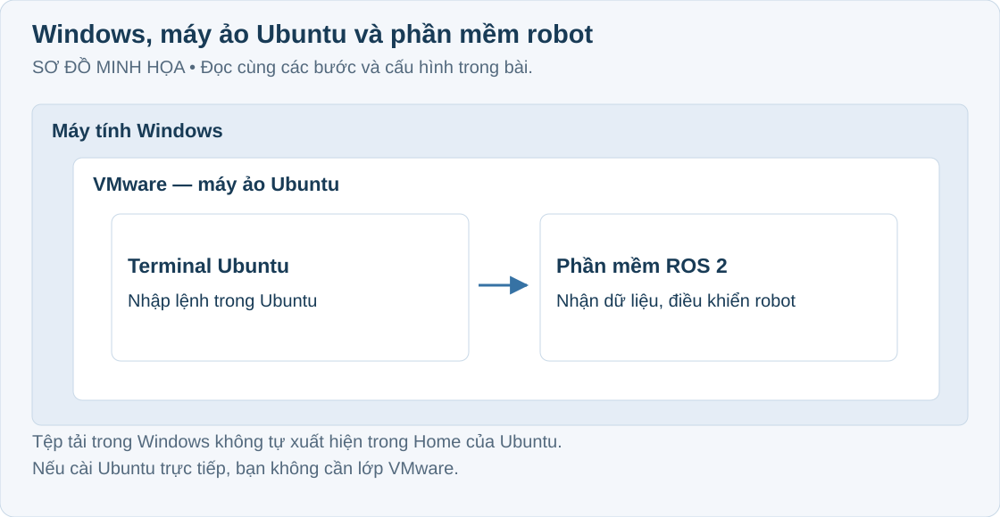
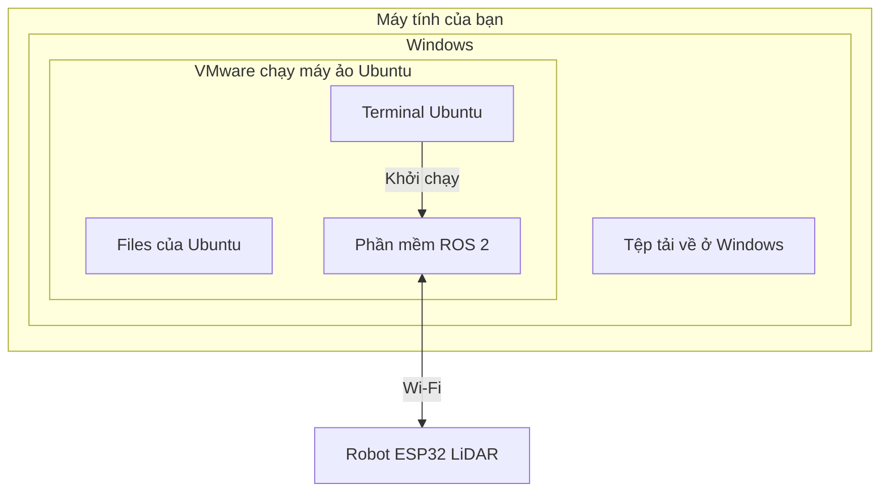

# Bài 1. Ubuntu là gì? Vì sao học robot cần dùng?

Khi đọc tài liệu robot, bạn có thể gặp yêu cầu “mở Ubuntu” hoặc “chạy lệnh trong Terminal”. Nếu trước đây chỉ sử dụng Windows, những tên gọi này dễ khiến chúng ta chưa biết phải bắt đầu từ cửa sổ nào.

Trong bài này, chúng ta sẽ tìm hiểu Ubuntu đảm nhiệm việc gì, phần mềm robot chạy ở đâu và vì sao một máy tính Windows vẫn có thể sử dụng Ubuntu để làm việc với robot.

**Mục tiêu:** hiểu Ubuntu dùng để làm gì và biết đâu là nơi bạn sẽ chạy phần mềm robot.

**Chuẩn bị:** chưa cần cài phần mềm hoặc bật robot.

## 1. Ubuntu là một hệ điều hành

Để mở một ứng dụng hoặc tìm một tệp trên máy tính, chúng ta cần một môi trường quản lý các công việc đó. **Hệ điều hành** cung cấp môi trường này, đồng thời quản lý kết nối mạng và việc sử dụng thiết bị.

Ubuntu là một hệ điều hành, tương tự vai trò của Windows mà bạn có thể đã quen sử dụng. Khi mở Ubuntu, chúng ta cũng làm việc với màn hình desktop, thư mục, trình duyệt và phần cài đặt. Điều cần làm quen là vị trí các công cụ và cách cài, chạy một số chương trình.

**Linux** là tên nền tảng mà Ubuntu sử dụng. Bạn chưa cần học cấu trúc Linux để bắt đầu các bài này.

| Thao tác quen thuộc trên Windows | Cách tương ứng trong Ubuntu |
| --- | --- |
| Mở File Explorer để tìm tệp | Mở **Files** |
| Mở Settings để chỉnh máy | Mở **Settings** |
| Dùng ổ `C:` và thư mục người dùng | Thường bắt đầu từ thư mục **Home** |
| Mở PowerShell hoặc Command Prompt để nhập lệnh | Mở **Terminal** |

Các công cụ có mục đích tương tự, nhưng không có nghĩa mọi lệnh Windows đều dùng được trong Ubuntu.

## 2. Ubuntu và ROS 2 có phải cùng một thứ không?

Ubuntu và ROS 2 thường xuất hiện cùng nhau trong hướng dẫn, nhưng chúng đảm nhiệm hai vai trò khác nhau. **Ubuntu là hệ điều hành; ROS 2 là bộ công cụ chạy trên hệ điều hành.**

Chẳng hạn, một chương trình cần nhận khoảng cách từ LiDAR, còn chương trình khác dùng dữ liệu đó để hiển thị hoặc xử lý. ROS 2 cung cấp công cụ để tổ chức việc trao đổi giữa các chương trình. Chúng ta sẽ sử dụng những công cụ này sau khi đã quen thao tác trên Ubuntu.

| Tên xuất hiện trong tài liệu | Hiểu đơn giản |
| --- | --- |
| Ubuntu 22.04 | Môi trường làm việc trên máy tính |
| ROS 2 Humble | Bộ công cụ hỗ trợ phần mềm robot |
| RViz | Ứng dụng xem robot, dữ liệu cảm biến và bản đồ |
| Workspace | Thư mục chứa phần mềm của một dự án robot |

Bạn chưa cần cài từng thành phần ở bài này. Nếu dùng máy ảo ROBOVIS, môi trường robot đã được chuẩn bị sẵn.

## 3. Dùng Windows thì Ubuntu nằm ở đâu?

Nếu máy đang dùng Windows, chúng ta có thể mở Ubuntu thông qua **máy ảo**, tức một máy tính được mô phỏng bằng phần mềm. Trong bộ hướng dẫn này, VMware chạy máy ảo Ubuntu bên trong một cửa sổ trên Windows. Vì vậy, bạn cần phân biệt thao tác đang thực hiện trong Windows hay trong Ubuntu.

<!-- tutorial-figure:ubuntu-trong-windows -->
<figure class="tutorial-figure" markdown>

<figcaption>Phân biệt nơi chạy phần mềm: nhập lệnh ROS 2 trong Terminal Ubuntu, không nhập vào PowerShell của Windows. Nhấp hình để xem lớn.</figcaption>
</figure>
<!-- /tutorial-figure:ubuntu-trong-windows -->

Windows và Ubuntu máy ảo có **thư mục, địa chỉ IP và ứng dụng riêng**. Tệp bạn tải bằng trình duyệt Windows không tự xuất hiện trong Home của Ubuntu. Hai bên chỉ trao đổi tệp khi có thao tác sao chép hoặc thiết lập chia sẻ phù hợp.

Nếu máy tính đã cài Ubuntu trực tiếp, bạn mở Terminal ngay trên Ubuntu, không cần VMware.

## 4. Phần mềm nào chạy trên máy tính, phần nào chạy trên robot?

Với bộ robot đang xét, robot thu thập dữ liệu cảm biến và thực hiện lệnh động cơ. Máy tính nhận dữ liệu để hiển thị, tạo bản đồ hoặc tính đường đi. Hai bên phối hợp với nhau, nhưng phần mềm chạy trên mỗi bên có nhiệm vụ riêng.

Vì vậy, học Ubuntu ở đây là học cách sử dụng **máy tính làm việc cùng robot**. Bạn không cài Ubuntu vào ESP32. Trong series này cũng chưa cần sửa hoặc nạp chương trình cho ESP32.

## Tổng kết

Ubuntu cung cấp môi trường làm việc, còn ROS 2 cung cấp các công cụ cho phần mềm robot. Nếu dùng Windows và VMware, chúng ta nhập lệnh ROS 2 trong Terminal của Ubuntu máy ảo. Ở bài tiếp theo, chúng ta sẽ chuẩn bị và mở môi trường đó để bắt đầu thực hành.

[← Lộ trình học](index.md) · [Bài 2: Chuẩn bị môi trường →](02-chuan-bi-moi-truong.md)
