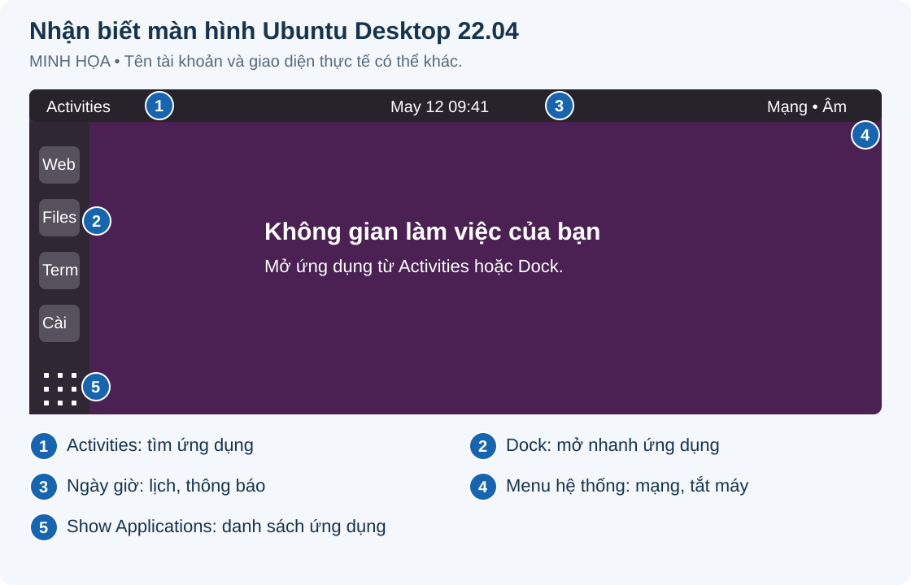
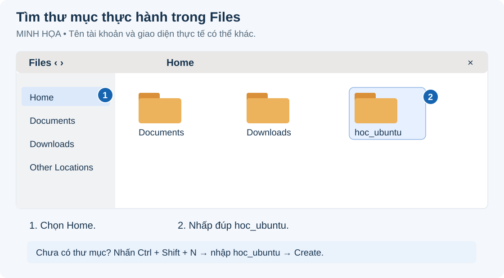

# Bài 3. Làm quen với giao diện Ubuntu

Khi vừa mở Ubuntu, chúng ta có thể chưa nhận ra nơi tìm ứng dụng hoặc nơi lưu tệp. Những thao tác này sẽ được dùng thường xuyên khi học robot, chẳng hạn mở Terminal, xem tệp cấu hình và chuyển sang cửa sổ hiển thị dữ liệu.

Trong bài này, chúng ta bắt đầu bằng chuột và các ứng dụng có sẵn, rồi tạo một thư mục để sử dụng trong những bài sau.

**Mục tiêu:** mở ứng dụng, tìm thư mục Home, chuyển cửa sổ và tắt Ubuntu đúng cách.

**Chuẩn bị:** đã đăng nhập Ubuntu theo [bài 2](02-chuan-bi-moi-truong.md). Chưa cần bật robot.

## 1. Nhận biết các khu vực trên màn hình

Trước khi mở ứng dụng, hãy quan sát các khu vực chính trên màn hình. Với Ubuntu Desktop 22.04 mặc định, những công cụ thường dùng được bố trí như sau:

| Khu vực | Vị trí thường gặp | Dùng để làm gì? |
| --- | --- | --- |
| **Activities** | Góc trên bên trái | Tìm ứng dụng và xem cửa sổ đang mở |
| Thanh ứng dụng, còn gọi là Dock | Mép trái | Mở nhanh Files, trình duyệt và ứng dụng đã ghim |
| Ngày, giờ | Thanh trên cùng | Xem lịch và thông báo |
| Menu hệ thống | Góc trên bên phải | Mạng, âm thanh, Settings và tắt máy |
| **Show Applications** | Nút hình các chấm trên Dock | Xem danh sách ứng dụng |

Vị trí có thể khác nếu máy đã được tùy chỉnh. Khi không thấy biểu tượng, dùng chức năng tìm tên ứng dụng ở bước tiếp theo.

<figure class="ubuntu-figure" markdown>

<figcaption>Hình 3.1 — Các khu vực chính trên Ubuntu Desktop 22.04, minh họa theo giao diện mặc định. Nhấp hình để xem lớn.</figcaption>
</figure>

## 2. Mở một ứng dụng bằng tên

Giả sử chúng ta muốn tìm một tệp nhưng chưa biết biểu tượng quản lý tệp nằm ở đâu. Có thể mở ứng dụng bằng tên thông qua Activities:

1. Nhấp **Activities**.
2. Gõ `Files`.
3. Nhấp ứng dụng **Files** trong kết quả.

**Kết quả cần thấy:** một cửa sổ quản lý tệp mở ra. Bạn có thể thấy Home, Downloads, Documents và các thư mục khác.

Lặp lại với từ `Settings` để mở cài đặt. Cách tìm bằng tên giúp bạn không phải nhớ vị trí từng biểu tượng.

!!! tip "Phím Super là phím nào?"
    Trên nhiều bàn phím máy tính, **Super** chính là phím có logo Windows. Nhấn phím này trong Ubuntu thường mở màn hình Activities. Nếu đang dùng máy ảo và Windows nhận phím thay vì Ubuntu, hãy nhấp Activities bằng chuột.

## 3. Tìm thư mục Home và Downloads

Sau khi mở Files, chúng ta cần một vị trí để lưu bài thực hành. Chọn **Home** ở thanh bên trái. Đây là thư mục riêng của tài khoản Ubuntu đang đăng nhập.

Mở thư mục **Downloads** nếu có. Đây thường là nơi chứa tệp tải bằng trình duyệt **bên trong Ubuntu**. Với giao diện ngôn ngữ khác, tên hiển thị có thể được dịch.

Nếu bạn đã tải `robovis.zip` bằng Windows, tệp đó nằm trong Windows. Không thấy nó ở Downloads của Ubuntu là điều bình thường.

### Thử tạo một thư mục bằng chuột

1. Quay lại **Home**.
2. Nhấp chuột phải vùng trống → **New Folder**. Bạn cũng có thể dùng **Ctrl + Shift + N**.
3. Đặt tên `hoc_ubuntu` rồi chọn **Create**.
4. Nhấp đúp để mở thư mục vừa tạo.

Nếu đã có `hoc_ubuntu`, mở thư mục đó, không cần tạo thêm. Các bài sau dùng chính thư mục này để thực hành.

**Kết quả cần thấy:** Files đang mở thư mục `hoc_ubuntu` trong Home. Chưa có tệp bên trong cũng đúng.

<figure class="ubuntu-figure" markdown>

<figcaption>Hình 3.2 — Từ Home, nhấp đúp hoc_ubuntu để mở. Nếu chưa có, dùng Ctrl + Shift + N để tạo thư mục.</figcaption>
</figure>

## 4. Chuyển giữa các cửa sổ

Trong một buổi thực hành, chúng ta thường dùng nhiều ứng dụng cùng lúc. Hãy giữ Files mở, sau đó mở Settings để thử chuyển qua lại mà không phải đóng một trong hai cửa sổ.

- Dùng **Alt + Tab** để chuyển qua lại giữa các ứng dụng.
- Dùng **Activities** để xem và chọn các cửa sổ đang mở.
- Nhấp biểu tượng ứng dụng trên Dock để quay lại ứng dụng đó.

**Thu nhỏ** cửa sổ và **đóng** ứng dụng là hai thao tác khác nhau. Sau này, Terminal chạy phần mềm robot cần được giữ mở; bạn có thể chuyển sang cửa sổ khác mà không đóng nó.

Các phím thao tác chung được mô tả thêm trong [hướng dẫn phím tắt Ubuntu](https://help.ubuntu.com/stable/ubuntu-help/shell-keyboard-shortcuts.html.en).

## 5. Chỉnh màn hình cho dễ đọc

Nếu chữ hoặc cửa sổ quá nhỏ, việc đọc hướng dẫn sẽ khó hơn. Chúng ta có thể kiểm tra độ phân giải trước khi tiếp tục thực hành:

1. Mở **Settings → Displays**.
2. Xem độ phân giải hiện tại ở **Resolution**.
3. Chọn độ phân giải phù hợp với màn hình, nếu có lựa chọn.
4. Nhấn **Apply**, rồi xác nhận giữ thay đổi nếu màn hình hiển thị tốt.

Với máy ảo, trước tiên thử phóng to cửa sổ VMware hoặc dùng **View → Full Screen**. Khả năng tự khớp kích thước phụ thuộc công cụ hỗ trợ đã cài trong máy ảo.

Nếu chỉ có ít lựa chọn độ phân giải, ghi nhận hiện tượng và tiếp tục bài học nếu vẫn đọc được. Không cần cài thêm trình điều khiển đồ họa để thực hành các thao tác cơ bản.

## 6. Xem kết nối mạng

Để nhận biết Ubuntu đang kết nối mạng bằng cách nào, nhấp menu hệ thống góc trên bên phải. Cách hiển thị phụ thuộc Ubuntu đang chạy trực tiếp hay thông qua VMware:

- **Ubuntu cài trực tiếp:** thường có mục Wi-Fi nếu máy có card Wi-Fi được nhận.
- **Ubuntu trong VMware:** thường hiện **Wired**, dù máy Windows kết nối bằng Wi-Fi. Đây là card mạng ảo của Ubuntu.

Vì vậy, không thấy danh sách Wi-Fi trong máy ảo chưa phải là lỗi. [Bài 7](07-ket-noi-robot.md) sẽ hướng dẫn kiểm tra đường kết nối này.

## 7. Tắt Ubuntu sau khi học

Khi kết thúc buổi học, trước tiên hãy lưu các tệp đang sửa để giữ lại kết quả thực hành. Sau đó, trong Ubuntu, mở menu hệ thống → **Power Off / Log Out → Power Off**, rồi xác nhận.

Nếu dùng máy ảo, đợi Ubuntu tắt xong mới đóng VMware. Không dùng nút tắt cưỡng bức máy ảo như thao tác kết thúc thông thường.

## Tổng kết

Chúng ta đã dùng giao diện để mở ứng dụng, tạo thư mục `hoc_ubuntu` và chuyển giữa các cửa sổ. Những công việc tương tự cũng có thể thực hiện bằng lệnh. Bài tiếp theo sẽ giới thiệu Terminal và cách đọc kết quả sau khi nhập một lệnh.

[← Bài 2](02-chuan-bi-moi-truong.md) · [Bài 4: Làm quen với Terminal →](04-terminal.md)
