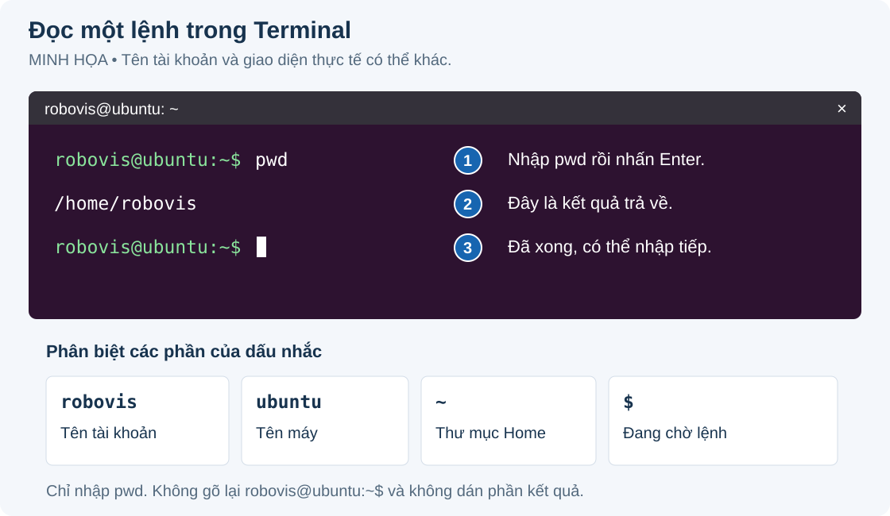
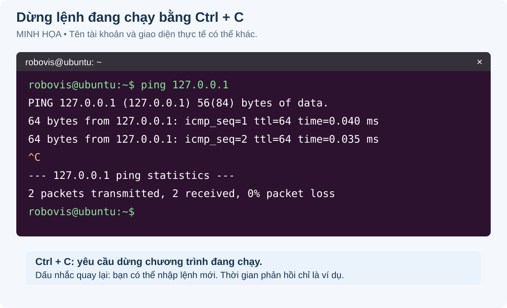
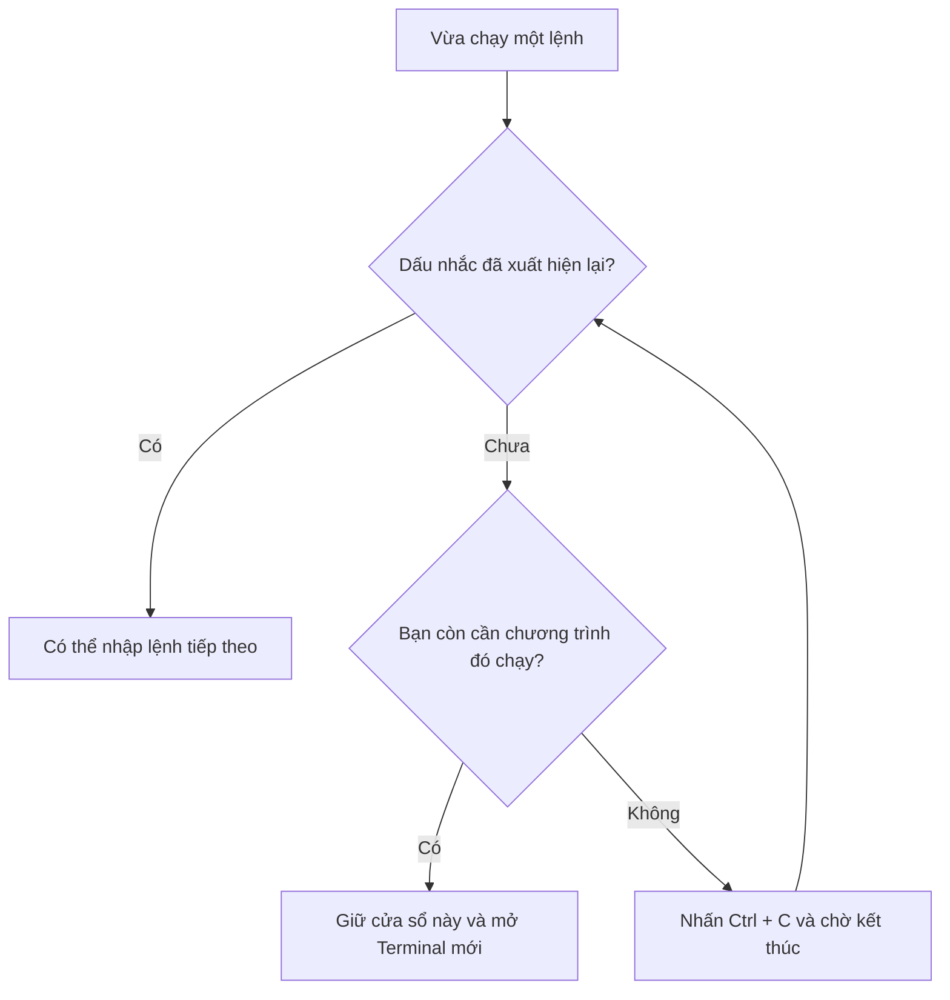

# Bài 4. Làm quen với Terminal

Trong bài trước, chúng ta dùng chuột để mở ứng dụng và tìm thư mục. Khi học robot, nhiều công việc tương tự được thực hiện bằng lệnh, giúp chỉ rõ chương trình cần chạy và các thiết lập đi kèm.

Terminal là nơi chúng ta nhập những lệnh đó. Bài này sẽ giúp bạn đọc một cửa sổ Terminal, chạy lệnh đầu tiên và nhận biết khi nào chương trình vẫn đang hoạt động.

**Mục tiêu:** tự nhập một lệnh, nhận biết khi lệnh đã chạy xong và dừng được lệnh đang chạy.

**Chuẩn bị:** Ubuntu đã mở. Bài này không cần Internet và không cần robot.

## 1. Terminal dùng để làm gì?

Terminal là cửa sổ để chúng ta làm việc với máy tính bằng lệnh. Chẳng hạn, thay vì tìm biểu tượng của một chương trình robot, chúng ta có thể nhập tên chương trình cùng các thông tin cần thiết để khởi chạy nó.

Ở bước đầu, điều cần làm quen là trình tự nhập lệnh, đọc kết quả và dừng chương trình. Bạn có thể tra lại tên lệnh trong tài liệu khi cần, rồi dần ghi nhớ qua thực hành.

## 2. Mở Terminal đúng nơi

Trong **Ubuntu**, nhấn **Ctrl + Alt + T**. Nếu phím tắt không hoạt động, mở **Activities**, gõ `Terminal`, rồi mở ứng dụng.

Bạn sẽ thấy dòng gần giống:

**Ví dụ màn hình, không phải lệnh cần chạy:**

```text
robovis@ubuntu:~$
```

| Phần hiển thị | Ý nghĩa |
| --- | --- |
| `robovis` | Tên tài khoản đang dùng |
| `ubuntu` | Tên máy tính |
| `~` | Đang ở thư mục Home |
| `$` | Terminal đang chờ bạn nhập lệnh với tài khoản thông thường |

Dòng này gọi là **dấu nhắc lệnh**. Tên người dùng trên máy bạn có thể khác. Không gõ lại `robovis@ubuntu:~$` khi sao chép lệnh từ tài liệu.

!!! note "Nếu màn hình bắt đầu bằng PS C:\\..."
    Bạn đang ở PowerShell của Windows. Hãy chuyển vào máy ảo Ubuntu và mở Terminal bên trong đó.

## 3. Chạy lệnh đầu tiên

Trước tiên, chúng ta sẽ hỏi Terminal đang làm việc trong thư mục nào. Gõ lệnh sau, rồi nhấn **Enter**:

```bash
pwd
```

Lệnh `pwd` cho biết Terminal đang làm việc trong thư mục nào.

**Kết quả ví dụ:**

```text
/home/robovis
```

Sau dòng kết quả, bạn sẽ thấy dấu nhắc xuất hiện trở lại. Đây là dấu hiệu lệnh `pwd` đã kết thúc và Terminal sẵn sàng nhận lệnh tiếp theo. Việc nhận biết dấu nhắc sẽ hữu ích khi chúng ta chạy những chương trình kéo dài ở phần sau.

<figure class="ubuntu-figure" markdown>

[](images/04-doc-terminal.svg)

<figcaption>Hình 4.1 — Đọc Terminal từ trên xuống: lệnh đã nhập → kết quả → dấu nhắc mới. Đây là màn hình minh họa; chỉ sao chép lệnh pwd.</figcaption>
</figure>

Tiếp tục chạy:

```bash
whoami
```

**Kết quả cần thấy:** tên tài khoản Ubuntu của bạn. Hai lệnh trên chỉ đọc thông tin, không sửa dữ liệu.

## 4. Sao chép và dán lệnh

Khi làm theo tài liệu, chúng ta có thể sao chép lệnh thay vì gõ lại. Trong trình duyệt, dùng nút sao chép hoặc **Ctrl + C**, sau đó chuyển vào Terminal và nhấn **Ctrl + Shift + V** để dán. Hãy đọc lại nội dung vừa dán trước khi nhấn **Enter**.

| Việc cần làm | Phím trong Terminal Ubuntu |
| --- | --- |
| Sao chép phần đã bôi chọn | **Ctrl + Shift + C** |
| Dán | **Ctrl + Shift + V** |
| Gọi lại lệnh vừa chạy | **Mũi tên lên** |
| Xóa nội dung đang nhập trước con trỏ | **Ctrl + U** |
| Yêu cầu dừng chương trình đang chạy | **Ctrl + C** |

**Ctrl + C trong Terminal thường dùng để dừng chương trình**, không phải phím sao chép thông thường.

Nếu sao chép từ Windows vào Ubuntu máy ảo chưa hoạt động, gõ tay các lệnh ngắn trong bài. Clipboard giữa Windows và Ubuntu còn phụ thuộc cấu hình VMware; điều đó không có nghĩa lệnh sai.

## 5. Thử một lệnh chạy liên tục

Các lệnh vừa thử đều trả kết quả rồi kết thúc. Bây giờ, chúng ta sẽ chạy một lệnh tiếp tục hoạt động để quan sát sự khác biệt:

```bash
ping 127.0.0.1
```

`127.0.0.1` là địa chỉ để máy tính liên lạc với **chính nó**. Lệnh này chỉ minh họa cách chạy và dừng một chương trình liên tục.

Bạn sẽ thấy những dòng phản hồi tiếp tục xuất hiện. Dấu nhắc chưa quay lại vì `ping` vẫn đang chạy.

Nhấn **Ctrl + C** trong cửa sổ đó.

**Kết quả cần thấy:** `ping` in thống kê rồi kết thúc; dấu nhắc xuất hiện trở lại. Các con số thời gian phản hồi có thể khác nhau giữa các máy.

<figure class="ubuntu-figure" markdown>

[](images/04-dung-ping.svg)

<figcaption>Hình 4.2 — Nhấn Ctrl + C để dừng ping. Ký hiệu ^C và thống kê trong hình là ví dụ kết quả, không phải lệnh cần nhập.</figcaption>
</figure>

Nếu hệ thống báo `ping: command not found`, xem phần cài công cụ ở bài 6 trước khi chạy lại lệnh. Không cần đổi địa chỉ IP để sửa lỗi thiếu lệnh.

## 6. Khi nào cần mở Terminal thứ hai?

Giả sử một Terminal đang chạy chương trình kết nối robot, còn chúng ta muốn kiểm tra dữ liệu nhận được. Nếu dừng chương trình kết nối để nhập lệnh kiểm tra, nguồn dữ liệu có thể cũng ngừng theo. Trong trường hợp đó, hãy giữ Terminal thứ nhất và mở thêm một cửa sổ cho công việc kiểm tra.



Để tập, mở một Terminal mới bằng **Ctrl + Alt + T**. Chạy `whoami` ở cửa sổ mới. Sau đó chuyển lại cửa sổ cũ: cả hai đều có thể sử dụng độc lập.

Một chương trình không in thêm dòng mới chưa chắc bị treo. Một số chương trình đang chờ dữ liệu. Hãy xem hướng dẫn của lệnh đó trước khi quyết định dừng.

## 7. Những lỗi nhập lệnh dễ gặp

Khi một lệnh chưa chạy như mong đợi, hãy đọc phần cuối cửa sổ trước khi nhập lại. Những dấu hiệu sau giúp chúng ta nhận ra lỗi gõ lệnh hoặc chương trình đang chờ thao tác.

| Hiện tượng | Kiểm tra trước tiên |
| --- | --- |
| `command not found` | Có gõ sai tên lệnh, sai chữ hoa/thường hoặc chưa cài công cụ không? |
| Xuất hiện dấu `>` ở đầu dòng mới | Có thể thiếu dấu nháy đóng. Nhấn **Ctrl + C**, nhập lại đúng lệnh |
| Dán cả kết quả vào Terminal | Chỉ sao chép phần **lệnh cần chạy** |
| Gõ mà không thấy dấu nhắc | Chương trình trước có thể vẫn đang chạy hoặc đang hỏi thông tin |

## Tổng kết

Trong Terminal, câu lệnh là yêu cầu chúng ta gửi cho máy tính, còn các dòng xuất hiện sau đó là kết quả hoặc thông báo của chương trình. Dấu nhắc trở lại cho biết có thể nhập lệnh mới. Ở bài tiếp theo, chúng ta sẽ dùng cách làm này để tạo thư mục và lưu một tệp ghi chú.

[← Bài 3](03-giao-dien-ubuntu.md) · [Bài 5: Thư mục, đường dẫn và tệp →](05-thu-muc-va-tep.md)
