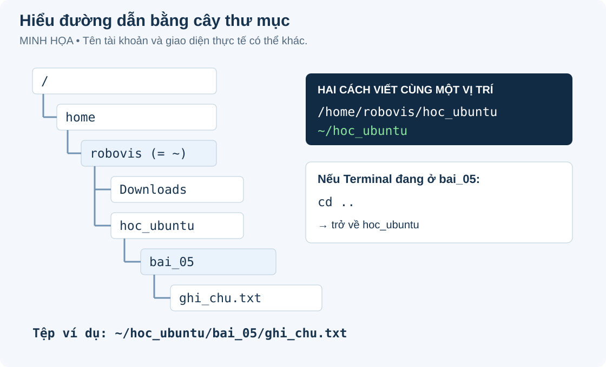
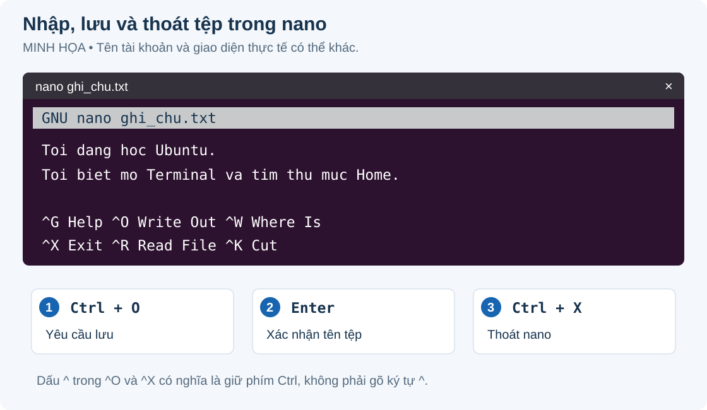

# Bài 5. Thư mục, đường dẫn và tệp

Giả sử chúng ta vừa tạo một tệp ghi chú bằng Terminal nhưng không tìm thấy nó trong Files. Tệp có thể đã được lưu đúng, chỉ là hai cửa sổ đang mở ở hai thư mục khác nhau.

Để tránh nhầm lẫn này, chúng ta cần hiểu đường dẫn và thư mục làm việc hiện tại. Trong bài, bạn sẽ tạo một tệp, tìm lại nó bằng giao diện và đọc nội dung từ một vị trí khác.

**Mục tiêu:** biết mình đang ở đâu, vào đúng thư mục và tạo được một tệp ghi chú bằng Terminal.

**Chuẩn bị:** đã làm được [bài Terminal](04-terminal.md). Các thao tác dưới đây dùng thư mục thực hành `hoc_ubuntu` trong Home.

## 1. Đường dẫn là địa chỉ của thư mục hoặc tệp

Mỗi tệp và thư mục nằm ở một vị trí trong cấu trúc lưu trữ của Ubuntu. **Đường dẫn** mô tả vị trí đó. Chẳng hạn, `/home/robovis/hoc_ubuntu` cho biết thư mục `hoc_ubuntu` nằm trong Home của tài khoản `robovis`.

Tên tài khoản của bạn có thể khác. Để không phải thay tên người dùng trong từng lệnh, các bài dùng ký hiệu **`~`**, đại diện cho Home của tài khoản đang đăng nhập.

| Cách viết | Ý nghĩa |
| --- | --- |
| `~` | Home của bạn |
| `~/hoc_ubuntu` | Thư mục `hoc_ubuntu` trong Home |
| `/home/robovis/hoc_ubuntu` | Địa chỉ đầy đủ trong ví dụ tài khoản `robovis` |
| `.` | Thư mục hiện tại của Terminal |
| `..` | Thư mục cha, tức lên một cấp |

Khi viết địa chỉ từ gốc `/`, chúng ta đang dùng **đường dẫn tuyệt đối**. Khi chỉ viết tên tệp hoặc thư mục con, vị trí đó được hiểu từ thư mục Terminal đang làm việc; đây là **đường dẫn tương đối**. Phần thực hành dưới đây sẽ giúp bạn thấy khi nào hai cách viết cho cùng một kết quả.

<figure class="ubuntu-figure" markdown>

[](images/05-cay-thu-muc.svg)

<figcaption>Hình 5.1 — Cấu trúc thư mục và tệp sẽ tạo trong bài. Tài khoản robovis chỉ là ví dụ; ~ luôn trỏ tới Home của tài khoản đang đăng nhập.</figcaption>
</figure>

## 2. Về Home và xem thư mục đang có

Trước khi tạo tệp, chúng ta đưa Terminal về một vị trí đã biết là Home. Chạy lần lượt các lệnh và đọc kết quả sau mỗi bước:

```bash
cd ~
```

`cd` dùng để chuyển thư mục làm việc của Terminal.

```bash
pwd
```

**Kết quả cần thấy:** đường dẫn Home, ví dụ `/home/robovis`.

```bash
ls
```

`ls` liệt kê tên tệp và thư mục tại vị trí hiện tại. Danh sách có thể gồm `Downloads`, `Documents`, `hoc_ubuntu` hoặc những tên khác trên máy bạn.

Mở một thư mục trong Files **không tự chuyển** vị trí của Terminal đã mở trước đó. Khi chưa chắc, chạy `pwd`.

## 3. Tạo thư mục thực hành và vào bên trong

Chúng ta sẽ dành riêng thư mục `bai_05` cho ví dụ trong bài. Nhờ đó, các tệp tạo ra nằm cùng một nơi và dễ tìm lại khi cần đối chiếu.

```bash
mkdir -p ~/hoc_ubuntu/bai_05
```

Lệnh này tạo `bai_05` trong `hoc_ubuntu`. Tùy chọn `-p` giúp tạo cả thư mục cha nếu còn thiếu và không báo lỗi chỉ vì thư mục đã có.

```bash
cd ~/hoc_ubuntu/bai_05
```

```bash
pwd
```

**Kết quả cần thấy:** đường dẫn kết thúc bằng `/hoc_ubuntu/bai_05`.

Trong Files, bạn cũng có thể mở Home → `hoc_ubuntu` → `bai_05` để nhìn thấy cùng vị trí. Terminal và Files đang nhìn vào cùng dữ liệu, chỉ khác cách thao tác.

## 4. Tạo một tệp ghi chú

Khi Terminal đã ở trong `bai_05`, chúng ta mở trình soạn thảo để tạo tệp đầu tiên:

```bash
nano ghi_chu.txt
```

Trong lệnh này, `nano` là trình sửa văn bản chạy trong Terminal, còn `ghi_chu.txt` là tệp chúng ta muốn mở. Nếu tệp chưa tồn tại, nano bắt đầu với nội dung trống; sau khi nhập và lưu, chúng ta sẽ có một tệp văn bản trong thư mục hiện tại.

Nhập hai dòng sau **vào màn hình nano**, không chạy chúng như lệnh:

```text
Toi dang hoc Ubuntu.
Toi biet mo Terminal va tim thu muc Home.
```

Để lưu và thoát:

1. Nhấn **Ctrl + O**. Trong nano, chữ `^O` ở dưới màn hình có nghĩa là Ctrl + O.
2. Nhấn **Enter** để xác nhận tên `ghi_chu.txt`.
3. Nhấn **Ctrl + X** để thoát.

<figure class="ubuntu-figure" markdown>

[](images/05-nano-luu-tep.svg)

<figcaption>Hình 5.2 — Nhập nội dung trong nano, rồi làm lần lượt ba bước phía dưới. ^O nghĩa là Ctrl + O, ^X nghĩa là Ctrl + X.</figcaption>
</figure>

Nếu báo `nano: command not found`, xem phần cài `nano` ở [bài 6](06-cai-va-chay-phan-mem.md), rồi quay lại bước này. Bạn cũng có thể dùng ứng dụng **Text Editor**, nhập nội dung và dùng **Save As** lưu vào đúng `~/hoc_ubuntu/bai_05/ghi_chu.txt`.

## 5. Kiểm tra tệp vừa lưu

Lưu xong chưa phải là bước cuối cùng. Chúng ta cần xác nhận tệp nằm đúng chỗ và nội dung bên trong đúng với phần vừa nhập. Trước tiên, xem danh sách tệp trong thư mục:

```bash
ls
```

Bạn cần thấy `ghi_chu.txt` trong danh sách. Để đọc nội dung:

```bash
cat ghi_chu.txt
```

**Kết quả cần thấy:** hai dòng vừa nhập. Lệnh `cat` ở đây chỉ đọc tệp văn bản, không mở chế độ chỉnh sửa.

Thử đi lên thư mục cha:

```bash
cd ..
```

Chạy `pwd`, bạn sẽ thấy vị trí kết thúc bằng `/hoc_ubuntu`. Từ đây, muốn đọc tệp cần ghi thêm thư mục con:

```bash
cat bai_05/ghi_chu.txt
```

Đó là đường dẫn **tương đối**. Nếu muốn đọc tệp từ vị trí bất kỳ, dùng đường dẫn bắt đầu từ Home:

```bash
cat ~/hoc_ubuntu/bai_05/ghi_chu.txt
```

## 6. Sao chép tệp trước khi sửa

Trước khi sửa một tệp cấu hình, việc giữ bản sao giúp chúng ta còn dữ liệu cũ để so sánh. Hãy tập thao tác này với tệp ghi chú vừa tạo:

```bash
cp -i ~/hoc_ubuntu/bai_05/ghi_chu.txt ~/hoc_ubuntu/bai_05/ghi_chu_ban_sao.txt
```

`cp` nhận **nguồn trước, đích sau**. Tùy chọn `-i` hỏi lại nếu đích đã tồn tại; trong bài này, chọn `n` nếu không muốn ghi đè bản sao cũ.

Chạy:

```bash
ls ~/hoc_ubuntu/bai_05
```

**Kết quả cần thấy:** tệp gốc và tệp `ghi_chu_ban_sao.txt`. Bạn có thể mở bản sao bằng nano rồi sửa thử một câu để so sánh hai tệp.

## 7. Khi gặp đường dẫn trong tài liệu robot

Các lệnh trong tài liệu robot cũng sử dụng đường dẫn theo cùng nguyên tắc. Khi gặp những tên dưới đây, hãy xác định chúng trỏ đến thư mục dự án hay một tệp cụ thể trước khi thực hiện thao tác.

| Ví dụ | Bạn cần hiểu gì? |
| --- | --- |
| `~/robot_ws` | Workspace của robot, nếu được cài theo cấu trúc này |
| `~/m_map.yaml` | Tệp mô tả bản đồ nằm trong Home |
| `~/m_map.pgm` | Tệp ảnh bản đồ tương ứng trong ví dụ |
| `~/.bashrc` | Tệp cấu hình của Bash; tên bắt đầu bằng dấu chấm nên thường bị ẩn |

Nhấn **Ctrl + H** trong Files để hiện hoặc ẩn tệp ẩn. Bài này chỉ giúp bạn nhận biết `.bashrc`; chưa cần sửa nó.

Tệp `.yaml` và `.pgm` của bản đồ có vai trò khác nhau. Khi sao lưu bản đồ, cần giữ các tệp liên quan cùng nhau theo bài quản lý bản đồ của robot.

## 8. Lỗi đường dẫn thường gặp

| Lỗi hoặc tình huống | Cách sửa |
| --- | --- |
| `No such file or directory` | Chạy `pwd` và `ls`; kiểm tra tên và vị trí |
| Gõ `Robot_ws` trong khi tên là `robot_ws` | Dùng đúng chữ hoa/thường |
| Thư mục có khoảng trắng | Đặt đường dẫn trong nháy kép, ví dụ `cd "$HOME/Thu muc hoc"` |
| Không thấy `ghi_chu.txt` ở nơi mong muốn | Xem có đang mở Home của Windows thay vì Ubuntu không |

**Mẹo:** nhấn **Tab** để Terminal hỗ trợ hoàn thành tên đường dẫn. Với tệp thực hành và bản đồ mới, đặt tên không dấu, dùng `_` thay khoảng trắng sẽ dễ thao tác hơn.

**Bạn đã hoàn thành bài này khi:** tạo, đọc và tìm lại được `ghi_chu.txt` từ một thư mục khác.

## Tổng kết

Chúng ta đã dùng `pwd` để xác định vị trí, `cd` để chuyển thư mục và đường dẫn để tìm lại cùng một tệp từ nhiều nơi. Khi một lệnh báo không thấy tệp, những thao tác này giúp kiểm tra nguyên nhân trước khi tạo lại dữ liệu. Bài tiếp theo sẽ sử dụng tệp theo cách tương tự để chạy một chương trình Python nhỏ.

[← Bài 4](04-terminal.md) · [Bài 6: Cài phần mềm và chạy chương trình →](06-cai-va-chay-phan-mem.md)
