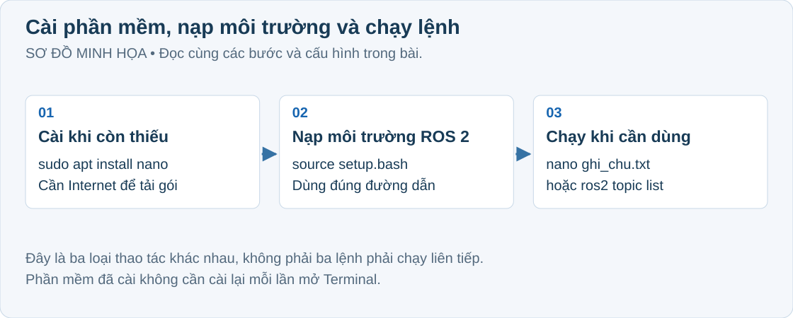

# Bài 6. Cài phần mềm và chạy chương trình

Khi làm theo một hướng dẫn robot, chúng ta có thể gặp ba yêu cầu nối tiếp nhau: cài một gói phần mềm, nạp môi trường và chạy chương trình. Các lệnh có thể cùng được nhập trong Terminal, nhưng mỗi bước thực hiện một công việc khác nhau.

Trong bài này, chúng ta sẽ phân biệt những công việc đó qua các công cụ Ubuntu và một chương trình Python nhỏ, rồi liên hệ với bước chuẩn bị môi trường ROS 2.

**Mục tiêu:** phân biệt cài phần mềm, mở phần mềm và chuẩn bị môi trường; biết dùng `sudo` khi hướng dẫn yêu cầu.

**Chuẩn bị:** đã biết Terminal và đường dẫn. Phần cài công cụ cần Ubuntu có Internet; phần chạy chương trình mẫu không cần robot.

## 1. Cài và chạy là hai việc khác nhau

Cài phần mềm là đưa chương trình cùng các thành phần cần thiết vào máy. Sau khi đã cài, chúng ta có thể mở chương trình nhiều lần để sử dụng. Chẳng hạn, nano cần được cài nếu máy chưa có công cụ này; những lần sửa tệp sau chỉ cần chạy nano với tên tệp muốn mở.

<!-- tutorial-figure:cai-nap-chay -->
<figure class="tutorial-figure" markdown>

[](../assets/illustrations/cai-nap-chay.svg)

<figcaption>Phân biệt ba công việc thường gặp. Với ROS 2, dùng nguyên đường dẫn source được ghi trong bài. Nhấp hình để xem lớn.</figcaption>
</figure>
<!-- /tutorial-figure:cai-nap-chay -->

| Ví dụ | Đang làm gì? | Khi nào thực hiện? |
| --- | --- | --- |
| `sudo apt install nano` | Cài công cụ sửa văn bản nano | Khi công cụ chưa có hoặc cần cập nhật |
| `nano ghi_chu.txt` | Mở nano để sửa tệp | Mỗi lần cần sửa tệp |
| `source /opt/ros/humble/setup.bash` | Nạp thiết lập ROS 2 cho Terminal hiện tại | Khi Terminal chưa có môi trường ROS 2 |
| `ros2 topic list` | Chạy công cụ xem tên các kênh dữ liệu ROS 2 | Khi muốn kiểm tra hệ thống |

Vì phần mềm đã cài được lưu trên máy, chúng ta thường không phải cài lại sau mỗi lần khởi động. Tuy nhiên, chương trình cần được mở lại và một số thiết lập môi trường cần được nạp cho phiên Terminal đang dùng. Đây là lý do tài liệu có thể lặp lại lệnh `source` mà không yêu cầu cài lại ROS 2.

## 2. `sudo` và mật khẩu

Một số thao tác thay đổi phần mềm của hệ thống cần quyền quản trị. Khi tài khoản được cấp quyền, `sudo` cho phép chúng ta thực hiện một lệnh với quyền đó. Trong bài này, bạn sẽ gặp `sudo` ở các bước cài công cụ bằng `apt`.

Khi lệnh hỏi mật khẩu, Terminal có thể hiện:

```text
[sudo] password for robovis:
```

Nhập mật khẩu Ubuntu của tài khoản, rồi nhấn **Enter**. **Màn hình không hiện chữ hoặc dấu sao khi gõ mật khẩu là bình thường.**

Nếu mật khẩu sai, đọc thông báo rồi nhập lại. Không tự thêm `sudo` vào mọi lệnh để chữa lỗi. Các ví dụ đọc tệp, chạy chương trình Python và kiểm tra ROS 2 trong bài này không cần `sudo`.

## 3. Kiểm tra công cụ trước khi cài

Trước khi cài thêm, chúng ta nên kiểm tra công cụ đã có trên máy hay chưa. Chạy từng lệnh dưới đây để xem phiên bản nano và Python 3:

```bash
nano --version
```

```bash
python3 --version
```

**Kết quả cần thấy:** thông tin phiên bản. Nếu các công cụ đã có, chuyển sang mục 5. Nếu máy báo `command not found`, đọc mục 4 để cài công cụ còn thiếu.

## 4. Cài công cụ còn thiếu bằng `apt`

Nếu một công cụ còn thiếu, chúng ta có thể sử dụng `apt` để cài gói tương ứng từ các nguồn đã cấu hình trong Ubuntu. Quá trình này cần kết nối Internet để lấy thông tin và tải gói phần mềm.

### Bước 1. Kết nối Internet

Nếu đang nối Wi-Fi robot, hãy chuyển về mạng có Internet. Với máy ảo, không chỉ Windows mà **Ubuntu cũng phải truy cập Internet được**. Thử mở một trang web trong trình duyệt Ubuntu.

### Bước 2. Cập nhật danh sách gói

```bash
sudo apt update
```

Lệnh này tải lại danh sách các gói có sẵn để `apt` biết có thể lấy phần mềm từ đâu. Đây là bước cập nhật thông tin gói, không nâng cấp phiên bản Ubuntu. Hãy chờ dấu nhắc quay lại và kiểm tra thông báo tải dữ liệu trước khi chuyển sang bước cài đặt.

### Bước 3. Cài đúng công cụ cần dùng

Nếu thiếu nano:

```bash
sudo apt install nano
```

Nếu thiếu Python 3:

```bash
sudo apt install python3
```

Nếu bài Terminal hoặc kiểm tra mạng báo thiếu `ping`:

```bash
sudo apt install iputils-ping
```

Khi có câu hỏi **Do you want to continue? [Y/n]**, đọc danh sách thay đổi. Nếu đúng phần mềm cần cài, nhập `y` rồi nhấn **Enter**. Sau khi hoàn tất, chạy lại lệnh kiểm tra phiên bản hoặc thử `ping -c 2 127.0.0.1`.

Nếu báo đang có tiến trình khác giữ khóa `apt`, chờ trình cài/cập nhật đó hoàn tất. Không xóa tệp khóa để ép hai trình cài chạy cùng lúc.

## 5. Chạy một chương trình Python nhỏ

Sau khi kiểm tra công cụ, chúng ta sẽ tạo một tệp Python và chạy nó để thấy mối quan hệ giữa nội dung tệp với kết quả trên màn hình. Bạn có thể làm theo mà chưa cần học Python trước; chương trình chỉ in một câu chào, không điều khiển robot.

Tạo thư mục:

```bash
mkdir -p ~/hoc_ubuntu/bai_06
```

Mở tệp mới:

```bash
nano ~/hoc_ubuntu/bai_06/xin_chao.py
```

Nhập đúng dòng dưới đây vào nano:

```python
print("Xin chao! Toi da chay duoc chuong trinh tren Ubuntu.")
```

Lưu bằng **Ctrl + O**, **Enter**, rồi thoát bằng **Ctrl + X**. Chạy:

```bash
python3 ~/hoc_ubuntu/bai_06/xin_chao.py
```

**Kết quả cần thấy:**

```text
Xin chao! Toi da chay duoc chuong trinh tren Ubuntu.
```

Ở đây, `python3` là chương trình đọc và thực thi tệp `xin_chao.py`. Bạn không cần dùng `sudo` hoặc đổi quyền tệp khi chạy theo cách này.

## 6. Hiểu bước `source` trong tài liệu ROS 2

Khi chuyển sang phần mềm robot, Terminal còn cần biết vị trí các công cụ ROS 2. Chúng ta sẽ kiểm tra và nạp những thiết lập đó trên máy **đã cài ROS 2 Humble**, chẳng hạn máy ảo ROBOVIS. Nếu Ubuntu mới cài chưa có ROS 2, hãy hoàn thành phần cài môi trường trong tài liệu robot trước.

Kiểm tra trong Terminal hiện tại:

```bash
printenv ROS_DISTRO
```

**Kết quả mong đợi với môi trường này:** `humble`. Nếu không in gì, biến môi trường chưa được đặt trong Terminal đó; chưa thể kết luận phần mềm không được cài.

Kiểm tra tệp thiết lập:

```bash
ls /opt/ros/humble/setup.bash
```

Nếu tệp tồn tại, nạp thiết lập:

```bash
source /opt/ros/humble/setup.bash
```

Chạy lại `printenv ROS_DISTRO`, rồi:

```bash
ros2 --help
```

**Kết quả cần thấy:** danh sách trợ giúp của công cụ `ros2`. Lệnh này không làm robot di chuyển.

`source` chỉ áp dụng thiết lập vào phiên Terminal hiện tại. Terminal mở mới cần được nạp thiết lập riêng, trừ khi cấu hình khởi động như `.bashrc` đã làm sẵn. Bản máy ảo ROBOVIS có thể đã chuẩn bị việc này.

### Workspace của robot là lớp riêng

Ngoài các công cụ ROS 2 dùng chung, một robot còn có các gói riêng được đặt trong workspace của dự án. Terminal có thể chạy `ros2` nhưng vẫn chưa tìm thấy những gói này nếu chưa nạp workspace. Với cấu trúc `~/robot_ws`, chúng ta kiểm tra:

```bash
ls ~/robot_ws/install/setup.bash
```

**Chỉ khi tệp này tồn tại**, chạy:

```bash
source ~/robot_ws/install/setup.bash
```

Nếu tệp không có, không tạo một tệp rỗng để cho hết lỗi. Workspace có thể nằm ở nơi khác hoặc chưa được chuẩn bị. Quay lại bài cài workspace của sản phẩm hoặc gửi thông báo lỗi để kiểm tra.

## 7. Nếu chưa chạy được

| Hiện tượng | Hướng kiểm tra |
| --- | --- |
| `Temporary failure resolving ...` khi dùng apt | Kiểm tra Internet và DNS của Ubuntu |
| `Unable to locate package ...` | Kiểm tra tên gói và kết quả `apt update` |
| Python báo không mở được tệp | Kiểm tra đường dẫn `xin_chao.py` |
| `ros2: command not found` | Kiểm tra nơi nhập lệnh, tệp thiết lập ROS 2 và lệnh `source` |
| `ROS_DISTRO` hiện tên khác `humble` | Kiểm tra môi trường theo tài liệu robot, chưa chạy lệnh cài chồng thêm phiên bản |

**Bạn đã hoàn thành bài này khi:** chạy được `xin_chao.py`, hiểu mật khẩu `sudo` và biết vì sao đôi khi cần `source`.

## Tổng kết

Cài đặt đưa phần mềm vào máy, nạp môi trường giúp Terminal tìm đúng các thành phần, còn chạy chương trình bắt đầu công việc cần thực hiện. Phân biệt ba bước này sẽ giúp chúng ta chọn đúng cách kiểm tra khi một lệnh chưa hoạt động. Tiếp theo, chúng ta sẽ xem máy tính kết nối với robot qua mạng như thế nào.

[← Bài 5](05-thu-muc-va-tep.md) · [Bài 7: Kết nối máy tính với robot →](07-ket-noi-robot.md)
