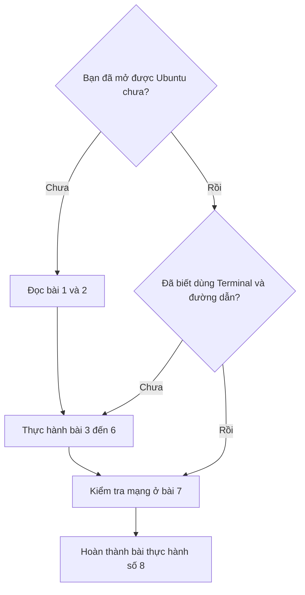

# Ubuntu cơ bản cho người mới học robot

Khi bắt đầu học robot, chúng ta thường muốn nhanh chóng nhìn thấy xe di chuyển hoặc dữ liệu cảm biến xuất hiện trên màn hình. Tuy nhiên, trước khi chạy những chương trình đó, chúng ta cần biết mở chúng ở đâu, tìm tệp cấu hình như thế nào và đọc thông báo khi một bước chưa thực hiện được.

Nhóm bài Ubuntu và công cụ giúp chúng ta làm quen với những thao tác này, từ sử dụng giao diện đến nhập lệnh và kiểm tra mạng. **Bạn không cần biết lập trình để bắt đầu.** Các bài đầu chỉ sử dụng máy tính, vì vậy chúng ta có thể thực hành trước khi có robot bên cạnh.

Series này nằm trong nhóm **Ubuntu và công cụ** của Kiến thức nền. Nếu chưa biết có cần học Ubuntu không, chọn [lộ trình phù hợp tại Bắt đầu từ đây](../kien-thuc-nen/index.md). Người học Arduino/ESP32 thuần chưa cần Ubuntu; người chuẩn bị học ROS 2 nên đọc bài 1–6 trước. Bài 7 dành cho lúc đã có robot, có thể quay lại sau.

## Bạn sẽ học những gì?

Các bài được sắp xếp theo một công việc quen thuộc: mở môi trường làm việc, tạo và tìm lại tệp, chạy chương trình, rồi kiểm tra kết nối với thiết bị. Mỗi bước chuẩn bị cho thao tác sẽ gặp trong tài liệu robot.

| Bài | Nội dung | Kết quả sau bài học |
| --- | --- | --- |
| [1. Ubuntu là gì?](01-ubuntu-la-gi.md) | Phân biệt Ubuntu, máy ảo và ROS 2 | Biết phần mềm chạy ở đâu |
| [2. Chuẩn bị môi trường](02-chuan-bi-moi-truong.md) | Mở máy ảo ROBOVIS hoặc kiểm tra Ubuntu đã có | Vào được màn hình Ubuntu |
| [3. Làm quen với giao diện](03-giao-dien-ubuntu.md) | Mở ứng dụng, tìm tệp, chỉnh màn hình, tắt máy | Tự thao tác bằng chuột |
| [4. Làm quen với Terminal](04-terminal.md) | Nhập lệnh, dán lệnh, đọc kết quả và dừng lệnh | Tự chạy được một hướng dẫn bằng lệnh |
| [5. Thư mục, đường dẫn và tệp](05-thu-muc-va-tep.md) | Tìm đúng thư mục, tạo và sửa tệp thực hành | Hiểu lệnh đang làm việc ở đâu |
| [6. Cài phần mềm và chạy chương trình](06-cai-va-chay-phan-mem.md) | `sudo`, `apt`, chương trình Python và môi trường ROS 2 | Phân biệt cài đặt, chuẩn bị môi trường và chạy |
| [7. Kết nối máy tính với robot](07-ket-noi-robot.md) | Wi-Fi, IP, máy ảo Bridged và kiểm tra USB | Kiểm tra được kết nối cơ bản |
| [8. Thực hành và xử lý lỗi](08-thuc-hanh-va-loi.md) | Tự tạo hồ sơ thực hành, kiểm tra máy và gửi thông tin lỗi | Sẵn sàng chuyển sang tài liệu vận hành robot |

## Nên bắt đầu ở đâu?

Nếu chưa từng mở Ubuntu, chúng ta nên đi từ bài 1 để hiểu mối quan hệ giữa Windows, máy ảo và phần mềm robot. Nếu đã dùng Ubuntu, bạn có thể dựa vào sơ đồ sau để tìm phần cần ôn lại.

## Môi trường dùng trong ví dụ

Trong series, chúng ta sử dụng **Ubuntu Desktop 22.04** để các thao tác và ví dụ nhất quán với nhau. Phần liên hệ với Robot ESP32 LiDAR/SLAM dùng **ROS 2 Humble**, phù hợp với bộ tài liệu ROBOVIS hiện tại.

Nếu dùng Windows, bạn thực hành trong **máy ảo Ubuntu của ROBOVIS chạy bằng VMware**. Lệnh trong series được nhập ở Terminal Ubuntu. Những thao tác thực hiện bên Windows sẽ được ghi rõ.

!!! tip "Cách học dễ nhất"
    Đọc một bước, thực hiện ngay bước đó, rồi so sánh với phần **Kết quả cần thấy**. Chưa cần nhớ hết các lệnh. Bạn có thể quay lại bài để tra khi cần.

## Quy ước trong các bài

Khi đọc một hướng dẫn bằng lệnh, điều cần phân biệt là phần chúng ta nhập và phần máy tính trả về. Các bài sử dụng những quy ước sau để bạn có thể thực hiện và đối chiếu từng bước.

- **Lệnh cần chạy** nằm trong khung có nhãn Bash hoặc Python và có nút sao chép.
- **Kết quả ví dụ** là phần máy tính trả về. Không sao chép phần này để chạy.
- Tên người dùng, tên card mạng và đường dẫn trên máy bạn có thể khác ví dụ.
- Mỗi khung lệnh ngắn tương ứng một thao tác. Chạy xong rồi mới chuyển bước tiếp theo.

[Bắt đầu bài 1: Ubuntu là gì? →](01-ubuntu-la-gi.md)

## Tải tài liệu

[Tải bộ tài liệu Ubuntu cơ bản dạng ZIP](../tai-xuong/ubuntu-co-ban.md).

Sau nhóm bài này, chúng ta hướng tới việc tự mở đúng Terminal, tìm được tệp và xác định bước nào đang gặp lỗi. Đó là nền tảng để chuyển sang ROS 2 hoặc làm theo tài liệu vận hành robot với ít nhầm lẫn hơn.

[← Chọn lại lộ trình](../kien-thuc-nen/index.md) · [Tiếp sau Ubuntu: Robot và ROS 2 cơ bản →](../kien-thuc-nen/robot-ros2/index.md)
